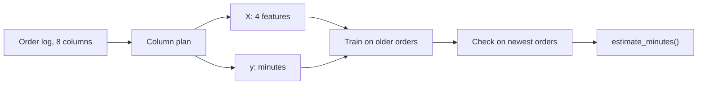

:::objectives
- Write a column plan that records each column's role and whether it's known at prediction time.
- Build `X` and `y` from that plan instead of by hand.
- Measure a model's error in minutes and compare it with a baseline that always guesses the average.
- Recognize a too-good-to-be-true score as a sign of leakage.
:::

You're going to build the thing the pizza shop asked for in the last lesson: a function that takes a new order and answers "about how many minutes?" Here's where the build ends up, with the real output from the finished notebook:

```text
4.5 km, 2 pizzas, dry, 14:00   -> about 26 minutes
4.5 km, 2 pizzas, rain, 19:00  -> about 35 minutes
8.0 km, 5 pizzas, rain, 19:00  -> about 50 minutes
```

And here's the path from the shop's order log to that function:



Open a new Colab notebook named `m2-pizza-predictor.ipynb`. Each step below is one cell.

## Step 1: Load the order log

A real shop would export this from its ordering system. You'll make a realistic one with NumPy's random number generator, so everyone gets identical numbers. The `default_rng(7)` seed is what makes your log match this page.

```python run
import numpy as np
import pandas as pd
pd.set_option("display.max_columns", None)
pd.set_option("display.width", 120)

rng = np.random.default_rng(7)
n = 300
distance = rng.uniform(0.5, 9.0, n).round(1)
pizzas = rng.integers(1, 6, n)
raining = (rng.random(n) < 0.25).astype(int)
hour = rng.integers(11, 23, n)
rush = (hour >= 18) & (hour <= 20)
kitchen = (8 + 2 * pizzas + 7 * rush + rng.normal(0, 2, n)).clip(5).round(1)
drive = (2 + 2.5 * distance * (1 + 0.3 * raining) + rng.normal(0, 2.5, n)).clip(1).round(1)

orders = pd.DataFrame({
    "order_id": np.arange(4001, 4001 + n),
    "distance_km": distance,
    "pizzas": pizzas,
    "raining": raining,
    "hour": hour,
    "kitchen_minutes": kitchen,
    "drive_minutes": drive,
    "minutes": (kitchen + drive).round().astype(int),
})
print(orders.shape)
print(orders.head())
```

Each row is one order, listed oldest first. Two columns are new compared with the last lesson. `kitchen_minutes` comes from the oven timer: how long the order took to make. `drive_minutes` comes from the driver's phone: how long the trip took. Both are real, useful-looking data. Keep an eye on them.

## Step 2: Write the column plan

Before touching a model, write down what every column is for. A dictionary is enough, and it doubles as documentation for anyone who reads your notebook later:

```python run
column_plan = {
    "order_id": "drop: identifier",
    "distance_km": "feature",
    "pizzas": "feature",
    "raining": "feature",
    "hour": "feature",
    "kitchen_minutes": "drop: oven timer, only known after the order is made",
    "drive_minutes": "drop: driver's phone, only known after delivery",
    "minutes": "target",
}

unplanned = set(orders.columns) - set(column_plan)
print("Columns without a plan:", unplanned or "none")
```

The check at the bottom matters more than it looks. When someone adds a column to the log next month, this line will name it instead of letting it slip silently into, or out of, your model.

Both timer columns fail the "would I know it yet?" test. When the customer taps **Order**, the pizza hasn't been made and the driver hasn't left.

## Step 3: Build X and y from the plan

Now let the plan pick the columns, so the plan and the code can't disagree:

```python run
features = [column for column, role in column_plan.items() if role == "feature"]
target = "minutes"

X = orders[features]
y = orders[target]
print("features:", features)
print("X:", X.shape, " y:", y.shape)
```

Four features, 300 rows, one target value per row.

:::video hd1W4CyPX58
Kevin Markham of Data School loads the iris data into scikit-learn and explains what it expects from `X` and `y`. Watch for his list of requirements for the feature table and the response (his word for the target), especially their shapes. The video is from 2015, and scikit-learn has since relaxed some rules: it now accepts pandas tables and text labels directly.
:::

## Step 4: Keep the newest orders for checking

You'll test the model on orders it never trained on. Since the log is in time order, the fairest test is the most recent orders: train on the past, check on the "future".

```python run
X_train, y_train = X.iloc[:240], y.iloc[:240]
X_test, y_test = X.iloc[240:], y.iloc[240:]
print("training orders:", len(X_train), " test orders:", len(X_test))
```

`.iloc[:240]` means "rows 0 up to, but not including, 240". In Module 3 you'll meet `train_test_split`, which shuffles before splitting; for a time-ordered log, cutting at a date like this is often the better choice.

## Step 5: Set a baseline, then train a model

How good is "good"? Start with the laziest possible prediction: guess the average training delivery time for every order. Any real model has to beat this.

The error measure is **mean absolute error** (MAE): for each test order, take the gap between the guess and the truth in minutes, ignore its sign, and average the gaps. An MAE of 5 means "off by 5 minutes on a typical order".

```python run
from sklearn.linear_model import LinearRegression
from sklearn.metrics import mean_absolute_error

average = y_train.mean()
baseline_mae = mean_absolute_error(y_test, [average] * len(y_test))
print(f"Always guess {average:.1f} min -> off by {baseline_mae:.2f} min on average")

model = LinearRegression()
model.fit(X_train, y_train)
predictions = model.predict(X_test)
model_mae = mean_absolute_error(y_test, predictions)
print(f"Linear regression        -> off by {model_mae:.2f} min on average")
```

The model roughly halves the baseline's error. It learned that distance, pizza count, rain, and time of day all push delivery times up, and by how much. (`LinearRegression` multiplies each feature by a learned weight and adds them up; you'll see exactly how it picks the weights in Module 4.)

To see where it's right and wrong, plot each test order's prediction against what really happened:

```python run alt="Scatter plot of predicted minutes against actual minutes for 60 test orders. Points cluster around a dashed diagonal line where prediction equals reality, with a spread of a few minutes on either side." caption="Points on the dashed line were predicted exactly; distance from it is the error."
import matplotlib.pyplot as plt

plt.figure(figsize=(5, 5))
plt.scatter(y_test, predictions, s=20, alpha=0.7)
plt.plot([10, 60], [10, 60], linestyle="--", color="gray")
plt.xlabel("actual minutes")
plt.ylabel("predicted minutes")
plt.title(f"60 test orders, MAE {model_mae:.1f} min")
```

Most points sit within a few minutes of the line. There's no area where the model is badly off in one direction, which is what you want to see.

## Step 6: See what the leaky columns would do

Suppose you'd skipped the plan and used every column except the id and the target. Try it:

```python run
leaky = features + ["kitchen_minutes", "drive_minutes"]
cheat = LinearRegression().fit(orders[leaky].iloc[:240], y_train)
cheat_mae = mean_absolute_error(y_test, cheat.predict(orders[leaky].iloc[240:]))
print(f"With the timer columns -> off by {cheat_mae:.2f} min on average")
```

Off by about a quarter of a minute. That isn't a better model; it's adding up the two timers, because kitchen time plus drive time *is* the delivery time. In the app, at the moment of ordering, both timers are blank, and this model would have nothing to go on.

Remember the feeling of this number. When a score is far better than seems possible, the first thing to check is whether `X` contains the answer, or something recorded after the answer was known.

## Step 7: Give the model a better feature

Here's a legitimate improvement. The model treats `hour` as a number, so it can only learn "later is slower" in a straight line. But kitchens are slowest during the dinner rush and then calm down again. A feature that says "is it rush hour?" describes that directly:

```python run
orders["rush_hour"] = orders["hour"].between(18, 20).astype(int)
column_plan["rush_hour"] = "feature"
column_plan["hour"] = "drop: replaced by rush_hour"

features = [column for column, role in column_plan.items() if role == "feature"]
X = orders[features]
X_train, X_test = X.iloc[:240], X.iloc[240:]

model = LinearRegression().fit(X_train, y_train)
model_mae = mean_absolute_error(y_test, model.predict(X_test))
print("features:", features)
print(f"With rush_hour -> off by {model_mae:.2f} min on average")
```

The error drops again, and this time it's honest: whether it's 6:30 p.m. is known the moment someone orders. Inventing useful columns from the ones you have is called **feature engineering**, and it often helps more than switching models. Notice that the column plan stayed the single place where the decision lives.

## Step 8: Wrap it in a function

The shop's app needs one call per order. The function builds a one-row table with exactly the columns the model trained on, in the same order:

```python run
def estimate_minutes(distance_km, pizzas, raining, hour):
    row = pd.DataFrame([{
        "distance_km": distance_km,
        "pizzas": pizzas,
        "raining": int(raining),
        "rush_hour": int(18 <= hour <= 20),
    }])[features]
    return model.predict(row)[0]

for km, count, rain, hour in [(4.5, 2, False, 14), (4.5, 2, True, 19), (8.0, 5, True, 19)]:
    weather = "rain" if rain else "dry"
    print(f"{km} km, {count} pizzas, {weather}, {hour}:00".ljust(30), f"-> about {estimate_minutes(km, count, rain, hour):.0f} minutes")
```

The `[features]` at the end of the `DataFrame(...)` line reorders the columns to match training, so a typo or a different order in the dictionary can't scramble the inputs.

## The finished predictor

Here's everything in one cell, ready to paste into a fresh notebook. It reuses the `orders` table from Step 1.

```python run
import pandas as pd
from sklearn.linear_model import LinearRegression
from sklearn.metrics import mean_absolute_error

orders["rush_hour"] = orders["hour"].between(18, 20).astype(int)
column_plan = {
    "order_id": "drop: identifier",
    "distance_km": "feature",
    "pizzas": "feature",
    "raining": "feature",
    "hour": "drop: replaced by rush_hour",
    "rush_hour": "feature",
    "kitchen_minutes": "drop: only known after the order is made",
    "drive_minutes": "drop: only known after delivery",
    "minutes": "target",
}
assert set(orders.columns) == set(column_plan), "every column needs a plan"

features = [c for c, role in column_plan.items() if role == "feature"]
X, y = orders[features], orders["minutes"]
X_train, X_test, y_train, y_test = X.iloc[:240], X.iloc[240:], y.iloc[:240], y.iloc[240:]

model = LinearRegression().fit(X_train, y_train)
baseline = mean_absolute_error(y_test, [y_train.mean()] * len(y_test))
print(f"baseline MAE {baseline:.2f}  model MAE {mean_absolute_error(y_test, model.predict(X_test)):.2f}")

def estimate_minutes(distance_km, pizzas, raining, hour):
    row = pd.DataFrame([{"distance_km": distance_km, "pizzas": pizzas,
                         "raining": int(raining), "rush_hour": int(18 <= hour <= 20)}])[features]
    return model.predict(row)[0]

print(f"{estimate_minutes(3.0, 1, False, 12):.0f} minutes")
```

The `assert` line is the column-plan check from Step 2 in its strictest form: the notebook stops with a clear message if the log ever has a column the plan doesn't mention.

:::quiz
Q: Why does the plan drop `kitchen_minutes`, even though it clearly relates to delivery time?
- [ ] It has decimal values and the model needs whole numbers
  `LinearRegression` handles decimals fine.
- [x] It's recorded after the order is made, so it doesn't exist when the app needs a prediction
  A feature has to be known at prediction time. This one only exists once the cooking is done.
- [ ] It makes the model less accurate
  On the old log it makes the model look far more accurate. That's exactly the trap.

Q: The model's MAE was compared with "always guess the average". Why bother?
- [ ] scikit-learn requires a baseline before `fit` will run
  There's no such requirement; the baseline is your own check.
- [x] Without it, you can't tell whether an error of a few minutes is impressive or useless
  If the lazy guess were nearly as good, the model would add little. Halving its error shows real learning.
- [ ] The baseline is what the app shows when the model fails
  It could be used that way, but its job in this build is to give the model's score some meaning.

Q: Why train on the first 240 orders and test on the last 60, instead of the other way round?
- [x] The log is in time order, so testing on the newest orders imitates using the model on future orders
  In real use the model always predicts orders that come after everything it learned from.
- [ ] The last 60 orders are easier to predict
  They're generated the same way as the rest, so they're no easier.
- [ ] `iloc` only works from the start of a table
  `iloc` can take any range of rows.
:::

:::takeaways
- Write a column plan before training: each column's role, and why dropped columns were dropped.
- Build `X` and `y` from the plan so your code and your reasoning can't drift apart.
- Report error in the target's own units (minutes here), and always next to a simple baseline.
- A near-perfect score usually means a leak. Look for columns recorded after the answer was known.
- New features made from existing ones, like `rush_hour`, can beat a fancier model.
:::

## Ideas to extend it

- Add a `weekend` column to the log generator that makes weekend kitchens slower, put it in the plan, and see if the error drops.
- Print `model.coef_` next to `features`. Each number is how many extra minutes the model adds per unit of that feature. Does "minutes per pizza" look reasonable?
- Swap `LinearRegression()` for `KNeighborsRegressor(n_neighbors=10)` from `sklearn.neighbors`. Same `fit`, same `predict`. Which has the lower error on this data?

## Further reading

- [`mean_absolute_error`](https://scikit-learn.org/stable/modules/generated/sklearn.metrics.mean_absolute_error.html): the exact formula and its options.
- [Common pitfalls and recommended practices](https://scikit-learn.org/stable/common_pitfalls.html): scikit-learn's own guide to the mistakes that make scores look better than they are, including leakage.
