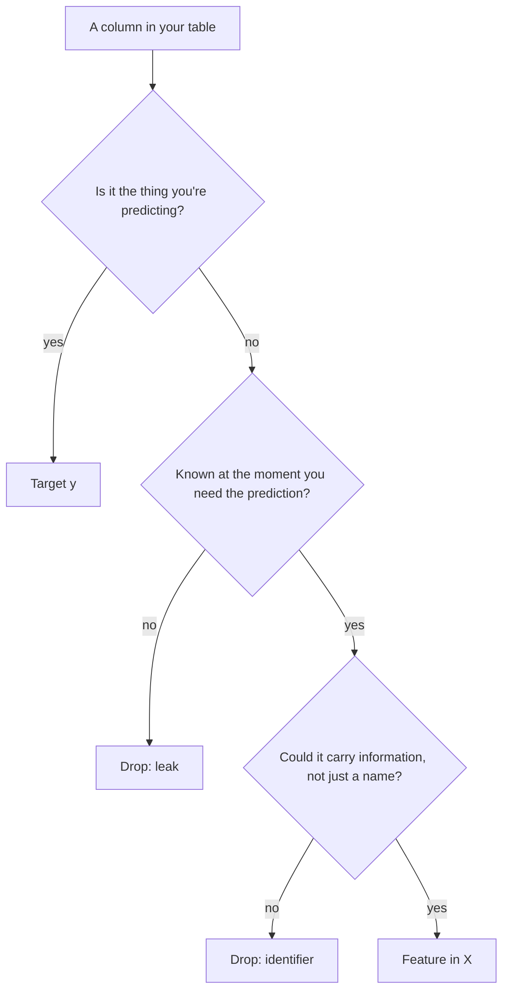

:::objectives
- Inspect a dataset's shape and target before training anything.
- Assign every column of a table a role: feature, target, or dropped (and why).
- Fix the one-dimensional `X` bug and predict with correctly shaped input.
- Use one loop to train several models with the same `fit` and `predict` calls.
- Find a leaky column by comparing how well each column predicts on its own.
:::

Make a notebook called `m2-practice.ipynb`. Try each exercise before opening the hint, and open the solution only after you have something that runs. The cells in a solution build on earlier ones, so run them in order.

## Warm-up: meet a new dataset

scikit-learn ships a dataset of 569 breast tissue samples, each described by 30 measurements from a microscope image, with a target saying whether the sample was malignant or benign. Load it with `as_frame=True` and print the shape of `X` and `y`, the target names, and how many samples are in each class.

```python run
from sklearn.datasets import load_breast_cancer

cancer = load_breast_cancer(as_frame=True)
X_cancer, y_cancer = cancer.data, cancer.target
print("X:", X_cancer.shape, " y:", y_cancer.shape)
print(cancer.target_names)
print(y_cancer.value_counts())
```

Classes aren't always balanced: 357 benign samples (target `1`) and 212 malignant (target `0`). Check the counts in every new dataset; you'll see in Module 6 why lopsided classes change how you judge a model.

### Exercise 1: A picture is a row of numbers

`load_digits()` holds 1,797 handwritten digits, each an 8×8 grid of pixel brightness values from 0 to 16. Print the shape of `X` and `y`. Then take row 0, reshape it into an 8×8 grid, and display it with `plt.imshow`. Print its target too.

Sample output:

```text
X: (1797, 64)  y: (1797,)
This row is labeled 0
```

:::hint
Each row has 64 numbers because 8 × 8 = 64. `X[0].reshape(8, 8)` turns one row back into a grid, and `plt.imshow(grid, cmap="gray_r")` draws it with dark ink on white.
:::

:::solution
```python run alt="An 8 by 8 pixel grid in shades of gray showing a handwritten zero." caption="Row 0 of the digits dataset, drawn from its 64 numbers."
import matplotlib.pyplot as plt
from sklearn.datasets import load_digits

X_digits, y_digits = load_digits(return_X_y=True)
print("X:", X_digits.shape, " y:", y_digits.shape)
print("This row is labeled", y_digits[0])

plt.figure(figsize=(3, 3))
plt.imshow(X_digits[0].reshape(8, 8), cmap="gray_r")
plt.title(f"label: {y_digits[0]}")
plt.axis("off")
```

To a model, this zero is just 64 features in a row. Pixel 27 is a feature in the same way that `distance_km` was. That's why one model type can learn from photos, tables, and sensor readings alike: everything becomes rows of numbers first.
:::

### Exercise 2: Write a column plan

A teacher wants to predict, **one week before the final exam**, whether each student will pass. Here's last year's data:

```python run
import pandas as pd
pd.set_option("display.max_columns", None)
pd.set_option("display.width", 120)

students = pd.DataFrame({
    "student_id":        [301, 302, 303, 304, 305, 306, 307, 308, 309, 310, 311, 312],
    "locker":            [17, 4, 22, 9, 31, 2, 14, 28, 6, 19, 25, 11],
    "study_hours_week":  [6, 1, 4, 8, 2, 5, 0, 7, 3, 9, 1, 5],
    "quiz_average":      [78, 52, 70, 88, 61, 74, 45, 83, 66, 91, 58, 69],
    "classes_missed":    [1, 7, 2, 0, 5, 2, 9, 1, 3, 0, 6, 4],
    "final_exam":        [81, 48, 72, 90, 55, 77, 40, 86, 64, 95, 51, 63],
    "passed":            ["yes", "no", "yes", "yes", "no", "yes", "no", "yes", "yes", "yes", "no", "yes"],
})
print(students)
```

Write a `plan` dictionary giving every column a role, then build `X` and `y` from it and print their shapes.

```text
features: ['study_hours_week', 'quiz_average', 'classes_missed']
X: (12, 3)  y: (12,)
```

:::hint
Run each column through the two questions from the Notes lesson: could it plausibly affect passing, and will the teacher know it a week before the exam? A locker number is known, but does it carry information? And `passed` is decided by one of the other columns.
:::

:::solution
```python run
plan = {
    "student_id": "drop: identifier",
    "locker": "drop: known, but it's a label with no meaning for grades",
    "study_hours_week": "feature",
    "quiz_average": "feature",
    "classes_missed": "feature",
    "final_exam": "drop: leak, the exam hasn't happened yet",
    "passed": "target",
}
assert set(plan) == set(students.columns)

features = [column for column, role in plan.items() if role == "feature"]
X_students = students[features]
y_students = students["passed"]
print("features:", features)
print("X:", X_students.shape, " y:", y_students.shape)
```

`final_exam` is the trap. It would be the best "feature" by far, because `passed` is decided from it, and it doesn't exist a week before the exam. `locker` is a number, but like an id it's just a name for a thing.
:::

### Exercise 3: Fix the shape bug

This code is meant to predict pass or fail from the quiz average alone, for a student averaging 72. Run it, read the last line of the error, and fix it so it prints the prediction.

```python run raises
from sklearn.neighbors import KNeighborsClassifier

X_quiz = students["quiz_average"]
model = KNeighborsClassifier(n_neighbors=3).fit(X_quiz, y_students)
print(model.predict([[72]]))
```

Sample output after the fix:

```text
(12, 1)
['yes']
```

:::hint
The error says scikit-learn got a `Series` where it wanted something two-dimensional. Selecting with a *list* of column names, even a list with one name in it, keeps the result a table. When you predict, give it a table with the same column name too.
:::

:::solution
```python run
X_quiz = students[["quiz_average"]]
print(X_quiz.shape)

model = KNeighborsClassifier(n_neighbors=3).fit(X_quiz, y_students)
print(model.predict(pd.DataFrame({"quiz_average": [72]})))
```

`students[["quiz_average"]]` is a 12×1 table, which is what `fit` needs. Predicting with a DataFrame that has the same column name (instead of a bare `[[72]]`) avoids a warning in Colab about missing feature names.
:::

### Exercise 4: Classification or regression?

For each target, decide whether it's a classification or a regression problem, and write one sentence why:

1. Tomorrow's high temperature in °C.
2. Which of 26 letters a handwritten character is.
3. A house's sale price.
4. A customer's postal code.
5. A movie's rating from 1 to 10 stars.

:::hint
Ask: is "close" meaningful? If being off by a little is better than being off by a lot, it behaves like a quantity. If every wrong answer is equally wrong, it's a category.
:::

:::solution
1. **Regression.** 21 °C when the truth is 22 °C is nearly right.
2. **Classification.** Guessing "B" for an "E" isn't "closer" than guessing "Z".
3. **Regression.** Prices are quantities, and the error in dollars is meaningful.
4. **Classification** (and a tricky one). Postal codes are digits, but 90210 isn't "near" 90211 in any way a model can use as a quantity.
5. **Either.** As regression, predicting 7 when the truth is 8 is nearly right. As classification, it's simply wrong. Most people would pick regression here, because closeness matters to the person reading the rating.
:::

### Exercise 5: One loop, three models

Train three different classifiers on the iris data and ask each about the same three flowers. Use one loop, so the only thing that changes between models is the model itself.

```text
KNeighborsClassifier     ['setosa' 'versicolor' 'virginica']
DecisionTreeClassifier   ['setosa' 'versicolor' 'virginica']
LogisticRegression       ['setosa' 'versicolor' 'virginica']
```

Use these flowers: `[[5.1, 3.5, 1.4, 0.2], [5.9, 3.0, 4.2, 1.5], [6.9, 3.1, 5.4, 2.1]]`.

:::hint
Put the three model objects in a list: `KNeighborsClassifier()`, `DecisionTreeClassifier(random_state=0)` from `sklearn.tree`, and `LogisticRegression(max_iter=1000)` from `sklearn.linear_model`. Inside the loop, call `fit`, then `predict`, then look up the names with `iris.target_names`. `type(model).__name__` gives a model's class name as text.
:::

:::solution
```python run
from sklearn.datasets import load_iris
from sklearn.tree import DecisionTreeClassifier
from sklearn.linear_model import LogisticRegression

iris = load_iris()
flowers = [[5.1, 3.5, 1.4, 0.2], [5.9, 3.0, 4.2, 1.5], [6.9, 3.1, 5.4, 2.1]]
models = [KNeighborsClassifier(), DecisionTreeClassifier(random_state=0), LogisticRegression(max_iter=1000)]

for model in models:
    model.fit(iris.data, iris.target)
    names = iris.target_names[model.predict(flowers)]
    print(f"{type(model).__name__:24s} {names}")
```

Three models that work in completely different ways (neighbors, a tree of yes/no questions, a weighted formula) all slot into the same two lines. Modules 4 and 5 open each one up. `max_iter=1000` just gives logistic regression enough steps to finish its fitting without a warning.
:::

### Exercise 6: X and y without pandas

scikit-learn doesn't need pandas. Build `X` and `y` as plain Python lists from this list of fruit, train a `KNeighborsClassifier(n_neighbors=3)`, and predict a 150 g fruit that is 7.5 cm across.

```python run
fruit = [
    {"grams": 120, "width_cm": 6.0, "name": "apple"},
    {"grams": 160, "width_cm": 7.2, "name": "apple"},
    {"grams": 140, "width_cm": 6.8, "name": "apple"},
    {"grams": 180, "width_cm": 8.0, "name": "orange"},
    {"grams": 200, "width_cm": 8.5, "name": "orange"},
    {"grams": 170, "width_cm": 7.9, "name": "orange"},
    {"grams": 60, "width_cm": 4.6, "name": "plum"},
    {"grams": 70, "width_cm": 5.0, "name": "plum"},
]
```

```text
X: [[120, 6.0], [160, 7.2], [140, 6.8], [180, 8.0], [200, 8.5], [170, 7.9], [60, 4.6], [70, 5.0]]
y: ['apple', 'apple', 'apple', 'orange', 'orange', 'orange', 'plum', 'plum']
['apple']
```

:::hint
Start with two empty lists, then loop over `fruit` and append a two-number list to `X` and the name to `y`, like the trace in the Notes lesson. Targets can be strings; scikit-learn's classifiers return them as they are.
:::

:::solution
```python run
X_fruit = []
y_fruit = []
for item in fruit:
    X_fruit.append([item["grams"], item["width_cm"]])
    y_fruit.append(item["name"])
print("X:", X_fruit)
print("y:", y_fruit)

fruit_model = KNeighborsClassifier(n_neighbors=3).fit(X_fruit, y_fruit)
print(fruit_model.predict([[150, 7.5]]))
```

The three nearest fruits to (150 g, 7.5 cm) are 160 g, 140 g, and 170 g, two apples and an orange, so the vote says apple. Notice that grams dominate this distance: a 10 g gap counts far more than a 1 cm gap. That's a problem you'll fix with scaling in Module 3.
:::

### Challenge: Catch the leak by its score

A smoothie stand logged 100 days of data. One column is a leak. Find it **without** reading how the data was made: train a `LinearRegression` on each column **by itself** (first 80 days to train, last 20 to test) and print each column's test MAE next to the baseline of always guessing the training average.

```python run
import numpy as np

rng = np.random.default_rng(3)
days = 100
temp_c = rng.uniform(12, 34, days).round(1)
weekend = (np.arange(days) % 7 >= 5).astype(int)
raining = (rng.random(days) < 0.2).astype(int)
sold = (5 * temp_c + 40 * weekend - 35 * raining + rng.normal(0, 15, days)).round().clip(0).astype(int)
cups_left = (300 - sold - rng.integers(0, 3, days)).astype(int)

smoothies = pd.DataFrame({"temp_c": temp_c, "weekend": weekend, "raining": raining,
                          "cups_left_at_close": cups_left, "smoothies_sold": sold})
print(smoothies.head())
```

Sample output (your numbers should match):

```text
baseline              MAE 34.8
temp_c                MAE 21.4
...
```

:::hint
Loop over every column except the target. For each one, `fit` on `smoothies[[column]].iloc[:80]` and score on `.iloc[80:]`. A single column that's nearly perfect on its own is either a miracle or a leak, and then you ask when that column gets recorded.
:::

:::solution
```python run
from sklearn.linear_model import LinearRegression
from sklearn.metrics import mean_absolute_error

y_s = smoothies["smoothies_sold"]
y_train, y_test = y_s.iloc[:80], y_s.iloc[80:]
print(f"{'baseline':20s}  MAE {mean_absolute_error(y_test, [y_train.mean()] * 20):.1f}")

for column in smoothies.columns.drop("smoothies_sold"):
    X_one = smoothies[[column]]
    single = LinearRegression().fit(X_one.iloc[:80], y_train)
    error = mean_absolute_error(y_test, single.predict(X_one.iloc[80:]))
    print(f"{column:20s}  MAE {error:.1f}")
```

`cups_left_at_close` predicts sales to within about a cup, far better than temperature, the honest best feature. It's counted when the stand closes, after the day's sales happened, so it can't help predict tomorrow's sales. It works only because it's the target in disguise (300 cups minus what was sold).
:::


