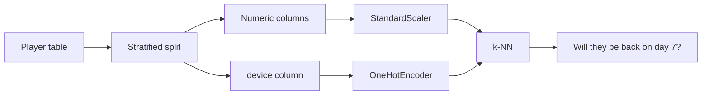

:::objectives
- Split a classification dataset with `stratify` and check that both parts keep the same class mix.
- Measure a do-nothing baseline before trusting any model's accuracy.
- Scale numeric columns and one-hot encode a text column, fitting each step on training rows only.
- Combine the steps into one pipeline with `make_column_transformer` and `make_pipeline`.
:::

A small studio has launched a puzzle game. After each new player's first day, the studio wants to guess whether that player will still be playing a week later, so it can send a well-timed tip to the ones likely to drift away. You have day-one data for 400 past players and whether each came back on day 7.

The model is k-nearest neighbors, unchanged from start to finish. Only the data preparation changes, and here's the plan:



Start a notebook called `m3-player-prep.ipynb`.

## Step 1: Make the player table

As in Module 2, the data comes from a seeded random generator so your numbers match this page. In real life this would be an export from the game's analytics.

```python run
import numpy as np
import pandas as pd
pd.set_option("display.max_columns", None)
pd.set_option("display.width", 120)

rng = np.random.default_rng(2)
n = 400
device = rng.choice(["android", "ios", "web"], n, p=[0.45, 0.35, 0.2])
sessions = rng.integers(1, 13, n)
levels = (sessions * 2.5 + rng.normal(0, 4, n)).clip(1, 40).round().astype(int)
coins = rng.integers(0, 20000, n)
hidden_score = (0.35 * sessions + 0.08 * levels - 1.8 * (device == "web")
                + 0.3 * (device == "ios") - 4.3 + rng.normal(0, 0.8, n))

players = pd.DataFrame({
    "sessions_day1": sessions,
    "levels_day1": levels,
    "coins_day1": coins,
    "device": device,
    "back_day7": (hidden_score > 0).astype(int),
})
print(players.head())
print(players.describe().loc[["min", "max"]])
print(players["device"].value_counts())
print("share who came back:", round(players["back_day7"].mean(), 2))
```

Look at the `min` and `max` rows. Sessions run from 1 to 12 and levels from 1 to 36, but coins run into the thousands. `device` is text. And only 37% of players came back, so the classes aren't balanced. Each of those three facts shapes one step below.

## Step 2: Split first, with stratify

The split happens before anything learns from the data:

```python run
from sklearn.model_selection import train_test_split

X = players.drop(columns="back_day7")
y = players["back_day7"]
X_train, X_test, y_train, y_test = train_test_split(
    X, y, test_size=0.25, stratify=y, random_state=0
)
print("train rows:", len(X_train), " test rows:", len(X_test))
print("came back, train:", round(y_train.mean(), 3), " test:", round(y_test.mean(), 3))
```

Both parts have the same share of returning players, thanks to `stratify=y`. From here on, `X_test` and `y_test` are only touched to score.

## Step 3: Measure the bar to clear

If you guessed "won't come back" for every player, how often would you be right?

```python run
majority_accuracy = (y_test == 0).mean()
print("always guess 'not back':", round(majority_accuracy, 3))
```

About 63%, with zero intelligence involved. With unbalanced classes, an accuracy that sounds decent can be worse than this lazy guess, so this is the number every model has to beat.

## Step 4: k-NN on the raw numbers

Try the model on the three numeric columns exactly as they are:

```python run
from sklearn.neighbors import KNeighborsClassifier

numeric = ["sessions_day1", "levels_day1", "coins_day1"]
raw_knn = KNeighborsClassifier().fit(X_train[numeric], y_train)
raw_accuracy = raw_knn.score(X_test[numeric], y_test)
print("k-NN, raw numbers:", round(raw_accuracy, 3))
```

Worse than always guessing "not back". The reason is the coin count. Two players who differ by 3,000 coins are "far apart", even if their sessions and levels are identical, and a gap of 10 sessions barely registers. So each player's five nearest neighbors are simply the players with similar coin counts, and in this game coins say nothing about who returns.

## Step 5: Scale the numbers

Fit a `StandardScaler` on the training rows, then transform both sets with what it learned:

```python run
from sklearn.preprocessing import StandardScaler

scaler = StandardScaler().fit(X_train[numeric])
print("learned means:", scaler.mean_.round(1).tolist())
print("learned stds: ", scaler.scale_.round(1).tolist())

train_num = scaler.transform(X_train[numeric])
test_num = scaler.transform(X_test[numeric])

scaled_knn = KNeighborsClassifier().fit(train_num, y_train)
scaled_accuracy = scaled_knn.score(test_num, y_test)
print("k-NN, scaled numbers:", round(scaled_accuracy, 3))
```

`mean_` and `scale_` are the averages and standard deviations the scaler learned from the 300 training players. Each column is now measured in "standard deviations from the training average", so a big gap in sessions counts as much as a big gap in coins. Accuracy jumps well past the baseline.

## Step 6: One-hot encode the device

The `device` column is still unused, and web players behave quite differently. Encode it, fitting on training rows only:

```python run
from sklearn.preprocessing import OneHotEncoder

encoder = OneHotEncoder(handle_unknown="ignore", sparse_output=False).fit(X_train[["device"]])
print(encoder.get_feature_names_out())

train_all = np.hstack([train_num, encoder.transform(X_train[["device"]])])
test_all = np.hstack([test_num, encoder.transform(X_test[["device"]])])
print("feature table now:", train_all.shape)

full_knn = KNeighborsClassifier().fit(train_all, y_train)
full_accuracy = full_knn.score(test_all, y_test)
print("k-NN, scaled + device:", round(full_accuracy, 3))
```

`np.hstack` glues the three scaled number columns and the three device columns side by side into one six-column table. Two web players are now "nearer" each other than a web player and an iOS player, which is exactly the information the model was missing.

## Step 7: Put it all in one pipeline

Steps 5 and 6 work, but there are six separate `fit` and `transform` calls to keep straight, and one slip (like fitting the encoder on `X_test`) would leak. `make_column_transformer` says which preprocessing goes with which columns, and `make_pipeline` puts the model after it:

```python run
from sklearn.compose import make_column_transformer
from sklearn.pipeline import make_pipeline

prep = make_column_transformer(
    (StandardScaler(), numeric),
    (OneHotEncoder(handle_unknown="ignore"), ["device"]),
)
player_model = make_pipeline(prep, KNeighborsClassifier())
player_model.fit(X_train, y_train)
print("pipeline:", round(player_model.score(X_test, y_test), 3))
```

Same accuracy as Step 6, from one `fit` call on the raw training table. The pipeline fits the scaler and encoder on whatever you pass to `fit` (the training rows) and only transforms whatever you pass to `score` or `predict`.

Data School has a three-minute demo of the same idea:

:::video 1Y6O9nCo0-I
Kevin Markham chains a column transformer and a model with `make_pipeline`. Watch for how a single `fit` runs every preprocessing step and then the model, and how `predict` reuses what was learned without refitting.
:::

It also takes raw rows straight from the game, text and all:

```python run
new_players = pd.DataFrame({
    "sessions_day1": [9, 2, 6],
    "levels_day1": [24, 3, 15],
    "coins_day1": [1200, 15000, 8000],
    "device": ["ios", "web", "tablet"],
})
print(player_model.predict(new_players))
```

The model expects the first player back and not the other two. The third player uses a `tablet`, a device the training data never contained. Because of `handle_unknown="ignore"`, its device columns are all zero and the model decides from the numbers alone, instead of crashing the app.

## Step 8: Compare every stage

```python run alt="Bar chart of test accuracy for four approaches: always guess not back about 0.63, k-NN on raw numbers about 0.54, k-NN on scaled numbers about 0.86, k-NN on scaled numbers plus device about 0.96." caption="Same model at every stage; only the preparation changed."
import matplotlib.pyplot as plt

labels = ["always 'not back'", "raw numbers", "scaled", "scaled + device"]
scores = [majority_accuracy, raw_accuracy, scaled_accuracy, full_accuracy]

plt.figure(figsize=(7, 3.8))
bars = plt.bar(labels, scores, color=["#9aa3b5", "#d9822b", "#5b7bd5", "#2f9e6e"])
plt.bar_label(bars, fmt="%.2f")
plt.ylim(0, 1)
plt.ylabel("test accuracy")
plt.title("k-NN on the player data")
```

Raw k-NN lost to a guess that ignores the data. Scaling fixed the distances, and encoding the device added a real signal.

## The finished preparation pipeline

Everything that matters, in one cell, reusing the `players` table from Step 1:

```python run
from sklearn.compose import make_column_transformer
from sklearn.model_selection import train_test_split
from sklearn.neighbors import KNeighborsClassifier
from sklearn.pipeline import make_pipeline
from sklearn.preprocessing import OneHotEncoder, StandardScaler

numeric = ["sessions_day1", "levels_day1", "coins_day1"]
categorical = ["device"]
X = players[numeric + categorical]
y = players["back_day7"]
X_train, X_test, y_train, y_test = train_test_split(X, y, test_size=0.25, stratify=y, random_state=0)

player_model = make_pipeline(
    make_column_transformer(
        (StandardScaler(), numeric),
        (OneHotEncoder(handle_unknown="ignore"), categorical),
    ),
    KNeighborsClassifier(),
)
player_model.fit(X_train, y_train)
print("baseline:", round((y_test == 0).mean(), 3), " model:", round(player_model.score(X_test, y_test), 3))
```

:::quiz
Q: Why does k-NN on the raw numbers score *below* the always-"not back" guess?
- [ ] k-NN can't handle more than two features without scaling
  It handles any number of features. The trouble is how they're weighted.
- [x] Coin counts are in the thousands, so they decide who counts as a neighbor, and coins don't predict returning
  Distance is dominated by the column with the biggest numbers. Here that column is noise.
- [ ] The test set has no returning players in it
  Stratifying guaranteed it has the same third of returners as the training set.

Q: In Step 6, why is the encoder fitted with `X_train[["device"]]` and not the whole `X`?
- [x] So the encoder learns its categories from training rows only, like the scaler
  Every preprocessing step that learns anything must learn it from the training rows, or the test set leaks in.
- [ ] Because `OneHotEncoder` can't take more than 300 rows
  It can take any number of rows.
- [ ] Because the test set has no `device` column
  It does; it's transformed with the encoder after fitting.

Q: What does `handle_unknown="ignore"` buy you in the finished pipeline?
- [ ] It skips players who have missing values
  It's about categories that weren't in the training data, not about missing values.
- [ ] It drops the `device` column if it seems unhelpful
  The encoder never decides whether a column is useful.
- [x] A brand-new device like `tablet` gets all-zero device columns instead of an error
  Real data keeps producing categories you haven't seen. This keeps the model working when it does.
:::

:::takeaways
- Measure the majority-guess baseline first. With unbalanced classes, it can beat a broken model.
- Raw k-NN is ruled by whichever column has the biggest numbers; scaling evens that out.
- Preprocessing learns (`fit`) on training rows only and is applied (`transform`) to both sets.
- `make_column_transformer` sends each group of columns to its own preprocessing step, and `make_pipeline` chains that to the model so one `fit` does it all correctly.
- `OneHotEncoder(handle_unknown="ignore")` keeps predictions working when a new category shows up.
:::

## Ideas to extend it

- Drop `coins_day1` from `numeric` entirely. Does the pipeline get better or worse? What does that tell you about the column?
- Change `KNeighborsClassifier()` to `KNeighborsClassifier(n_neighbors=15)` and compare. Module 4 explains what's changing.
- Swap `StandardScaler()` for `MinMaxScaler()` from `sklearn.preprocessing`, which squeezes each column into the range 0 to 1, and see whether it matters here.

## Further reading

- [Pipelines and composite estimators](https://scikit-learn.org/stable/modules/compose.html): the official guide to `Pipeline` and `ColumnTransformer`, with more ways to pick columns.
- [`OneHotEncoder` reference](https://scikit-learn.org/stable/modules/generated/sklearn.preprocessing.OneHotEncoder.html): every option, including how to drop a column or group rare categories.
