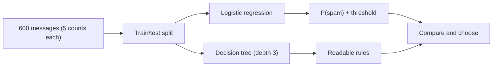

:::objectives
- Train a logistic regression pipeline and read which features push a message toward spam.
- Use `predict_proba` to see how sure the model is about single messages.
- Choose a threshold by counting the two kinds of mistakes it causes.
- Grow a depth-limited decision tree, draw it, and follow one message to its leaf.
- Compare the two models and argue for one.
:::

Every email app makes the same call thousands of times a day: inbox or spam folder? The two mistakes aren't equal. If a coupon slips into your inbox, you delete it. If your teacher's message about tomorrow's test lands in spam, you never see it. A good filter needs a probability (how spammy is this?) and a rule for acting on it.

You'll build that filter in one notebook. Here is the plan:



## Step 1: Make 600 messages

Real filters count things in each message. We'll simulate five of those counts. First the code decides whether a message is spam, then it draws the counts from spam habits (lots of links, shouting, money talk) or real-mail habits (fewer of each, usually from someone in your contacts).

```python run
import numpy as np
import pandas as pd

pd.set_option("display.width", 120)       # print wide tables
pd.set_option("display.max_columns", 10)  # without "..." gaps
rng = np.random.default_rng(4)
n = 600
spam = (rng.random(n) < 0.3).astype(int)

messages = pd.DataFrame({
    "links":        np.where(spam, rng.poisson(1.8, n), rng.poisson(0.5, n)),
    "exclaims":     np.where(spam, rng.poisson(2.5, n), rng.poisson(0.8, n)),
    "caps_pct":     np.where(spam, rng.uniform(5, 60, n), rng.uniform(0, 25, n)).round(),
    "money_words":  np.where(spam, rng.poisson(1.2, n), rng.poisson(0.15, n)),
    "from_contact": np.where(spam, rng.random(n) < 0.1, rng.random(n) < 0.6).astype(int),
    "spam": spam,
})
print(messages.head())
print(messages["spam"].value_counts())
```

`caps_pct` is the percentage of letters in capitals, and `money_words` counts words like "free", "cash", and "prize". About 3 in 10 messages are spam. The habits overlap on purpose: some real messages shout, and some spam is polite. That overlap is what makes the problem worth a model.

## Step 2: Split, and find the score to beat

```python run
from sklearn.model_selection import train_test_split

X = messages.drop(columns="spam")
y = messages["spam"]
X_train, X_test, y_train, y_test = train_test_split(
    X, y, test_size=0.25, stratify=y, random_state=0
)
print("Test messages:", len(y_test), "| spam among them:", y_test.sum())
print(f"Accuracy of 'nothing is spam': {(y_test == 0).mean():.3f}")
```

`stratify=y` keeps the spam share the same in both halves. The second line is the **baseline**: a filter that never flags anything is already right about 73% of the time. Any model you build has to clear that bar by a clear margin.

## Step 3: Train logistic regression and read its weights

The counts live on very different scales (`caps_pct` runs to 60, `from_contact` is 0 or 1), so the model goes in a pipeline with `StandardScaler`, just as in Module 3.

```python run
from sklearn.pipeline import make_pipeline
from sklearn.preprocessing import StandardScaler
from sklearn.linear_model import LogisticRegression

logit = make_pipeline(StandardScaler(), LogisticRegression())
logit.fit(X_train, y_train)
print(f"Test accuracy: {logit.score(X_test, y_test):.3f}")

weights = pd.Series(logit[-1].coef_[0], index=X.columns).sort_values()
print(weights.round(2))
```

0.94 beats the 0.73 baseline comfortably. The weights tell you why. `logit[-1]` is the last step of the pipeline (the `LogisticRegression`), and each weight says how much one standard deviation of that feature moves the score. Capital letters push hardest toward spam. `from_contact` is the only negative weight: a message from someone you know is pulled toward "real".

## Step 4: See how sure the model is about single messages

```python run
p_spam = logit.predict_proba(X_test)[:, 1]

peek = X_test.head(6).copy()
peek["P(spam)"] = p_spam[:6].round(3)
peek["really spam?"] = y_test.head(6).values
print(peek)
```

Three of these six are easy calls, with probabilities close to 0. The other three sit between 0.5 and 0.8, and those are the messages where the threshold decides the folder. Look at message 59: it's real and it comes from a contact, yet its two links and three money words earn it a P(spam) of 0.800. Maybe a friend sharing a contest link. A filter with a 0.5 threshold would hide it.

## Step 5: Pick a threshold that protects real mail

Count both mistakes at several thresholds. "Real mail lost" is a real message sent to the spam folder. "Spam let through" is spam that reaches the inbox.

```python run
def count_mistakes(p, truth, threshold):
    flagged = p >= threshold
    lost = (flagged & (truth == 0)).sum()
    through = (~flagged & (truth == 1)).sum()
    return lost, through

for threshold in [0.5, 0.6, 0.7, 0.8, 0.9]:
    lost, through = count_mistakes(p_spam, y_test.values, threshold)
    print(f"threshold {threshold}: real mail lost {lost}, spam let through {through}")
```

As the threshold climbs, fewer real messages are lost and more spam sneaks in. You can't drive both to zero with this model; you choose the trade. We'll pick **0.8**: it loses one real message out of 110 while still catching most of the spam. (The one it loses is message 59 from Step 4, whose 0.8003 just clears the line.) A chart shows why moving the line works:

```python run alt="Two overlapping histograms of P(spam) on the test set: real messages pile up near 0, spam piles up near 1, with a few of each in the middle; a dashed line at 0.8 separates the folders" caption="Everything right of the dashed line goes to the spam folder."
import matplotlib.pyplot as plt

threshold = 0.8
plt.figure(figsize=(7, 3.5))
bins = np.linspace(0, 1, 21)
plt.hist(p_spam[y_test == 0], bins=bins, alpha=0.6, label="real messages")
plt.hist(p_spam[y_test == 1], bins=bins, alpha=0.6, label="spam")
plt.axvline(threshold, color="black", linestyle="--", label=f"threshold {threshold}")
plt.xlabel("P(spam) from logistic regression")
plt.ylabel("Messages")
plt.legend(loc="upper center")
plt.show()
```

Real bars to the right of the line are lost mail. Spam bars to the left are spam that got through. Sliding the line right trades one for the other.

## Step 6: Grow a decision tree and draw it

Trees split on one feature at a time, so the units don't matter and there's no scaler. Limit the depth so the rules stay short enough to read.

```python run alt="A depth-3 decision tree whose root asks whether caps_pct is at most 25.5; the right branch is a single spam leaf, and the left branch asks about money words and then whether the sender is a contact" caption="The tree's first question: does the message shout?"
from sklearn.tree import DecisionTreeClassifier, plot_tree, export_text

tree = DecisionTreeClassifier(max_depth=3, random_state=0)
tree.fit(X_train, y_train)
print(f"Test accuracy: {tree.score(X_test, y_test):.3f}")

plt.figure(figsize=(12, 5.5))
plot_tree(tree, feature_names=X.columns, class_names=["real", "spam"], filled=True, rounded=True, fontsize=8)
plt.show()
```

The root question splits off every message that is more than about a quarter capitals, and that whole branch becomes one spam leaf. On the calmer side, the tree checks for money words and then asks whether the sender is a contact. Those are rules you could explain to someone with no ML background.

One leaf deserves suspicion: `samples = 1`. The tree carved out a rule ("more than six links means spam") to fit a single training message. A rule built on one example is the first sign of overfitting, which Module 7 measures properly.

## Step 7: Follow one message through the tree

The same rules print as indented text, which is easier to follow with your finger:

```python run
print(export_text(tree, feature_names=list(X.columns)))

one = X_test[(X_test["money_words"] > 0) & (X_test["caps_pct"] <= 25)].head(1)
print(one)
print("Tree says:", "spam" if tree.predict(one)[0] == 1 else "real")
print("Leaf P(spam):", tree.predict_proba(one)[0, 1].round(2))
```

Trace it yourself before reading on. The message's `caps_pct` is 4, under 25.5, so take the top branch. It has two money words, so go to the `money_words > 0.50` branch. It's from a contact, so `from_contact <= 0.50` is false and it lands in the leaf with 32 real and 5 spam training messages. That's why the tree says "real" with a spam probability of 5 out of 37, or 0.14.

## Step 8: Put the two models side by side

```python run
p_tree = tree.predict_proba(X_test)[:, 1]

for name, p in [("logistic regression", p_spam), ("decision tree", p_tree)]:
    for t in [0.5, 0.8]:
        lost, through = count_mistakes(p, y_test.values, t)
        acc = ((p >= t) == y_test.values).mean()
        print(f"{name:<20} t={t}: accuracy {acc:.3f}, real mail lost {lost}, spam let through {through}")
```

At the default 0.5, logistic regression is more accurate and makes fewer mistakes of both kinds. At 0.8 the two models land close together, and the tree loses no real mail at all. Which would you ship? If accuracy matters most, logistic regression. If you need to explain every decision to users ("it had money words and wasn't from a contact"), the tree's rules are hard to beat. Both answers are defensible, as long as you say which reason you chose.

## The finished notebook

Here's the whole build in one cell, ready to paste into a fresh Colab notebook:

```python run title="spam_filter.py"
import numpy as np
import pandas as pd
from sklearn.model_selection import train_test_split
from sklearn.pipeline import make_pipeline
from sklearn.preprocessing import StandardScaler
from sklearn.linear_model import LogisticRegression
from sklearn.tree import DecisionTreeClassifier, export_text

rng = np.random.default_rng(4)
n = 600
spam = (rng.random(n) < 0.3).astype(int)
messages = pd.DataFrame({
    "links":        np.where(spam, rng.poisson(1.8, n), rng.poisson(0.5, n)),
    "exclaims":     np.where(spam, rng.poisson(2.5, n), rng.poisson(0.8, n)),
    "caps_pct":     np.where(spam, rng.uniform(5, 60, n), rng.uniform(0, 25, n)).round(),
    "money_words":  np.where(spam, rng.poisson(1.2, n), rng.poisson(0.15, n)),
    "from_contact": np.where(spam, rng.random(n) < 0.1, rng.random(n) < 0.6).astype(int),
    "spam": spam,
})

X = messages.drop(columns="spam")
y = messages["spam"]
X_train, X_test, y_train, y_test = train_test_split(X, y, test_size=0.25, stratify=y, random_state=0)

logit = make_pipeline(StandardScaler(), LogisticRegression()).fit(X_train, y_train)
tree = DecisionTreeClassifier(max_depth=3, random_state=0).fit(X_train, y_train)

THRESHOLD = 0.8
for name, model in [("logistic regression", logit), ("decision tree", tree)]:
    p = model.predict_proba(X_test)[:, 1]
    flagged = p >= THRESHOLD
    lost = (flagged & (y_test.values == 0)).sum()
    through = (~flagged & (y_test.values == 1)).sum()
    print(f"{name}: real mail lost {lost}, spam let through {through}")

print(export_text(tree, feature_names=list(X.columns)))
```

:::quiz
Q: Why does the logistic regression go in a pipeline with `StandardScaler`, while the tree doesn't?
- [x] Logistic regression adds up weighted features, so their scales matter; a tree compares one feature to a cutoff at a time
  Scaling changes how the weights compare, but a cutoff like `caps_pct <= 25.5` works the same in any units.
- [ ] Trees can't handle scaled data
  They handle it fine. Scaling just doesn't change which splits they find.
- [ ] `StandardScaler` makes the test accuracy of any model higher
  It helps models that combine features numerically, like logistic regression and k-NN; it's not a general booster.

Q: Raising the threshold from 0.5 to 0.8 lowered logistic regression's accuracy. Why was 0.8 still the choice?
- [ ] Accuracy doesn't matter for spam filters
  It matters, but it treats a lost real message and a missed spam as equally bad.
- [x] Losing real mail is worse than seeing extra spam, and 0.8 lost fewer real messages
  The threshold was chosen for the mistake that costs users most, and accuracy was allowed to dip a little to get it.
- [ ] A higher threshold always gives better models
  Push it to 0.99 and almost all spam gets through. Every threshold is a trade.

Q: The baseline "nothing is spam" scored about 0.73. Why print it at all?
- [ ] It's the accuracy the models will get on new data
  It's a do-nothing filter, not a forecast for the trained models.
- [x] It shows how much of the models' accuracy comes from the class balance alone
  With 73% real messages, 0.73 costs no effort. A model is only useful by the margin it beats that.
:::

:::takeaways
- Logistic regression's weights (after scaling) show which features push a prediction toward each class and how hard.
- `predict_proba` reveals the uncertain middle, where the threshold decides the outcome.
- A threshold is chosen by counting the specific mistakes that matter for the job, not by maximizing accuracy alone.
- A depth-limited tree gives rules people can follow by hand, sometimes at a small cost in accuracy.
- Comparing models at the same threshold, on the same test set, is the only fair comparison.
:::

## Ideas to extend it

- Add a sixth feature, such as message length, with its own spam and real habits, and see whether either model's mistakes drop.
- Try `max_depth=2` and `max_depth=6`. Which rules disappear, which new ones appear, and what happens to test accuracy?
- Write a function `route(message_counts)` that returns `"inbox"` or `"spam folder"` using the 0.8 threshold, and test it on three messages you invent.

## Further reading

- [scikit-learn: `LogisticRegression`](https://scikit-learn.org/stable/modules/generated/sklearn.linear_model.LogisticRegression.html): every option, including `predict_proba` and `classes_`.
- [scikit-learn: `plot_tree`](https://scikit-learn.org/stable/modules/generated/sklearn.tree.plot_tree.html): settings for colors, font size, and how much detail each box shows.
- [Google's crash course on thresholds](https://developers.google.com/machine-learning/crash-course/classification/thresholding): another walk through how one probability becomes a yes or no, with an interactive slider.
