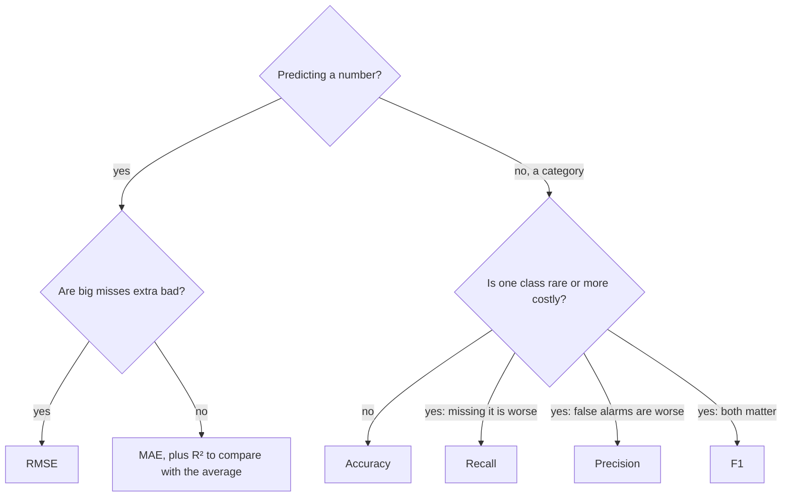

:::objectives
- Show why a high accuracy can hide a useless model when one class is rare.
- Build a confusion matrix and name its four boxes for a real problem.
- Calculate precision, recall, and F1 by hand and with scikit-learn.
- Explain what MAE, RMSE, and R² each say about number predictions.
- Choose a metric based on which mistake costs more.
:::

A camera on a factory line photographs every phone case and a model decides whether it has a hairline crack. About 4 cases in 100 are cracked. Your model scores 96.7% accuracy on cases it has never seen. Ship it?

Before you answer, consider a "model" that ignores the camera completely and says "fine" every time. It scores 96.0%. Your model beats doing nothing by less than one percentage point. This lesson is about the numbers that would have warned you.

## Accuracy counts every answer the same

The camera's measurements are simulated with `make_classification`: four numbers per case, and about 4% of cases labeled 1 (cracked). Label 1 is the **positive class**, the thing you're hunting for.

```python run
from sklearn.datasets import make_classification
from sklearn.model_selection import train_test_split
from sklearn.dummy import DummyClassifier
from sklearn.linear_model import LogisticRegression

X, y = make_classification(n_samples=1200, n_features=4, n_informative=3, n_redundant=0,
                           weights=[0.96], class_sep=1.0, flip_y=0, random_state=1)
X_train, X_test, y_train, y_test = train_test_split(X, y, test_size=0.25, stratify=y, random_state=0)
print("Cracked cases in the test set:", y_test.sum(), "of", len(y_test))

always_fine = DummyClassifier(strategy="most_frequent").fit(X_train, y_train)
model = LogisticRegression().fit(X_train, y_train)
y_pred = model.predict(X_test)

print(f"Always 'fine' accuracy: {always_fine.score(X_test, y_test):.3f}")
print(f"Model accuracy:         {model.score(X_test, y_test):.3f}")
```

`DummyClassifier(strategy="most_frequent")` always predicts the most common class. It's the do-nothing baseline, and it gets 288 of 300 right without looking at a single photo. When one class is rare, accuracy is mostly a measure of how rare it is.

## The confusion matrix: four kinds of answers

Instead of one number, sort every prediction into one of four boxes:

- **True positive (TP):** cracked, and the model said cracked.
- **False negative (FN):** cracked, but the model said fine. A broken case ships to a customer.
- **False positive (FP):** fine, but the model said cracked. A good case gets thrown away.
- **True negative (TN):** fine, and the model said fine.

```python run alt="A 2-by-2 confusion matrix with true labels on the rows and predicted labels on the columns: 286 fine cases predicted fine, 2 fine cases predicted cracked, 8 cracked cases predicted fine, and 4 cracked cases predicted cracked" caption="Rows are the truth, columns are the model's answer. The diagonal holds the correct answers."
import matplotlib.pyplot as plt
from sklearn.metrics import confusion_matrix, ConfusionMatrixDisplay

tn, fp, fn, tp = confusion_matrix(y_test, y_pred).ravel()
print(f"TN={tn}  FP={fp}  FN={fn}  TP={tp}")

ConfusionMatrixDisplay.from_predictions(y_test, y_pred, display_labels=["fine", "cracked"], cmap="Blues")
plt.show()
```

Now the problem is impossible to miss. Of the 12 cracked cases, the model caught 4 and let 8 through. The 96.7% came almost entirely from the 286 easy "fine" answers. `confusion_matrix(...).ravel()` flattens the 2×2 grid in the order TN, FP, FN, TP, which is worth memorizing because it isn't the order most people guess.

## Precision and recall ask two different questions

Each metric answers one plain question about the positive class:

- **Precision:** when the model says "cracked", how often is it right? `TP / (TP + FP)`
- **Recall:** of all the cracked cases, how many did the model catch? `TP / (TP + FN)`

Precision is about trusting the alarms. Recall is about not missing anything. Predict both from the matrix before you run the cell: 4 true alarms out of 6 alarms, and 4 catches out of 12 cracked cases.

```python run
from sklearn.metrics import precision_score, recall_score, f1_score

print(f"precision by hand: {tp / (tp + fp):.3f}   scikit-learn: {precision_score(y_test, y_pred):.3f}")
print(f"recall by hand:    {tp / (tp + fn):.3f}   scikit-learn: {recall_score(y_test, y_pred):.3f}")
```

The model is fairly trustworthy when it raises an alarm (0.667) but it misses two of every three cracked cases (recall 0.333). For a factory whose reputation depends on not shipping broken cases, that recall is the number that matters, and accuracy hid it completely.

:::video Kdsp6soqA7o start=0:24
StatQuest builds confusion matrices for a medical example and then compares two models by their matrices. Watch how the rows and columns are labeled. Not everyone uses scikit-learn's layout (truth on the rows), so check the axis labels before you read any matrix.
:::

## F1: one number that needs both

Sometimes you need a single score that's only high when precision and recall are both high. That's **F1**, the harmonic mean of the two:

`F1 = 2 × precision × recall / (precision + recall)`

Why not the ordinary average? Imagine a model with precision 1.0 and recall 0.1: it raises one alarm, which is correct, and misses nearly everything. The ordinary average is 0.55, which sounds fine. F1 is 0.18, which is the truth. The harmonic mean gets dragged toward the smaller number.

```python run
print(f"F1: {f1_score(y_test, y_pred):.3f}")

from sklearn.metrics import classification_report
print(classification_report(y_test, y_pred, target_names=["fine", "cracked"]))
```

`classification_report` prints precision, recall, and F1 for every class at once. The "cracked" row is the one to read here. `support` is how many true cases of each class there were.

## The threshold slides between precision and recall

From Module 5 you know `predict` uses a 0.5 threshold on `predict_proba`. Lower it and the model raises more alarms. Predict which metric goes up and which goes down:

```python run
p_cracked = model.predict_proba(X_test)[:, 1]
for threshold in [0.5, 0.3, 0.1]:
    pred = (p_cracked >= threshold).astype(int)
    print(f"threshold {threshold}: precision {precision_score(y_test, pred):.2f}, recall {recall_score(y_test, pred):.2f}")
```

More alarms catch more cracks (recall rises from 0.33 to 0.67), but more of the alarms are wrong (precision falls). You'll pick a threshold this way, on purpose, in the Build-along.

## Scoring number predictions: MAE, RMSE, and R²

Precision and recall only make sense for categories. When a model predicts a number, the mistakes are distances. Say a pizza shop's model predicts delivery times in minutes:

```python run
import numpy as np
from sklearn.metrics import mean_absolute_error, root_mean_squared_error, r2_score

actual    = np.array([22, 35, 28, 41, 30, 25, 38, 33])
predicted = np.array([25, 31, 29, 36, 32, 27, 35, 34])

print("misses:", actual - predicted)
print(f"MAE:  {mean_absolute_error(actual, predicted):.2f} minutes")
print(f"RMSE: {root_mean_squared_error(actual, predicted):.2f} minutes")
print(f"R²:   {r2_score(actual, predicted):.3f}")
```

- **MAE** (mean absolute error) is the average size of a miss: about 2.6 minutes. It's in the same units as the target, so you can say it to a customer.
- **RMSE** (root mean squared error) squares each miss before averaging, then takes the square root. Squaring makes big misses count extra, so RMSE is always at least as large as MAE.
- **R²** compares your model to the laziest guess, predicting the average every time. 1.0 is perfect, 0 means no better than the average, and it goes negative when the model is worse than the average.

Watch what one terrible delivery does to each number:

```python run
bad = predicted.copy()
bad[3] = 21          # predicted 21 minutes; it took 41
print(f"MAE:  {mean_absolute_error(actual, bad):.2f}")
print(f"RMSE: {root_mean_squared_error(actual, bad):.2f}")
```

MAE rises from 2.6 to 4.5, but RMSE leaps from 2.9 to 7.5. If one very late pizza costs you a customer forever, RMSE is the number that notices. If every minute of error costs the same, MAE describes the model better.

:::note
`root_mean_squared_error` arrived in scikit-learn 1.4. On an older version, use `np.sqrt(mean_squared_error(actual, predicted))` instead.
:::

## Pick the metric that matches the cost of mistakes



Always report the confusion matrix alongside whatever single number you choose. The number is for comparing models, and the matrix is for understanding them.

:::warning
**Swapping the arguments.** Every scikit-learn metric takes the truth first: `precision_score(y_true, y_pred)`. Reverse them and nothing crashes, but precision and recall trade places:

```python run
print(precision_score(y_test, y_pred), recall_score(y_test, y_pred))
print(precision_score(y_pred, y_test), "<- this is really recall")
```

Write `y_true` and `y_pred` as keyword arguments if you're ever unsure.
:::

:::warning
**The wrong positive class.** Precision, recall, and F1 measure class 1 by default. If your data codes the thing you're hunting as 0, flip the labels with `y = 1 - y` or pass `pos_label=0`; otherwise you'll proudly report how well the model finds the boring class.
:::

:::quiz
Q: A model screens 1,000 bags at an airport, 10 of which hold a banned item. It flags 8 bags, and 5 of those really have one. What is its recall?
- [ ] 5/8 = 0.625
  That's precision: how many of the flagged bags were right.
- [x] 5/10 = 0.5
  Recall asks how many of the 10 banned items were caught, and 5 were.
- [ ] 992/1000 = 0.992
  That's the accuracy, and it mostly reflects the 990 harmless bags.

Q: A wildfire smoke alarm wakes a whole town each time it fires. Residents complain it goes off for barbecues. Which number should the engineers raise?
- [x] Precision
  Too many false alarms means low precision: of the times it fires, too few are real fires.
- [ ] Recall
  Recall is about missed fires. The complaint is about alarms that fire with no wildfire.
- [ ] Accuracy
  With wildfires so rare, accuracy is already near 1 and barely changes when false alarms go down.

Q: Two house-price models have the same MAE, but model B's RMSE is much larger than model A's. What does that tell you?
- [ ] Model B is more accurate on average
  Their average miss is the same; that's what equal MAE means.
- [x] Model B makes a few much bigger misses
  Squaring punishes large misses, so a higher RMSE with the same MAE points to occasional big errors.
- [ ] Model B has a higher R²
  A larger squared error would lower R², not raise it.

Q: A model's R² on test data is −0.2. What happened?
- [ ] There's a bug, because R² can't go below 0
  R² goes negative whenever the model's squared error is bigger than the average guess's.
- [x] Predicting the average of the targets would have been better
  R² compares to the average guess; below 0 means the model loses to it.
:::

:::takeaways
- When the positive class is rare, accuracy mostly measures how rare it is. Always compare with a `DummyClassifier` baseline.
- The confusion matrix splits answers into TP, FP, FN, and TN. In scikit-learn, rows are the truth and `.ravel()` gives TN, FP, FN, TP.
- Precision is "can I trust an alarm?"; recall is "did we catch them all?"; F1 is high only when both are.
- Lowering the threshold usually raises recall and lowers precision.
- MAE is the typical miss in the target's units, RMSE punishes big misses, and R² compares the model with always guessing the average.
:::

## Further reading

- [scikit-learn: metrics and scoring](https://scikit-learn.org/stable/modules/model_evaluation.html): the official guide to every classification and regression metric, with the exact formulas.
- [MLU-Explain: precision and recall](https://mlu-explain.github.io/precision-recall/): an interactive article where you drag a threshold and watch both numbers change.
- [Google's crash course on accuracy, precision, and recall](https://developers.google.com/machine-learning/crash-course/classification/accuracy-precision-recall): short explanations with a worked example of when each metric is the right one.
