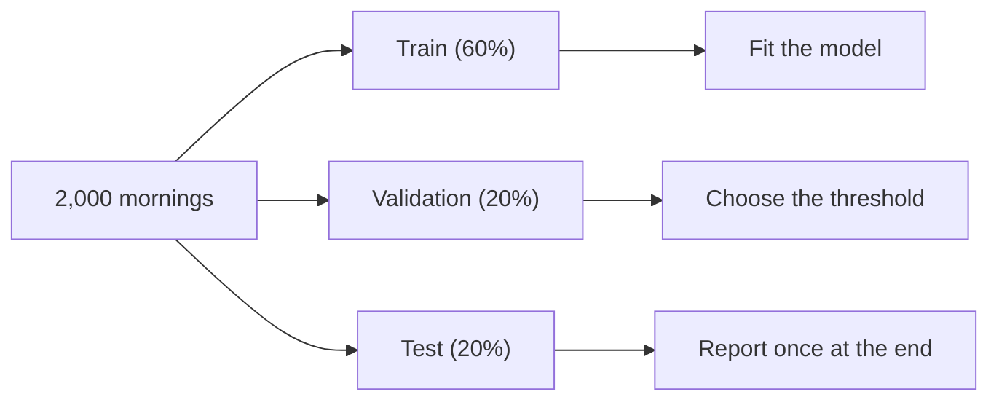

:::objectives
- Write a `report` function that prints accuracy, precision, recall, F1, and the confusion counts.
- Compare a trained model with a do-nothing baseline on a rare positive class.
- Sweep the threshold and chart precision and recall against it.
- Pick a threshold from a written requirement, using validation data only.
- Confirm the choice once on the untouched test set.
:::

A town's road crew has one truck of salt and has to decide each night whether to send it out. If the roads freeze and nobody salted, people crash. If the crew salts and the roads stay dry, the town wastes money and sleep. The crew chief gives you a rule in plain words: **"Warn us on at least 9 of every 10 icy mornings. Within that, give us as few false alarms as you can."**

That sentence is a metric requirement: recall of at least 0.9, then the best precision you can get. You'll build a model and a threshold that meet it, and prove it on data the model never touched. Here's the plan for the data:



## Step 1: Simulate 2,000 winter mornings

Each morning has four readings taken at midnight. Colder air, damp air, and clear skies (which let roads lose heat) all make ice more likely; wind dries roads a little.

```python run
import numpy as np
import pandas as pd

rng = np.random.default_rng(1)
n = 2000
air_temp  = rng.normal(2, 4, n).round(1)      # °C
humidity  = rng.uniform(40, 100, n).round()    # %
wind      = rng.gamma(2, 6, n).round(1)        # km/h
clear_sky = rng.integers(0, 2, n)              # 1 = no clouds

score = -3.3 - 0.9 * air_temp + 0.06 * (humidity - 70) + 1.0 * clear_sky - 0.05 * wind
icy = (rng.random(n) < 1 / (1 + np.exp(-score))).astype(int)

roads = pd.DataFrame({"air_temp": air_temp, "humidity": humidity, "wind": wind,
                      "clear_sky": clear_sky, "icy": icy})
print(roads.head())
print(f"Icy mornings: {roads['icy'].sum()} of {n} ({roads['icy'].mean():.1%})")
```

About one morning in nine is icy. That's rare enough to make accuracy misleading, which you'll see in a moment.

## Step 2: Split three ways

The threshold is a setting you choose by looking at results, so it needs its own data. If you chose it by peeking at the test set, the test score would no longer be a fair preview of next winter. Two calls to `train_test_split` give 60% train, 20% validation, and 20% test:

```python run
from sklearn.model_selection import train_test_split

X = roads.drop(columns="icy")
y = roads["icy"]
X_rest, X_test, y_rest, y_test = train_test_split(X, y, test_size=0.2, stratify=y, random_state=0)
X_train, X_val, y_train, y_val = train_test_split(X_rest, y_rest, test_size=0.25, stratify=y_rest, random_state=0)

for name, part in [("train", y_train), ("validation", y_val), ("test", y_test)]:
    print(f"{name:<11} {len(part):>4} mornings, {part.sum():>3} icy")
```

The second split takes 25% of the remaining 80%, which is 20% of the whole. `stratify` keeps roughly the same share of icy mornings in every part.

## Step 3: A report card, and the baseline it exposes

You'll check many predictions, so write the report once:

```python run
from sklearn.metrics import confusion_matrix, accuracy_score, precision_score, recall_score, f1_score

def report(y_true, y_pred, label=""):
    tn, fp, fn, tp = confusion_matrix(y_true, y_pred).ravel()
    print(f"{label:<16} accuracy {accuracy_score(y_true, y_pred):.3f} | "
          f"precision {precision_score(y_true, y_pred, zero_division=0):.3f} | "
          f"recall {recall_score(y_true, y_pred):.3f} | F1 {f1_score(y_true, y_pred):.3f} | "
          f"TP {tp} FP {fp} FN {fn} TN {tn}")

from sklearn.dummy import DummyClassifier
never_icy = DummyClassifier(strategy="most_frequent").fit(X_train, y_train)
report(y_val, never_icy.predict(X_val), "never icy")
```

`zero_division=0` tells `precision_score` what to do when the model never predicts "icy" (precision would be 0 divided by 0). The baseline is 89% accurate and completely useless: recall 0, every icy morning missed. That's the line to beat, and it isn't accuracy.

## Step 4: Train the model and read its matrix

```python run alt="A confusion matrix for the validation set at threshold 0.5: 350 dry mornings predicted dry, 7 dry mornings predicted icy, 16 icy mornings predicted dry, and 27 icy mornings predicted icy" caption="At the default threshold, 16 icy mornings get no warning."
import matplotlib.pyplot as plt
from sklearn.pipeline import make_pipeline
from sklearn.preprocessing import StandardScaler
from sklearn.linear_model import LogisticRegression
from sklearn.metrics import ConfusionMatrixDisplay

model = make_pipeline(StandardScaler(), LogisticRegression())
model.fit(X_train, y_train)
report(y_val, model.predict(X_val), "model @ 0.5")

ConfusionMatrixDisplay.from_estimator(model, X_val, y_val, display_labels=["dry", "icy"], cmap="Blues")
plt.show()
```

Accuracy jumped to 0.94, and the model is right most times it warns (precision 0.79). But recall is 0.63: 16 of 43 icy mornings get no warning. The crew chief asked for 0.9. The model's probabilities are fine; the 0.5 threshold is the problem.

## Step 5: Sweep the threshold

Compute `P(icy)` once, then test every threshold from 0.05 to 0.95:

```python run alt="Line chart of precision and recall against threshold: recall starts near 1 at low thresholds and falls as the threshold rises, while precision starts near 0.4 and climbs; a dashed horizontal line marks the 0.9 recall target" caption="Low thresholds catch almost all ice but cry wolf; high thresholds are trustworthy but miss ice."
p_val = model.predict_proba(X_val)[:, 1]
thresholds = np.round(np.arange(0.05, 0.96, 0.05), 2).tolist()

precisions, recalls = [], []
for t in thresholds:
    pred = (p_val >= t).astype(int)
    precisions.append(precision_score(y_val, pred, zero_division=0))
    recalls.append(recall_score(y_val, pred))

plt.figure(figsize=(7, 3.5))
plt.plot(thresholds, recalls, marker="o", label="recall")
plt.plot(thresholds, precisions, marker="o", label="precision")
plt.axhline(0.9, color="gray", linestyle="--", label="recall target 0.9")
plt.xlabel("threshold")
plt.ylabel("score")
plt.legend()
plt.show()
```

The two lines cross: you can't have both at their best. Recall stays above the dashed target only at the low end, where precision is weakest.

## Step 6: Let the requirement choose the threshold

Turn the chief's sentence into code. Keep only thresholds whose recall is at least 0.9, then take the highest of them, since a higher threshold means fewer false alarms:

```python run
meets_target = [t for t, r in zip(thresholds, recalls) if r >= 0.9]
chosen = max(meets_target)
print("Thresholds that meet the target:", meets_target)
print("Chosen threshold:", chosen)

report(y_val, (p_val >= chosen).astype(int), f"model @ {chosen}")
```

At 0.1 the model warns on 40 of the 43 icy validation mornings. The price is 48 false alarms, so a warning is right a bit less than half the time. That's the trade the chief asked for, and now it's written down as a number you can defend.

## Step 7: Confirm once on the test set

The test set has waited untouched. Use it once, with the threshold fixed:

```python run alt="A confusion matrix for the test set at threshold 0.1: 302 dry mornings predicted dry, 54 dry mornings predicted icy, 4 icy mornings predicted dry, and 40 icy mornings predicted icy" caption="On unseen mornings, 40 of 44 icy days get a warning."
p_test = model.predict_proba(X_test)[:, 1]
test_pred = (p_test >= chosen).astype(int)
report(y_test, test_pred, f"TEST @ {chosen}")

ConfusionMatrixDisplay.from_predictions(y_test, test_pred, display_labels=["dry", "icy"], cmap="Blues")
plt.show()
```

Recall on the test set is 0.909, so the requirement held on mornings that played no part in any decision. Precision came out a little lower than on validation, which is normal: a number tuned on one set usually slips a bit on the next. If test recall had dropped well below 0.9, the honest move would be to report that, not to go back and re-tune on the test set.

## The finished notebook

```python run title="icy_roads.py"
import numpy as np
import pandas as pd
from sklearn.model_selection import train_test_split
from sklearn.pipeline import make_pipeline
from sklearn.preprocessing import StandardScaler
from sklearn.linear_model import LogisticRegression
from sklearn.metrics import confusion_matrix, precision_score, recall_score

rng = np.random.default_rng(1)
n = 2000
air_temp = rng.normal(2, 4, n).round(1)
humidity = rng.uniform(40, 100, n).round()
wind = rng.gamma(2, 6, n).round(1)
clear_sky = rng.integers(0, 2, n)
score = -3.3 - 0.9 * air_temp + 0.06 * (humidity - 70) + 1.0 * clear_sky - 0.05 * wind
icy = (rng.random(n) < 1 / (1 + np.exp(-score))).astype(int)
roads = pd.DataFrame({"air_temp": air_temp, "humidity": humidity, "wind": wind,
                      "clear_sky": clear_sky, "icy": icy})

X, y = roads.drop(columns="icy"), roads["icy"]
X_rest, X_test, y_rest, y_test = train_test_split(X, y, test_size=0.2, stratify=y, random_state=0)
X_train, X_val, y_train, y_val = train_test_split(X_rest, y_rest, test_size=0.25, stratify=y_rest, random_state=0)

model = make_pipeline(StandardScaler(), LogisticRegression()).fit(X_train, y_train)

# Choose the threshold on validation data: recall >= 0.9, then the highest threshold
p_val = model.predict_proba(X_val)[:, 1]
candidates = np.round(np.arange(0.05, 0.96, 0.05), 2)
chosen = max(t for t in candidates if recall_score(y_val, (p_val >= t).astype(int)) >= 0.9)

# Report once on the test set
test_pred = (model.predict_proba(X_test)[:, 1] >= chosen).astype(int)
tn, fp, fn, tp = confusion_matrix(y_test, test_pred).ravel()
print(f"threshold {chosen}: recall {recall_score(y_test, test_pred):.3f}, "
      f"precision {precision_score(y_test, test_pred):.3f}, missed ice {fn}, false alarms {fp}")
```

:::quiz
Q: Why was the threshold chosen on the validation set instead of the test set?
- [ ] The validation set is bigger
  Both are 20% of the data. Size isn't the reason.
- [x] Choosing a setting by looking at results uses up that data; the test set has to stay unseen to give a fair final score
  Once the test set has influenced a choice, its score is no longer a preview of new data.
- [ ] scikit-learn can't predict on the test set until the end
  It can predict on any data at any time. Keeping the test set aside is a discipline, not a rule the library enforces.

Q: Among the thresholds that reached recall 0.9, why take the highest one?
- [x] A higher threshold raises fewer alarms, so it gives the best precision that still meets the recall target
  The requirement fixes recall first; the highest qualifying threshold then minimizes false alarms.
- [ ] Higher thresholds always give higher recall
  It's the opposite. Raising the threshold can only keep or lower recall.
- [ ] The highest threshold has the best accuracy, which is what the crew cares about
  The crew's rule never mentions accuracy. It asks for recall, then precision.

Q: The baseline was 89% accurate. Why was it still useless?
- [ ] 89% is below the usual 90% cutoff for a good model
  There's no universal cutoff. A good accuracy depends on the problem.
- [x] It never warned, so its recall was 0: every icy morning was missed
  Its accuracy came entirely from the dry mornings, which are 89% of the data.
:::

:::takeaways
- Turn a plain-language requirement ("warn on 9 of 10 icy mornings") into a metric target before you tune anything.
- A small `report` function keeps every comparison consistent: same metrics, same order, every time.
- Precision and recall move in opposite directions as the threshold changes; a chart shows the whole trade at once.
- Choose thresholds and other settings on validation data, then report on the test set once.
- Expect test scores to slip a little from validation scores, and report them as they are.
:::

## Ideas to extend it

- Change the crew's rule to "no more than 20 false alarms on validation, then the best recall" and find the new threshold.
- Give each mistake a cost (say, a missed icy morning costs 20 times as much as a wasted salting run) and choose the threshold with the lowest total cost.
- Swap in `DecisionTreeClassifier(max_depth=4)` and rerun Steps 4 to 7. Does it meet the target at a better precision?

## Further reading

- [scikit-learn: `ConfusionMatrixDisplay`](https://scikit-learn.org/stable/modules/generated/sklearn.metrics.ConfusionMatrixDisplay.html): both ways to draw a matrix, plus options for labels, colors, and normalized percentages.
- [scikit-learn: metrics and scoring](https://scikit-learn.org/stable/modules/model_evaluation.html): the section on precision, recall, and F-measures covers `zero_division` and `pos_label`.
- [MLU-Explain: train, test, and validation sets](https://mlu-explain.github.io/train-test-validation/): a visual explanation of why each part of the data gets its own job.
