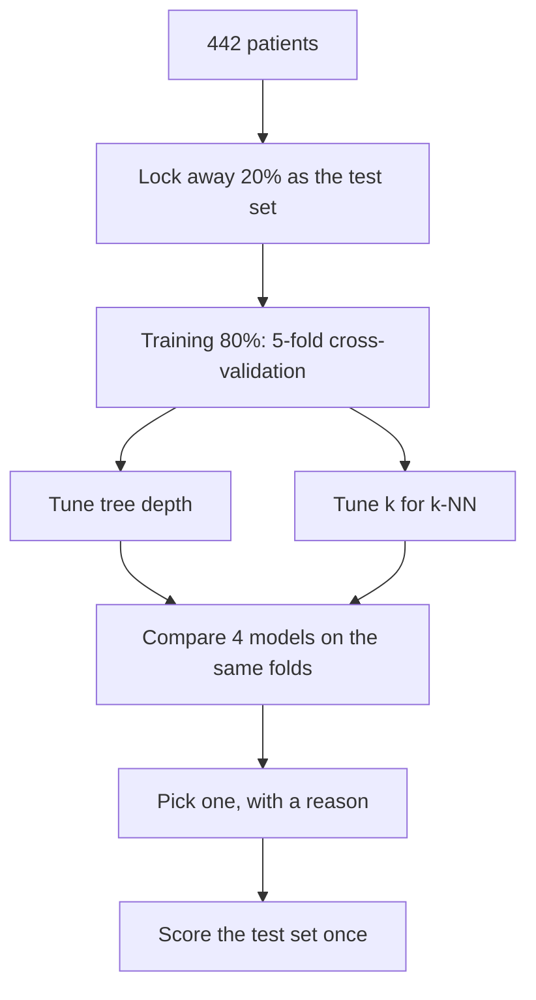

:::objectives
- Set up a fair comparison: a locked test set, one `KFold` object, and one metric.
- Use `cross_validate` with `return_train_score=True` to draw a training-versus-validation curve.
- Tune one setting each for k-NN and a decision tree.
- Compare four models with means and standard deviations, and chart them with error bars.
- Pick a model with a stated reason, then score it once on the test set.
:::

Doctors in the diabetes study behind scikit-learn's `load_diabetes` recorded ten measurements for each of 442 patients (age, body mass index, blood pressure, and six blood tests), then measured how much each patient's disease had progressed a year later. Your job is to recommend a model that predicts that progression score. Not to build the fanciest model, but to make a recommendation you can defend with numbers.

The finished notebook ends with a chart like the one in Step 6 and a three-line report on data no decision ever touched. Here's the route:



## Step 1: Load the data and lock away a test set

```python run
from sklearn.datasets import load_diabetes
from sklearn.model_selection import train_test_split

X, y = load_diabetes(return_X_y=True, as_frame=True)
X_train, X_test, y_train, y_test = train_test_split(X, y, test_size=0.2, random_state=42)

print("Features:", list(X.columns))
print("Training rows:", len(X_train), "| test rows:", len(X_test))
print(f"Target range: {y.min():.0f} to {y.max():.0f}, average {y_train.mean():.0f}")
```

From here until Step 7, `X_test` and `y_test` aren't used at all. Every choice (depth, k, which model) is made on the 353 training rows. The feature columns come already centered and scaled by the dataset's authors, so don't be surprised that `bmi` holds small decimals like 0.03 instead of real body-mass values.

## Step 2: Write down the rules of the contest

```python run
from sklearn.model_selection import KFold, cross_val_score

folds = KFold(n_splits=5, shuffle=True, random_state=0)

def cv_mae(model):
    scores = cross_val_score(model, X_train, y_train, cv=folds, scoring="neg_mean_absolute_error")
    maes = -scores
    return maes.mean(), maes.std()
```

Three rules, fixed before seeing a single score: the same five folds for everyone, MAE as the metric (the average miss in progression points, easy to explain to a doctor), and every model run through the same `cv_mae` function.

Why the minus sign? scikit-learn's scoring system assumes **bigger is better** for every score, so error metrics come back negated: an MAE of 45 is reported as −45. `cv_mae` flips them back so smaller means better again. `KFold` is the right fold maker here; `StratifiedKFold` is for class labels, not numeric targets.

## Step 3: The baseline to beat

```python run
from sklearn.dummy import DummyRegressor

mean, std = cv_mae(DummyRegressor())
print(f"Always predict the average: MAE {mean:.1f} ± {std:.1f}")
```

A "model" that predicts the training average for every patient misses by about 67 points on average. Any model that can't clearly beat that isn't learning anything useful.

## Step 4: Tune the tree's depth with a cross-validated curve

`cross_validate` is the bigger sibling of `cross_val_score`: with `return_train_score=True`, it reports each fold's training score as well as its validation score, which is exactly what a fit diagnosis needs.

```python run alt="Line chart of mean absolute error against tree max_depth from 1 to 10: training error falls steadily from about 54 to about 6, while validation error dips to its lowest, about 51, at depth 2 and then climbs past 60" caption="Lower is better. Validation error bottoms out at depth 2; after that the tree memorizes."
import numpy as np
import matplotlib.pyplot as plt
from sklearn.model_selection import cross_validate
from sklearn.tree import DecisionTreeRegressor

depths = range(1, 11)
train_mae, val_mae = [], []
for depth in depths:
    result = cross_validate(DecisionTreeRegressor(max_depth=depth, random_state=0), X_train, y_train,
                            cv=folds, scoring="neg_mean_absolute_error", return_train_score=True)
    train_mae.append(-result["train_score"].mean())
    val_mae.append(-result["test_score"].mean())

best_depth = depths[int(np.argmin(val_mae))]
print("Best depth:", best_depth, f"(validation MAE {min(val_mae):.1f})")

plt.figure(figsize=(7, 3.5))
plt.plot(depths, train_mae, marker="o", label="training MAE")
plt.plot(depths, val_mae, marker="o", label="validation MAE")
plt.axvline(best_depth, color="gray", linestyle="--")
plt.xlabel("max_depth")
plt.ylabel("MAE (lower is better)")
plt.legend()
plt.show()
```

This is the Notes' validation curve upside down, because lower error is better. Training error keeps falling, all the way to about 6 points at depth 10, while validation error rises past 60. A depth-10 tree has nearly memorized 282 patients per fold and learned little that transfers. In `cross_validate`'s results, `"test_score"` means the validation fold, not your locked test set.

## Step 5: Tune k for k-NN

k-NN averages the targets of the k most similar patients. Too few neighbors and it copies noise; too many and every prediction drifts toward the overall average. Scaling goes inside the pipeline, so each fold's scaler learns from that fold's training rows only.

```python run
from sklearn.pipeline import make_pipeline
from sklearn.preprocessing import StandardScaler
from sklearn.neighbors import KNeighborsRegressor

for k in [1, 3, 5, 10, 15, 20, 30, 60]:
    mean, std = cv_mae(make_pipeline(StandardScaler(), KNeighborsRegressor(n_neighbors=k)))
    print(f"k={k:<3} MAE {mean:.1f} ± {std:.1f}")
```

`k=1` is the overfit end (MAE 62, barely better than the baseline), and the error drops to its lowest around `k=15` before creeping back up. Notice how flat the bottom is: anywhere from 10 to 20 is within a fraction of a point.

## Step 6: Put four models on the same folds

```python run alt="Bar chart of cross-validated MAE with error bars for four models: average guess about 67, depth-2 tree about 51, k-NN with k=15 about 48, and linear regression about 45, the shortest bar" caption="Shorter bars are better. Error bars show one standard deviation across the five folds."
from sklearn.linear_model import LinearRegression

contenders = {
    "average guess": DummyRegressor(),
    f"tree (depth {best_depth})": DecisionTreeRegressor(max_depth=best_depth, random_state=0),
    "k-NN (k=15)": make_pipeline(StandardScaler(), KNeighborsRegressor(n_neighbors=15)),
    "linear regression": LinearRegression(),
}
names, means, stds = [], [], []
for name, model in contenders.items():
    mean, std = cv_mae(model)
    names.append(name)
    means.append(mean)
    stds.append(std)
    print(f"{name:<18} MAE {mean:.1f} ± {std:.1f}")

plt.figure(figsize=(7, 3.5))
plt.barh(names, means, xerr=stds, capsize=5, color="#7892ee")
plt.xlabel("cross-validated MAE (lower is better)")
plt.show()
```

Linear regression wins: about 3 points better than k-NN and about 7 better than the tree. Its 3-point lead over k-NN is about one standard deviation, which on its own would be borderline. But linear regression has the lower error on every one of the five folds (print both models' fold scores side by side to see it), so the lead isn't luck. It's also the simplest model on the list, with one weight per feature that a doctor could inspect. When the best scorer is also the simplest, the choice is easy.

:::note
Depth and k were tuned on these same folds, so the tree's and k-NN's scores here are a little optimistic: they got to pick their best setting after seeing the results. Linear regression had nothing to tune and still won, which makes the conclusion stronger, not weaker.
:::

## Step 7: Score the winner once on the test set

The decision is made. Now, and only now, open the locked test set:

```python run
from sklearn.metrics import mean_absolute_error, root_mean_squared_error, r2_score

final = LinearRegression().fit(X_train, y_train)
pred = final.predict(X_test)
print(f"Test MAE:  {mean_absolute_error(y_test, pred):.1f}")
print(f"Test RMSE: {root_mean_squared_error(y_test, pred):.1f}")
print(f"Test R²:   {r2_score(y_test, pred):.3f}")
```

The test MAE of 42.8 lands close to the cross-validated estimate of about 45, which is what an honest process looks like: no surprise in either direction. R² of 0.45 says the model explains a bit under half of the variation in progression. That's a real improvement over guessing the average and nowhere near precise enough to replace a doctor's judgment. Saying both of those things is part of the recommendation.

## The finished notebook

```python run title="choose_model.py"
from sklearn.datasets import load_diabetes
from sklearn.model_selection import train_test_split, KFold, cross_val_score
from sklearn.dummy import DummyRegressor
from sklearn.linear_model import LinearRegression
from sklearn.neighbors import KNeighborsRegressor
from sklearn.tree import DecisionTreeRegressor
from sklearn.pipeline import make_pipeline
from sklearn.preprocessing import StandardScaler
from sklearn.metrics import mean_absolute_error, root_mean_squared_error, r2_score

X, y = load_diabetes(return_X_y=True, as_frame=True)
X_train, X_test, y_train, y_test = train_test_split(X, y, test_size=0.2, random_state=42)
folds = KFold(n_splits=5, shuffle=True, random_state=0)

contenders = {
    "average guess": DummyRegressor(),
    "tree (depth 2)": DecisionTreeRegressor(max_depth=2, random_state=0),
    "k-NN (k=15)": make_pipeline(StandardScaler(), KNeighborsRegressor(n_neighbors=15)),
    "linear regression": LinearRegression(),
}
for name, model in contenders.items():
    maes = -cross_val_score(model, X_train, y_train, cv=folds, scoring="neg_mean_absolute_error")
    print(f"{name:<18} CV MAE {maes.mean():.1f} ± {maes.std():.1f}")

final = LinearRegression().fit(X_train, y_train)
pred = final.predict(X_test)
print(f"\nChosen: linear regression | test MAE {mean_absolute_error(y_test, pred):.1f}, "
      f"RMSE {root_mean_squared_error(y_test, pred):.1f}, R² {r2_score(y_test, pred):.3f}")
```

:::video fSytzGwwBVw start=1:18
StatQuest's short tour of cross-validation. Watch for the moment the same blocks of data are used to compare several methods; that's the job your single `folds` object did for all four models.
:::

:::quiz
Q: `cross_val_score(..., scoring="neg_mean_absolute_error")` returns `[-44.1, -47.9, ...]`. Why negative?
- [ ] The model's predictions are below the true values
  The sign has nothing to do with the direction of the misses; MAE is always positive.
- [x] scikit-learn treats every score as "higher is better", so it negates error metrics
  Negating MAE means a smaller error becomes a larger (less negative) score. Flip the sign to read it.
- [ ] Something went wrong in the folds
  Negative values are exactly what this scoring name promises.

Q: Why was the tree's depth chosen with cross-validation on the training rows instead of with the test set?
- [x] Choosing with the test set would make its final score optimistic, since it influenced the choice
  The test set is only a fair preview of new patients if no decision ever looked at it.
- [ ] The test set is too small to train a tree
  The tree is never trained on the test set either way; this is about which data guides the choice.
- [ ] Trees can't be evaluated on test data
  They can. The issue is when you look, not whether you can.

Q: Linear regression's CV MAE was about 45 and its test MAE was 42.8. What does that small difference suggest?
- [ ] The model is overfitting
  Overfitting would make the test error noticeably worse than the cross-validated estimate, not slightly better.
- [x] The cross-validated estimate was a good preview of performance on unseen data
  A test score close to the CV estimate is what you hope for; a small gap either way is normal variation.
- [ ] The test set leaked into training
  Nothing in the build touched the test set until Step 7, and a 2-point gap is ordinary sample-to-sample variation.
:::

:::takeaways
- Fix the rules before you score anything: one locked test set, one folds object, one metric.
- Error metrics come back negated from scikit-learn's scoring; flip the sign before reading them.
- `cross_validate(..., return_train_score=True)` gives the training and validation numbers a fit diagnosis needs.
- Error bars show fold-to-fold spread; a lead smaller than that spread isn't a real lead.
- Score the test set once, after the decision, and report it with its limits.
:::

## Ideas to extend it

- Add a fifth contender, such as `DecisionTreeRegressor(max_depth=2, min_samples_leaf=20)`, and see whether a different limit helps the tree.
- Rerun the comparison with `scoring="neg_root_mean_squared_error"`. Does the ranking change when big misses count extra?
- Plot `final.coef_` as a bar chart against the feature names. Which measurements push predicted progression up the most?

## Further reading

- [scikit-learn: `cross_val_score`](https://scikit-learn.org/stable/modules/generated/sklearn.model_selection.cross_val_score.html): the full parameter list, including every `scoring` name.
- [scikit-learn: toy datasets](https://scikit-learn.org/stable/datasets/toy_dataset.html): where the diabetes data comes from, what each column means, and how it was scaled.
- [scikit-learn: common pitfalls](https://scikit-learn.org/stable/common_pitfalls.html): the official page on leakage and inconsistent preprocessing, with examples of the mistakes this build avoids.
