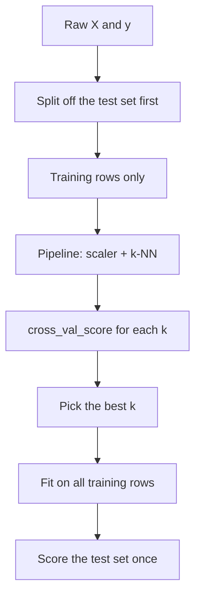

:::objectives
- Turn training and validation scores into a diagnosis with code.
- Find the overfit and underfit ends of a k-NN validation curve.
- Recognize when unshuffled folds give nonsense scores, and fix them.
- Measure how much a single split's score can vary.
- Run a fair comparison and repair a tuning loop that leaks test data.
:::

These exercises build from reading numbers to fixing real code. Each solution runs in the same notebook, so imports from one carry into the next.

## Warm-up: three report cards

Before any code, diagnose each model from its accuracy scores (train, then validation): **A** 0.62 and 0.60; **B** 0.99 and 0.74; **C** 0.88 and 0.86.

A is underfitting: low everywhere with almost no gap. B is overfitting: a near-perfect training score and a 25-point drop. C is a good fit: fairly high, with a small gap. If you got those, Exercise 1 asks you to teach the same judgment to Python.

### Exercise 1: Write `diagnose`

Write `diagnose(train, val)` that returns `"overfitting"` when the training score beats validation by more than 0.10, `"underfitting"` when the training score is below 0.75, and `"good fit"` otherwise. Check the gap first. Test it on the warm-up's three models and on one more: train 0.70, validation 0.55.

```text
A: underfitting
B: overfitting
C: good fit
D: overfitting
```

:::hint
Order matters. Model D has both a low training score and a big gap; checking the gap first means it's reported as overfitting, the more urgent problem.
:::

:::solution
```python run
def diagnose(train, val):
    if train - val > 0.10:
        return "overfitting"
    if train < 0.75:
        return "underfitting"
    return "good fit"

for name, train, val in [("A", 0.62, 0.60), ("B", 0.99, 0.74), ("C", 0.88, 0.86), ("D", 0.70, 0.55)]:
    print(f"{name}: {diagnose(train, val)}")
```

The cutoffs (0.10 and 0.75) are judgment calls that depend on the problem. In a task where the best possible accuracy is 0.70, a training score of 0.68 isn't underfitting at all. Treat a function like this as a first look, not a verdict.
:::

### Exercise 2: Find both ends of a k-NN curve

Make 400 points with `make_moons(n_samples=400, noise=0.35, random_state=1)` and split off 30% for validation (`random_state=0`). Train `KNeighborsClassifier` for k in `[1, 3, 5, 10, 20, 40, 80, 150, 250]`, record training and validation accuracy, and plot both against k. Which k overfits, which underfits, and which is best?

```text
k=1    train 1.000  validation 0.858
...
k=20   train 0.875  validation 0.875
...
k=250  train 0.771  validation 0.733
```

:::hint
With `k=1`, each training point's nearest neighbor is itself. What does that do to the training score? At the other extreme, think about what happens when k is close to the size of the training set.
:::

:::solution
```python run alt="Line chart of accuracy against k on a log scale: training accuracy starts at 1.0 for k=1 and falls steadily; validation accuracy stays around 0.85 to 0.875 through k=80, then both lines drop sharply at k=250" caption="Small k memorizes; huge k blurs everything together."
import matplotlib.pyplot as plt
from sklearn.datasets import make_moons
from sklearn.model_selection import train_test_split
from sklearn.neighbors import KNeighborsClassifier

X, y = make_moons(n_samples=400, noise=0.35, random_state=1)
X_train, X_val, y_train, y_val = train_test_split(X, y, test_size=0.3, random_state=0)

ks = [1, 3, 5, 10, 20, 40, 80, 150, 250]
train_acc, val_acc = [], []
for k in ks:
    knn = KNeighborsClassifier(n_neighbors=k).fit(X_train, y_train)
    train_acc.append(knn.score(X_train, y_train))
    val_acc.append(knn.score(X_val, y_val))
    print(f"k={k:<4} train {train_acc[-1]:.3f}  validation {val_acc[-1]:.3f}")

plt.figure(figsize=(7, 3.5))
plt.plot(ks, train_acc, marker="o", label="training")
plt.plot(ks, val_acc, marker="o", label="validation")
plt.xscale("log")
plt.xlabel("k (log scale)")
plt.ylabel("accuracy")
plt.legend()
plt.show()
```

`k=1` overfits: a perfect training score, because every training point votes for itself, and a 14-point gap. `k=250` underfits: with 250 of the 280 training points voting, every prediction drifts toward the majority class, and both scores fall. `k=20` is best here, with the two scores equal. The curve runs in the opposite direction from tree depth: for k-NN, *small* k is the flexible end.
:::

### Exercise 3: The fold trap

A classmate runs this and concludes that decision trees can't learn iris at all:

```python
from sklearn.datasets import load_iris
from sklearn.model_selection import KFold, cross_val_score
from sklearn.tree import DecisionTreeClassifier

X, y = load_iris(return_X_y=True)
print(cross_val_score(DecisionTreeClassifier(random_state=0), X, y, cv=KFold(n_splits=3)))
```

```text
[0. 0. 0.]
```

Find the cause (hint: print `y`), then fix it two different ways.

:::hint
`load_iris` lists all 50 setosa first, then 50 versicolor, then 50 virginica. `KFold` without shuffling cuts the rows in order. What does each training set contain when fold 1 is held out?
:::

:::solution
```python run
from sklearn.datasets import load_iris
from sklearn.model_selection import KFold, StratifiedKFold, cross_val_score
from sklearn.tree import DecisionTreeClassifier

X, y = load_iris(return_X_y=True)
print("First and last labels:", y[:5], y[-5:])

tree = DecisionTreeClassifier(random_state=0)
print("shuffled KFold:  ", cross_val_score(tree, X, y, cv=KFold(n_splits=3, shuffle=True, random_state=0)))
print("StratifiedKFold: ", cross_val_score(tree, X, y, cv=StratifiedKFold(n_splits=3, shuffle=True, random_state=0)))
```

Unshuffled, fold 1 is exactly the 50 setosa. The tree trains on only versicolor and virginica, so it has never seen the species it's tested on, and it scores 0. Every fold repeats the trick. Shuffling mixes the species before cutting; `StratifiedKFold` goes further and guarantees each fold has the same species mix. (Passing `cv=3` as a plain number is also safe for classifiers, because scikit-learn then uses stratified folds automatically.)
:::

### Exercise 4: How much does one split wobble?

Using iris, run `train_test_split` with `test_size=0.2` and `random_state` from 0 to 19. Each time, train `DecisionTreeClassifier(max_depth=3, random_state=0)` and record its test accuracy. Print the lowest, highest, and average score.

```text
lowest 0.867, highest 1.000, average 0.945
```

:::hint
Collect the 20 scores in a list, then use `min`, `max`, and `sum(scores) / len(scores)`.
:::

:::solution
```python run
scores = []
for seed in range(20):
    X_tr, X_te, y_tr, y_te = train_test_split(X, y, test_size=0.2, random_state=seed)
    scores.append(DecisionTreeClassifier(max_depth=3, random_state=0).fit(X_tr, y_tr).score(X_te, y_te))

print(f"lowest {min(scores):.3f}, highest {max(scores):.3f}, average {sum(scores) / len(scores):.3f}")
```

The same model, on the same data, scored anywhere from 87% to 100%, depending only on which 30 flowers landed in the test set. With a small dataset, a single split is close to a coin toss for comparing models. That's the whole case for cross-validation.
:::

### Exercise 5: A fair three-model contest on iris

Compare three models on iris with one `StratifiedKFold(n_splits=5, shuffle=True, random_state=0)`: a scaled `LogisticRegression`, a scaled `KNeighborsClassifier(n_neighbors=5)`, and `DecisionTreeClassifier(max_depth=3, random_state=0)`. Print each mean ± std. Then decide: is there a clear winner?

```text
logistic regression  0.960 ± 0.013
k-NN (k=5)           0.953 ± 0.034
tree (depth 3)       0.927 ± 0.039
```

:::hint
Put the models in a dictionary and loop over it, passing the same `cv` object to every `cross_val_score` call. Scalers belong inside `make_pipeline`.
:::

:::solution
```python run
from sklearn.pipeline import make_pipeline
from sklearn.preprocessing import StandardScaler
from sklearn.linear_model import LogisticRegression

cv = StratifiedKFold(n_splits=5, shuffle=True, random_state=0)
contest = {
    "logistic regression": make_pipeline(StandardScaler(), LogisticRegression()),
    "k-NN (k=5)": make_pipeline(StandardScaler(), KNeighborsClassifier(n_neighbors=5)),
    "tree (depth 3)": DecisionTreeClassifier(max_depth=3, random_state=0),
}
for name, model in contest.items():
    s = cross_val_score(model, X, y, cv=cv)
    print(f"{name:<20} {s.mean():.3f} ± {s.std():.3f}")
```

Logistic regression and k-NN are separated by 0.007, a fraction of k-NN's std; on 150 flowers, that's one flower. Call it a tie. The tree trails by about one std, which is suggestive but not decisive. Logistic regression is a reasonable pick because it's the steadiest (smallest std) and as accurate as anything here, but a well-argued case for k-NN is fine too. "Logistic regression wins by 0.7 points" is the one conclusion the evidence can't support.
:::

### Exercise 6: Repair a leaky tuning loop

This code runs without errors and reports a test accuracy of 0.88. It contains two leaks. Find both, then rewrite it so the choice of k uses only training data and the test set is scored once.

```python
from sklearn.datasets import make_classification
from sklearn.model_selection import train_test_split
from sklearn.preprocessing import StandardScaler
from sklearn.neighbors import KNeighborsClassifier

X, y = make_classification(n_samples=300, n_features=5, n_informative=3, n_redundant=0,
                           flip_y=0.1, class_sep=0.8, random_state=6)
X_scaled = StandardScaler().fit_transform(X)
X_train, X_test, y_train, y_test = train_test_split(X_scaled, y, test_size=0.25, random_state=0)

best_k, best_score = None, 0
for k in [1, 5, 15, 30]:
    score = KNeighborsClassifier(n_neighbors=k).fit(X_train, y_train).score(X_test, y_test)
    if score > best_score:
        best_k, best_score = k, score
print("Best k:", best_k, "| accuracy:", round(best_score, 3))
```

:::hint
Leak one happens before the split. Leak two is about which data the `if` statement is looking at. The diagram below shows the order the fixed version should follow.
:::



:::solution
```python run
from sklearn.datasets import make_classification

X, y = make_classification(n_samples=300, n_features=5, n_informative=3, n_redundant=0,
                           flip_y=0.1, class_sep=0.8, random_state=6)
X_train, X_test, y_train, y_test = train_test_split(X, y, test_size=0.25, random_state=0)

cv = StratifiedKFold(n_splits=5, shuffle=True, random_state=0)
best_k, best_cv = None, 0
for k in [1, 5, 15, 30]:
    pipe = make_pipeline(StandardScaler(), KNeighborsClassifier(n_neighbors=k))
    cv_score = cross_val_score(pipe, X_train, y_train, cv=cv).mean()
    print(f"k={k:<3} CV accuracy {cv_score:.3f}")
    if cv_score > best_cv:
        best_k, best_cv = k, cv_score

final = make_pipeline(StandardScaler(), KNeighborsClassifier(n_neighbors=best_k)).fit(X_train, y_train)
print("Chosen k:", best_k, "| test accuracy (scored once):", round(final.score(X_test, y_test), 3))
```

**Leak 1:** the scaler was fit on all 300 rows, so the test rows helped set the averages used to scale the training rows. The pipeline fixes it: inside each fold, and in the final fit, the scaler learns from training rows only. **Leak 2:** k was chosen by test accuracy, which turns the test set into a validation set and makes the reported score the best of four tries instead of a fair preview. Cross-validation on the training rows chooses k, and the test set is touched once.

The leaky loop reported 0.88 with k=30. The honest process picks k=5 and scores 0.84 on the test set. That 4-point gap is what the leaks were worth: picking the best of four test scores flatters whichever k got lucky on those 75 rows. On another dataset the gap might be smaller or larger, but only the honest number means what it claims to mean.
:::

### Challenge: Tune two settings at once

Make noisy data with `make_classification(n_samples=800, n_features=8, n_informative=5, n_redundant=0, flip_y=0.2, random_state=3)`, and hold out 25% as a test set (`stratify=y, random_state=0`). On the training rows, use 5-fold `StratifiedKFold` to score every combination of `max_depth` in `[2, 3, 4, 6, 8, None]` and `min_samples_leaf` in `[1, 5, 10, 20, 40]`. Report the best pair, then compare its test accuracy with a default `DecisionTreeClassifier(random_state=0)`.

:::hint
Two nested `for` loops, one per setting, with `cross_val_score(...).mean()` inside. `min_samples_leaf=20` means no leaf may hold fewer than 20 training rows, which is another way to stop a tree from memorizing single examples.
:::

:::solution
```python run
X, y = make_classification(n_samples=800, n_features=8, n_informative=5, n_redundant=0,
                           flip_y=0.2, random_state=3)
X_train, X_test, y_train, y_test = train_test_split(X, y, test_size=0.25, stratify=y, random_state=0)

best = (0, None, None)
for depth in [2, 3, 4, 6, 8, None]:
    for leaf in [1, 5, 10, 20, 40]:
        tree = DecisionTreeClassifier(max_depth=depth, min_samples_leaf=leaf, random_state=0)
        score = cross_val_score(tree, X_train, y_train, cv=cv).mean()
        if score > best[0]:
            best = (score, depth, leaf)

score, depth, leaf = best
print(f"Best: max_depth={depth}, min_samples_leaf={leaf} (CV accuracy {score:.3f})")

tuned = DecisionTreeClassifier(max_depth=depth, min_samples_leaf=leaf, random_state=0).fit(X_train, y_train)
default = DecisionTreeClassifier(random_state=0).fit(X_train, y_train)
print(f"Test accuracy, tuned:   {tuned.score(X_test, y_test):.3f}")
print(f"Test accuracy, default: {default.score(X_test, y_test):.3f}")
```

With 20% of labels flipped, the default tree memorizes noise and pays for it on the test set. The tuned tree, limited in both depth and leaf size, beats it by about nine points. You just wrote by hand what scikit-learn's `GridSearchCV` does automatically; knowing the loop underneath makes that tool much less mysterious when you meet it.
:::
