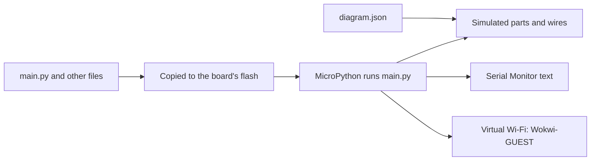

:::objectives
- Explain the difference between a Raspberry Pi Pico W and a Raspberry Pi 4 or 5, and what each does in an IoT system.
- Open a MicroPython project for the Pico W in Wokwi and find main.py, diagram.json, the play button, and the Serial Monitor.
- Read the Pico W's pinout: GP numbers, physical pin numbers, the analog pins, and the power pins.
- Install Thonny or Raspberry Pi Imager if you own real hardware, and fix the setup problems people hit most.
:::

The name "Raspberry Pi" covers two very different machines. A Raspberry Pi 5 is a full computer: it boots Linux, runs a desktop and a web browser, and has gigabytes of memory. A Raspberry Pi Pico W is a microcontroller board the size of a stick of gum with 264 KB of RAM. It has no operating system and runs exactly one program, but that program is running a fraction of a second after you plug the board in, and it can read a sensor and send the value over Wi-Fi.

Real IoT systems use both kinds. Small, cheap, low-power boards sit next to the plants or the door, and a bigger computer collects their data and shows a dashboard. This course builds that system, and you can do all of it in a browser for free.

## Two boards, two jobs

| | Raspberry Pi Pico W | Raspberry Pi 4 or 5 |
| --- | --- | --- |
| What it is | A microcontroller board (RP2040 chip plus a Wi-Fi chip) | A single-board Linux computer |
| What runs on it | One MicroPython program, started from `main.py` at power-up | Raspberry Pi OS, with many programs at once |
| Its job in this course | The sensor node: read sensors, drive LEDs and servos, send readings | Optional: the Linux machine for the terminal lessons, an MQTT broker, or a dashboard |
| Cost to follow along | $0 in Wokwi | $0 (every lesson has a simulated or browser path) |

You need a computer with a recent version of Chrome, Edge, Firefox, or Safari and an internet connection. Windows, macOS, ChromeOS, and Linux all work. You don't need an account to run simulations; a free Wokwi account only matters for saving projects, which lesson 3 covers.

## Open your first Pico W project in Wokwi

1.  Go to **wokwi.com** and click the **Pi Pico** tile under *Simulate with Wokwi Online*.
2.  Under **Starter Templates**, find the Pi Pico W row and click **Micropython Pico W**. (The direct address is `wokwi.com/projects/new/micropython-pi-pico-w`. Bookmark it.)
3.  Be careful to pick the MicroPython template. The plain **Pi Pico W** tile starts an Arduino C++ project, and the **Pico 2W** tiles use a newer chip.

The project opens with code on the left and a drawing of the board on the right. The template's `main.py` contains three lines:

```python
import time
time.sleep(0.1) # Wait for USB to become ready

print("Hello, Pi Pico W!")
```

Press the green play button. After a moment, `Hello, Pi Pico W!` appears in a terminal panel under the board. That panel is the **Serial Monitor**: everything your program prints shows up there, and it's also where you type to the board. The short sleep exists because the board talks to the terminal over a simulated USB connection, and text printed before that connection is ready is lost.

## What each part of the editor does

-   **main.py** is your program. MicroPython runs it automatically every time the board starts, exactly like a real Pico W does at power-up.
-   **diagram.json** describes every part and wire in the circuit as text. Dragging parts around rewrites it, and pasting a whole circuit into it is the fastest way to build the lessons' circuits.
-   **Library Manager** adds libraries. You won't need it in the early modules.
-   Extra tabs are extra files. Wokwi copies every file in the project onto the board's simulated flash drive, so a second file such as `sensors.py` can be imported from `main.py`.
-   The blue **+** button above the diagram adds parts (or press **A** with the diagram selected). To draw a wire, click one pin, then another.
-   The green **play** button starts the board; while it runs, the same spot stops it.



## Read the Pico W's pinout

Zoom in on the board (scroll, or press **+**) and hover over a pin to see its name. The pins have two kinds of numbers, and mixing them up is the most common wiring mistake in this course. **Physical pin numbers** count around the board: pin 1 is at the top left next to the USB connector, pins 1 to 20 run down the left edge, and 21 to 40 run up the right edge. **GP numbers** are what your code uses. `Pin(15)` means GP15, which sits at physical pin 20.

| Physical pins | Name | What it is for |
| --- | --- | --- |
| 1, 2, 4–7, 9–12, 14–17, 19–22, 24–27, 29 | GP0 to GP22 | Digital input and output; any of them can do PWM |
| 31, 32, 34 | GP26, GP27, GP28 | Digital pins that can also measure voltage (analog inputs ADC0 to ADC2) |
| 3, 8, 13, 18, 23, 28, 38 | GND | Ground, the 0 V reference every circuit returns to |
| 33 | AGND | A quieter ground for analog sensors |
| 36 | 3V3(OUT) | 3.3 V for powering small sensors |
| 39 and 40 | VSYS and VBUS | Power input, and the 5 V that arrives from USB |
| 30, 35, 37 | RUN, ADC_VREF, 3V3_EN | Special pins; leave them unconnected |

The Pico W's onboard LED is a special case. On the original Pico it was wired to GP25, but on the Pico W it hangs off the Wi-Fi chip, so MicroPython reaches it by name: `Pin("LED")`.

:::warning
Every GPIO pin on the Pico W is a **3.3 V** pin. VBUS carries 5 V when USB is plugged in, and connecting it to any GP pin can destroy the chip. The simulator won't warn you, so build the habit now: power sensors from 3V3(OUT), not VBUS. Module 2 explains why.
:::

:::video WHvUdmbDeDc
A short tour of the Pico's pins from Core Electronics. It shows the original Pico, whose layout the Pico W keeps. Watch for the GP numbers versus the physical pin numbers, and for where the ground pins sit.
:::

## Optional: set up a real Pico W or Raspberry Pi

Skip this section if you're staying in the simulator; nothing later depends on it. If you have hardware, pick your computer below. **Thonny** is a free Python editor that talks to a Pico W over USB. **Raspberry Pi Imager** writes Raspberry Pi OS onto a microSD card for a Pi 4 or 5.

:::tabs
@tab Windows
-   **Thonny:** download the Windows installer from `thonny.org`, run it, and accept the defaults.
-   **Imager:** download Raspberry Pi Imager for Windows from `raspberrypi.com/software` and run the installer.
-   **SSH, for lesson 2:** Windows 10 and 11 include the `ssh` command. Open **PowerShell** from the Start menu to use it.
@tab macOS
-   **Thonny:** download the macOS package from `thonny.org`, open it, and follow the installer.
-   **Imager:** download Raspberry Pi Imager for macOS from `raspberrypi.com/software`, open the file, and drag the app into **Applications**.
-   **SSH, for lesson 2:** open **Terminal** (in Applications › Utilities). The `ssh` command is built in.
@tab Chromebook
-   **Thonny:** turn on the Linux development environment in **Settings › About ChromeOS › Developers**, open the Terminal app, and run `sudo apt install thonny`. When you plug in a Pico W, ChromeOS asks whether to connect it to Linux; say yes.
-   **Imager:** Raspberry Pi Imager doesn't run on ChromeOS. Borrow a Windows, macOS, or Linux computer for the ten minutes it takes to write the card, or use a kit whose card comes with Raspberry Pi OS already on it.
-   **SSH, for lesson 2:** use the Linux Terminal app. If `ssh` says command not found, run `sudo apt install openssh-client`.
@tab Linux
-   **Thonny:** on Debian, Ubuntu, or Raspberry Pi OS, run `sudo apt install thonny` (Raspberry Pi OS with desktop already has it).
-   **Imager:** on Ubuntu, `sudo apt install rpi-imager`, or download the AppImage from `raspberrypi.com/software`.
-   **SSH, for lesson 2:** the `ssh` command is almost always installed; if not, `sudo apt install openssh-client`.
:::

**Put MicroPython on a real Pico W.** Hold down the white **BOOTSEL** button and plug the board into your computer with a micro-USB cable, then let go. A drive called **RPI-RP2** appears. Download the Pico W `.uf2` file from `micropython.org/download/RPI_PICO_W` and drag it onto that drive; the board reboots into MicroPython. (Thonny can do the same step for you from **Tools › Options › Interpreter**: choose *MicroPython (Raspberry Pi Pico)*, then use its link for installing or updating MicroPython.) Afterwards, select the same interpreter in Thonny and you get a `>>>` prompt from the board.

**Prepare a Raspberry Pi 4 or 5.** Insert a microSD card into your computer and open Imager. Pick your model on the **Device** tab, **Raspberry Pi OS** on the **OS** tab, and your card on the **Storage** tab. Keep *Exclude system drives* turned on so you can't erase your own computer. On the **Customisation** tabs, set a hostname (this course uses `iotpi`), your time zone, a username and password, and your Wi-Fi, and on **Remote Access** turn on **Enable SSH** with password authentication. Review the summary, select **Write**, and wait for it to finish verifying.

:::video MepM1juFYzA
Gary Explains walks through setting up a card with Raspberry Pi Imager 2.0. Watch for the customisation screens: the hostname, user, Wi-Fi, and SSH settings you pick there are what lesson 2 uses to log in.
:::

## Fixes for the problems people actually hit

-   **Wokwi never loads, or the play button spins forever.** School networks sometimes block simulator sites. Try another network or browser, and close extra tabs on an older laptop. The first run of a session can take several seconds while the firmware loads.
-   **The terminal stays empty.** Check you picked the *MicroPython* template, since an Arduino project shows different text. If you deleted the `time.sleep(0.1)` line, put it back so early prints aren't lost.
-   **Keyboard shortcuts such as A or R do nothing.** Click an empty spot on the diagram first. In Firefox, turn off the setting *Search for text when you start typing*, which steals those keys.
-   **(Real Pico W) No RPI-RP2 drive appears.** Many micro-USB cables carry power only. Try another cable, and make sure you hold BOOTSEL *before* plugging in.
-   **(Real Pico W) Thonny says it can't find the device.** Click the interpreter name in the bottom-right corner of Thonny and pick MicroPython (Raspberry Pi Pico) with the right port. Close any other program that might be holding the port.
-   **(Raspberry Pi) Imager can't see the card.** Try another USB card reader. Built-in readers on some laptops are unreliable.

:::quiz
Q: Your code says `Pin(15)`. Which physical pin should the wire go to?
- [ ] Physical pin 15
  Physical pin 15 is GP11. Code always uses GP numbers, not positions.
- [x] Physical pin 20, labeled GP15
  `Pin(15)` means GP15, which sits at physical pin 20 at the bottom of the left edge.
- [ ] Any pin, because the simulator connects it automatically
  The simulator only connects the pins you wire. A wire on the wrong pin does nothing.

Q: A light sensor needs power. Which pin should feed it?
- [ ] VBUS, because it's the strongest supply
  VBUS is 5 V from USB. A sensor powered at 5 V can send 5 V back into a 3.3 V GPIO pin and damage it.
- [x] 3V3(OUT)
  It provides 3.3 V, the same level the GPIO pins use, so the sensor's output can't exceed what the pins accept.
- [ ] GP28
  GP28 is a signal pin. It's meant to read the sensor's output, not to power it.

Q: Which job fits a Pico W better than a Raspberry Pi 5?
- [x] Reading a soil sensor in a greenhouse and sending the value over Wi-Fi every minute
  It starts in a fraction of a second, runs one program, and costs a few dollars, which is ideal for a sensor node.
- [ ] Running a web dashboard that ten people open at once
  That needs an operating system and much more memory; it's a job for a Linux computer.
- [ ] Editing Python files in a desktop text editor
  The Pico W has no desktop. You edit on another computer (or in Wokwi) and the board runs the result.
:::

:::takeaways
- A Pico W is a microcontroller that runs one MicroPython program; a Raspberry Pi 4 or 5 is a Linux computer. IoT systems often use both.
- In Wokwi, choose **Pi Pico › Micropython Pico W**. `main.py` runs at start-up, `diagram.json` holds the circuit, and prints appear in the Serial Monitor.
- Code uses GP numbers; wires go to physical pins. GP26 to GP28 can read analog voltages.
- GPIO pins are 3.3 V only. Power sensors from 3V3(OUT), never from VBUS.
:::

## Further reading

-   [Wokwi's MicroPython guide](https://docs.wokwi.com/guides/micropython): how Wokwi copies your files to the board and how to reach the REPL.
-   [MicroPython quick reference for the RP2](https://docs.micropython.org/en/latest/rp2/quickref.html): one page of working snippets for pins, PWM, ADC, Wi-Fi, and timers, kept up to date with the firmware.
-   [Raspberry Pi Pico W datasheet](https://datasheets.raspberrypi.com/picow/pico-w-datasheet.pdf): the official pinout drawing and what each power pin can supply.
