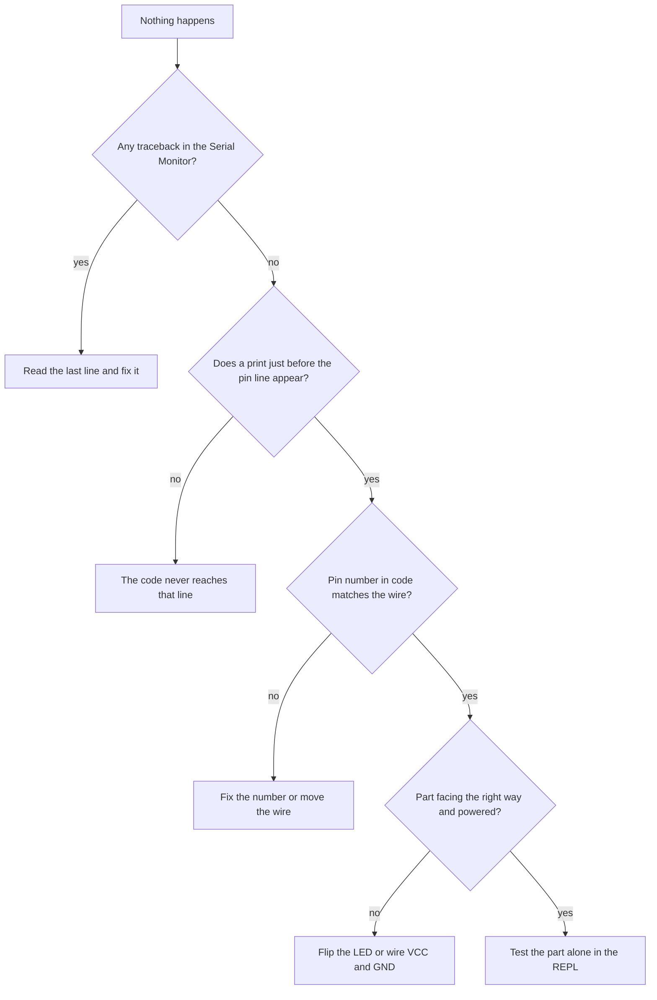

:::objectives
- Save Wokwi projects with an account, as a ZIP, or as plain files, and know who can see a saved project.
- Read a MicroPython traceback and fix the four errors beginners see most.
- Follow a fixed order of checks when a circuit doesn't work.
- Keep secrets out of simulator projects, use Wokwi from the keyboard, and handle real hardware safely.
:::

Here's a message you will see this week:

```text
Traceback (most recent call last):
  File "main.py", line 6, in <module>
NameError: name 'led' isn't defined
```

It looks like a wall, but it answers three questions in order: which file (`main.py`), which line (6), and what went wrong (a name that doesn't exist yet). Read the last line first, then jump to the line number. Most errors in this course take less than a minute to fix once you read them that way.

## Save your work, and know who can see it

A Wokwi project lives in your browser tab until you save it. You have three options:

1.  **A free Wokwi account.** Sign in, then click **Save**. The project gets its own web address, and **Share** gives you a link to send. Free projects are **public**: anyone with the link can open them, and they can appear in Wokwi's lists of recent projects. Keeping projects unlisted is a paid feature.
2.  **Download a ZIP.** The project menu next to **Save** includes **Download project ZIP**, which saves `main.py`, `diagram.json`, and any other files to your computer.
3.  **Copy the files by hand.** Select all the text in each tab and paste it into a file with the same name on your computer. It always works, even when you can't sign in.

Whichever you use, keep one folder per project on your own computer. A layout like this makes it easy to find last week's circuit when a later module builds on it:

```text
hardware-lab/
├── m1-blink/
│   ├── main.py
│   ├── diagram.json
│   └── notes.md        what worked, what broke, what you changed
├── m3-status-panel/
│   ├── main.py
│   └── diagram.json
└── m4-logger/
    ├── main.py
    ├── diagram.json
    └── readings.csv    data copied out of the Serial Monitor
```

## The four errors you'll see most

MicroPython's messages are shorter than regular Python's, but they mean the same things.

| Last line of the traceback | What it means | Usual fix |
| --- | --- | --- |
| `NameError: name 'led' isn't defined` | You used a name before creating it, or spelled it differently (`LED` and `led` are different names) | Check the spelling and that the line creating it runs first |
| `AttributeError: 'Pin' object has no attribute 'vlaue'` | The object exists, but it has no method with that name | Fix the typo (`value`) or look up the method in the docs |
| `ImportError: no module named 'umqtt'` | That library isn't on the board | Check the spelling; if it's right, the library has to be added to the project as a file |
| `OSError: [Errno 2] ENOENT` | A file you tried to open doesn't exist on the board's flash | Create it first, or check the file name and folder |

One more is worth knowing by sight: `IndentationError: unexpected indent`. MicroPython is as strict about indentation as regular Python, and pasting code from a web page sometimes adds a space at the start of a line.

:::tip
When an error mentions a line number, look at the line just *above* it too. A missing closing bracket on line 5 is often reported on line 6.
:::

## A debugging routine for hardware

When nothing happens, the fault could be in the code, the wiring, or the part. Guessing wastes time. Check in this order, because each step is quicker than the next and rules out a whole category:



The second question is the one people skip. Adding `print("about to turn on LED")` just before the line that should do something tells you instantly whether the problem is before that line or after it. Leave the prints in while you work, and remove them once it does.

## Keep secrets out of the simulator

Two facts about Wokwi's free plan shape how this course handles passwords:

-   **Free projects are public.** Anything in `main.py` can be read by anyone who finds the link.
-   **Wokwi's public internet gateway is monitored.** When the simulated Pico W goes online, its traffic passes through Wokwi's servers, and Wokwi's documentation says plainly not to send private or sensitive data through it.

So the simulated board joins `Wokwi-GUEST`, an open network with no password, and the course never asks you to type a real password, API key, or home address into a Wokwi project. Use made-up device names like `greenhouse-01`, not your name or school. Module 7 shows how real devices keep credentials out of their source code.

## Use Wokwi from the keyboard

You can build and run every circuit without precise mouse work:

-   With the diagram selected, **A** adds a part, **R** rotates the selected part, the arrow keys move it, **D** duplicates it, and **Delete** removes it. **+** and **−** zoom, and **F** fits the whole circuit in view.
-   A potentiometer responds to the keyboard while the simulation runs: click it, then use **Left** and **Right** for small steps, **Page Up** and **Page Down** for big ones, and **Home** or **End** for the ends of its range.
-   A pushbutton can have a keyboard key. Add `"key": "b"` to its `attrs` in `diagram.json`, and holding **B** holds the button down.
-   Browser zoom (**Ctrl** and **+**, or **⌘** and **+** on a Mac) enlarges the code and the Serial Monitor text. Every chart in these lessons has a text description, and the videos have captions in their YouTube settings.

## Work safely with real parts

The simulator can't be damaged. Real boards can, and so can fingers if something overheats. If you build on a desk:

-   **Unplug before you rewire.** Moving wires on a powered board is how pins end up briefly connected to the wrong thing.
-   **3.3 V only on GPIO pins.** Never connect 5 V, VBUS, or a 5 V sensor's output directly to a Pico W or Raspberry Pi GPIO pin.
-   **Every LED gets a resistor**, and nothing connects 3V3 straight to GND. That's a short circuit.
-   **Motors never run from a GPIO pin.** Even small motors need a driver board and their own power supply. A micro servo's signal wire can connect to a GPIO pin, but its power comes from 5 V (VBUS for one small servo, a separate supply for anything bigger), never from a GPIO pin.
-   **If anything gets hot or smells, unplug it immediately** and look for a short before plugging back in.
-   Keep drinks off the desk, and touch something metal and grounded before handling a board on a dry day.

:::quiz
Q: The last line of a traceback says `NameError: name 'sensor' isn't defined` and points to line 9. What do you check first?
- [x] Whether `sensor` is created, with exactly that spelling, on a line that runs before line 9
  NameError means the name doesn't exist yet at that moment, usually a typo or an assignment that comes later.
- [ ] Whether the sensor is wired to the right pin
  A wiring mistake can't cause a NameError. Python failed before it ever touched a pin.
- [ ] Whether the board has enough memory
  Memory problems raise `MemoryError`, not `NameError`.

Q: You want help with a project that connects to your home Wi-Fi. What's safe to put in a public Wokwi project?
- [ ] Your real network name and password, since only people with the link can see it
  Free projects are public, and the gateway is monitored. Treat anything in the project as published.
- [x] The `Wokwi-GUEST` network and made-up device names
  The simulated board only needs the open virtual network, so there is no secret to leak.
- [ ] Your password, as long as it's in a separate file
  Every file in a public project is just as visible as `main.py`.
:::

:::takeaways
- Save with a free account (public), a downloaded ZIP, or by copying files; keep one local folder per project.
- Read a traceback from the bottom: error type and message, then the line number.
- Debug in order: traceback, a print before the pin line, pin number, part orientation and power.
- Never put real passwords or personal details in a Wokwi project. Real hardware rules: unplug to rewire, 3.3 V only on GPIO, resistors on LEDs, drivers for motors.
:::
