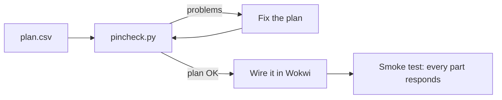

:::objectives
- Create a project folder and files from the Linux terminal.
- Describe a circuit as a CSV wiring plan with one row per part.
- Write checks for pin names, analog-capable pins, reused pins, signal voltage, and LED current.
- Wire the approved plan in Wokwi and confirm each part with a short test program.
- Make the checker an executable command on Linux with a shebang and `chmod +x`.
:::

Engineers don't solder first and test later. They write the plan down, check it against the datasheet, and only then pick up a wire. You'll do the same for the circuit Module 3 programs: two LEDs, a button, a knob, and a light sensor on a Pico W.

The tool you build reads a plan like the one below and refuses it, with reasons, if any connection would fail or damage the board. Then you'll fix the plan, wire it in Wokwi, and run a test that exercises every part.



## Step 1: Make the project folder

On any Linux terminal (a Raspberry Pi over SSH, WSL, a Chromebook, or macOS Terminal):

```bash
mkdir -p ~/iot-lab/m2-pincheck
cd ~/iot-lab/m2-pincheck
touch pincheck.py plan.csv
ls -l
```

```text
total 0
-rw-r--r-- 1 student student 0 Nov 16 14:20 pincheck.py
-rw-r--r-- 1 student student 0 Nov 16 14:20 plan.csv
```

`touch` creates empty files. Both are readable and writable by you, and neither is executable yet; Step 7 changes that. If you don't have a terminal handy, the Python cells on this page work the same way: the first one writes `plan.csv` and later ones read it.

## Step 2: Write the plan as CSV

Each row is one part: its name, the Pico W pin its signal uses, what kind of connection it is, the highest voltage the signal can reach, and for LEDs the resistor and the LED's forward voltage. This first draft has four mistakes in it. See if you can spot them before the checker does.

```python run title="write_plan.py"
plan = """part,pin,kind,signal_v,ohms,led_v
status_led,GP15,led,3.3,330,2.0
alarm_led,GP14,led,3.3,150,2.0
mode_button,GP13,button,3.3,,
knob,GP22,analog,3.3,,
light_sensor,GP27,analog,5.0,,
fan_led,GP15,led,3.3,330,2.0
"""
with open("plan.csv", "w") as f:
    f.write(plan)
print("Wrote", plan.count("\n") - 1, "parts to plan.csv")
```

## Step 3: Load the plan and check pin names

`csv.DictReader` turns each row into a dictionary keyed by the header, which keeps the checks readable. The Pico W's usable GPIO pins are GP0 to GP22 plus GP26 to GP28, and only those last three can read analog voltages.

```python run
import csv

GPIO_PINS = {f"GP{n}" for n in range(23)} | {"GP26", "GP27", "GP28"}
ANALOG_PINS = {"GP26", "GP27", "GP28"}

def load_plan(path):
    with open(path) as f:
        return list(csv.DictReader(f))

def check_pins(rows):
    problems = []
    for row in rows:
        if row["pin"] not in GPIO_PINS:
            problems.append(f"{row['part']}: {row['pin']} is not a usable GPIO pin")
        elif row["kind"] == "analog" and row["pin"] not in ANALOG_PINS:
            problems.append(f"{row['part']}: analog parts need GP26, GP27, or GP28, not {row['pin']}")
    return problems

rows = load_plan("plan.csv")
for problem in check_pins(rows):
    print(problem)
```

GP22 is a perfectly good digital pin, but a potentiometer produces a voltage anywhere between 0 and 3.3 V, and GP22 can only tell "high" from "low". The knob would read as a switch.

## Step 4: Catch a pin used twice

Two parts on one pin fight each other: two outputs drive against each other, and an input next to an output reads whatever the output is doing. `collections.Counter` counts how many rows claim each pin.

```python run
from collections import Counter

def check_reuse(rows):
    counts = Counter(row["pin"] for row in rows)
    problems = []
    for pin, count in counts.items():
        if count > 1:
            parts = [row["part"] for row in rows if row["pin"] == pin]
            problems.append(f"{pin} is used by {count} parts: {', '.join(parts)}")
    return problems

for problem in check_reuse(rows):
    print(problem)
```

## Step 5: Reject signals above 3.3 V

The light sensor in the draft is a 5 V module. Its output can reach 5 V, which is above what any Pico W pin survives.

```python run
MAX_SIGNAL_V = 3.3

def check_voltage(rows):
    problems = []
    for row in rows:
        volts = float(row["signal_v"])
        if volts > MAX_SIGNAL_V:
            problems.append(f"{row['part']}: signal reaches {volts} V; power it from 3V3 or add a divider")
    return problems

for problem in check_voltage(rows):
    print(problem)
```

## Step 6: Add up the LED currents

Each LED's current is the voltage left after the LED, divided by its resistor. The checker warns above the Pico W's default 4 mA drive setting (the pin's voltage sags and the LED is dimmer than the math says), refuses anything above 12 mA, and refuses a total above the chip's 50 mA budget.

```python run
WARN_MA, MAX_MA, TOTAL_MA = 4.0, 12.0, 50.0

def led_current_ma(row):
    return (float(row["signal_v"]) - float(row["led_v"])) / float(row["ohms"]) * 1000

def check_current(rows):
    problems, warnings, total = [], [], 0.0
    for row in rows:
        if row["kind"] != "led":
            continue
        ma = led_current_ma(row)
        total += ma
        if ma > MAX_MA:
            problems.append(f"{row['part']}: {ma:.1f} mA is over the {MAX_MA:.0f} mA per-pin limit")
        elif ma > WARN_MA:
            warnings.append(f"{row['part']}: {ma:.1f} mA is above the default 4 mA drive; use 330 ohms or more")
    if total > TOTAL_MA:
        problems.append(f"all LEDs together draw {total:.1f} mA, over the {TOTAL_MA:.0f} mA budget")
    return problems, warnings, total

problems, warnings, total = check_current(rows)
print("problems:", problems)
print("warnings:", warnings)
print(f"total LED current: {total:.1f} mA")
```

## Step 7: The finished checker

Here is the whole tool in one file. It runs every check, prints a report, and returns `0` when the plan is safe and `1` when it isn't, the convention every Linux command uses for success and failure. This cell runs it on the draft, then on a corrected plan:

```python run title="pincheck.py"
import csv
from collections import Counter

GPIO_PINS = {f"GP{n}" for n in range(23)} | {"GP26", "GP27", "GP28"}
ANALOG_PINS = {"GP26", "GP27", "GP28"}
MAX_SIGNAL_V = 3.3
WARN_MA, MAX_MA, TOTAL_MA = 4.0, 12.0, 50.0

def check_plan(rows):
    problems, warnings = [], []
    for pin, count in Counter(row["pin"] for row in rows).items():
        if count > 1:
            problems.append(f"{pin} is used by {count} parts")
    total = 0.0
    for row in rows:
        name, pin, volts = row["part"], row["pin"], float(row["signal_v"])
        if pin not in GPIO_PINS:
            problems.append(f"{name}: {pin} is not a usable GPIO pin")
        elif row["kind"] == "analog" and pin not in ANALOG_PINS:
            problems.append(f"{name}: analog parts need GP26, GP27, or GP28")
        if volts > MAX_SIGNAL_V:
            problems.append(f"{name}: signal reaches {volts} V (max {MAX_SIGNAL_V} V)")
        if row["kind"] == "led":
            ma = (volts - float(row["led_v"])) / float(row["ohms"]) * 1000
            total += ma
            if ma > MAX_MA:
                problems.append(f"{name}: {ma:.1f} mA is over {MAX_MA:.0f} mA")
            elif ma > WARN_MA:
                warnings.append(f"{name}: {ma:.1f} mA is above the default 4 mA drive")
    if total > TOTAL_MA:
        problems.append(f"LEDs draw {total:.1f} mA in total (max {TOTAL_MA:.0f} mA)")
    return problems, warnings

def main(path):
    with open(path) as f:
        rows = list(csv.DictReader(f))
    problems, warnings = check_plan(rows)
    for line in problems:
        print("PROBLEM ", line)
    for line in warnings:
        print("WARNING ", line)
    print(f"{path}: {len(rows)} parts | problems: {len(problems)} | warnings: {len(warnings)}")
    return 1 if problems else 0

print("exit status:", main("plan.csv"))
print()

fixed = """part,pin,kind,signal_v,ohms,led_v
status_led,GP15,led,3.3,330,2.0
alarm_led,GP14,led,3.3,330,2.0
mode_button,GP13,button,3.3,,
knob,GP26,analog,3.3,,
light_sensor,GP27,analog,3.3,,
"""
with open("plan-fixed.csv", "w") as f:
    f.write(fixed)
print("exit status:", main("plan-fixed.csv"))
```

The fixes: the alarm LED got a 330 Ω resistor, the knob moved to GP26, the light sensor is now powered from 3V3 so its output can't pass 3.3 V, and the fan LED was dropped because GP15 was already taken. If you need a third LED, give it its own pin.

To use the checker as a terminal command, save the program in `pincheck.py`, then make two small changes: a first line that names the interpreter, and a last line that takes the file name from the command line instead of hard-coding it.

```diff
+#!/usr/bin/env python3
 import csv
+import sys
 from collections import Counter
 ...
-print("exit status:", main("plan.csv"))
+sys.exit(main(sys.argv[1]))
```

```bash
chmod +x pincheck.py
./pincheck.py plan-fixed.csv
echo $?
```

```text
plan-fixed.csv: 5 parts | problems: 0 | warnings: 0
0
```

`echo $?` prints the exit status of the last command. Scripts and automated tests use that number to decide whether to carry on, which is why the checker returns it instead of only printing.

## Step 8: Wire the approved plan in Wokwi

Start a new **Micropython Pico W** project, open `diagram.json`, and replace its contents with the approved plan:

```json title="diagram.json"
{
  "version": 1,
  "author": "C4T Hardware Lab",
  "editor": "wokwi",
  "parts": [
    {
      "type": "board-pi-pico-w",
      "id": "pico",
      "top": 0,
      "left": 0,
      "attrs": { "env": "micropython-20260406-v1.28.0" }
    },
    { "type": "wokwi-led", "id": "led_status", "top": 150, "left": -150, "attrs": { "color": "green", "label": "status" } },
    { "type": "wokwi-resistor", "id": "r1", "top": 230, "left": -130, "attrs": { "value": "330" } },
    { "type": "wokwi-led", "id": "led_alarm", "top": 150, "left": -230, "attrs": { "color": "red", "label": "alarm" } },
    { "type": "wokwi-resistor", "id": "r2", "top": 260, "left": -210, "attrs": { "value": "330" } },
    { "type": "wokwi-pushbutton", "id": "btn_mode", "top": 50, "left": -250, "attrs": { "color": "blue", "key": "b" } },
    { "type": "wokwi-potentiometer", "id": "knob", "top": -30, "left": 160, "attrs": {} },
    { "type": "wokwi-photoresistor-sensor", "id": "light", "top": 120, "left": 160, "attrs": {} }
  ],
  "connections": [
    [ "pico:GP15", "r1:2", "green", [] ],
    [ "r1:1", "led_status:A", "green", [] ],
    [ "led_status:C", "pico:GND.4", "black", [] ],
    [ "pico:GP14", "r2:2", "orange", [] ],
    [ "r2:1", "led_alarm:A", "orange", [] ],
    [ "led_alarm:C", "pico:GND.4", "black", [] ],
    [ "pico:GP13", "btn_mode:1.r", "blue", [] ],
    [ "btn_mode:2.r", "pico:GND.3", "black", [] ],
    [ "knob:VCC", "pico:3V3", "red", [] ],
    [ "knob:GND", "pico:GND.8", "black", [] ],
    [ "knob:SIG", "pico:GP26", "violet", [] ],
    [ "light:VCC", "pico:3V3", "red", [] ],
    [ "light:GND", "pico:GND.8", "black", [] ],
    [ "light:AO", "pico:GP27", "violet", [] ]
  ],
  "dependencies": {}
}
```

Both sensors are powered from `pico:3V3`, never from VBUS, exactly as the checker demanded. The button connects GP13 to ground when pressed, and `"key": "b"` lets you press it by holding **B**.

## Step 9: Smoke-test every part

A **smoke test** checks that each part responds at all, before you write real logic around it. Put this in `main.py` and press play:

```python title="main.py"
from machine import Pin, ADC
import time

time.sleep(0.1)

status = Pin(15, Pin.OUT)
alarm = Pin(14, Pin.OUT)
button = Pin(13, Pin.IN, Pin.PULL_UP)  # Module 3 explains PULL_UP
knob = ADC(Pin(26))
light = ADC(Pin(27))

for led in (status, alarm):  # flash each LED once
    led.value(1)
    time.sleep(0.5)
    led.value(0)

while True:
    print("button", button.value(), "| knob", knob.read_u16(), "| light", light.read_u16())
    time.sleep(0.5)
```

Each LED should flash once, then a line prints twice a second. Click the knob and press **Home** and **End**: its number should swing from near 0 to near 65535. Hold **B**: the button value drops from 1 to 0. Click the light sensor while the simulation runs and drag its lux slider; brighter light gives a *lower* number, because of how that module is wired. If any part doesn't respond, the plan and the wiring disagree somewhere, and the smoke test has just saved you from debugging it inside a bigger program.

:::video dB-4nVc0s10
Robotics Back-End walks through every pin on the Raspberry Pi's 40-pin header. If you have a Pi, watch for which pins are power, which are ground, and which GPIO numbers have extra jobs such as I2C; the same rules your checker enforces apply there.
:::

:::quiz
Q: Why does the checker reject the knob on GP22 even though GP22 is a valid GPIO pin?
- [ ] GP22 can't be used as an input
  GP22 can be an input; it just can only read high or low.
- [x] Only GP26 to GP28 can measure a voltage between 0 and 3.3 V
  A potentiometer's output is a range of voltages, so it needs a pin connected to the analog-to-digital converter.
- [ ] GP22 is reserved for the Wi-Fi chip
  The Wi-Fi chip uses internal pins that aren't on the edge connector; GP22 is free.

Q: Why does `main` return 1 for a bad plan instead of just printing the problems?
- [x] Other programs and scripts can check the exit status and stop automatically
  By convention 0 means success and anything else means failure, so `./pincheck.py plan.csv && echo build it` only continues for a safe plan.
- [ ] Python needs a return value or it crashes
  Functions without a `return` simply return `None`.
- [ ] It makes the LEDs flash on the board
  The checker runs on your computer and never touches the board.

Q: The light sensor runs on 5 V in the draft. Which fix did the plan use?
- [ ] Move it to GP28
  GP28 is also a 3.3 V pin; moving the wire doesn't change the voltage.
- [x] Power the sensor from 3V3 so its output can't rise above 3.3 V
  A resistive sensor's output can't exceed its supply, so powering it from 3.3 V keeps the signal in range.
- [ ] Lower `MAX_SIGNAL_V` to make the warning go away
  That silences the check without making the circuit any safer.
:::

:::takeaways
- Write the wiring down as data, then check it with code, before touching a wire.
- Pins must exist, analog parts need GP26 to GP28, and no two parts share a pin.
- Every signal stays at or below 3.3 V; power sensors from 3V3.
- Size LED resistors for about 4 mA per pin and keep the total far below 50 mA.
- A shebang, `chmod +x`, and a meaningful exit status turn a Python file into a real command.
- Smoke-test each part with a tiny program before writing the real logic.
:::

## Ideas to extend it

-   Add a `servo` kind that must use a PWM-capable pin and must be powered from VBUS or an external 5 V supply, never 3V3.
-   Make the checker also print the physical pin number for each GP pin, so you can wire a real board from its report.
-   Read a second column, `pull`, and warn when a button has no pull-up or pull-down.

## Further reading

-   [Python's csv module](https://docs.python.org/3/library/csv.html): `DictReader`, `DictWriter`, and the quirks of quoting.
-   [SparkFun's voltage divider tutorial](https://learn.sparkfun.com/tutorials/voltage-dividers/all): how to bring a 5 V signal down to 3.3 V with two resistors, with worked examples.
-   [Raspberry Pi Pico W datasheet](https://datasheets.raspberrypi.com/picow/pico-w-datasheet.pdf): the pin table this checker's rules come from.
