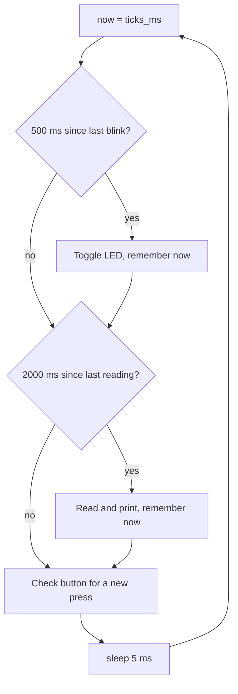

:::objectives
- Explain why an unconnected input reads randomly, and fix it with a pull-up resistor.
- Detect a button press as an edge and ignore contact bounce.
- Convert `read_u16()` values into volts, percentages, and a temperature, and reject readings that can't be true.
- Use PWM duty cycle to set LED brightness and servo angle.
- Schedule a blink, a sensor reading, and a button check in one loop with `ticks_ms` and `ticks_diff`.
:::

Your environmental station blinks a status LED, reads a temperature every two seconds, and has a button to change modes. The obvious code is `led.toggle()` followed by `time.sleep(1)`. Then you notice the button only works if you press it at exactly the right moment, because for 99.9% of every second the board is asleep and not looking.

Every idea in this lesson leads to the same habit: read the inputs, update the outputs, and get back to the top of the loop quickly.

## Digital inputs: why a loose wire reads random values

A pin set as an input reports whether the voltage on it is near 3.3 V (`1`) or near 0 V (`0`). A button connects a pin to something only while it's pressed. When it's released, the pin is connected to nothing at all, and an unconnected input "floats": it picks up electrical noise and reads 0 or 1 unpredictably.

A **pull-up resistor** fixes that by connecting the pin weakly to 3.3 V. Released, the pin reads 1. Pressed, the button connects the pin straight to ground, which overpowers the weak resistor, and the pin reads 0. The RP2040 has pull-ups built in, so you switch one on in code:

```python
from machine import Pin

button = Pin(13, Pin.IN, Pin.PULL_UP)  # button wired between GP13 and GND
print(button.value())  # 1 while released, 0 while pressed
```

This is called **active low**: pressed means 0. It looks backwards at first, but it's the most common way to wire buttons, because the button only needs a wire to ground. `Pin.PULL_DOWN` does the opposite for a button wired to 3V3.

## Edges and bounce: counting one press as one press

You usually care about the moment the button goes *down*, not the whole time it's held. That moment is an **edge**: the value changed from 1 to 0 since the last check. Real buttons make it harder. Their metal contacts bounce for a few milliseconds, so one press can look like several quick presses. Wokwi simulates this bounce too.

The fix is **debouncing**: accept a new level only after it has stayed the same for a few readings in a row. Step through this simulation, where each number is one reading taken 5 ms apart, and compare the two counters:

:::trace Naive edge counting versus debouncing
```python
samples = [1, 1, 0, 1, 0, 0, 0, 1, 1, 1]
naive = 0
previous = 1
stable = 1
run = 0
presses = 0
for level in samples:
    if previous == 1 and level == 0:
        naive += 1
    run = run + 1 if level == previous else 1
    previous = level
    if run == 3 and level != stable:
        stable = level
        if stable == 0:
            presses += 1
print("naive:", naive, "debounced:", presses)
```
:::

The naive counter saw two presses, because the contacts bounced between the third and fifth readings. The debounced version only changed its mind once the level had held for three readings (15 ms), so it counted one.

## Analog inputs: from a voltage to a number

GP26, GP27, and GP28 connect to the RP2040's **analog-to-digital converter** (ADC), which measures a voltage between 0 and 3.3 V. In MicroPython, `read_u16()` reports it as a number from 0 to 65535. The chip really measures in 4,096 steps (12 bits), and MicroPython scales that up to the 16-bit range so the same code works on boards with different converters.

```python run title="adc_math.py"
FULL_SCALE = 65535
VREF = 3.3

for raw in [0, 16384, 32768, 49152, 65535]:
    volts = raw * VREF / FULL_SCALE
    percent = raw * 100 / FULL_SCALE
    print(f"raw {raw:>5} -> {volts:.2f} V -> {percent:5.1f}%")
```

A potentiometer wired between 3V3 and GND turns its knob position into exactly this kind of voltage. On the board it's one line, `ADC(Pin(26)).read_u16()`. Real readings jitter by a few counts even when nothing moves, so programs often average several readings before using them; you'll practise that in lesson 3.

## The onboard temperature sensor, and a reading you shouldn't trust

The RP2040 also has a fifth ADC channel wired to a temperature sensor inside the chip. Raspberry Pi's datasheet gives the conversion: the sensor outputs about 0.706 V at 27 °C, and the voltage falls by 1.721 mV for every degree warmer.

```python
from machine import ADC

sensor = ADC(4)  # channel 4 is the internal temperature sensor
volts = sensor.read_u16() * 3.3 / 65535
celsius = 27 - (volts - 0.706) / 0.001721
print(round(celsius, 1))
```

Run that in Wokwi and you'll most likely get about **437 °C**. Wokwi's Pi Pico documentation notes that its simulated temperature sensor always reads 0, and here's what the formula does with that:

```python run title="chip_temperature.py"
def chip_celsius(raw):
    volts = raw * 3.3 / 65535
    return 27 - (volts - 0.706) / 0.001721

def plausible(celsius, low=-20, high=85):
    return low <= celsius <= high

for raw in [0, 13600, 14020, 14500]:
    c = chip_celsius(raw)
    print(f"raw {raw:>5} -> {c:6.1f} °C  plausible: {plausible(c)}")
```

Newer firmware also accepts `ADC(ADC.CORE_TEMP)`, which picks the right channel on any RP2 chip. A real Pico W gives a sensible number, but it measures the chip, which runs warmer than the room, and each chip is a little different. Treat it as a "board is overheating" alarm, not a weather reading. The bigger lesson applies to every sensor in this course: **check readings against what's physically possible** before you log them or act on them. A sensor that says 437 °C is broken, unwired, or simulated, and your code should say so.

## PWM: in-between outputs from a pin that's only on or off

A GPIO pin can only output 0 V or 3.3 V. **Pulse-width modulation** (PWM) switches it on and off hundreds or thousands of times a second. The fraction of each cycle spent on is the **duty cycle**. An LED switched fast enough looks steadily dimmer at lower duty cycles, because your eye averages the flicker.

```python run alt="Three square waves over three cycles, on 25%, 50%, and 75% of each cycle, with a dashed line at each wave's average voltage of 0.8, 1.6, and 2.5 volts" caption="Same frequency, different duty cycles. The dashed line is the average voltage."
import matplotlib.pyplot as plt

fig, axes = plt.subplots(3, 1, figsize=(7, 4.5), sharex=True)
for ax, duty in zip(axes, [0.25, 0.50, 0.75]):
    times, levels = [], []
    for cycle in range(3):
        times += [cycle, cycle + duty, cycle + duty, cycle + 1]
        levels += [3.3, 3.3, 0, 0]
    ax.plot(times, levels, color="#4a6fe3", linewidth=2)
    ax.axhline(3.3 * duty, color="#d9822b", linestyle="--")
    ax.set_ylabel("V")
    ax.set_ylim(-0.3, 3.7)
    ax.set_title(f"{duty:.0%} duty cycle (average {3.3 * duty:.1f} V)", fontsize=10)
axes[-1].set_xlabel("time (cycles)")
fig.tight_layout()
```

In MicroPython, `duty_u16` takes the duty cycle as a number from 0 (always off) to 65535 (always on):

```python
from machine import Pin, PWM

led = PWM(Pin(15), freq=1000, duty_u16=0)
led.duty_u16(16384)  # about 25% on
```

A **servo** uses PWM differently. It expects a pulse every 20 ms (50 Hz), and the *length* of that pulse sets the angle. Common micro servos, and Wokwi's simulated one, move from 0° to 180° as the pulse grows from about 0.5 ms to 2.4 ms; check your servo's datasheet, because the ends vary. Converting an angle to `duty_u16` is arithmetic you can check here:

```python run title="servo_math.py"
PERIOD_US = 20_000          # one pulse every 20 ms = 50 Hz
MIN_US, MAX_US = 500, 2400  # pulse lengths for 0 and 180 degrees

def servo_duty(angle):
    pulse_us = MIN_US + (MAX_US - MIN_US) * angle / 180
    return pulse_us, round(pulse_us / PERIOD_US * 65535)

for angle in [0, 45, 90, 135, 180]:
    pulse, duty = servo_duty(angle)
    print(f"{angle:>3}° -> {pulse:6.1f} µs pulse -> duty_u16 {duty}")
```

So `servo = PWM(Pin(16), freq=50)` followed by `servo.duty_u16(4751)` points it to about 90°. MicroPython also has `duty_ns()`, which takes the pulse length in nanoseconds directly.

:::video prLQYFB2jP4
Core Electronics' Pico workshop chapter on PWM in MicroPython. Watch for how the duty cycle maps to LED brightness, and for the other jobs they show PWM doing.
:::

## Doing several things at once without blocking

`time.sleep()` freezes everything. The non-blocking alternative asks, on every pass of the loop, "is it time yet?" `time.ticks_ms()` returns a millisecond counter, and each job remembers when it last ran:

```python title="main.py"
from machine import Pin, ADC
import time

led = Pin("LED", Pin.OUT)
button = Pin(13, Pin.IN, Pin.PULL_UP)
knob = ADC(Pin(26))

last_blink = last_read = time.ticks_ms()
was_pressed = False

while True:
    now = time.ticks_ms()
    if time.ticks_diff(now, last_blink) >= 500:
        led.toggle()
        last_blink = now
    if time.ticks_diff(now, last_read) >= 2000:
        print("knob:", knob.read_u16())
        last_read = now
    pressed = button.value() == 0
    if pressed and not was_pressed:
        print("button down")
    was_pressed = pressed
    time.sleep_ms(5)
```

The loop runs roughly 200 times a second, so the button is checked every 5 ms while the LED and the knob keep their own schedules. Always subtract with `ticks_diff(now, then)`, never `now - then`. The counter wraps back to zero after about 12 days on the Pico W, and `ticks_diff` handles the wrap correctly.



## The same ideas on a Raspberry Pi with gpiozero

| On the Pico W (MicroPython) | On a Raspberry Pi (gpiozero) |
| --- | --- |
| `Pin(13, Pin.IN, Pin.PULL_UP)` | `Button(13)` (pull-up on by default; `button.is_pressed`, `when_pressed`) |
| `PWM(Pin(15), freq=1000)` and `duty_u16()` | `PWMLED(15)` and `led.value = 0.25` |
| `PWM(Pin(16), freq=50)` and a pulse length | `AngularServo(16, min_angle=0, max_angle=180, min_pulse_width=0.0005, max_pulse_width=0.0024)` and `servo.angle = 90` |
| `ADC(Pin(26)).read_u16()` | No built-in analog inputs: add an ADC chip such as the MCP3008 and use `MCP3008(channel=0).value` |

gpiozero runs callbacks like `when_pressed` in the background, so on a Pi you often don't write the polling loop yourself. The rule about not blocking still applies to whatever your own code does.

:::warning
**Classic bugs in this lesson.** A button with no pull-up gives random presses: add `Pin.PULL_UP`. Code that reads the button only after a `sleep(1)` misses presses: use the ticks pattern. A servo powered from 3V3 twitches or resets the board: power it from VBUS or a separate 5 V supply and connect only its signal wire to GPIO. And a sensor reading of 437 °C (or 0, or 65535 forever) usually means a wiring or simulation problem, not weather.
:::

:::quiz
Q: A button is wired between GP13 and GND with `Pin.PULL_UP`. What does `button.value()` return while it's held down?
- [ ] 1
  1 is the released state; the pull-up holds the pin high when nothing else is connected.
- [x] 0
  Pressing connects the pin directly to ground, which overpowers the weak pull-up.
- [ ] It alternates between 0 and 1
  That's what a floating input does. The pull-up is there to prevent it.

Q: `read_u16()` on a potentiometer returns 49152. Roughly what voltage is on the pin?
- [ ] 1.65 V
  That's half of 3.3 V, which would read about 32768.
- [x] 2.48 V
  49152 is three quarters of 65535, and three quarters of 3.3 V is about 2.48 V.
- [ ] 4.9 V
  The ADC can't measure above 3.3 V, and the pin must never see that much.

Q: You want a servo at 0°. With pulses from 0.5 ms (0°) to 2.4 ms (180°) at 50 Hz, which duty is right?
- [x] About 1638 out of 65535
  0.5 ms out of a 20 ms period is 2.5%, and 2.5% of 65535 is about 1638.
- [ ] 0
  A duty of 0 sends no pulses at all, so the servo receives no position command.
- [ ] 32768
  That's 50% duty, a 10 ms pulse, far outside what a servo expects.

Q: Why use `time.ticks_diff(now, last)` instead of `now - last`?
- [ ] `ticks_diff` is faster
  Speed isn't the reason; both are tiny operations.
- [x] The tick counter wraps around, and `ticks_diff` still gives the right answer when it does
  After about 12 days `ticks_ms()` restarts near zero, so plain subtraction would suddenly go negative.
- [ ] `now - last` raises an error in MicroPython
  It runs fine. It just gives wrong answers after the wrap, which is worse.
:::

:::takeaways
- Inputs need a defined level: use `Pin.PULL_UP` and read 0 as "pressed".
- React to edges, and debounce by waiting for a level to stay steady.
- `read_u16()` maps 0 to 3.3 V onto 0 to 65535; only GP26 to GP28 (and channel 4, the chip's temperature) can do it.
- Sanity-check every reading against what's physically possible.
- PWM duty cycle sets brightness; a 50 Hz pulse of 0.5 to 2.4 ms sets a servo's angle.
- Never block the main loop: give each job its own `ticks_ms` timer and compare with `ticks_diff`.
:::

## Further reading

-   [SparkFun on pull-up resistors](https://learn.sparkfun.com/tutorials/pull-up-resistors/all): what floating inputs look like and how to choose an external pull-up.
-   [SparkFun on pulse-width modulation](https://learn.sparkfun.com/tutorials/pulse-width-modulation/all): duty cycle, frequency, and examples beyond LEDs.
-   [MicroPython's machine.ADC reference](https://docs.micropython.org/en/latest/library/machine.ADC.html): `read_u16`, `read_uv`, and how each port numbers its channels.
