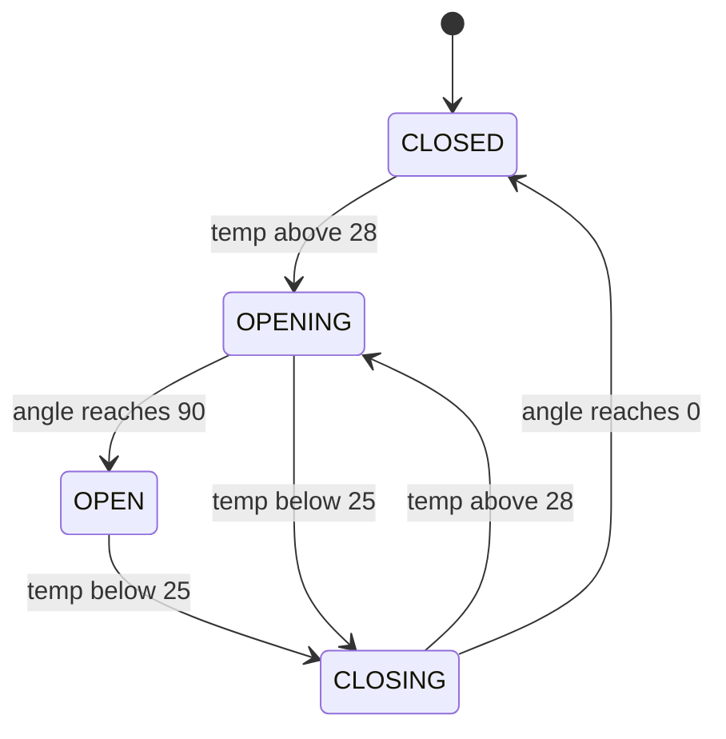

:::objectives
- Map raw ADC readings to percentages with dead zones at the ends.
- Reduce noise by averaging, and measure how much it helps.
- Convert an NTC thermistor reading to °C and detect disconnected or shorted sensors.
- Count button presses from timestamped samples with a settle time.
- Use hysteresis so an alarm doesn't flicker near its threshold.
- Compare tick counts correctly across a wrap-around, and move a servo gradually with a state machine.
:::

Every exercise here is logic that runs on the Pico W, written as plain Python functions so you can test it on this page first. Each solution ends with a note on how to use it on the board.

**Warm-up.** In your head: what voltage does `read_u16()` = 20000 mean? (About 1.01 V: 20000 / 65535 × 3.3.) And what reading would 3.0 V give? (About 59577.)

### Exercise 1: A knob with dead zones

Real potentiometers rarely reach exactly 0 or 65535, so a "fully turned" knob might read 64,800 and never show 100%. Write `knob_percent(raw)` that returns 0 for anything at or below 1000, 100 for anything at or above 64500, and a straight line in between.

```text
raw   500 ->   0.0%
raw  1000 ->   0.0%
raw 32750 ->  50.0%
raw 64500 -> 100.0%
raw 65535 -> 100.0%
```

:::hint
Clamp first, then scale: `(raw - LOW) / (HIGH - LOW) * 100` gives 0 at `LOW` and 100 at `HIGH`. Clamp the raw value into that range before the arithmetic.
:::

:::solution
```python run title="dead_zone.py"
LOW, HIGH = 1000, 64500

def knob_percent(raw):
    raw = max(LOW, min(HIGH, raw))
    return (raw - LOW) / (HIGH - LOW) * 100

for raw in [500, 1000, 32750, 64500, 65535]:
    print(f"raw {raw:>5} -> {knob_percent(raw):5.1f}%")
```

The midpoint of the usable range is 32750, not 32768, because the range itself starts at 1000. On the board, use `knob_percent(knob.read_u16())` anywhere the status panel used `percent()`.
:::

### Exercise 2: How much does averaging help?

A sensor that should read 30000 comes back with random noise. Simulate 400 readings with `random.gauss(30000, 400)` (use `random.seed(7)` so your numbers match), then compare single readings with averages of 8 consecutive readings. Print the standard deviation of each.

```text
single readings:    spread (std dev) 410
averages of 8:      spread (std dev) 134
```

:::hint
`statistics.pstdev(values)` gives the standard deviation. To make averages of 8, slice the list in steps: `readings[i:i + 8]` for `i` in `range(0, 400, 8)`.
:::

:::solution
```python run title="averaging.py"
import random
import statistics

random.seed(7)
readings = [random.gauss(30000, 400) for _ in range(400)]
averages = [sum(readings[i:i + 8]) / 8 for i in range(0, len(readings), 8)]

print(f"single readings:    spread (std dev) {statistics.pstdev(readings):.0f}")
print(f"averages of 8:      spread (std dev) {statistics.pstdev(averages):.0f}")
print(f"improvement:        {statistics.pstdev(readings) / statistics.pstdev(averages):.1f}x (theory: {8 ** 0.5:.1f}x)")
```

Averaging *n* independent readings shrinks random noise by about √n, so 8 readings give roughly a 2.8× improvement and 64 would give 8×. On the board the helper is one line:

```python
from machine import ADC, Pin

def read_average(adc, n=8):
    return sum(adc.read_u16() for _ in range(n)) // n

knob = ADC(Pin(26))
print(read_average(knob))
```
:::

### Exercise 3: A thermistor that reports its own failures

Wokwi's NTC temperature sensor is a 10 kΩ thermistor in series with a 10 kΩ resistor, with a beta coefficient of 3950. Adapted for `read_u16()`, its documented formula is:

`celsius = 1 / (log(1 / (65535 / raw - 1)) / 3950 + 1 / 298.15) - 273.15`

Write `ntc_celsius(raw)` that returns the temperature rounded to one decimal, or `None` when the reading is impossible: a raw value of 0 or 65535 (the formula divides by zero or takes the log of zero there, which usually means a broken or shorted wire), or a result outside −40 to 125 °C.

```text
raw     0 -> None
raw 22700 -> 40.0
raw 32768 -> 25.0
raw 45000 -> 8.3
raw 65535 -> None
```

:::hint
Check the two edge values before doing any math. Then compute, then check the range. Returning `None` lets the caller decide what to show, such as "sensor fault" instead of a fake number.
:::

:::solution
```python run title="thermistor.py"
import math

BETA = 3950

def ntc_celsius(raw):
    if raw <= 0 or raw >= 65535:
        return None
    celsius = 1 / (math.log(1 / (65535 / raw - 1)) / BETA + 1 / 298.15) - 273.15
    if not -40 <= celsius <= 125:
        return None
    return round(celsius, 1)

for raw in [0, 22700, 32768, 45000, 65535]:
    print(f"raw {raw:>5} -> {ntc_celsius(raw)}")
```

In this module, the reading goes **down** as the temperature goes up. On the board, `math.log` exists in MicroPython too, so the same function works unchanged with `ntc_celsius(ADC(Pin(28)).read_u16())`. Module 7's failure planning builds on exactly this habit: a function that can say "I don't know" is safer than one that always returns a number.
:::

### Exercise 4: Count presses from bouncy samples

These `(time_ms, level)` samples record two presses of a button with a pull-up (0 means pressed), with bounce on each press and release. Write `count_presses(samples, settle_ms=20)` that counts a press only when the level has been 0 for at least `settle_ms` since it last changed.

```python
samples = [(0, 1), (100, 0), (102, 1), (104, 0), (106, 1), (108, 0), (300, 1), (303, 0), (305, 1),
           (600, 0), (601, 1), (603, 0), (900, 1)]
```

```text
naive falling edges: 6
debounced presses:   2
```

:::hint
Walk through the samples keeping `level`, `changed_at`, and a `stable` level. A new sample with a different level updates `level` and `changed_at`. Before applying each sample, check whether the *current* level has lasted `settle_ms` up to this sample's time; if so and it differs from `stable`, the stable level changes, and a change to 0 is a press.
:::

:::solution
```python run title="debounce_samples.py"
samples = [(0, 1), (100, 0), (102, 1), (104, 0), (106, 1), (108, 0), (300, 1), (303, 0), (305, 1),
           (600, 0), (601, 1), (603, 0), (900, 1)]

def naive_edges(samples):
    return sum(1 for (_, a), (_, b) in zip(samples, samples[1:]) if a == 1 and b == 0)

def count_presses(samples, settle_ms=20):
    level, changed_at = samples[0][1], samples[0][0]
    stable, presses = level, 0
    for time_ms, new_level in samples[1:]:
        if level != stable and time_ms - changed_at >= settle_ms:
            stable = level
            if stable == 0:
                presses += 1
        if new_level != level:
            level, changed_at = new_level, time_ms
    return presses

print("naive falling edges:", naive_edges(samples))
print("debounced presses:  ", count_presses(samples))
```

The level settles at 0 from 108 ms to 300 ms and from 603 ms to 900 ms, so there are two presses. The short blips at 303 ms and 600 ms never last 20 ms, so they're ignored. On the board, use the same rule with `time.ticks_diff(now, changed_at)` in place of the subtraction, as the status panel's `new_press` does.
:::

:::video IvU8m_30iK0
DigiKey explains switch bounce and demonstrates two hardware fixes, a latch and an RC circuit. Watch for how one press turns into several, then compare: the settle time in this exercise solves the same problem in software, with no extra parts.
:::

### Exercise 5: Stop the alarm from chattering

At dusk the light level drifts around 20% with a little noise, and the status panel's alarm flickers on and off. Generate the light readings below, then compare a single threshold (alarm when below 20) with **hysteresis**: turn on below 18, and turn off only above 24. Count how many times each version switches, and plot both.

```text
single threshold switches: 21
hysteresis switches:       1
```

(Your switch counts depend on the random seed; with the code below they match these.)

:::hint
With hysteresis, the alarm has memory: if it's on, only a reading above 24 can turn it off; if it's off, only a reading below 18 can turn it on. Keep the current state in a variable and update it per reading.
:::

:::solution
```python run alt="Light level drifting from about 30 percent down to 12 percent with noise, with two alarm traces below it: the single-threshold alarm flips on and off about ten times near 20 percent while the hysteresis alarm switches on once and stays on" caption="Hysteresis ignores noise near the threshold."
import math
import random
import matplotlib.pyplot as plt

random.seed(3)
light = [30 - 18 * i / 199 + 2.5 * math.sin(i / 3) * random.random() + random.gauss(0, 1.2) for i in range(200)]

def single(readings, threshold=20):
    return [1 if r < threshold else 0 for r in readings]

def hysteresis(readings, on_below=18, off_above=24):
    alarm, states = 0, []
    for r in readings:
        if alarm == 0 and r < on_below:
            alarm = 1
        elif alarm == 1 and r > off_above:
            alarm = 0
        states.append(alarm)
    return states

def switches(states):
    return sum(1 for a, b in zip(states, states[1:]) if a != b)

a, b = single(light), hysteresis(light)
print("single threshold switches:", switches(a))
print("hysteresis switches:      ", switches(b))

fig, (top, mid, low) = plt.subplots(3, 1, figsize=(7, 4.8), sharex=True)
top.plot(light, color="#4a6fe3")
top.axhline(20, color="#888", linestyle=":")
top.set_ylabel("light %")
mid.step(range(200), a, color="#d9822b")
mid.set_ylabel("single")
mid.set_yticks([0, 1], ["off", "on"])
low.step(range(200), b, color="#2a9d6f")
low.set_ylabel("hysteresis")
low.set_yticks([0, 1], ["off", "on"])
low.set_xlabel("reading number")
fig.tight_layout()
```

The gap between 18 and 24 is wider than the noise, so once the alarm turns on, noise alone can't turn it off. On the board, keep `alarm` as a global variable and run the same `if`/`elif` on each new reading.
:::

### Exercise 6: Survive the tick counter wrapping

On the Pico W, `time.ticks_ms()` counts up to 2³⁰ − 1 and then wraps to 0 (about 12.4 days). Write `ticks_diff(end, start)` the way MicroPython defines it, then show that a timer started just before the wrap is computed correctly, while plain subtraction is wildly wrong.

```text
start = 1073741000, now = 600 (after the wrap)
plain subtraction: -1073740400 ms
ticks_diff:        1424 ms
1000 ms timer due? plain: False  ticks_diff: True
```

:::hint
With `PERIOD = 2 ** 30` and `HALF = PERIOD // 2`, the difference is `((end - start + HALF) % PERIOD) - HALF`. That maps any raw difference into the range from −HALF to HALF − 1.
:::

:::solution
```python run title="ticks_wrap.py"
PERIOD = 2 ** 30
HALF = PERIOD // 2

def ticks_diff(end, start):
    return ((end - start + HALF) % PERIOD) - HALF

start = PERIOD - 824        # 824 ms before the counter wraps
now = 600                   # 600 ms after it wrapped
print(f"start = {start}, now = {now} (after the wrap)")
print("plain subtraction:", now - start, "ms")
print("ticks_diff:       ", ticks_diff(now, start), "ms")
print("1000 ms timer due? plain:", now - start >= 1000, " ticks_diff:", ticks_diff(now, start) >= 1000)
```

A greenhouse monitor that runs for two weeks *will* hit the wrap. With plain subtraction, every timer in the loop would stop firing for the next 12 days. `time.ticks_diff` is built into MicroPython, so on the board you never write this yourself; you just never subtract ticks directly.
:::

### Challenge: A vent that opens gradually without blocking

A servo opens a greenhouse vent. It should open to 90° when the temperature rises above 28 °C and close to 0° when it falls below 25 °C, moving **2° per 20 ms tick** so it doesn't slam. Model it as a state machine with four states and write `step(state, angle, temp)` that returns the new `(state, angle)` for one tick. Simulate 3 seconds (150 ticks) with the temperature at 30 °C for the first second and 22 °C afterwards, printing each state change.



```text
tick   0 (0.00 s): CLOSED -> OPENING at 2°
tick  44 (0.88 s): OPENING -> OPEN at 90°
tick  50 (1.00 s): OPEN -> CLOSING at 88°
tick  94 (1.88 s): CLOSING -> CLOSED at 0°
```

:::hint
Handle the temperature checks first (they can interrupt a movement), then the movement: `OPENING` adds 2 and becomes `OPEN` at 90; `CLOSING` subtracts 2 and becomes `CLOSED` at 0. Keep `step` free of any hardware calls so you can test it here.
:::

:::solution
```python run title="vent.py"
STEP, OPEN_AT, CLOSE_AT = 2, 28, 25

def step(state, angle, temp):
    if temp > OPEN_AT and state in ("CLOSED", "CLOSING"):
        state = "OPENING"
    elif temp < CLOSE_AT and state in ("OPEN", "OPENING"):
        state = "CLOSING"
    if state == "OPENING":
        angle = min(90, angle + STEP)
        if angle == 90:
            state = "OPEN"
    elif state == "CLOSING":
        angle = max(0, angle - STEP)
        if angle == 0:
            state = "CLOSED"
    return state, angle

state, angle = "CLOSED", 0
for tick in range(150):
    temp = 30 if tick < 50 else 22
    before = state
    state, angle = step(state, angle, temp)
    if state != before:
        print(f"tick {tick:>3} ({tick * 0.02:.2f} s): {before} -> {state} at {angle}°")
```

From 0° to 90° in 2° steps takes 45 ticks (ticks 0 to 44), or 0.9 s, and the angle printed with each change is the angle after that tick's step. On the board, call `step` once every 20 ms from the main loop using a `ticks_ms` timer, then send `angle_to_duty(angle)` to the servo; the rest of the loop keeps reading sensors and buttons the whole time the vent is moving.
:::
