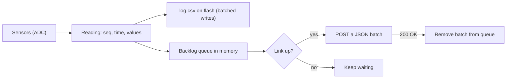

:::objectives
- Connect a Pico W to Wi-Fi in Wokwi and set its clock with NTP, with a fallback when either fails.
- Read a thermistor and a light sensor into timestamped readings with sequence numbers.
- Append readings to a CSV file on the board's flash in batches, and copy the file off the board.
- Test the queue logic in regular Python, including an outage, before deploying it.
- Post batches of JSON readings over HTTP and remove them from the queue only after the server confirms.
:::

In the last lesson's simulation, a queue kept every reading through a 40-minute outage. Now you'll build the real thing on a Pico W. The device reads temperature and light every 2 seconds, logs each reading to a file, and posts them in batches to a web server over Wi-Fi. A slide switch on the breadboard pretends to unplug the network, so you can watch the backlog grow, then drain without losing a single reading.

This is what the Serial Monitor shows around a simulated outage (your numbers will differ):

```text
read 14 | 24.0 C | light 75.6 % | backlog 2
sent 3 readings | backlog 0
read 15 | 24.0 C | light 75.6 % | backlog 1
offline: keeping 3 readings
read 33 | 24.0 C | light 75.6 % | backlog 21
sent 20 readings | backlog 1
```



## Step 1: Wire the sensors and the outage switch

Start a new **Micropython Pico W** project and paste this into `diagram.json`:

```json title="diagram.json"
{
  "version": 1,
  "author": "C4T Hardware Lab",
  "editor": "wokwi",
  "parts": [
    {
      "type": "board-pi-pico-w",
      "id": "pico",
      "top": 0,
      "left": 0,
      "attrs": { "env": "micropython-20260406-v1.28.0" }
    },
    { "type": "wokwi-ntc-temperature-sensor", "id": "temp", "top": -40, "left": 150, "attrs": {} },
    { "type": "wokwi-photoresistor-sensor", "id": "light", "top": 90, "left": 150, "attrs": {} },
    { "type": "wokwi-slide-switch", "id": "net", "top": 40, "left": -170, "attrs": { "value": "1" } },
    { "type": "wokwi-led", "id": "led_backlog", "top": 150, "left": -150, "attrs": { "color": "red", "label": "backlog" } },
    { "type": "wokwi-resistor", "id": "r1", "top": 230, "left": -130, "attrs": { "value": "330" } }
  ],
  "connections": [
    [ "temp:VCC", "pico:3V3", "red", [] ],
    [ "temp:GND", "pico:GND.8", "black", [] ],
    [ "temp:OUT", "pico:GP26", "violet", [] ],
    [ "light:VCC", "pico:3V3", "red", [] ],
    [ "light:GND", "pico:GND.8", "black", [] ],
    [ "light:AO", "pico:GP27", "violet", [] ],
    [ "net:2", "pico:GP12", "blue", [] ],
    [ "net:1", "pico:GND.3", "black", [] ],
    [ "pico:GP15", "r1:2", "orange", [] ],
    [ "r1:1", "led_backlog:A", "orange", [] ],
    [ "led_backlog:C", "pico:GND.4", "black", [] ]
  ],
  "dependencies": {}
}
```

The slide switch's middle pin goes to GP12 with a pull-up. Slid **right** (where `"value": "1"` starts it), nothing pulls GP12 down, so it reads 1 and the code treats the network as available. Slid **left**, it connects GP12 to ground, reads 0, and the code behaves as if the network were unplugged. That gives you an outage on demand without touching Wokwi's Wi-Fi.

## Step 2: Connect, set the clock, and take a reading

Each function does one job and fails gracefully. `connect_wifi` gives up after 15 seconds instead of hanging forever (remember that a Pico W retries a failed connection indefinitely unless you stop waiting). `sync_clock` asks an internet time server for UTC and reports whether it worked.

```python
from machine import Pin, ADC
import network
import ntptime
import math
import time

DEVICE = "greenhouse-01"
temp_adc = ADC(Pin(26))
light_adc = ADC(Pin(27))

def connect_wifi(timeout_ms=15000):
    wlan = network.WLAN(network.STA_IF)
    wlan.active(True)
    wlan.connect("Wokwi-GUEST", "")
    print("Wi-Fi: connecting", end="")
    start = time.ticks_ms()
    while not wlan.isconnected():
        if time.ticks_diff(time.ticks_ms(), start) > timeout_ms:
            print(" gave up for now")
            return wlan
        print(".", end="")
        time.sleep_ms(250)
    print(" connected, IP", wlan.ifconfig()[0])
    return wlan

def sync_clock():
    try:
        ntptime.settime()  # sets the board's clock to UTC
        return True
    except Exception as err:
        print("Clock: NTP failed:", err)
        return False

def iso_utc():
    t = time.gmtime()
    return "{:04d}-{:02d}-{:02d}T{:02d}:{:02d}:{:02d}Z".format(*t[:6])

def ntc_celsius(raw):
    if raw <= 0 or raw >= 65535:
        return None
    c = 1 / (math.log(1 / (65535 / raw - 1)) / 3950 + 1 / 298.15) - 273.15
    return round(c, 1) if -40 <= c <= 125 else None

def take_reading(seq, clock_ok):
    return {
        "device": DEVICE,
        "seq": seq,
        "time": iso_utc() if clock_ok else None,
        "up_ms": time.ticks_ms(),
        "temp_c": ntc_celsius(temp_adc.read_u16()),
        "light_pct": round(100 - light_adc.read_u16() * 100 / 65535, 1),
    }
```

Two details matter later. `time` is `None` until the clock is set, so a reading never carries a believable but wrong date; `up_ms` is always there as a fallback. And `temp_c` uses Module 3's thermistor function, so a disconnected sensor shows up as `None` instead of a nonsense number.

## Step 3: Log to a CSV file in batches

Rows wait in a list and reach the flash five at a time. That's five times fewer writes, which matters for a device meant to run for months.

```python
LOG = "log.csv"
pending_rows = []

def start_log():
    try:
        open(LOG).close()  # the file already exists: keep appending to it
    except OSError:
        with open(LOG, "w") as f:
            f.write("seq,time_utc,up_ms,temp_c,light_pct\n")

def cell(value):
    return "" if value is None else str(value)

def flush_log():
    global pending_rows
    if pending_rows:
        with open(LOG, "a") as f:
            for row in pending_rows:
                f.write(row)
        pending_rows = []

def log(reading):
    keys = ("seq", "time", "up_ms", "temp_c", "light_pct")
    pending_rows.append(",".join(cell(reading[k]) for k in keys) + "\n")
    if len(pending_rows) >= 5:
        flush_log()
```

`open(LOG)` raises `OSError` when the file doesn't exist yet. That's how `start_log` decides whether to write the header, so restarting the program never adds a second header in the middle of the file.

## Step 4: Test the queue logic before it touches the board

The sending rules are where bugs hide: when to send, how much, what to delete. So test the exact same rules in regular Python first. Readings arrive every 2 seconds, a send is attempted every 6 seconds with up to 20 readings, the queue holds at most 100, and the link is down from 40 to 100 seconds:

```python run
SAMPLE_S, SEND_S, BATCH, MAX_BACKLOG = 2, 6, 20, 100

def simulate(seconds=180, outage=(40, 100)):
    backlog, delivered, dropped, sizes = [], [], 0, []
    seq = 0
    for t in range(seconds + 1):
        if t % SAMPLE_S == 0:
            seq += 1
            backlog.append(seq)
            if len(backlog) > MAX_BACKLOG:
                backlog.pop(0)
                dropped += 1
        link_up = not (outage[0] <= t < outage[1])
        if t % SEND_S == 0 and link_up and backlog:
            batch = backlog[:BATCH]
            delivered.extend(batch)       # the server confirmed this batch
            backlog = backlog[len(batch):]
        sizes.append(len(backlog))
    return delivered, dropped, sizes, seq

delivered, dropped, sizes, made = simulate()
print("readings made:     ", made)
print("delivered:         ", len(delivered), "| in order:", delivered == sorted(delivered))
print("dropped:           ", dropped)
print("largest backlog:   ", max(sizes))
print("still queued at end:", sizes[-1])
```

Every reading arrives, in order, and the largest backlog (about 30) is far below the limit of 100. Plotting the backlog makes the outage visible:

```python run alt="Backlog size over 180 seconds: it stays between 0 and 2 while the link is up, climbs steadily to 32 during the outage from 40 to 100 seconds, then drops back to near zero within two send attempts." caption="The backlog grows during the outage and drains in two sends."
import matplotlib.pyplot as plt

plt.figure(figsize=(7.5, 3))
plt.plot(sizes, color="#4a6fe3")
plt.axvspan(40, 100, color="#d9822b", alpha=0.15, label="link down")
plt.xlabel("seconds")
plt.ylabel("readings in backlog")
plt.legend(fontsize=8)
plt.tight_layout()
```

Try changing `MAX_BACKLOG` to 20 and running both cells again: `dropped` becomes nonzero, and `delivered` is missing the oldest outage readings. That's the trade-off from the notes, now measured.

## Step 5: Post batches over HTTP

The board sends each batch as one JSON object to `httpbin.org/post`, a free public test service that replies with a copy of whatever it receives. A reply with status 200 is the confirmation; anything else, including an exception, means "keep the batch and try later."

```python
from machine import Pin
import requests

URL = "https://httpbin.org/post"
link_switch = Pin(12, Pin.IN, Pin.PULL_UP)

def link_up(wlan):
    return link_switch.value() == 1 and wlan.isconnected()

def send_batch(batch):
    try:
        resp = requests.post(URL, json={"device": DEVICE, "readings": batch}, timeout=5)
        ok = resp.status_code == 200
        resp.close()
        return ok
    except Exception as err:  # timeouts, DNS failures, dropped connections
        print("send failed:", err)
        return False
```

Batching is the big efficiency win: one HTTP request carries 20 readings, instead of 20 requests each with their own connection setup. `timeout=5` caps how long a stuck request can freeze the loop. A network call **does** block, which is why sends happen only every 6 seconds and why the sample timer, using `ticks_diff`, simply takes its next reading late rather than skipping it.

:::note
The readings travel through Wokwi's public gateway and a public test service, so they must never contain anything private. Fake greenhouse numbers are fine. MicroPython's `requests` encrypts an `https://` connection, but by default it doesn't verify the server's certificate, so it can't prove who it's talking to. Module 6 deals with trusting the other end.
:::

## Step 6: The finished logger

Put every piece together in `main.py`. The main loop has two timers: one takes a reading every 2 seconds, and the other attempts a send every 6 seconds and retries Wi-Fi and NTP if they failed at start-up.

```python title="main.py"
from machine import Pin, ADC
import network
import ntptime
import requests
import math
import time

time.sleep(0.1)  # let the USB terminal connect

DEVICE = "greenhouse-01"
URL = "https://httpbin.org/post"
SAMPLE_MS, SEND_MS, BATCH, MAX_BACKLOG = 2000, 6000, 20, 100
LOG = "log.csv"

temp_adc = ADC(Pin(26))
light_adc = ADC(Pin(27))
link_switch = Pin(12, Pin.IN, Pin.PULL_UP)  # right = online, left = simulated outage
backlog_led = Pin(15, Pin.OUT)

def connect_wifi(timeout_ms=15000):
    wlan = network.WLAN(network.STA_IF)
    wlan.active(True)
    wlan.connect("Wokwi-GUEST", "")
    print("Wi-Fi: connecting", end="")
    start = time.ticks_ms()
    while not wlan.isconnected():
        if time.ticks_diff(time.ticks_ms(), start) > timeout_ms:
            print(" gave up for now")
            return wlan
        print(".", end="")
        time.sleep_ms(250)
    print(" connected, IP", wlan.ifconfig()[0])
    return wlan

def sync_clock():
    try:
        ntptime.settime()
        return True
    except Exception as err:
        print("Clock: NTP failed:", err)
        return False

def iso_utc():
    t = time.gmtime()
    return "{:04d}-{:02d}-{:02d}T{:02d}:{:02d}:{:02d}Z".format(*t[:6])

def ntc_celsius(raw):
    if raw <= 0 or raw >= 65535:
        return None
    c = 1 / (math.log(1 / (65535 / raw - 1)) / 3950 + 1 / 298.15) - 273.15
    return round(c, 1) if -40 <= c <= 125 else None

def take_reading(seq, clock_ok):
    return {
        "device": DEVICE,
        "seq": seq,
        "time": iso_utc() if clock_ok else None,
        "up_ms": time.ticks_ms(),
        "temp_c": ntc_celsius(temp_adc.read_u16()),
        "light_pct": round(100 - light_adc.read_u16() * 100 / 65535, 1),
    }

pending_rows = []

def start_log():
    try:
        open(LOG).close()
    except OSError:
        with open(LOG, "w") as f:
            f.write("seq,time_utc,up_ms,temp_c,light_pct\n")

def cell(value):
    return "" if value is None else str(value)

def flush_log():
    global pending_rows
    if pending_rows:
        with open(LOG, "a") as f:
            for row in pending_rows:
                f.write(row)
        pending_rows = []

def log(reading):
    keys = ("seq", "time", "up_ms", "temp_c", "light_pct")
    pending_rows.append(",".join(cell(reading[k]) for k in keys) + "\n")
    if len(pending_rows) >= 5:
        flush_log()

def link_up(wlan):
    return link_switch.value() == 1 and wlan.isconnected()

def send_batch(batch):
    try:
        resp = requests.post(URL, json={"device": DEVICE, "readings": batch}, timeout=5)
        ok = resp.status_code == 200
        resp.close()
        return ok
    except Exception as err:
        print("send failed:", err)
        return False

start_log()
wlan = connect_wifi()
clock_ok = wlan.isconnected() and sync_clock()
if clock_ok:
    print("Clock: set from NTP,", iso_utc())

backlog = []
dropped = 0
seq = 0
last_sample = last_send = time.ticks_ms()

while True:
    now = time.ticks_ms()

    if time.ticks_diff(now, last_sample) >= SAMPLE_MS:
        last_sample = now
        seq += 1
        reading = take_reading(seq, clock_ok)
        log(reading)
        backlog.append(reading)
        if len(backlog) > MAX_BACKLOG:
            backlog.pop(0)
            dropped += 1
        print("read", seq, "|", reading["temp_c"], "C | light", reading["light_pct"], "% | backlog", len(backlog))

    if time.ticks_diff(now, last_send) >= SEND_MS:
        last_send = now
        if not wlan.isconnected():
            if wlan.status() != network.STAT_CONNECTING:
                wlan.connect("Wokwi-GUEST", "")  # retry in the background
        elif not clock_ok:
            clock_ok = sync_clock()
        if not link_up(wlan):
            print("offline: keeping", len(backlog), "readings")
        elif backlog:
            batch = backlog[:BATCH]
            if send_batch(batch):
                backlog = backlog[len(batch):]
                print("sent", len(batch), "readings | backlog", len(backlog))

    backlog_led.value(1 if backlog else 0)
    time.sleep_ms(20)
```

Press play. After the Wi-Fi and clock messages, a reading prints every 2 seconds and a batch of about three goes out every 6. Now slide the switch **left**: `offline` messages appear, the backlog climbs, and the red LED stays on. After a minute, slide it **right** again. The next sends carry 20 readings at a time until the backlog is back to a handful.

To check the log, click in the Serial Monitor, press **Ctrl+C**, and type:

```text
>>> flush_log()
>>> print(open("log.csv").read())
seq,time_utc,up_ms,temp_c,light_pct
1,2026-11-16T14:03:14Z,9310,24.0,75.6
2,2026-11-16T14:03:16Z,11310,24.0,75.6
```

Every reading is there, including the ones taken while "offline", because logging happens before any attempt to send. Copy the output into a file on your computer for the next lesson's analysis. (On a real Pico W, `mpremote cp :log.csv .` copies the file directly.) Click the temperature sensor while the simulation runs and drag its slider to give yourself more interesting data.

:::video FmpWi5a0yIU
Core Electronics connects a real Pico W to Wi-Fi and queries websites for text data in MicroPython. Watch for how they wait for the connection, and for their point about how little memory the Pico W has for web content.
:::

:::quiz
Q: Why does the logger remove readings from the backlog only after `send_batch` returns `True`?
- [ ] Removing them first would be slower
  Speed isn't the concern. The order decides whether data can be lost.
- [x] If the send fails partway, the readings are still in the queue and go out on the next attempt
  Deleting only after the server confirms is what makes store and forward lossless.
- [ ] `requests.post` deletes them automatically
  `requests` knows nothing about your queue.

Q: Why does each reading carry `seq` as well as `time`?
- [x] The receiver can detect missing or duplicated readings even if the clock was never set
  Sequence numbers count readings directly, so a gap from 41 to 57 is obvious whatever the timestamps say.
- [ ] HTTP requires a sequence number
  HTTP has no such rule. It's a choice made for the data.
- [ ] It makes the CSV file sort alphabetically
  Sorting isn't the purpose; detecting gaps is.

Q: The log writes to flash every 5 readings instead of every reading. What's the trade-off?
- [ ] There isn't one; it's strictly better
  If the power fails, up to four unwritten rows in memory are lost.
- [x] Fewer flash writes and less wear, at the risk of losing the last few rows on a sudden power cut
  Real loggers pick the batch size from how valuable the newest data is versus how long the flash must last.
- [ ] It saves Wi-Fi bandwidth
  The CSV file stays on the board; it never goes over Wi-Fi.
:::

:::takeaways
- Connect with a timeout, set the clock with NTP, and mark the time as unknown when that fails.
- Every reading gets a `seq` number and an uptime, so gaps and order can be checked without trusting the clock.
- Log first, send second: the local CSV file keeps every reading even when the network doesn't.
- Batch both the flash writes and the HTTP posts; one request with 20 readings beats 20 requests.
- Delete from the queue only after the server confirms; cap the queue and drop the oldest when it's full.
- Test the queue rules in regular Python, with an outage, before running them on the board.
:::

## Ideas to extend it

-   Save the backlog to a file whenever the link goes down, and reload it at start-up, so a reboot during an outage doesn't lose the queue.
-   Back off when sends fail: wait 6 s, then 12, then 24, up to a minute, so a broken server isn't hammered.
-   Send a reading immediately (instead of waiting for the batch) when the temperature changes by more than 2 °C since the last one sent.
-   Read the reply with `resp.json()` and check that httpbin echoed back the same `seq` numbers you sent.

## Further reading

-   [MicroPython's network.WLAN reference](https://docs.micropython.org/en/latest/library/network.WLAN.html): connecting, checking status, and the station and access-point modes.
-   [Wokwi's WiFi networking guide](https://docs.wokwi.com/guides/esp32-wifi): how the virtual Wokwi-GUEST network and the public gateway work. It's written for the ESP32, and the network is the same one your simulated Pico W joins.
-   [MicroPython's mpremote tool](https://docs.micropython.org/en/latest/reference/mpremote.html): copying files to and from a real board, running scripts, and opening a REPL from your terminal.
