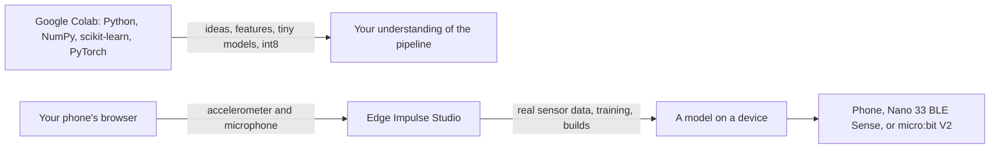

:::objectives
- Open Google Colab and run Python in it without installing anything.
- Create a private Edge Impulse project and find your way around its menu.
- Connect your phone to Edge Impulse as a free accelerometer and microphone.
- Prepare an Arduino Nano 33 BLE Sense or a micro:bit V2 if you own one, and fix the setup problems people hit most.
:::

The Arduino Nano 33 BLE Sense is smaller than a stick of gum. It has 256 KB of RAM, less than a single photo from your phone, and yet it can hear a spoken word, feel a gesture, and react in a few milliseconds with no internet connection at all. Getting a model to fit in a space that small is what TinyML is about, and it's what this course teaches.

You don't need the board. Every lesson works with two free tools and the phone you probably already carry.

## Three tools, three jobs



- **Google Colab** is a Jupyter notebook that runs on a Google computer and shows up in your browser. NumPy, scikit-learn, matplotlib, SciPy, and PyTorch come preinstalled. This is where you'll build windows, features, classifiers, and quantized models yourself, line by line.
- **Edge Impulse Studio** is a web tool that does the same pipeline at production scale: it collects data from real sensors, extracts features, trains, estimates memory and latency for a chip, and builds the result for a device. Its **Developer** plan is free.
- **Your phone** can join an Edge Impulse project as a sensor through its web browser, so you can record real motion and sound without any hardware.

## Step 1: Open Google Colab

1. Go to [colab.research.google.com](https://colab.research.google.com/) and sign in with a Google account.
2. In the window that opens, choose **New notebook**. (If no window appears, use **File › New notebook in Drive**.)
3. Click the name **Untitled0.ipynb** at the top left and rename it `tinyml-setup.ipynb`. Colab saves it in a folder called **Colab Notebooks** in your Google Drive.
4. Click inside the first cell, type `print("hello, edge")`, and press **Shift+Enter**. The first run takes a few seconds while Colab connects you to a computer, and then the text appears under the cell.

Colab works the same on Windows, macOS, ChromeOS, and Linux, in Chrome, Edge, Firefox, or Safari. You'll run the real version check in the next lesson.

:::note
Some school Google accounts have Colab switched off by the school's administrator. If you see a message saying Colab isn't available for your account, use a personal Google account instead, or ask your teacher whether it can be turned on.
:::

## Step 2: Create an Edge Impulse account and a private project

Edge Impulse's terms of service say account holders must be **at least 18**. If you're younger, ask a parent, guardian, or teacher to create the account and the project, then work in it together. If that isn't possible, skip the Edge Impulse parts: every lesson's Colab code teaches the same idea without it.

1. Go to [studio.edgeimpulse.com/signup](https://studio.edgeimpulse.com/signup) and sign up. Confirm the email address if asked.
2. Create a new project and name it `tinyml-course-motion`. If you're asked whether it should be public or private, choose **private**. The free plan allows 3 private projects and unlimited public ones, and a public project shares all of its data with anyone.
3. The project opens on its **Dashboard**.

The Developer plan gives each training job up to 60 minutes of compute, which is far more than any model in this course needs.

## Step 3: Tour the project menu

The menu on the left follows the order you'll build things in. You don't need to click everything now, but find each of these:

| Menu item | What happens there |
| --- | --- |
| **Dashboard** | Project settings, collaborators, and the project ID |
| **Devices** | Phones and boards connected to the project, with a green dot when online |
| **Data acquisition** | Recording new samples and browsing your training and test data |
| **Create impulse** | Choosing the window size, the feature extraction block, and the learning block |
| **Live classification** | Sending new data from a device through your trained model |
| **Model testing** | Running the model on the test set you held back |
| **Deployment** | Building the model as an Arduino library, C++ code, firmware, or a phone app |

Near the top of the page there's also a **target device** setting (it starts at a Cortex-M4F at 80 MHz). Studio uses it to estimate how much RAM, flash, and time your model would need on that chip, which becomes important in later modules.

## Step 4: Connect your phone as a sensor

1. Open **Devices** and choose **Connect a new device**.
2. Pick **Mobile phone**. A QR code appears.
3. Scan it with your phone's camera and open the link. The page on your phone should say it's connected.
4. Back on the **Devices** page, your phone is listed with a green dot.

When you record data later, the phone asks for permission to use its motion sensors or microphone. Allow it only while you're recording.

:::video lVr4pGeSQKg
What to watch for: the path from a new project to the Devices page. Studio's layout has changed a little since this was recorded, so match the menu names to the table above rather than the exact screen positions.
:::

## Optional: set up an Arduino Nano 33 BLE Sense

Skip this section if you don't have the board. You need a **micro-USB data cable** (some cables only carry power and the computer will never see the board), the **Edge Impulse CLI**, and the **Arduino CLI**, which the flashing script uses behind the scenes.

:::tabs
@tab Windows
1. Install Node.js (version 22 LTS is recommended) from [nodejs.org](https://nodejs.org/en/download). When the installer offers **Tools for Native Modules**, tick it.
2. Install the Arduino CLI with the **Windows msi** installer from the [Arduino CLI installation page](https://arduino.github.io/arduino-cli/latest/installation/).
3. Open **Command Prompt** (Edge Impulse recommends it over PowerShell for this tool) and run:

```bash
npm install -g edge-impulse-cli --force
```
@tab macOS
1. Install Node.js 22 LTS from [nodejs.org](https://nodejs.org/en/download).
2. Install the Arduino CLI with Homebrew (or use the macOS download on the Arduino CLI installation page):

```bash
brew update
brew install arduino-cli
```

3. Install the Edge Impulse CLI:

```bash
npm install -g edge-impulse-cli
```
@tab Linux
1. Install Node.js 22, GNU Screen, and the Edge Impulse CLI:

```bash
curl -sL https://deb.nodesource.com/setup_22.x | sudo -E bash -
sudo apt-get install -y nodejs screen
npm install -g edge-impulse-cli
```

If `npm install -g` fails with a permission error, follow the "change npm's default directory" steps in the Edge Impulse install guide linked at the bottom of this page, then run it again.

2. Install the Arduino CLI with its install script, then make sure the folder it creates is on your PATH:

```bash
curl -fsSL https://raw.githubusercontent.com/arduino/arduino-cli/master/install.sh | sh
```
:::

Then flash the Edge Impulse firmware and connect:

1. Plug in the board and **press RESET twice quickly**. An LED on the board starts to pulse, which means the board is waiting for new firmware.
2. Download the [Edge Impulse firmware for this board](https://cdn.edgeimpulse.com/firmware/arduino-nano-33-ble-sense.zip), unzip it, and run the script for your system: `flash_windows.bat`, `flash_mac.command`, or `flash_linux.sh`.
3. When it finishes, press RESET once.
4. In a terminal, run `edge-impulse-daemon`, log in, and pick your project. The board now appears under **Devices**.

The same firmware works on the original board and the Rev2. You can tell them apart by the text printed on the underside: the Rev2 says *NANO 33 BLE SENSE REV2*.

## Optional: set up a micro:bit V2

The micro:bit isn't on Edge Impulse's list of supported boards, but the free [micro:bit CreateAI](https://createai.microbit.org/) tool runs the same collect, train, and deploy loop for motion. It needs no account. Open it in Chrome or Edge on a laptop or Chromebook, connect the micro:bit over Bluetooth (or with a second micro:bit plugged in by USB as a radio link), record one-second samples of at least two actions, and train. You then code with the model in MakeCode and download it to the micro:bit, where it runs with no computer attached. Only a **V2** can run the model.

## When something goes wrong

:::warning
**The phone connects, but Data acquisition records nothing (Chrome on Android).** Chrome may be blocking motion sensors for the site. Open Chrome's **Settings › Site settings › Motion sensors** and allow them, then reload the page from the QR code.
:::

:::warning
**`edge-impulse-daemon` can't find the board, or says the port is busy.** Only one program can talk to the board's serial port at a time. Close the Arduino IDE's Serial Monitor and any other terminal running an Edge Impulse tool, unplug the board, plug it back in, and try again. If the computer never sees the board at all, swap the cable for one you know carries data.
:::

:::warning
**`bad CPU type in executable` while flashing on an Apple silicon Mac.** One of the flashing tools is built for Intel Macs and needs Rosetta 2. Install it with `softwareupdate --install-rosetta --agree-to-license` and run the flash script again.
:::

:::warning
**`npm install` fails on Windows with a message about Visual Studio Build Tools.** Part of the CLI is compiled during install. Re-run the Node.js installer with **Tools for Native Modules** ticked, then run the install command again in Command Prompt.
:::

You're ready for the next lesson when a Colab cell prints text and Edge Impulse shows your phone under **Devices** with a green dot.

## Further reading

- [Edge Impulse: Mobile phone](https://docs.edgeimpulse.com/hardware/devices/mobile-phone): the official steps for connecting a phone, including the classification mode you'll use later.
- [Edge Impulse: Arduino Nano 33 BLE Sense](https://docs.edgeimpulse.com/hardware/boards/arduino-nano-33-ble-sense): firmware, flashing, and deployment notes for both board revisions.
- [Edge Impulse CLI installation](https://docs.edgeimpulse.com/tools/clis/edge-impulse-cli/installation): troubleshooting for every install error the CLI is known to produce.
