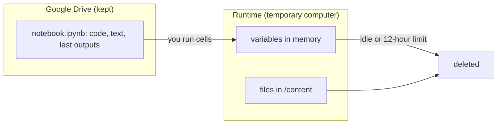
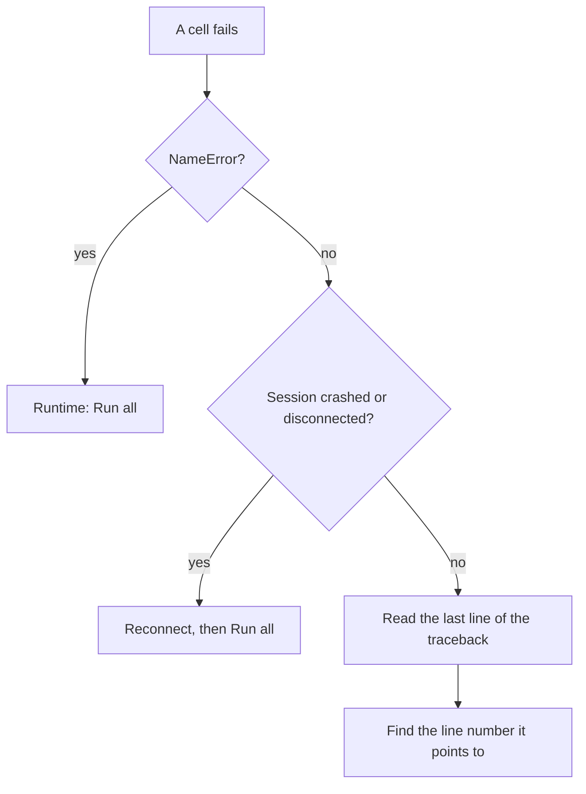

:::objectives
- Explain the difference between a Colab notebook (kept in Drive) and its runtime (deleted when idle).
- Organize the course's notebooks and data so you can rerun any lesson months later.
- Decide what sensor data you may record, keep, and share, and set an Edge Impulse project up to match.
- Handle a development board and its power safely.
- Diagnose the Colab and Edge Impulse problems you're most likely to hit.
:::

You train a model on Monday, close the laptop, and on Tuesday you open the same notebook and run the cell that tests it. Colab answers with this:

```python run raises title="Tuesday's first cell"
predictions = model.predict(test_windows)
```

The code is still there. Your outputs from Monday are still printed under the cells. But the variables are gone, so the very first name Python looks up, `model`, doesn't exist. Once you know why, it takes five seconds to fix.

## The notebook is kept, the runtime is not



A Colab notebook has two halves. The **notebook file** lives in your Google Drive and keeps your code, your text, and the output each cell printed last time. The **runtime** is a temporary virtual machine that actually executes the code. It holds your variables and any files you created in `/content`. Colab deletes a runtime after it has been idle for a while, and on the free tier no runtime lasts more than 12 hours.

So the fix for Tuesday's `NameError` is **Runtime › Run all**, which rebuilds every variable in order. Get in the habit of choosing **Runtime › Restart session** and then **Run all** before you trust a result. It proves the notebook works from top to bottom, not just in the order you happened to click.

## Organize the course so you can rerun it

- **One notebook per lesson**, named after it: `m3-l2-gesture-windows.ipynb`, `m4-l2-keyword-int8.ipynb`. Keep them together in one Drive folder called `TinyML course` (new notebooks land in **Colab Notebooks**, so drag them across in Google Drive).
- **Make data in code, not by hand.** Every dataset in this course is generated by a cell or recorded in Edge Impulse, so rerunning the notebook recreates it.
- **Seed your randomness.** Synthetic data uses NumPy's random generator. Give it a seed and the "random" numbers repeat exactly:

```python run title="seeds.py"
import numpy as np

a = np.random.default_rng(seed=7).normal(size=3)
b = np.random.default_rng(seed=7).normal(size=3)
c = np.random.default_rng().normal(size=3)       # no seed

print("a:", a.round(3))
print("b:", b.round(3))
print("a and b identical:", np.array_equal(a, b))
print("a and c identical:", np.array_equal(a, c))
```

Without the seed, `c` is different every run, and so is any accuracy you compute from it. When you're comparing two versions of a model, a seed makes sure the only thing that changed is the thing you changed.

- **Save files you want to keep in Drive, not `/content`.** A cell can connect your Drive to the runtime, after which anything saved under `/content/drive/MyDrive` survives:

```python
from google.colab import drive
drive.mount("/content/drive")
np.save("/content/drive/MyDrive/TinyML course/windows.npy", windows)
```

Colab asks you to approve access the first time. For this course you rarely need it, because the data is regenerated by code.

- **Back up.** **File › Download › Download .ipynb** saves a copy to your computer. In Edge Impulse, the **Versioning** page stores a snapshot of a project's data and settings that you can return to.

## Sensor data is personal data

It's easy to think of accelerometer numbers as harmless. They aren't always. The way a person walks is distinctive enough to identify them, a day of motion data shows when they sleep and leave the house, and a microphone records everyone in the room, not just the person who pressed **Start sampling**. Edge AI is often chosen *because* it can keep data like this on the device, a trade-off you'll measure in Module 7.

Four rules for this course:

1. **Record only yourself, or people who agreed first** after you told them what you're recording and why.
2. **Keep Edge Impulse projects private.** A public project publishes all of its data. Edge Impulse's terms also forbid content involving minors in public projects, so never make a project public if it holds recordings of anyone under 18.
3. **Label by class, not by person.** Use labels like `wave` or `idle`, never someone's name.
4. **Delete what you don't need.** When a project is finished, remove raw recordings of voices or faces you no longer use.

Sharing a Colab notebook shares its printed outputs too. If an output shows something you'd rather not share, use **Edit › Notebook settings** and tick **Omit code cell output when saving this notebook** before sharing.

## Handle boards safely

The Nano 33 BLE Sense and the micro:bit run on low voltages from USB and are safe to touch, but they can still be damaged, or damage things.

- **Power them from a computer USB port or a phone charger**, through the board's own connector. Never connect a power supply directly to the pins unless a lesson's wiring diagram says exactly how.
- **Keep a bare board off metal surfaces**, keys, and loose wires. The pins on the underside can short against metal and destroy the board.
- **Touch a grounded metal object before handling a board** in dry weather, so a static spark doesn't hit the chip.
- **Treat lithium batteries with care** if you use one later. Use a charger made for that battery, don't charge one unattended, and stop using any battery that swells, gets hot, or is dented.
- **Unplug before changing any wiring**, and plug back in only after checking it.

## Make the tools work for you

Colab is fully usable from the keyboard. **Shift+Enter** runs a cell and moves to the next one, **Ctrl+Enter** (Cmd+Enter on a Mac) runs it and stays put, and **Ctrl+M H** shows the full list of shortcuts. Browser zoom (**Ctrl** and **+**) enlarges both code and charts.

Every chart in this course has a text description, and the lessons print the key numbers next to each chart so nothing depends on color alone. When you draw your own charts, give each line a different style as well as a different color (`linestyle="--"`), or switch to a palette designed for color-vision deficiency with `plt.style.use("tableau-colorblind10")`.

:::video inN8seMm7UI
What to watch for: how a notebook connects to a runtime, and where Colab saves your work. The interface is older than today's, but the ideas are the same.
:::

## Getting unstuck



| What you see | What it means | What to do |
| --- | --- | --- |
| `NameError: name 'x' is not defined` | The cell that creates `x` hasn't run in this session | **Runtime › Run all** |
| A cell shows a spinning icon for minutes | A loop is too slow or never ends | **Runtime › Interrupt execution**, then shrink the data or fix the loop |
| "Your session crashed after using all available RAM" | An array got far bigger than intended | Check the shape of your arrays; a window count in the millions is usually a stride of 1 by mistake |
| `ModuleNotFoundError` for a course library | The runtime didn't start cleanly | **Runtime › Restart session**, then run again |
| Phone shows as offline in **Devices** | The phone's screen locked or the tab closed | Unlock it and reopen the page from the QR code |
| Edge Impulse job fails or stops | A training run hit an error or the job time limit | Read the job log at the bottom of the page; reduce the training cycles and try again |

:::tip
When you ask for help, in a forum or from a teacher, include three things: the last line of the error, the cell that produced it, and what you expected to happen. Most problems get solved from those three alone.
:::
