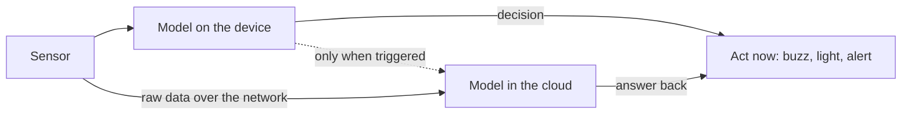
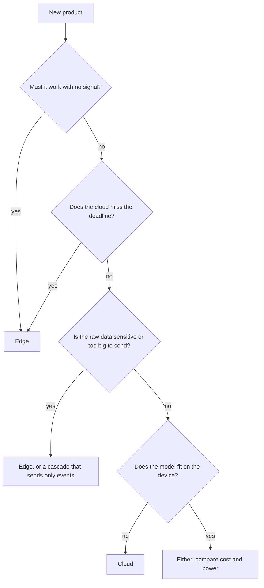

:::objectives
- Explain the difference between edge inference, cloud inference, and a cascade that uses both.
- Calculate cloud and on-device latency for a payload, including upload time.
- Calculate how much raw data a sensor produces per day and compare it with sending only decisions.
- Estimate how radio use changes battery life, using stated assumptions.
- Apply a decision flow that weighs latency, bandwidth, privacy, power, cost, and connectivity.
:::

A phone's microphone produces 16,000 numbers every second. Apple's description of "Hey Siri" starts there: the phone turns your voice into "a stream of instantaneous waveform samples, at a rate of 16000 per second." If the phone shipped all of that to a server just to check for two words, it would upload gigabytes a day, mostly the sound of a quiet room, and keep its radio awake the whole time.

So it doesn't. A small neural network runs on a low-power processor inside the phone and listens for the trigger phrase. Only when it fires does the phone wake its main processor, check again with a bigger model, and finally send your request to Apple's servers, where the heavy speech recognition happens. That design, a tiny model on the device deciding when to call a big model in the cloud, is a pattern you'll meet again and again in edge AI. To choose it (or not) for your own device, you need numbers.

## Two places to run the same model

**Inference** means using a trained model to make a prediction. (Training usually happens on a big computer either way.) The question here is where inference happens.



- **Edge inference**: the model runs on the device that holds the sensor. Only the decision, if anything, leaves.
- **Cloud inference**: the device sends raw data (or features) to a server, which runs the model and sends an answer back.
- **Cascade**: a small edge model filters the stream and wakes a larger cloud model only for the moments that matter. Wake words work this way.

Six factors decide between them. Three of them you can calculate directly, so start there.

## Latency: count the whole round trip

On a device, latency is roughly the time the model takes to run. In the cloud you also pay to **upload** the data, wait for the network **round trip**, and wait for the **server**. Upload time is the one people forget, and it grows with the payload:

upload time = bytes × 8 ÷ link speed in bits per second

```python run title="latency"
def upload_ms(payload_bytes, uplink_mbps):
    return payload_bytes * 8 / (uplink_mbps * 1_000_000) * 1000

def cloud_ms(payload_bytes, uplink_mbps, round_trip_ms, server_ms):
    return upload_ms(payload_bytes, uplink_mbps) + round_trip_ms + server_ms

#  name,                        bytes,  Mbit/s, RTT ms, server ms, on-device ms
cases = [
    ("fall: 2 s of motion",      1_200,   5,     70,     10,        15),
    ("wake word: 1 s of audio", 32_000,   5,     70,     20,        40),
    ("wildlife photo",       2_000_000,   0.5,  400,     50,       900),
]
print(f"{'case':<26}{'cloud':>10}{'edge':>10}")
for name, size, mbps, rtt, server, device in cases:
    print(f"{name:<26}{cloud_ms(size, mbps, rtt, server):>8.0f}ms{device:>8.0f}ms")
```

The link speeds and timings are typical round numbers, not measurements, so change them and rerun. Notice what they show. For the 1,200-byte motion window, the cloud is slower but still under a tenth of a second, which is fine for most jobs. For a 2 MB photo on a slow rural link, upload alone takes 32 seconds, while a small image model on the camera answers in under one. **Payload size times link speed** usually decides latency, not how fast the server is.

## Bandwidth: raw sensor data adds up

A sensor that streams produces data every second of every day. Multiply it out:

```python run title="data per day" alt="Bar chart on a log scale of megabytes per day: accelerometer about 52, microphone about 2,765, camera about 4,320, and sending only events about 0.001." caption="Streaming raw data vs sending only decisions, per device per day"
import numpy as np
import matplotlib.pyplot as plt

SECONDS_PER_DAY = 24 * 60 * 60
streams = {                                      # bytes produced per second
    "accelerometer\n100 Hz, 3 axes": 100 * 3 * 2,  # 2 bytes per reading
    "microphone\n16 kHz": 16_000 * 2,
    "camera, 1 photo/s\n(~50 KB JPEG)": 50_000,
    "events only\n(20 B, 50/day)": 20 * 50 / SECONDS_PER_DAY,
}
for name, rate in streams.items():
    print(f"{name.splitlines()[0]:<18}{rate * SECONDS_PER_DAY / 1e6:>12,.3f} MB per day")

plt.figure(figsize=(8, 3.2))
names = list(streams)
plt.bar(names, [streams[n] * SECONDS_PER_DAY / 1e6 for n in names],
        color=["#4C72B0", "#4C72B0", "#4C72B0", "#55A868"])
plt.yscale("log")
plt.ylabel("MB per day (log scale)")
plt.title("Raw sensor data vs sending only decisions")
```

A microphone streams about 2.8 GB a day. Sending 50 short event messages instead ("door knock at 14:02") costs about a kilobyte, roughly a million times less. Bandwidth costs money on a cellular plan, and on some links it's simply not available: long-range radios like LoRa carry messages of tens to a few hundred bytes, a few times an hour. A wildlife camera on that kind of link *can't* send photos, only counts like "3 deer, 1 fox".

## Power: the radio is the expensive part

On a battery device, sending data usually costs far more energy than computing on it, because a radio has to stay powered while it connects and transmits. The next cell compares streaming everything with deciding on the device. Every number in `assume` is a rough, typical value, not a datasheet figure, and the point is the ratio.

```python run title="battery"
assume = {
    "radio_mw": 500,        # cellular modem while transmitting
    "mcu_mw": 15,           # microcontroller while running a model
    "idle_mw": 0.5,         # sensor plus sleep, always on
    "inference_ms": 20,     # one model run
    "windows_per_s": 2,     # a new window every 0.5 s
    "events_per_day": 5,    # reports the device actually sends
    "radio_s_per_event": 1, # radio on-time per report, including connecting
}
a = assume
battery_j = 1.0 * 3.7 * 3600            # 1000 mAh at 3.7 V = 13,320 joules

stream_mw = a["idle_mw"] + a["radio_mw"]  # radio never sleeps
edge_mw = (a["idle_mw"]
           + a["mcu_mw"] * a["inference_ms"] / 1000 * a["windows_per_s"]
           + a["radio_mw"] * a["radio_s_per_event"] * a["events_per_day"] / SECONDS_PER_DAY)

for name, mw in (("stream everything", stream_mw), ("decide on device", edge_mw)):
    hours = battery_j / (mw / 1000) / 3600
    print(f"{name:<18} average {mw:8.2f} mW   battery lasts {hours:7.1f} h ({hours / 24:.1f} days)")
```

The edge version runs its model twice a second and still lasts months, because the microcontroller works for 20 ms and then sleeps, and the radio wakes only five times a day. Streaming keeps the radio on, so the same battery is flat before the end of a school day. Module 7 measures this properly with duty cycles.

## Privacy, cost, and connectivity

The last three factors are harder to put in one formula, but just as decisive.

**Privacy.** Data that never leaves the device can't leak in transit, can't be breached on a server, and can't be reused for something you didn't agree to. A smart doorbell that sends "person at door" reveals much less than one that streams video. Edge isn't automatically private, though: a stolen device still holds whatever it stored, and a firmware update can change what gets sent. The real principle is **send the least data that does the job**.

**Cost.** Cloud inference has a running cost per prediction, multiplied by every device, every day, for as long as the product exists. Edge inference moves the cost into the hardware: a chip with enough memory, and the engineering time to make the model fit.

**Connectivity.** Some devices have to work where there's no signal. Apple's fall detection is a good example: the watch detects the hard fall and starts the alert itself, and needs a cellular, Wi-Fi, or satellite link only to place the emergency call. A fall detector that needed the cloud to *notice* the fall would fail in a basement or on a hiking trail.

The cloud's big advantage is size. A server can run a model thousands of times larger than any microcontroller can hold, and you can update it without touching a single device.

## A decision flow you can reuse



Here's the same logic as a function, with one addition: if something forces the edge but the model doesn't fit, the answer isn't "cloud", it's "make the model smaller", which is what Modules 4 and 5 teach. Step through it for a fall detector that must work offline.

:::trace Follow the decision for a fall detector
```python
def where_to_run(offline_needed, deadline_ms, cloud_ms, sensitive, fits):
    reasons = []
    if offline_needed:
        reasons.append("works with no signal")
    if cloud_ms > deadline_ms:
        reasons.append("cloud misses deadline")
    if sensitive:
        reasons.append("raw data is sensitive")
    if not fits:
        if reasons:
            return "shrink the model", reasons
        return "cloud", ["too big for device"]
    if reasons:
        return "edge", reasons
    return "either", ["compare cost"]

choice, why = where_to_run(True, 1000, 95, False, True)
print(choice, why)
```
:::

The 95 ms cloud latency easily meets a 1-second deadline, so latency adds no reason. The single reason is connectivity, and it's enough.

:::video QXuvUW4B7jU
What to watch for: the reasons the video gives for moving inference onto devices, and which of them match the six factors here. Notice which examples are about latency and which are about bandwidth or privacy.
:::

## Mistakes that flip the answer

:::warning
**Mixing up bits and bytes.** Link speeds are quoted in **bits** per second (Mbit/s), file sizes in **bytes**. Forget the × 8 and every upload looks eight times faster than it is:

```python run title="bits vs bytes"
photo_bytes, link_mbps = 2_000_000, 0.5
wrong = photo_bytes / (link_mbps * 1_000_000)
right = photo_bytes * 8 / (link_mbps * 1_000_000)
print(f"wrong: {wrong:.0f} s   right: {right:.0f} s")
```

An answer of 4 seconds might pass a design review that 32 seconds would fail.
:::

:::warning
**Planning with the average network instead of the worst one.** A 70 ms round trip is typical on a good connection, but phones on a weak signal see seconds, and sometimes no connection at all. If missing a deadline is dangerous, design for the bad case.
:::

:::warning
**Treating "edge" as free.** The model still has to fit in the device's flash and RAM and run fast enough on its processor. A 50 MB model can't move onto a chip with 1 MB of flash just because the privacy argument is good.
:::

:::quiz
Q: A doorbell sends a 150 KB photo whenever it sees motion, over a 2 Mbit/s uplink with an 80 ms round trip and 50 ms of server time. About how long until the answer comes back?
- [ ] 130 ms
  That counts the round trip and the server but leaves out the upload, which is the biggest part.
- [ ] 205 ms
  This treats 150 KB as 150,000 bits. Bytes must be multiplied by 8 first.
- [x] 730 ms
  150,000 × 8 = 1.2 million bits, which takes 600 ms at 2 Mbit/s; add 80 ms and 50 ms.

Q: A voice assistant must answer open-ended questions, but you don't want everything the microphone hears sent to a server. Which design fits?
- [ ] Stream all audio to the cloud, encrypted
  Encryption protects data on the way, but the server still receives every sound in the room.
- [x] A wake-word model on the device that opens the cloud connection only after it hears the trigger
  The cascade keeps ordinary room audio local while still letting a big cloud model handle real questions.
- [ ] Run the full assistant on the microcontroller
  A model that answers open-ended questions is far too large for a microcontroller's memory.

Q: A sensor in a factory has wired power and Ethernet, reports once a minute, has no deadline tighter than a minute, and needs a 50 MB model. Where should it run?
- [ ] On the sensor, because edge is always more efficient
  Nothing here needs the edge, and the model wouldn't fit on a small device anyway.
- [x] In the cloud (or on a local server)
  It has a reliable link, plenty of time, and a model too big for a microcontroller, so nothing forces it onto the device.
- [ ] It must be shrunk to fit on the sensor
  Shrinking is the answer only when something forces edge inference, and nothing does here.

Q: In the battery cell, why does streaming drain the battery so much faster even though the cloud does all the computing?
- [ ] Servers draw power from the device
  The server's power comes from the data center, not from the device's battery.
- [x] The radio stays on all the time, and it draws far more power than the microcontroller does while running a model
  Running the model costs 15 mW for 20 ms at a time; the radio costs 500 mW for as long as it's on.
- [ ] Streaming needs a bigger model
  The model's size isn't the issue; the energy goes into transmitting data.
:::

:::takeaways
- **Edge** inference runs the model next to the sensor; **cloud** inference sends data to a server; a **cascade** uses a small edge model to decide when to call a big cloud one.
- Cloud latency = upload (bytes × 8 ÷ bit rate) + round trip + server time, and the upload often dominates.
- Raw sensors produce megabytes to gigabytes a day; sending only decisions can cut that a millionfold.
- On batteries the radio usually costs more energy than the computing, so deciding locally can stretch battery life from hours to months.
- Privacy, running cost, and offline operation often settle the question even when latency doesn't, and a model that doesn't fit has to be made smaller, not wished onto the device.
:::

## Further reading

- [Hey Siri: An On-device DNN-powered Voice Trigger](https://machinelearning.apple.com/research/hey-siri), Apple Machine Learning Research: a detailed description of a real cascade, from 16 kHz samples to a two-stage detector on a low-power processor.
- [Why the Future of Machine Learning is Tiny](https://petewarden.com/2018/06/11/why-the-future-of-machine-learning-is-tiny/), Pete Warden: the energy argument for TinyML from one of the people who started the field.
- [What is edge AI?](https://docs.edgeimpulse.com/knowledge/courses/edge-ai-fundamentals/what-is-edge-ai), Edge Impulse: benefits, limits, and examples from the Edge AI Fundamentals course.
