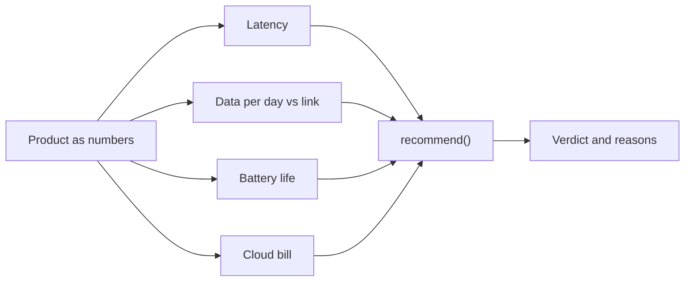

:::objectives
- Turn a product idea into a small set of numbers a calculation can use.
- Compute latency, daily data volume, link capacity, battery life, and cloud cost for each product.
- Write a `recommend()` function that returns a verdict and the reasons for it.
- Change one assumption and see which verdicts move.
:::

Design reviews for connected devices tend to go in circles. One person says "the cloud is simpler," another says "edge is more private," and nobody has a number. This build ends the argument with a calculator. You'll describe three products as Python dictionaries, run five calculations on each, and get a report like this one, every line of which comes from code you write:

```text
WILDLIFE CAMERA: edge
   - cloud takes 81,550 ms; deadline is 60,000 ms
   - raw stream is 8x what the link can carry
   - raw data is sensitive
   - battery: 1.6 days streaming vs 26 days on device
```



Open a new Colab notebook called `m2-l2-edge-or-cloud.ipynb` and add each cell as you go.

## Step 1: Describe each product as numbers

Every number below is a stated assumption, chosen to be realistic in size. That's the honest way to do early design: write the assumption down where everyone can see it and change it.

```python run title="step 1: products"
DAY = 24 * 3600

products = {
    "smart speaker": dict(
        stream_bytes_per_s=32_000, payload_bytes=32_000, decisions_per_s=4,
        events_per_day=20, link_mbps=20, round_trip_ms=40, server_ms=20,
        device_ms=30, deadline_ms=300, offline_needed=False, sensitive=True,
        battery_wh=None, sensor_mw=1, model_kb=80, flash_kb=1024),
    "fall-detection pendant": dict(
        stream_bytes_per_s=600, payload_bytes=1_200, decisions_per_s=2,
        events_per_day=1, link_mbps=5, round_trip_ms=70, server_ms=10,
        device_ms=15, deadline_ms=1_000, offline_needed=True, sensitive=True,
        battery_wh=1.1, sensor_mw=0.2, model_kb=40, flash_kb=1024),
    "wildlife camera": dict(
        stream_bytes_per_s=5_000, payload_bytes=50_000, decisions_per_s=0.1,
        events_per_day=30, link_mbps=0.005, round_trip_ms=1_500, server_ms=50,
        device_ms=900, deadline_ms=60_000, offline_needed=False, sensitive=True,
        battery_wh=20, sensor_mw=30, model_kb=300, flash_kb=2048),
}
for name, p in products.items():
    print(f"{name:<24}{p['stream_bytes_per_s']:>7,} B/s   link {p['link_mbps']} Mbit/s")
```

Where the numbers come from:

- The **speaker** hears 16 kHz audio at 2 bytes a sample (32,000 B/s), checks a 1-second window four times a second, sits on home Wi-Fi, and is plugged into the wall (`battery_wh=None`).
- The **pendant** samples a 3-axis accelerometer at 100 Hz, 2 bytes per reading (600 B/s), checks a 2-second window twice a second, and has a small 1.1 Wh battery. It must catch a fall in a basement with no signal, so `offline_needed=True`.
- The **camera** takes a 50 KB photo every 10 seconds (5,000 B/s on average) and talks over a long-range, low-power radio of about 5 kbit/s. Its photos sometimes show hikers, so they count as sensitive.

## Step 2: Latency for each product

Reuse the formula from the Notes: upload, plus round trip, plus server time.

```python run title="step 2: latency"
def cloud_ms(p):
    upload = p["payload_bytes"] * 8 / (p["link_mbps"] * 1e6) * 1000
    return upload + p["round_trip_ms"] + p["server_ms"]

for name, p in products.items():
    c = cloud_ms(p)
    print(f"{name:<24}cloud {c:>8,.0f} ms   edge {p['device_ms']:>4} ms   "
          f"deadline {p['deadline_ms']:>6,} ms   cloud in time: {c <= p['deadline_ms']}")
```

Only the camera misses its deadline in the cloud, and by a lot: one 50 KB photo takes 80 seconds to squeeze through a 5 kbit/s radio. The speaker and the pendant could both use the cloud *on latency alone*. That's worth knowing, because it means their verdicts will be decided by something else.

## Step 3: Data per day, and whether the link can carry it

A link has a fixed capacity per day. If the raw stream is bigger, streaming isn't slow, it's impossible.

```python run title="step 3: data" alt="Grouped bar chart on a log scale. For each product, three bars: raw stream per day, link capacity per day, and events per day. The wildlife camera's raw stream bar is taller than its link capacity bar; for the other two the link is far larger." caption="Raw data, link capacity, and events-only traffic per device per day"
import numpy as np
import matplotlib.pyplot as plt

EVENT_BYTES = 20                     # label, score, and timestamp

def data_per_day(p):
    stream = p["stream_bytes_per_s"] * DAY
    events = p["events_per_day"] * EVENT_BYTES
    link_capacity = p["link_mbps"] * 1e6 / 8 * DAY
    return stream, events, link_capacity

rows = {name: data_per_day(p) for name, p in products.items()}
for name, (stream, events, cap) in rows.items():
    print(f"{name:<24}stream {stream / 1e6:>8,.1f} MB   link {cap / 1e6:>9,.1f} MB   "
          f"events {events:>4} B   stream fits: {stream <= cap}")

x = np.arange(len(rows))
plt.figure(figsize=(8, 3.4))
for offset, (label, index) in zip((-0.27, 0, 0.27), (("raw stream", 0), ("link capacity", 2), ("events only", 1))):
    plt.bar(x + offset, [r[index] / 1e6 for r in rows.values()], width=0.27, label=label)
plt.xticks(x, list(rows))
plt.yscale("log")
plt.ylabel("MB per day (log scale)")
plt.legend()
```

The camera produces 432 MB a day and its radio can carry 54 MB, so the raw photos physically can't all be sent. For the speaker and pendant the link is hundreds of times bigger than needed, so bandwidth doesn't decide them either.

## Step 4: Battery life

The energy model from the Notes, with one improvement: each product's sensor has its own power draw, and a camera sensor uses much more than an accelerometer.

```python run title="step 4: battery"
RADIO_MW, MCU_MW, SLEEP_MW = 500, 15, 0.2
RADIO_S_PER_SEND = 1.0               # radio on-time per message, including connecting

def battery_days(p, mode):
    if p["battery_wh"] is None:
        return None                  # plugged into the wall
    base = SLEEP_MW + p["sensor_mw"]
    if mode == "stream":
        mw = base + RADIO_MW
    else:
        busy = min(p["device_ms"] / 1000 * p["decisions_per_s"], 1.0)
        mw = base + MCU_MW * busy + RADIO_MW * RADIO_S_PER_SEND * p["events_per_day"] / DAY
    return p["battery_wh"] * 3600 / (mw / 1000) / DAY

for name, p in products.items():
    s, e = battery_days(p, "stream"), battery_days(p, "edge")
    print(f"{name:<24}" + ("plugged in" if s is None else f"stream {s:5.1f} days   edge {e:5.0f} days"))
```

`busy` is the fraction of each second the processor spends running the model. The pendant computes for 15 ms twice a second, so it's busy 3% of the time and asleep the rest. Streaming would flatten its battery in about two hours. These figures count only sensing, computing, and the radio; a real product also powers a screen, lights, or a buzzer.

## Step 5: The cloud bill

Cloud prices vary, so `PRICE_PER_MILLION` is a made-up round number. Swap in a real quote when you have one. The comparison that matters is between calling the cloud on **every window** and calling it only on **events**.

```python run title="step 5: cost"
PRICE_PER_MILLION = 1.00             # dollars per million predictions (assumed)
FLEET = 10_000

def cloud_cost_per_month(calls_per_device_per_day):
    return calls_per_device_per_day * 30 * FLEET / 1e6 * PRICE_PER_MILLION

for name, p in products.items():
    every = cloud_cost_per_month(p["decisions_per_s"] * DAY)
    events = cloud_cost_per_month(p["events_per_day"])
    print(f"{name:<24}every window ${every:>9,.0f}/month   events only ${events:>6,.2f}/month")
```

Four checks a second, on ten thousand speakers, is about a hundred billion predictions a month. Sending only the 20 moments a day when someone actually says the wake word cuts that to six million.

## Step 6: Turn the numbers into a verdict

Now combine everything. The function collects a reason for each factor that pushes toward the device. Then it decides:

- no reasons: either location works, so compare cost;
- reasons, but the model is too big: shrink the model (we keep half the flash free for the rest of the firmware);
- reasons that make the cloud *impossible* (offline, deadline, link too small): edge;
- reasons that only make the cloud *undesirable* (sensitivity, battery): a cascade.

```python run title="step 6: recommend"
def recommend(p):
    reasons = []
    c = cloud_ms(p)
    stream, events, cap = data_per_day(p)
    if p["offline_needed"]:
        reasons.append("must work offline")
    if c > p["deadline_ms"]:
        reasons.append(f"cloud takes {c:,.0f} ms; deadline is {p['deadline_ms']:,} ms")
    if stream > cap:
        reasons.append(f"raw stream is {stream / cap:.0f}x what the link can carry")
    if p["sensitive"]:
        reasons.append("raw data is sensitive")
    s, e = battery_days(p, "stream"), battery_days(p, "edge")
    if s is not None and e > 10 * s:
        reasons.append(f"battery: {s:.1f} days streaming vs {e:.0f} days on device")
    fits = p["model_kb"] <= p["flash_kb"] / 2
    if not reasons:
        return "either: compare cost", reasons
    if not fits:
        return "shrink the model", reasons
    cloud_impossible = p["offline_needed"] or c > p["deadline_ms"] or stream > cap
    if not cloud_impossible:
        return "cascade: edge trigger, cloud for the hard part", reasons
    return "edge", reasons

for name, p in products.items():
    verdict, why = recommend(p)
    print(f"{name}: {verdict}")
    for reason in why:
        print("   -", reason)
```

The speaker gets a cascade for a single reason, privacy, which matches what real smart speakers do. The pendant and the camera both land on the edge, but for different reasons: the pendant because it must work offline (and its battery agrees), the camera because its link and its deadline both rule out the cloud.

:::try
Give the camera a cellular modem instead of the long-range radio: set `link_mbps=5` and `round_trip_ms=80`, then rerun steps 2 to 6. Which reasons disappear, and does the verdict change?
:::

## The finished calculator

Here's the whole thing in one cell, with a cost line added to the report. Paste it into a fresh notebook and it runs on its own.

```python run title="edge_or_cloud.py"
DAY = 24 * 3600
EVENT_BYTES = 20
RADIO_MW, MCU_MW, SLEEP_MW, RADIO_S_PER_SEND = 500, 15, 0.2, 1.0
PRICE_PER_MILLION, FLEET = 1.00, 10_000

products = {
    "smart speaker": dict(
        stream_bytes_per_s=32_000, payload_bytes=32_000, decisions_per_s=4,
        events_per_day=20, link_mbps=20, round_trip_ms=40, server_ms=20,
        device_ms=30, deadline_ms=300, offline_needed=False, sensitive=True,
        battery_wh=None, sensor_mw=1, model_kb=80, flash_kb=1024),
    "fall-detection pendant": dict(
        stream_bytes_per_s=600, payload_bytes=1_200, decisions_per_s=2,
        events_per_day=1, link_mbps=5, round_trip_ms=70, server_ms=10,
        device_ms=15, deadline_ms=1_000, offline_needed=True, sensitive=True,
        battery_wh=1.1, sensor_mw=0.2, model_kb=40, flash_kb=1024),
    "wildlife camera": dict(
        stream_bytes_per_s=5_000, payload_bytes=50_000, decisions_per_s=0.1,
        events_per_day=30, link_mbps=0.005, round_trip_ms=1_500, server_ms=50,
        device_ms=900, deadline_ms=60_000, offline_needed=False, sensitive=True,
        battery_wh=20, sensor_mw=30, model_kb=300, flash_kb=2048),
}

def cloud_ms(p):
    upload = p["payload_bytes"] * 8 / (p["link_mbps"] * 1e6) * 1000
    return upload + p["round_trip_ms"] + p["server_ms"]

def data_per_day(p):
    stream = p["stream_bytes_per_s"] * DAY
    events = p["events_per_day"] * EVENT_BYTES
    return stream, events, p["link_mbps"] * 1e6 / 8 * DAY

def battery_days(p, mode):
    if p["battery_wh"] is None:
        return None
    base = SLEEP_MW + p["sensor_mw"]
    if mode == "stream":
        mw = base + RADIO_MW
    else:
        busy = min(p["device_ms"] / 1000 * p["decisions_per_s"], 1.0)
        mw = base + MCU_MW * busy + RADIO_MW * RADIO_S_PER_SEND * p["events_per_day"] / DAY
    return p["battery_wh"] * 3600 / (mw / 1000) / DAY

def cloud_cost_per_month(calls_per_device_per_day):
    return calls_per_device_per_day * 30 * FLEET / 1e6 * PRICE_PER_MILLION

def recommend(p):
    reasons = []
    c = cloud_ms(p)
    stream, events, cap = data_per_day(p)
    if p["offline_needed"]:
        reasons.append("must work offline")
    if c > p["deadline_ms"]:
        reasons.append(f"cloud takes {c:,.0f} ms; deadline is {p['deadline_ms']:,} ms")
    if stream > cap:
        reasons.append(f"raw stream is {stream / cap:.0f}x what the link can carry")
    if p["sensitive"]:
        reasons.append("raw data is sensitive")
    s, e = battery_days(p, "stream"), battery_days(p, "edge")
    if s is not None and e > 10 * s:
        reasons.append(f"battery: {s:.1f} days streaming vs {e:.0f} days on device")
    if not reasons:
        return "either: compare cost", reasons
    if p["model_kb"] > p["flash_kb"] / 2:
        return "shrink the model", reasons
    if not (p["offline_needed"] or c > p["deadline_ms"] or stream > cap):
        return "cascade: edge trigger, cloud for the hard part", reasons
    return "edge", reasons

for name, p in products.items():
    verdict, why = recommend(p)
    every = cloud_cost_per_month(p["decisions_per_s"] * DAY)
    triggered = cloud_cost_per_month(p["events_per_day"])
    print(f"{name.upper()}: {verdict}")
    for reason in why:
        print(f"   - {reason}")
    print(f"   cloud bill for {FLEET:,} devices: ${every:,.0f}/month on every window, "
          f"${triggered:,.2f}/month on events only\n")
```

:::note
The `device_ms` values here are guesses. Once a model is trained in Edge Impulse, the Studio estimates its processing time, RAM, and flash on the **target device** you chose, and those estimates are what you'd paste in. Module 5 does exactly that.
:::

:::quiz
Q: The speaker's cloud latency (73 ms) beats its 300 ms deadline and its link is huge. Why does the calculator still not say "cloud"?
- [ ] Because the battery would run out
  The speaker is plugged in; `battery_days` returns `None` for it.
- [x] Because its raw audio is sensitive, so the calculator prefers a cascade that sends only triggered moments
  Privacy is the one reason on its list, and it makes the cloud undesirable rather than impossible, which is exactly when a cascade fits.
- [ ] Because the model doesn't fit in flash
  An 80 KB model fits easily in 1 MB of flash, even with half kept free.

Q: Why does `recommend()` treat "must work offline" differently from "raw data is sensitive"?
- [x] Offline makes the cloud impossible, while sensitivity only makes it undesirable, so only the second leaves room for a cascade
  A device with no connection can't call the cloud at all, but a sensitive device can still call it for the rare moments that need it.
- [ ] Offline devices are always battery powered
  Plenty of offline devices are plugged in; the rule is about whether the cloud can be reached.
- [ ] Sensitivity is less important than connectivity
  The function doesn't rank importance; it asks whether the cloud is possible at all.

Q: The camera's model grows to 1,500 KB. What does the calculator now say?
- [ ] cloud
  The camera's link and deadline still rule out the cloud, so the model can't just move there.
- [x] shrink the model
  It has reasons to run on the device but the model is more than half of its 2,048 KB flash, so the answer is to make it smaller.
- [ ] edge
  The size check happens before the edge verdict, and 1,500 KB fails it.
:::

:::takeaways
- Write every assumption as a named number; a design argument becomes a calculation anyone can rerun.
- Latency, link capacity, and battery life are separate checks, and a product can pass one and fail another.
- Separate the reasons that make the cloud **impossible** (offline, deadline, link) from the ones that make it **undesirable** (privacy, energy); the second kind points to a cascade.
- Calling the cloud only on events, not on every window, cuts the cost and the data by orders of magnitude.
:::

## Ideas to extend it

- Add a fourth product of your own, such as a bike crash sensor, a baby monitor, or a beehive weight scale, and check whether the verdict matches your intuition.
- Add a `monthly_data_cost` using a per-megabyte price for cellular data, and include it in the report.
- Replace the fixed `EVENT_BYTES` with a field per product, so a camera that sends a small thumbnail with each event can be compared with one that sends only a count.

## Further reading

- [What is edge computing?](https://docs.edgeimpulse.com/knowledge/courses/edge-ai-fundamentals/what-is-edge-computing), Edge Impulse: a short comparison of edge and cloud processing with diagrams of where the data goes.
- [Use Fall Detection with Apple Watch](https://support.apple.com/en-us/108896), Apple Support: how a real fall detector behaves, including what happens when there's no cellular or Wi-Fi connection.
