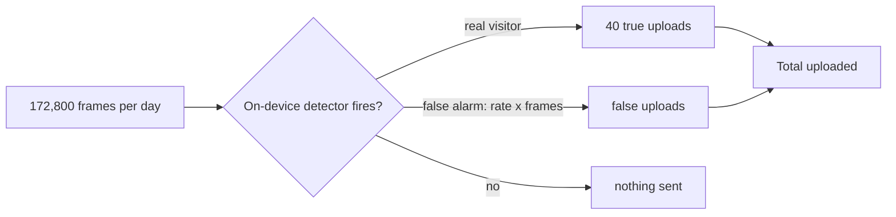

:::objectives
- Calculate data rates and daily volumes for sensors you haven't seen yet.
- Test a design against a latency deadline, including the worst-case network.
- Work out how a cascade's false-positive rate changes the data it sends.
- Compare battery life across three designs and pick the one that meets a target.
- Find unit bugs, strip a payload down to what it needs, and pack a report into bytes.
:::

These problems use new devices, not the three from the build. Write your answer in a Colab cell before opening the solution. The cells share variables, so run the warm-up first.

## Warm-up

A gyroscope measures rotation on 3 axes. At 200 readings per second with 2 bytes per reading, how many bytes per second does it produce?

```python run title="warm-up"
DAY = 24 * 3600
print("gyroscope:", 200 * 3 * 2, "bytes per second")
```

Rate × channels × bytes per sample. Every data-rate question in this set starts from that product.

### Exercise 1: Three new sensors

Write `bytes_per_day(rate_hz, channels, bytes_per_sample)` and use it for a 25 Hz heart-rate sensor (1 channel, 2 bytes), stereo music at 44.1 kHz (2 channels, 2 bytes), and a 96 × 96 grayscale camera at 5 frames per second (each pixel is 1 byte, so treat every pixel as a channel). Print MB per day.

```text
heart-rate sensor, 25 Hz           4.3 MB/day
stereo music, 44.1 kHz        15,241.0 MB/day
96x96 gray camera, 5 fps       3,981.3 MB/day
```

:::hint
A camera frame is 96 × 96 = 9,216 values at once. With `channels=96 * 96` and `rate_hz=5`, the same formula works for images.
:::

:::solution
```python run title="exercise 1"
def bytes_per_day(rate_hz, channels, bytes_per_sample):
    return rate_hz * channels * bytes_per_sample * DAY

sensors = [
    ("heart-rate sensor, 25 Hz", 25, 1, 2),
    ("stereo music, 44.1 kHz", 44_100, 2, 2),
    ("96x96 gray camera, 5 fps", 5, 96 * 96, 1),
]
for name, rate, channels, size in sensors:
    print(f"{name:<28}{bytes_per_day(rate, channels, size) / 1e6:>10,.1f} MB/day")
```

The heart-rate sensor is small enough to stream all day over almost any link. Music and video are thousands of times bigger, which is why devices that listen or look usually decide locally.
:::

### Exercise 2: A drone's 50 ms deadline

A small drone must react to an obstacle within 50 ms. Each decision needs one 96 × 96 grayscale frame. On a good day the drone has a 10 Mbit/s uplink with a 40 ms round trip, and the server needs 5 ms. Can the cloud meet the deadline? What about when the round trip rises to 200 ms?

```text
round trip  40 ms ->   52.4 ms  meets 50 ms: False
round trip 200 ms ->  212.4 ms  meets 50 ms: False
```

:::hint
The payload is 9,216 bytes. Convert to bits before dividing by the link speed, then add the round trip and the server time.
:::

:::solution
```python run title="exercise 2"
def cloud_ms(payload_bytes, uplink_mbps, round_trip_ms, server_ms):
    upload = payload_bytes * 8 / (uplink_mbps * 1e6) * 1000
    return upload + round_trip_ms + server_ms

frame = 96 * 96
for rtt in (40, 200):
    total = cloud_ms(frame, 10, rtt, 5)
    print(f"round trip {rtt:>3} ms -> {total:6.1f} ms  meets 50 ms: {total <= 50}")
```

Even the good case misses by a couple of milliseconds, and the bad case misses by four times the deadline. A design that "almost" works on the average network fails exactly when the drone flies somewhere with a weak signal.
:::

### Exercise 3: Sort five products

Write `verdict(offline, cloud_in_time, link_big_enough, sensitive)` that returns `"edge"` if the cloud is impossible, `"cascade"` if it's possible but the data is sensitive, and `"cloud"` otherwise. Then decide the four inputs for each product yourself and run it:

- noise-cancelling earbuds (they must react to sound in under a millisecond or two)
- a phone app that identifies plant diseases when the user taps **Check**
- a voice-controlled light switch
- a trail camera counting animals over a tiny radio link
- an avalanche beacon that must work far from any signal

:::hint
"Cloud impossible" means any one of: it must work offline, the cloud misses the deadline, or the link can't carry the data. Check those three first, then sensitivity.
:::

:::solution
```python run title="exercise 3"
def verdict(offline, cloud_in_time, link_big_enough, sensitive):
    if offline or not cloud_in_time or not link_big_enough:
        return "edge"
    if sensitive:
        return "cascade"
    return "cloud"

cases = {                         # offline, cloud in time, link ok, sensitive
    "noise-cancelling earbuds": (False, False, True, True),
    "plant-disease photo app":  (False, True,  True, False),
    "voice light switch":       (False, True,  True, True),
    "trail-camera counter":     (False, True,  False, True),
    "avalanche beacon":         (True,  True,  True, False),
}
for name, flags in cases.items():
    print(f"{name:<26}{verdict(*flags)}")
```

The plant app is the one product where the cloud is the natural fit: a user taps a button, waits a second, and gets an answer from a model far bigger than a phone could hold comfortably. The earbuds are the opposite: no network on Earth answers in a millisecond.
:::

### Exercise 4: The hidden cost of false alarms

A doorbell checks a camera frame twice a second for a person. Streaming every frame (30 KB each) would be expensive, so you design a cascade: an on-device person detector, and a 150 KB photo uploaded only when it fires. About 40 real visitors come per day. But the detector also fires falsely on some frames. Compare the MB uploaded per day for a false-positive rate of 2% per frame and 0.1% per frame, against streaming every frame.

```text
false-positive rate 2.0%: 3,456 false uploads, 524 MB/day
false-positive rate 0.1%: 173 false uploads, 32 MB/day
streaming every frame: 5,184 MB/day
```

:::hint
Frames per day = 2 × 86,400. False uploads = rate × frames per day. Total uploads = real visitors + false uploads.
:::

:::solution
```python run title="exercise 4"
frames_per_day = 2 * DAY
real_visitors = 40
for fp_rate in (0.02, 0.001):
    false_uploads = fp_rate * frames_per_day
    total = real_visitors + false_uploads
    print(f"false-positive rate {fp_rate:.1%}: {false_uploads:,.0f} false uploads, "
          f"{total * 150_000 / 1e6:,.0f} MB/day")
print(f"streaming every frame: {frames_per_day * 30_000 / 1e6:,.0f} MB/day")
```

At 2%, false alarms outnumber real visitors 86 to 1. The cascade still beats streaming tenfold, but the edge model's false-positive rate, not the visitors, sets the data bill. A 2% error rate sounds small until you multiply it by 172,800 frames a day.
:::



### Exercise 5: Will the pendant last a month?

A fall-detection pendant has a 150 mAh, 3.7 V battery and must last 30 days. It always draws 0.3 mW for the sensor and sleep. Compare three designs, using a 500 mW radio and a 15 mW processor that's busy 3% of the time when it runs a model:

1. stream everything (radio always on)
2. decide on the device, and send about 2 one-second messages a day
3. decide on the device, but also send a 1-second "double-check" to the cloud every minute

Which designs meet the target?

```text
stream everything                   500.30 mW      1.1 hours   month: False
edge, events only                     0.76 mW     30.4 days    month: True
edge + cloud check every minute       9.08 mW      2.5 days    month: False
```

:::hint
Energy in the battery: 0.150 Ah × 3.7 V × 3600 = joules. A radio on for 1 second, *n* times a day, averages 500 × *n* / 86,400 mW.
:::

:::solution
```python run title="exercise 5"
battery_j = 0.150 * 3.7 * 3600
designs = {
    "stream everything": 0.3 + 500,
    "edge, events only": 0.3 + 15 * 0.03 + 500 * 1 * 2 / DAY,
    "edge + cloud check every minute": 0.3 + 15 * 0.03 + 500 * 1 * 1440 / DAY,
}
for name, mw in designs.items():
    hours = battery_j / (mw / 1000) / 3600
    shown = f"{hours:7.1f} hours" if hours < 48 else f"{hours / 24:7.1f} days "
    print(f"{name:<34}{mw:8.2f} mW  {shown}   month: {hours >= 30 * 24}")
```

Design 3 looks harmless, since it still decides on the device, but 1,440 radio wake-ups a day multiply its average power by twelve. Only design 2 survives the month, and only just, so the real product would need a bigger battery or fewer messages.
:::

### Exercise 6: Find the unit bug

This function is supposed to return how many seconds a file takes to upload. For a 500 KB file on a 2 Mbit/s link it returns 250. Find the bug and fix it.

```python run title="buggy upload time"
def upload_seconds(size_kb, link_mbps):
    return size_kb / link_mbps

print(upload_seconds(500, 2))
```

:::hint
Write out the units: KB ÷ (Mbit/s). What do you need to multiply KB by to get bits, and Mbit/s by to get bits per second?
:::

:::solution
```python run title="exercise 6"
def upload_seconds(size_kb, link_mbps):
    bits = size_kb * 1000 * 8
    return bits / (link_mbps * 1_000_000)

print(upload_seconds(500, 2))
```

500 KB is 4 million bits, and a 2 Mbit/s link moves 2 million bits per second, so it takes 2 seconds. The buggy version was off by a factor of 125 (1,000,000 ÷ 8,000), and it never crashed or printed a warning. Unit bugs are dangerous precisely because the result looks like a normal number.
:::

### Exercise 7: Send only what the cloud needs

A glass-break detector builds this event when it fires. The cloud only needs to know *what* happened, *how sure* the model was, and roughly *when*. Write `minimize(event)` that keeps the label, the confidence rounded to 2 decimals, and the time cut to the hour, and compare the sizes as JSON.

```python run title="the raw event"
import json

raw_event = {
    "label": "glass_break", "confidence": 0.9312, "time": "2026-11-16T14:07:31",
    "audio": [0.01, -0.02, 0.15] * 5000, "gps": (37.4219, -122.0840), "owner": "Sam Rivera",
}
print(len(json.dumps(raw_event)), "bytes")
```

:::hint
The time is a string, so slicing it with `[:13]` keeps `"2026-11-16T14"`.
:::

:::solution
```python run title="exercise 7"
def minimize(event):
    return {
        "label": event["label"],
        "confidence": round(event["confidence"], 2),
        "hour": event["time"][:13],
    }

small = minimize(raw_event)
print(small)
print(len(json.dumps(small)), "bytes")
```

The audio, the exact location, and the owner's name were 99.9% of the bytes and 100% of the privacy risk. Dropping them doesn't stop the cloud from doing its job (logging alarms and notifying someone), which is the test for whether a field belongs in the message at all.
:::

### Challenge: A 7-byte wildlife report

A camera in a forest counts animals on the device and reports over a long-range radio link. Some of these links allow as little as 11 bytes per message. Each report needs the counts of deer, fox, boar, and people (each 0 to 255), the battery percentage (0 to 100), and the time as minutes since midnight (0 to 1439).

Use Python's `struct` module to pack a report into as few bytes as possible, print it as hex, and unpack it again to prove nothing was lost.

:::hint
`struct.pack("<B", n)` stores one unsigned byte (0 to 255). Minutes since midnight can reach 1439, which doesn't fit in a byte, so use `"H"` (2 bytes, 0 to 65,535) for that field. `"<"` fixes the byte order and removes padding.
:::

:::solution
```python run title="challenge"
import struct

FORMAT = "<BBBBBH"        # deer, fox, boar, people, battery %, minutes since midnight

def pack_report(deer, fox, boar, people, battery_pct, minutes):
    return struct.pack(FORMAT, deer, fox, boar, people, battery_pct, minutes)

message = pack_report(3, 1, 0, 2, 87, 14 * 60 + 5)
print(message.hex(" "), "->", len(message), "bytes")
print(struct.unpack(FORMAT, message))
```

Five 1-byte fields and one 2-byte field make 7 bytes, small enough for the tightest links. Compare that with the 50 KB photo the camera took: the report is about 7,000 times smaller and reveals nothing about any hiker beyond "2 people passed".
:::
