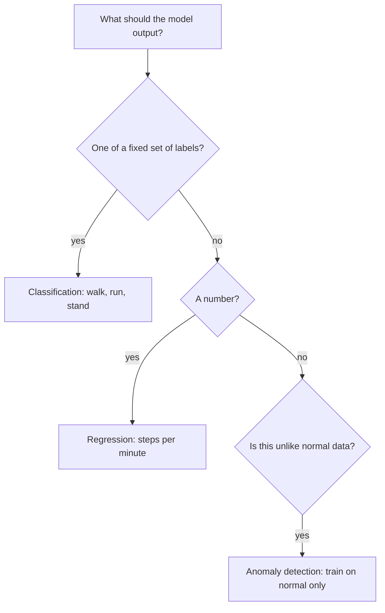

:::objectives
- Choose a sampling rate high enough to capture a motion, and recognize aliasing when it's too low.
- Cut a stream into windows with a chosen size and stride, and predict how many windows you'll get.
- Label windows that contain one activity, and handle the ones that straddle a change.
- Compute mean, standard deviation, RMS, and dominant frequency for each axis of a window.
- Decide whether a problem is classification, anomaly detection, or regression.
:::

A phone in someone's pocket records 20 seconds of accelerometer data: walking, then standing still, then walking again. At 50 readings per second on three axes, that's a 1,000 × 3 array. A classifier wants something quite different: lots of **examples**, each the same size, each with one label. The stream has no examples in it. It's one long recording with no boundaries.

Turning a stream into examples is the first real design decision in any sensor model. Get it wrong and no amount of training fixes it. This lesson covers the four choices involved: how often to sample, how to cut, how to label, and what to compute from each piece.

## Sampling rate: look often enough, or the signal lies

The **sampling rate** is how many readings per second the sensor takes. Too few and you miss the motion. Worse, you can see a motion that isn't there. Run this and look at the squares:

```python run title="aliasing" alt="A gray 6 Hz sine wave over one second. Dots sampled at 100 Hz trace it exactly. Squares sampled at 8 Hz join up into a slow wave with only two cycles per second." caption="A 6 Hz motion sampled at 100 Hz and at 8 Hz"
import numpy as np
import matplotlib.pyplot as plt

true_hz = 6
fine_t = np.linspace(0, 1, 1000)
plt.figure(figsize=(8, 3))
plt.plot(fine_t, np.sin(2 * np.pi * true_hz * fine_t), color="lightgray", label="real 6 Hz motion")
for rate, marker in ((100, "o"), (8, "s")):
    ts = np.arange(0, 1, 1 / rate)
    plt.plot(ts, np.sin(2 * np.pi * true_hz * ts), marker + "-", markersize=4,
             linewidth=1, label=f"sampled at {rate} Hz")
plt.legend(loc="upper right", fontsize=8)
plt.xlabel("time (s)")
plt.title("Too slow a sampling rate invents a slower wave")

for rate in (8, 100):
    ts = np.arange(0, 4, 1 / rate)
    spectrum = np.abs(np.fft.rfft(np.sin(2 * np.pi * true_hz * ts)))
    freqs = np.fft.rfftfreq(ts.size, d=1 / rate)
    print(f"sampled at {rate:>3} Hz, the strongest frequency looks like {freqs[spectrum.argmax()]} Hz")
```

Sampled at 8 Hz, a 6 Hz shake looks exactly like a 2 Hz sway. This is **aliasing**, and no model can undo it, because the 8 Hz samples genuinely are identical to those of a 2 Hz wave.

The rule (the Nyquist criterion): the sampling rate must be **more than twice the highest frequency** you need to capture. In practice engineers leave a margin and sample 3 to 5 times faster. Human movement mostly sits below about 15 Hz, which is why motion projects commonly sample at 50 to 100 Hz (Edge Impulse's motion tutorial uses 62.5 Hz). Speech carries useful detail up to about 8 kHz, which is why keyword spotters sample at 16 kHz.

## Windows: fixed-size slices of the stream

A **window** is a slice of consecutive readings, and every window is the same length. Two numbers define how you cut:

- **window size** *W*: how many samples (or seconds) each window holds.
- **stride** *S*: how far the start moves between one window and the next. Edge Impulse calls this the **window increase**.

When the stride is smaller than the window, windows **overlap**. For a stream of *N* samples:

number of windows = ⌊(*N* − *W*) ÷ *S*⌋ + 1    overlap = 1 − *S* ÷ *W*

Before you step through the next program, use the formula to predict how many windows it makes from 8 numbers with *W* = 4 and *S* = 2.

:::trace Cut a stream into windows of 4 with a stride of 2
```python
signal = [3, 1, 4, 1, 5, 9, 2, 6]
size, stride = 4, 2
windows = []
for start in range(0, len(signal) - size + 1, stride):
    windows.append(signal[start:start + size])
print(windows)
```
:::

(8 − 4) ÷ 2 + 1 = 3 windows, each sharing half its samples with the next. Now the real stream: 20 seconds at 50 Hz, cut into 2-second windows (100 samples) with a 1-second stride (50 samples).

```python run title="windows" alt="The z axis of a 20-second accelerometer stream, oscillating while walking and flat while standing between 8 and 14 seconds. Below it, 19 orange bars mark 2-second windows that start every second, staggered so the overlaps are visible." caption="Windows over a walk, stand, walk recording"
rate = 50
rng = np.random.default_rng(3)

def walking(seconds, steps_per_s=1.8):
    t = np.arange(int(seconds * rate)) / rate
    x = 0.25 * np.sin(2 * np.pi * steps_per_s / 2 * t)              # sway: once per two steps
    y = 0.1 * rng.normal(size=t.size)
    z = 1 + 0.35 * np.sin(2 * np.pi * steps_per_s * t) + 0.1 * np.sin(2 * np.pi * 2 * steps_per_s * t)
    return np.stack([x, y, z], axis=1) + rng.normal(0, 0.04, (t.size, 3))

def standing(seconds):
    return np.array([0.0, 0.0, 1.0]) + rng.normal(0, 0.02, (int(seconds * rate), 3))

stream = np.concatenate([walking(8), standing(6), walking(6)])
labels = np.array(["walk"] * 400 + ["stand"] * 300 + ["walk"] * 300)

def make_windows(signal, size, stride):
    starts = list(range(0, len(signal) - size + 1, stride))
    return np.stack([signal[s:s + size] for s in starts]), starts

windows, starts = make_windows(stream, size=100, stride=50)
print("stream:", stream.shape, " windows:", windows.shape)

t = np.arange(len(stream)) / rate
fig, ax = plt.subplots(figsize=(8, 3.4))
ax.plot(t, stream[:, 2], linewidth=0.8, color="#4C72B0")
ax.axvspan(8, 14, color="#DDDDDD", alpha=0.6, label="label: stand")
for i, s in enumerate(starts):
    level = 0.35 - 0.06 * (i % 3)
    ax.plot([s / rate, (s + 100) / rate], [level, level], color="#DD8452", linewidth=3)
ax.set_ylim(0.1, 1.6)
ax.set_xlabel("time (s)")
ax.set_ylabel("z acceleration (g)")
ax.set_title("19 windows of 2 s, a new one every 1 s")
ax.legend(loc="upper right", fontsize=8)
```

The array shape `(19, 100, 3)` reads as 19 windows, 100 time steps, 3 axes. Each window is now one example.

How do you choose the numbers? The **window size** must be long enough to contain at least one full cycle of the slowest pattern you care about. One walking step takes about half a second, and the side-to-side sway repeats once every two steps, so a 2-second window holds a couple of complete cycles. The **stride** trades work for responsiveness: a smaller stride gives more training windows from the same recording and lets the device react sooner, but it means running the model more often.

## Labeling a window

Each sample has a label, but each window needs exactly one. When a window sits inside a single activity, that's easy. When it straddles a change, it isn't:

```python run title="window labels"
def window_label(sample_labels):
    values, counts = np.unique(sample_labels, return_counts=True)
    best = counts.argmax()
    return str(values[best]), counts[best] / len(sample_labels)

for start in (300, 350, 400):
    label, purity = window_label(labels[start:start + 100])
    print(f"window starting at {start / rate:4.1f} s: {label:<6} purity {purity:.0%}")
```

The window that starts at 7 seconds is half walking and half standing, so its "majority" label is a coin toss. Training on it teaches the model a contradiction. Common fixes: **drop windows below a purity threshold** (say 80%), or use the label at the **end** of the window, which is what a live device cares about ("what is happening now?"). Edge Impulse offers that second option for samples with several labels.

## Features: from 300 numbers to 12

A 2-second window holds 300 numbers. Small models do far better with a handful of numbers that describe what matters. For each axis, compute:

- **mean**: the average, which mostly reflects how the device is tilted relative to gravity;
- **standard deviation** and **RMS**: how much it moves;
- **dominant frequency**: the strongest repeating rate, found with a Fourier transform (`np.fft.rfft`).

```python run title="features"
def features(window, rate=50):
    out = {}
    for i, axis in enumerate("xyz"):
        v = window[:, i]
        spectrum = np.abs(np.fft.rfft(v - v.mean()))
        freqs = np.fft.rfftfreq(len(v), d=1 / rate)
        out[f"{axis}_mean"] = v.mean()
        out[f"{axis}_std"] = v.std()
        out[f"{axis}_rms"] = np.sqrt(np.mean(v ** 2))
        out[f"{axis}_peak_hz"] = freqs[spectrum.argmax()]
    return out

for name, w in (("walking", windows[0]), ("standing", windows[9])):
    z_only = {k: round(float(v), 2) for k, v in features(w).items() if k.startswith("z")}
    print(f"{name:<9}{z_only}")
```

Walking has a z standard deviation more than ten times higher than standing, and a peak at 2.0 Hz. Two details are worth noticing. First, the frequency resolution is 50 ÷ 100 = 0.5 Hz, so a 1.8 Hz step rate shows up in the 2.0 Hz bin; longer windows give finer resolution. Second, the "peak" while standing is a random number, because the strongest frequency in pure noise means nothing. That's why a peak frequency should always travel with a measure of strength like the standard deviation.

Edge Impulse's **Spectral Analysis** block computes this kind of feature set (statistics plus frequency-domain power) for every window, and next lesson you'll build the same thing yourself.

:::video oDFxBjcvrQU
What to watch for: how Shawn turns raw accelerometer windows into features with the Fast Fourier Transform, and why the features separate gestures that look tangled in the raw data.
:::

## Three task types, one stream

Windows and features are the same whatever you ask the model. What changes is the question:



- **Classification** picks one label from a list you defined: *walk*, *stand*, *wave*. Every class needs labeled examples.
- **Regression** predicts a number: steps per minute, a machine's speed, how full a bin is.
- **Anomaly detection** answers "is this unusual?" It's trained only on normal data, because the faults you most want to catch are rare and hard to record. A motor that has never failed can still learn what healthy vibration looks like.

The same ideas apply to **images**, except the window is spatial instead of temporal: one camera frame is one example, usually resized to something small like 96 × 96 pixels before it reaches the model.

## Mistakes that wreck sensor models

:::warning
**Leaking overlapping windows into the test set.** With a 50% overlap, neighboring windows share half their samples. If you shuffle all windows and split randomly, the test set is full of near-copies of training windows, and accuracy looks far better than it will on a new person or a new day. **Split by recording** (or by person), so every window from one recording lands on the same side. Edge Impulse's dataset split settings can group samples by metadata for the same reason.
:::

:::warning
**Training at one sampling rate and deploying at another.** A phone might record at 100 Hz while the board runs at 62.5 Hz. A window of "100 samples" then covers a different amount of time, and the dominant-frequency feature shifts. Resample the training data to the device's rate, or set the rate explicitly in the impulse.
:::

:::warning
**A stride of 1 on long recordings.** It looks like free data, but it creates almost-identical windows: an hour at 100 Hz with a 2-second window gives about 360,000 windows that mostly repeat each other. Training slows down and the model gains little.
:::

:::quiz
Q: A stream has 1,000 samples. You use windows of 200 samples with a stride of 100. How many windows do you get?
- [ ] 5
  That would be windows that don't overlap (stride 200). A stride of 100 starts a new window twice as often.
- [x] 9
  (1000 − 200) ÷ 100 + 1 = 9. The last window starts at sample 800 and ends exactly at 1,000.
- [ ] 10
  A window starting at sample 900 would need samples up to 1,100, which don't exist.

Q: A machine vibrates at 40 Hz when it's healthy. Which sampling rate is the lowest that won't alias it?
- [ ] 40 Hz
  Sampling at exactly the vibration's frequency catches it at the same point every cycle, so it looks like a constant.
- [ ] 60 Hz
  60 Hz is below twice 40 Hz, so a 40 Hz vibration would alias to 20 Hz.
- [x] 100 Hz
  It's more than twice 40 Hz, with some margin, so the vibration's true frequency survives.

Q: You split 2,000 overlapping windows from 10 recordings randomly into train and test, and get 99% accuracy. On a new recording the model scores 78%. What's the most likely cause?
- [x] Overlapping windows from the same recordings ended up in both sets, so the test set wasn't really new data
  Neighboring windows share samples, so a random split tests on near-copies of training windows.
- [ ] The model needs more training epochs
  More training would make it fit the training recordings even more closely, not generalize better.
- [ ] The windows are too long
  Window length affects what patterns fit, but it doesn't explain a big gap between test and new data.

Q: You want a model that warns when a fridge compressor starts sounding unusual, but you only have recordings of it working normally. Which task type fits?
- [ ] Classification into "normal" and "faulty"
  You have no faulty examples to learn that class from.
- [x] Anomaly detection
  It learns what normal looks like and flags anything far from it, so it needs only normal data.
- [ ] Regression
  Regression predicts a number, such as a temperature; it doesn't flag unusual behavior by itself.
:::

:::takeaways
- Sample at more than twice the highest frequency you need (3 to 5 times in practice), or aliasing invents frequencies that aren't there.
- Windows turn a stream into examples: *W* sets how much each example sees, *S* sets how many you get and how often the device decides; count = ⌊(*N* − *W*) ÷ *S*⌋ + 1.
- Give every window one label, and drop or relabel windows that straddle a change.
- Mean, standard deviation, RMS, and dominant frequency per axis turn hundreds of raw numbers into a dozen useful ones.
- Classification picks a label, regression predicts a number, and anomaly detection learns normal and flags the rest.
- Split overlapping windows by recording, never randomly.
:::

## Further reading

- [Impulse design](https://docs.edgeimpulse.com/studio/projects/impulse-design), Edge Impulse: the window size, window increase, frequency, and zero-pad settings, with a sketch of how windows slide.
- [Spectral analysis block](https://docs.edgeimpulse.com/studio/projects/processing-blocks/blocks/spectral-analysis), Edge Impulse: exactly which statistical and frequency features the Studio computes for motion data.
- [Cross-validation: GroupKFold](https://scikit-learn.org/stable/modules/cross_validation.html#group-k-fold), scikit-learn: how to keep every window from one recording on the same side of a split.
