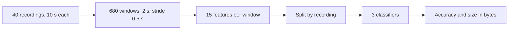

:::objectives
- Generate realistic synthetic accelerometer recordings, including the tilt and noise of a real hand.
- Cut every recording into labeled windows while tracking which recording each window came from.
- Extract 15 time and frequency features per window, and look at them the way Edge Impulse's feature explorer does.
- Split by recording, train three classifiers, and compare their accuracy against their size.
- Read a confusion matrix and set up the same pipeline in Edge Impulse Studio.
:::

A gesture-controlled light switch needs to tell four things apart: the hand is still, it waves side to side, it moves up and down, or it draws a circle. By the end of this build you'll have a model that does that from accelerometer data, and you'll know exactly how big it is. The pipeline:



And the result you're building toward, a comparison where the smallest good model wins:

```text
logistic regression      accuracy  94.6%       94 values   ~    376 bytes
decision tree, depth 4   accuracy  85.3%       16 values   ~     64 bytes
random forest, 50 trees  accuracy  94.1%    1,271 values   ~  5,084 bytes
```

Make a Colab notebook called `m3-l2-gesture-windows.ipynb`.

## Step 1: Generate the recordings

Real recordings are coming in Step 7. Synthetic ones let you see every decision clearly, but they have to be realistic enough to be hard. Three things make them so:

- every recording has its own **speed** and **size** of motion, like different people;
- every recording is **rotated** by up to 30°, because nobody holds a device perfectly level, and rotation leaks motion from one axis into the others;
- every reading gets **noise**.

```python run title="step 1: recordings" alt="Four small line charts, one per gesture, each showing 3 seconds of x, y, and z acceleration. Idle is three nearly flat lines; wave oscillates mostly on x; updown oscillates mostly on z; circle oscillates on both x and y." caption="The first 3 seconds of one recording of each gesture"
import numpy as np
import matplotlib.pyplot as plt

RATE = 50                                   # samples per second
CLASSES = ["idle", "wave", "updown", "circle"]
rng = np.random.default_rng(2)

def random_rotation(max_degrees):
    a, b, c = np.radians(rng.uniform(-max_degrees, max_degrees, 3))
    rx = np.array([[1, 0, 0], [0, np.cos(a), -np.sin(a)], [0, np.sin(a), np.cos(a)]])
    ry = np.array([[np.cos(b), 0, np.sin(b)], [0, 1, 0], [-np.sin(b), 0, np.cos(b)]])
    rz = np.array([[np.cos(c), -np.sin(c), 0], [np.sin(c), np.cos(c), 0], [0, 0, 1]])
    return rz @ ry @ rx

def record(gesture, seconds=10):
    t = np.arange(seconds * RATE) / RATE
    speed = rng.uniform(0.8, 2.5)           # repetitions per second
    size = rng.uniform(0.3, 1.0)            # in g
    phase = rng.uniform(0, 2 * np.pi)
    motion = np.zeros((t.size, 3))
    if gesture == "wave":                   # side to side
        motion[:, 0] = size * np.sin(2 * np.pi * speed * t + phase)
    elif gesture == "updown":
        motion[:, 2] = size * np.sin(2 * np.pi * speed * t + phase)
    elif gesture == "circle":
        motion[:, 0] = size * np.sin(2 * np.pi * speed * t + phase)
        motion[:, 1] = size * np.cos(2 * np.pi * speed * t + phase)
    else:                                   # idle: slow drift of a hand at rest
        motion[:] = 0.05 * np.sin(2 * np.pi * rng.uniform(0.2, 0.6) * t[:, None] + rng.uniform(0, 6, 3))
    gravity = np.array([0.0, 0.0, 1.0])
    tilt = random_rotation(30)              # everyone holds the device differently
    return (motion + gravity) @ tilt.T + rng.normal(0, 0.1, (t.size, 3))

recordings = [(record(label), label) for label in CLASSES for _ in range(10)]
print(len(recordings), "recordings, each", recordings[0][0].shape)

fig, axes = plt.subplots(1, 4, figsize=(10, 2.6), sharey=True)
for ax, label in zip(axes, CLASSES):
    signal = next(s for s, l in recordings if l == label)[:150]
    t = np.arange(150) / RATE
    for i, (name, style) in enumerate((("x", "-"), ("y", "--"), ("z", ":"))):
        ax.plot(t, signal[:, i], style, linewidth=1, label=name)
    ax.set_title(label)
    ax.set_xlabel("s")
axes[0].set_ylabel("g")
axes[0].legend(fontsize=7, loc="lower left")
fig.tight_layout()
```

Look at **idle**: x sits near −0.3 and y near +0.4 even though the hand isn't moving. That's gravity, split across the axes by the tilt. A model that assumes "z is up" would already be confused.

## Step 2: Cut windows and remember where each came from

Use the settings from Edge Impulse's own motion tutorial, adapted to 50 Hz: windows of **2 seconds** (100 samples) with a stride of **0.5 seconds** (25 samples). Each 10-second recording gives (500 − 100) ÷ 25 + 1 = 17 windows.

The new idea in this step is `groups`: for every window, the number of the recording it came from. You'll need it in Step 4.

```python run title="step 2: windows"
WINDOW, STRIDE = 100, 25
windows, labels, groups = [], [], []
for rec_id, (signal, label) in enumerate(recordings):
    for start in range(0, len(signal) - WINDOW + 1, STRIDE):
        windows.append(signal[start:start + WINDOW])
        labels.append(label)
        groups.append(rec_id)
windows, labels, groups = np.array(windows), np.array(labels), np.array(groups)
print("windows:", windows.shape, "  per recording:", (500 - WINDOW) // STRIDE + 1)
```

## Step 3: Extract features and look at them

Five features per axis, fifteen in all: mean, standard deviation, RMS, the dominant frequency, and how much power sits at that frequency (on a log scale, so big and small motions stay comparable).

```python run title="step 3: features" alt="Scatter plot of x_std against y_std for all 680 windows. Idle windows form a tight cluster near the bottom left. Wave windows spread along the bottom to the right. Updown windows stack up the left side. Circle windows sit in the upper middle. Each class is made of several small, tight clumps." caption="Two of the 15 features for every window, like Edge Impulse's feature explorer"
def features(window):
    out = []
    freqs = np.fft.rfftfreq(len(window), d=1 / RATE)
    for i in range(3):
        v = window[:, i]
        power = np.abs(np.fft.rfft(v - v.mean())) ** 2
        out += [v.mean(), v.std(), np.sqrt(np.mean(v ** 2)),
                freqs[power.argmax()], np.log1p(power.max())]
    return out

FEATURE_NAMES = [f"{axis}_{name}" for axis in "xyz"
                 for name in ("mean", "std", "rms", "peak_hz", "log_power")]
X = np.array([features(w) for w in windows])
print("features:", X.shape)

fig, ax = plt.subplots(figsize=(5, 4))
for label, marker in zip(CLASSES, "osD^"):
    points = X[labels == label]
    ax.scatter(points[:, 1], points[:, 6], s=12, marker=marker, alpha=0.6, label=label)
ax.set_xlabel("x_std (g)")
ax.set_ylabel("y_std (g)")
ax.legend(fontsize=8)
```

Edge Impulse's advice for its feature explorer applies here too: if you can see the classes separate, a model can probably learn to. Idle sits alone in the corner, wave spreads along the bottom, circle sits high on both. Now look closer: each class is made of **small, tight clumps**. Every clump is one recording, 17 windows that share the same speed, size, and tilt. Keep that picture in mind.

## Step 4: Split by recording, not by window

Those clumps are why a random split would cheat. If 12 windows of a recording go to training and 5 to testing, the test windows are near-copies of training windows, and the score measures memory instead of skill. Instead, hold out whole recordings: the last 3 of each gesture's 10.

```python run title="step 4: split"
test_recordings = [r for r in range(len(recordings)) if r % 10 >= 7]   # 3 per class
is_test = np.isin(groups, test_recordings)
X_train, y_train = X[~is_test], labels[~is_test]
X_test, y_test = X[is_test], labels[is_test]

print(f"train: {len(X_train)} windows from {len(set(groups[~is_test]))} recordings")
print(f"test:  {len(X_test)} windows from {len(set(groups[is_test]))} recordings")
print("recordings in both:", set(groups[~is_test]) & set(groups[is_test]))
```

The last line is a check worth keeping in every project: the set of recordings that appear on both sides must be empty.

## Step 5: Train three models and weigh them

Accuracy alone can't pick a model for a microcontroller. You also need its size. Here, size means the numbers the model must store to make a prediction:

- **logistic regression**: one weight per feature per class, one bias per class, and the scaler's mean and scale for each feature;
- **decision tree**: a feature number and a threshold for every split, and a class for every leaf;
- **random forest**: all of that, for every tree.

At 4 bytes per number (a float32), that gives a close estimate of the bytes a C version would need.

```python run title="step 5: train and weigh"
from sklearn.linear_model import LogisticRegression
from sklearn.tree import DecisionTreeClassifier
from sklearn.ensemble import RandomForestClassifier
from sklearn.preprocessing import StandardScaler
from sklearn.pipeline import make_pipeline
from sklearn.metrics import accuracy_score

def stored_values(model):
    if hasattr(model, "estimators_"):                     # a forest
        return sum(stored_values(tree) for tree in model.estimators_)
    if hasattr(model, "tree_"):                           # one tree
        leaves = (model.tree_.children_left == -1).sum()
        splits = model.tree_.node_count - leaves
        return 2 * splits + leaves
    scaler, clf = model[0], model[-1]                     # scaler + logistic regression
    return clf.coef_.size + clf.intercept_.size + scaler.mean_.size + scaler.scale_.size

models = {
    "logistic regression": make_pipeline(StandardScaler(), LogisticRegression(max_iter=1000)),
    "decision tree, depth 4": DecisionTreeClassifier(max_depth=4, random_state=0),
    "random forest, 50 trees": RandomForestClassifier(n_estimators=50, random_state=0),
}
for name, model in models.items():
    model.fit(X_train, y_train)
    acc = accuracy_score(y_test, model.predict(X_test))
    values = stored_values(model)
    print(f"{name:<25}accuracy {acc:6.1%}   {values:>6,} values   ~{values * 4:>7,} bytes")
```

The forest is no more accurate than logistic regression, yet it's more than 13 times bigger. The tiny tree is smallest of all but makes far more mistakes. On a desktop you'd shrug and pick the forest; on a chip with 256 KB of RAM, shared with everything else the firmware does, logistic regression is the clear choice. That trade-off, accuracy per byte, runs through the rest of this course.

## Step 6: See what it gets wrong

```python run title="step 6: confusion matrix" alt="Confusion matrix for logistic regression on the 204 test windows. Idle, updown, and circle are all correct at 51 each. Wave has 40 correct and 11 predicted as circle." caption="Logistic regression on the held-out recordings"
from sklearn.metrics import ConfusionMatrixDisplay

best = models["logistic regression"]
fig, ax = plt.subplots(figsize=(4.5, 4))
ConfusionMatrixDisplay.from_predictions(y_test, best.predict(X_test), labels=CLASSES,
                                        ax=ax, colorbar=False, cmap="Blues")
```

Every mistake is a **wave** called a **circle**. That makes physical sense: tilt a side-to-side wave enough and some of its motion lands on the y axis, which is exactly what a circle looks like. The fix isn't a bigger model. It's better data (recordings of waves at more angles) or a feature that doesn't depend on orientation, such as the magnitude of the acceleration. You'll try one in the Practice lesson.

## Step 7: The same pipeline in Edge Impulse

Everything you just wrote by hand has a matching setting in Studio. With your phone connected, record about ten 10-second samples per gesture in **Data acquisition** (label each one `idle`, `wave`, `updown`, or `circle`, and vary how you hold the phone). Then:

```text
Create impulse      Time series data:  window size 2000 ms, window increase 500 ms
                    Processing block:  Spectral Analysis
                    Learning block:    Classification
                    Save impulse
Spectral features   Save parameters, then Generate features (opens the feature explorer)
Classifier          Start training
Model testing       Classify all
```

Studio measures windows in **milliseconds**, not samples, so a 2000 ms window covers 2 seconds whatever rate your phone records at. That avoids the sample-rate mismatch from the Notes. Studio splits training and test data by **sample** (each 10-second recording), which matches what you did in Step 4.

## The finished pipeline

Here are all the steps in one cell, without the charts. It runs on its own in a fresh notebook and prints the comparison table.

```python run title="gesture_pipeline.py"
import numpy as np
from sklearn.linear_model import LogisticRegression
from sklearn.tree import DecisionTreeClassifier
from sklearn.ensemble import RandomForestClassifier
from sklearn.preprocessing import StandardScaler
from sklearn.pipeline import make_pipeline
from sklearn.metrics import accuracy_score

RATE, WINDOW, STRIDE = 50, 100, 25
CLASSES = ["idle", "wave", "updown", "circle"]
rng = np.random.default_rng(2)

def random_rotation(max_degrees):
    a, b, c = np.radians(rng.uniform(-max_degrees, max_degrees, 3))
    rx = np.array([[1, 0, 0], [0, np.cos(a), -np.sin(a)], [0, np.sin(a), np.cos(a)]])
    ry = np.array([[np.cos(b), 0, np.sin(b)], [0, 1, 0], [-np.sin(b), 0, np.cos(b)]])
    rz = np.array([[np.cos(c), -np.sin(c), 0], [np.sin(c), np.cos(c), 0], [0, 0, 1]])
    return rz @ ry @ rx

def record(gesture, seconds=10):
    t = np.arange(seconds * RATE) / RATE
    speed, size, phase = rng.uniform(0.8, 2.5), rng.uniform(0.3, 1.0), rng.uniform(0, 2 * np.pi)
    motion = np.zeros((t.size, 3))
    if gesture == "wave":
        motion[:, 0] = size * np.sin(2 * np.pi * speed * t + phase)
    elif gesture == "updown":
        motion[:, 2] = size * np.sin(2 * np.pi * speed * t + phase)
    elif gesture == "circle":
        motion[:, 0] = size * np.sin(2 * np.pi * speed * t + phase)
        motion[:, 1] = size * np.cos(2 * np.pi * speed * t + phase)
    else:
        motion[:] = 0.05 * np.sin(2 * np.pi * rng.uniform(0.2, 0.6) * t[:, None] + rng.uniform(0, 6, 3))
    tilt = random_rotation(30)
    return (motion + np.array([0.0, 0.0, 1.0])) @ tilt.T + rng.normal(0, 0.1, (t.size, 3))

def features(window):
    out = []
    freqs = np.fft.rfftfreq(len(window), d=1 / RATE)
    for i in range(3):
        v = window[:, i]
        power = np.abs(np.fft.rfft(v - v.mean())) ** 2
        out += [v.mean(), v.std(), np.sqrt(np.mean(v ** 2)), freqs[power.argmax()], np.log1p(power.max())]
    return out

def stored_values(model):
    if hasattr(model, "estimators_"):
        return sum(stored_values(tree) for tree in model.estimators_)
    if hasattr(model, "tree_"):
        leaves = (model.tree_.children_left == -1).sum()
        return 2 * (model.tree_.node_count - leaves) + leaves
    return model[-1].coef_.size + model[-1].intercept_.size + 2 * model[0].mean_.size

recordings = [(record(label), label) for label in CLASSES for _ in range(10)]
X, y, groups = [], [], []
for rec_id, (signal, label) in enumerate(recordings):
    for start in range(0, len(signal) - WINDOW + 1, STRIDE):
        X.append(features(signal[start:start + WINDOW]))
        y.append(label)
        groups.append(rec_id)
X, y, groups = np.array(X), np.array(y), np.array(groups)

is_test = np.isin(groups, [r for r in range(len(recordings)) if r % 10 >= 7])
models = {
    "logistic regression": make_pipeline(StandardScaler(), LogisticRegression(max_iter=1000)),
    "decision tree, depth 4": DecisionTreeClassifier(max_depth=4, random_state=0),
    "random forest, 50 trees": RandomForestClassifier(n_estimators=50, random_state=0),
}
for name, model in models.items():
    model.fit(X[~is_test], y[~is_test])
    acc = accuracy_score(y[is_test], model.predict(X[is_test]))
    values = stored_values(model)
    print(f"{name:<25}accuracy {acc:6.1%}   {values:>6,} values   ~{values * 4:>7,} bytes")
```

:::quiz
Q: Why does Step 2 record a `groups` entry for every window?
- [ ] So the windows can be sorted by time
  The windows are already in time order inside each recording; `groups` is used for something else.
- [x] So Step 4 can keep all windows from one recording on the same side of the split
  Windows from one recording overlap and share speed, size, and tilt, so splitting them up would leak test data into training.
- [ ] Because scikit-learn needs a group for every sample to train
  `fit` never sees `groups`; it's only used to choose which windows are held out.

Q: Logistic regression and the random forest score within one point of each other. Why pick logistic regression for the device?
- [x] It stores about 94 numbers instead of about 1,271, so it takes far less memory and time on a microcontroller
  When accuracy is equal, the smaller and simpler model wins on a device where every kilobyte is shared with the rest of the firmware.
- [ ] Logistic regression always generalizes better than forests
  Neither model type always wins; here they happen to tie on accuracy.
- [ ] Random forests can't run on microcontrollers
  They can (a forest is just many if-statements), but this one costs 13 times the memory for no gain.

Q: All the mistakes are waves predicted as circles. What would most likely fix them?
- [ ] Training the logistic regression for more iterations
  It has already converged; the problem is that tilted waves really do look like circles in these features.
- [ ] Switching to a bigger model
  The forest makes similar mistakes; capacity isn't the issue.
- [x] Recording waves at more angles, or adding a feature that doesn't depend on orientation
  The confusion comes from tilt moving wave motion onto the y axis, so the data or the features have to account for tilt.
:::

:::takeaways
- Keep a recording ID for every window from the moment you cut it, and split on that ID.
- Plotting two or three features against each other shows whether the classes separate, and also shows the per-recording clumps that make random splits misleading.
- Measure a model's size as the numbers it must store, times 4 bytes for float32, and compare accuracy per byte.
- A confusion matrix tells you which physical situation fools the model, which usually points to a data fix, not a bigger model.
- Edge Impulse's window size, window increase, Spectral Analysis block, and Classification block are the same pipeline you just wrote.
:::

## Ideas to extend it

- Add a feature for the magnitude of acceleration, `np.linalg.norm(window, axis=1)`, which doesn't change when the device is tilted. Does the wave and circle confusion shrink?
- Raise `random_rotation(30)` to 60 degrees and watch which models cope best.
- Shorten the window to 1 second (50 samples). How do accuracy and the dominant-frequency resolution change?

## Further reading

- [Motion recognition with anomaly detection](https://docs.edgeimpulse.com/tutorials/end-to-end/motion-recognition), Edge Impulse: the official version of this build, with real data from a phone or board.
- [Logistic regression](https://scikit-learn.org/stable/modules/linear_model.html#logistic-regression), scikit-learn: how the weights and intercepts you counted in Step 5 are learned.
