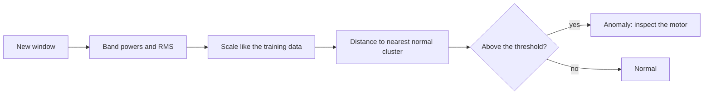

:::objectives
- Predict window counts and overlap for any stream, and label windows that cross a change.
- Spot aliasing and choose a safe sampling rate.
- Build a feature that doesn't change when a device is rotated.
- Measure how much a random split inflates accuracy on overlapping windows.
- Build an anomaly detector trained only on normal data, and a regression model that estimates a number.
:::

Each exercise uses a new situation. Try it in Colab before opening the solution, and run the warm-up cell first, since later cells reuse `np`.

## Warm-up

A 12-second recording at 50 Hz has 600 samples. With windows of 100 samples and a stride of 50, how many windows are there, and how much does each overlap the next?

```python run title="warm-up"
import numpy as np
print((600 - 100) // 50 + 1, "windows,", f"{1 - 50 / 100:.0%} overlap")
```

### Exercise 1: How stride multiplies your data

Write `window_stats(n, size, stride)` that returns the number of windows and the overlap. Print a table for one minute of data at 50 Hz (3,000 samples) with 2-second windows (100 samples) and strides of 100, 50, 25, 10, and 1.

```text
stride  windows  overlap
   100       30       0%
    50       59      50%
    25      117      75%
    10      291      90%
     1    2,901      99%
```

:::hint
Count = (n − size) // stride + 1, and overlap = 1 − stride / size.
:::

:::solution
```python run title="exercise 1"
def window_stats(n, size, stride):
    return (n - size) // stride + 1, 1 - stride / size

print(f"{'stride':>6}{'windows':>9}{'overlap':>9}")
for stride in (100, 50, 25, 10, 1):
    count, overlap = window_stats(3000, 100, stride)
    print(f"{stride:>6}{count:>9,}{overlap:>9.0%}")
```

Going from stride 25 to stride 1 multiplies the windows by 25, but at 99% overlap each new window differs from the last by a single sample. That's 25 times the training time for very little new information, and 25 times the inferences per second on a device.
:::

### Exercise 2: Drop the windows that can't be labeled

A recording has per-sample labels: 120 samples of `walk`, then 80 of `run`, then 100 of `walk`. Write `label_windows(sample_labels, size, stride, min_purity=0.8)` that returns the windows to keep as `(start, label, purity)` and the ones to drop. Use windows of 50 with a stride of 25.

```text
9 kept, 2 dropped
dropped (100, 'run', 0.6)
dropped (175, 'run', 0.5)
```

:::hint
`np.unique(values, return_counts=True)` gives each label and how often it appears. Purity is the biggest count divided by the window size.
:::

:::solution
```python run title="exercise 2"
sample_labels = np.array(["walk"] * 120 + ["run"] * 80 + ["walk"] * 100)

def label_windows(sample_labels, size, stride, min_purity=0.8):
    kept, dropped = [], []
    for start in range(0, len(sample_labels) - size + 1, stride):
        values, counts = np.unique(sample_labels[start:start + size], return_counts=True)
        purity = counts.max() / size
        entry = (start, str(values[counts.argmax()]), round(float(purity), 2))
        (kept if purity >= min_purity else dropped).append(entry)
    return kept, dropped

kept, dropped = label_windows(sample_labels, 50, 25)
print(len(kept), "kept,", len(dropped), "dropped")
for entry in dropped:
    print("dropped", entry)
```

The window at 175 is a perfect 50/50 tie. `np.unique` sorts labels alphabetically, so `argmax` picks `run` only because "r" comes before "w". Keeping a window like that would teach the model a coin toss, which is exactly why the purity threshold exists.
:::

### Exercise 3: The fan that looked slow

A desk fan wobbles 12 times per second. Write `dominant_hz(signal_hz, rate)` that samples a sine wave of that frequency for 4 seconds at `rate` and returns the strongest frequency the FFT finds. Try rates of 15, 20, 30, and 50 Hz. Before running, predict what 15 Hz will show.

```text
12 Hz fan sampled at 15 Hz looks like 3.0 Hz
12 Hz fan sampled at 20 Hz looks like 8.0 Hz
12 Hz fan sampled at 30 Hz looks like 12.0 Hz
12 Hz fan sampled at 50 Hz looks like 12.0 Hz
```

:::hint
`np.fft.rfftfreq(number_of_samples, d=1 / rate)` gives the frequency of each FFT bin. Below the Nyquist limit, a frequency *f* sampled at rate *r* shows up at |*f* − *r*|.
:::

:::solution
```python run title="exercise 3"
def dominant_hz(signal_hz, rate, seconds=4):
    t = np.arange(0, seconds, 1 / rate)
    spectrum = np.abs(np.fft.rfft(np.sin(2 * np.pi * signal_hz * t)))
    return np.fft.rfftfreq(t.size, d=1 / rate)[spectrum.argmax()]

for rate in (15, 20, 30, 50):
    print(f"12 Hz fan sampled at {rate} Hz looks like {dominant_hz(12, rate)} Hz")
```

At 15 and 20 Hz the fan appears to wobble at 3 and 8 Hz, which are |12 − 15| and |12 − 20|. Both rates are below 24 Hz, twice the real frequency. At 30 Hz and above the truth comes through. A model trained on the 15 Hz data would learn that "fan on" means a slow 3 Hz wobble, and nothing about it would look wrong.
:::

:::video yWqrx08UeUs
What to watch for: why sampling below twice a signal's frequency produces a lower "alias" frequency, shown with spinning wheels and sampled waves. It's the same effect as the fan.
:::

### Exercise 4: A feature that ignores tilt

In the Build-along, tilted waves were mistaken for circles because per-axis features change when the device rotates. Build a 2-second wave (0.8 g side to side on x at 1.5 Hz, gravity on z), then rotate it 90° around z so the motion moves onto y. Print the x and y standard deviations and the standard deviation of the **magnitude**, `np.linalg.norm(window, axis=1)`, for both versions.

```text
held normally      x_std 0.57  y_std 0.05  magnitude_std 0.105
turned 90 degrees  x_std 0.05  y_std 0.57  magnitude_std 0.105
```

:::hint
A 90° turn around z is the matrix `[[0, -1, 0], [1, 0, 0], [0, 0, 1]]`. Apply it to every row with `window @ R.T`.
:::

:::solution
```python run title="exercise 4"
rng = np.random.default_rng(0)
t = np.arange(100) / 50
wave = np.stack([0.8 * np.sin(2 * np.pi * 1.5 * t), np.zeros(100), np.ones(100)], axis=1)
wave += rng.normal(0, 0.05, (100, 3))

R = np.array([[0, -1, 0], [1, 0, 0], [0, 0, 1]])        # 90 degrees around z
turned = wave @ R.T

for name, w in (("held normally", wave), ("turned 90 degrees", turned)):
    magnitude = np.linalg.norm(w, axis=1)
    print(f"{name:<18} x_std {w[:, 0].std():.2f}  y_std {w[:, 1].std():.2f}  "
          f"magnitude_std {magnitude.std():.3f}")
```

The x and y features swap completely, so a model that learned "wave means big x_std" fails on the turned device. Rotation never changes a vector's length, so the magnitude's statistics are identical. The trade-off: magnitude throws away direction, so it can't tell a wave from an up-down motion of the same size. Real projects usually keep both kinds of feature.
:::

### Exercise 5: Measure the leak

Generate 30 recordings that alternate between `walk` and `jog` (the generator is below). Cut 2-second windows with a 0.5-second stride and compute mean, standard deviation, and dominant frequency per axis. Train a random forest twice: once with `train_test_split` on windows, once with `GroupShuffleSplit` on recordings. Compare the accuracies.

```python run title="walk and jog recordings"
from sklearn.ensemble import RandomForestClassifier
from sklearn.model_selection import train_test_split, GroupShuffleSplit
from sklearn.metrics import accuracy_score

RATE = 50
rng = np.random.default_rng(1)

def recording(kind, seconds=12):
    t = np.arange(seconds * RATE) / RATE
    steps = rng.uniform(1.5, 2.1) if kind == "walk" else rng.uniform(1.9, 2.6)
    bounce = rng.uniform(0.2, 0.5) if kind == "walk" else rng.uniform(0.35, 0.8)
    z = bounce * np.sin(2 * np.pi * steps * t)
    signal = np.stack([0.3 * z, 0.2 * z, z], axis=1) + np.array([0, 0, 1.0]) + rng.normal(0, 0.2, 3)
    return signal + rng.normal(0, 0.08, signal.shape)

def basic_features(w):
    out = []
    freqs = np.fft.rfftfreq(len(w), d=1 / RATE)
    for i in range(3):
        v = w[:, i]
        power = np.abs(np.fft.rfft(v - v.mean())) ** 2
        out += [v.mean(), v.std(), freqs[power.argmax()]]
    return out
```

:::hint
`GroupShuffleSplit(n_splits=1, test_size=0.3, random_state=0).split(X, y, groups)` yields one pair of index arrays, so wrap it in `next(...)`. Use `random_state=0` for both splits and both forests.
:::

:::solution
```python run title="exercise 5"
X, y, groups = [], [], []
for rec_id in range(30):
    kind = "walk" if rec_id % 2 == 0 else "jog"
    signal = recording(kind)
    for start in range(0, len(signal) - 100 + 1, 25):
        X.append(basic_features(signal[start:start + 100]))
        y.append(kind)
        groups.append(rec_id)
X, y, groups = np.array(X), np.array(y), np.array(groups)

a, b, c, d = train_test_split(X, y, test_size=0.3, random_state=0)
leaky = RandomForestClassifier(n_estimators=50, random_state=0).fit(a, c)
print(f"random split over windows:    {accuracy_score(d, leaky.predict(b)):.1%}")

train_idx, test_idx = next(GroupShuffleSplit(n_splits=1, test_size=0.3, random_state=0).split(X, y, groups))
honest = RandomForestClassifier(n_estimators=50, random_state=0).fit(X[train_idx], y[train_idx])
print(f"split by recording:           {accuracy_score(y[test_idx], honest.predict(X[test_idx])):.1%}")
```

The random split reports a perfect score because nearly every test window has a twin in training from the same recording, with the same tilt in its mean features. The grouped split asks the real question, "how does it do on a recording it has never seen?", and the answer is much lower. Only the second number predicts what happens when a new person straps on the device.
:::

### Exercise 6: Catch a failing motor without any failures

A motor turns about 30 times a second, and a vibration sensor samples it at 400 Hz. You have plenty of recordings of it running normally, but none of it failing. A worn bearing would add a faint tone near 87 Hz. Build an anomaly detector:

1. Compute features for 0.5-second windows (200 samples): log power in four frequency bands (0 to 45, 45 to 75, 75 to 120, and 120 to 200 Hz) plus the RMS.
2. Fit a `StandardScaler` and `KMeans(n_clusters=4)` on **normal windows only**.
3. Score a window by its distance to the nearest cluster center, and set the threshold at the 99th percentile of the training scores.
4. Report the false-alarm rate on new normal windows and the share of faulty windows caught. Then try thresholds at the 90th and 95th percentiles.

```python run title="motor windows"
from sklearn.cluster import KMeans
from sklearn.preprocessing import StandardScaler

MOTOR_RATE = 400
rng = np.random.default_rng(7)

def motor_window(faulty=False, n=200):
    t = np.arange(n) / MOTOR_RATE
    speed = rng.uniform(29, 31)                          # shaft turns per second
    x = rng.uniform(0.15, 0.25) * np.sin(2 * np.pi * speed * t + rng.uniform(0, 6))
    x += 0.05 * np.sin(2 * np.pi * 2 * speed * t + rng.uniform(0, 6))
    if faulty:                                           # worn bearing: a faint new tone
        x += rng.uniform(0.01, 0.08) * np.sin(2 * np.pi * 87 * t + rng.uniform(0, 6))
    return x + rng.normal(0, 0.03, n)
```

:::hint
`kmeans.transform(features)` returns the distance from each row to every cluster center, so `.min(axis=1)` is the distance to the nearest one. Remember to scale with the same `StandardScaler` you fitted on the training windows.
:::

:::solution
```python run title="exercise 6"
def band_features(x):
    power = np.abs(np.fft.rfft(x - x.mean())) ** 2
    freqs = np.fft.rfftfreq(len(x), d=1 / MOTOR_RATE)
    bands = [(0, 45), (45, 75), (75, 120), (120, 200)]
    return [np.log1p(power[(freqs >= lo) & (freqs < hi)].sum()) for lo, hi in bands] + [np.sqrt(np.mean(x ** 2))]

train = np.array([band_features(motor_window()) for _ in range(300)])
normal_test = np.array([band_features(motor_window()) for _ in range(100)])
faulty_test = np.array([band_features(motor_window(faulty=True)) for _ in range(100)])

scaler = StandardScaler().fit(train)
kmeans = KMeans(n_clusters=4, n_init=10, random_state=0).fit(scaler.transform(train))

def anomaly_score(features):
    return kmeans.transform(scaler.transform(features)).min(axis=1)

for pct in (99, 95, 90):
    threshold = np.percentile(anomaly_score(train), pct)
    false_alarms = (anomaly_score(normal_test) > threshold).mean()
    caught = (anomaly_score(faulty_test) > threshold).mean()
    print(f"threshold at {pct}th percentile: false alarms {false_alarms:4.0%}   faults caught {caught:4.0%}")
```

The detector never saw a faulty window, yet it catches most of them, because a fault puts energy into the 75 to 120 Hz band where healthy windows have almost none. The threshold is a dial between two costs: lower it and you catch more of the faint faults, but you also raise false alarms on a healthy motor. Which way to turn it depends on whether a missed fault or a needless inspection costs more. Edge Impulse's **Anomaly Detection (K-Means)** block works the same way: clusters around normal data, and a score based on distance to the nearest one.
:::



### Challenge: Count steps per minute

A fitness band wants to show walking **cadence**, in steps per minute: a regression problem. Generate 400 four-second windows of walking (50 Hz, z axis only) with cadences between 80 and 135 steps per minute. Compare two estimators on the last 100 windows, using mean absolute error:

1. **No learning:** find the FFT peak between 1.0 and 2.5 Hz and multiply by 60.
2. **Regression:** train `Ridge` on the first 300 windows, using as features the power in each FFT bin from 1.0 to 2.5 Hz, divided by the total power in that range.

```python run title="walking windows"
from sklearn.linear_model import Ridge
from sklearn.metrics import mean_absolute_error

rng = np.random.default_rng(11)

def walk_window(steps_per_min, seconds=4, rate=50):
    t = np.arange(seconds * rate) / rate
    hz = steps_per_min / 60
    z = rng.uniform(0.2, 0.5) * np.sin(2 * np.pi * hz * t + rng.uniform(0, 6))
    z += 0.1 * np.sin(2 * np.pi * 2 * hz * t + rng.uniform(0, 6))
    return z + rng.normal(0, 0.08, t.size)

cadence = rng.uniform(80, 135, 400)
walks = np.array([walk_window(c) for c in cadence])
```

:::hint
With 200 samples at 50 Hz, FFT bins are 0.25 Hz apart, which is 15 steps per minute. A single peak can only land on one of those bins, but the power in the *neighboring* bins says which way the true cadence lies.
:::

:::solution
```python run title="challenge"
freqs = np.fft.rfftfreq(walks.shape[1], d=1 / 50)
power = np.abs(np.fft.rfft(walks - walks.mean(axis=1, keepdims=True), axis=1)) ** 2
band = (freqs >= 1.0) & (freqs <= 2.5)

peak_estimate = freqs[band][power[:, band].argmax(axis=1)] * 60
shares = power[:, band] / power[:, band].sum(axis=1, keepdims=True)

train, test = slice(0, 300), slice(300, 400)
ridge = Ridge(alpha=1e-3).fit(shares[train], cadence[train])

print(f"FFT bins in the band: {band.sum()}, each {freqs[1] * 60:.0f} steps/min wide")
print(f"FFT peak:  mean error {mean_absolute_error(cadence[test], peak_estimate[test]):.1f} steps/min")
print(f"Ridge:     mean error {mean_absolute_error(cadence[test], ridge.predict(shares[test])):.1f} steps/min")
```

The peak picker can only answer in steps of 15, so its error is stuck at a few steps per minute however clean the signal is. The regression model reads the *balance* of power between neighboring bins and interpolates between them, cutting the error by more than half. It needs only 8 weights (7 bins plus an intercept), which is a fine trade on a microcontroller.
:::
