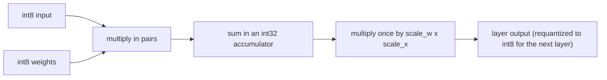

:::objectives
- Predict MFCC feature sizes from the sample rate, frame length, and stride.
- Read pitch and timing from a spectrogram you compute yourself.
- Measure how the mel scale spends its resolution.
- Check whether a model fits a flash budget as float32 and as int8.
- Test a quantizer against PyTorch, tame outliers, and pick symmetric or asymmetric quantization.
- Compute a layer's output using only integer multiplies and a 32-bit accumulator.
:::

Each exercise is a new situation, not a repeat of the build. Run the warm-up first: later cells reuse its imports.

## Warm-up

Edge Impulse's MFCC block measures frames in seconds. With a 20 ms frame length and a 20 ms frame stride, how many frames fit in one second of 16 kHz audio?

```python run title="warm-up"
import numpy as np
SR = 16_000
frame, stride = int(0.020 * SR), int(0.020 * SR)
print((SR - frame) // stride + 1, "frames")
```

With the stride equal to the frame length, the frames sit edge to edge and never overlap.

### Exercise 1: How settings change the feature size

Write `mfcc_shape(sample_rate, seconds, frame_s, stride_s, n_coeffs=13)` that returns `(frames, coefficients)`. Print the number of features for these four settings.

```text
 16000 Hz, frame   25 ms, stride   10 ms ->  98 x 13 = 1,274 features
 16000 Hz, frame   20 ms, stride   20 ms ->  50 x 13 =   650 features
  8000 Hz, frame   25 ms, stride   10 ms ->  98 x 13 = 1,274 features
 16000 Hz, frame   25 ms, stride    5 ms -> 196 x 13 = 2,548 features
```

:::hint
Convert seconds to samples first (`int(sample_rate * frame_s)`), then use the same window formula as Module 3.
:::

:::solution
```python run title="exercise 1"
def mfcc_shape(sample_rate, seconds, frame_s, stride_s, n_coeffs=13):
    n = int(sample_rate * seconds)
    frame, stride = int(sample_rate * frame_s), int(sample_rate * stride_s)
    return (n - frame) // stride + 1, n_coeffs

settings = [(16000, 1, 0.025, 0.010), (16000, 1, 0.020, 0.020),
            (8000, 1, 0.025, 0.010), (16000, 1, 0.025, 0.005)]
for rate, seconds, frame_s, stride_s in settings:
    frames, coeffs = mfcc_shape(rate, seconds, frame_s, stride_s)
    print(f"{rate:>6} Hz, frame {frame_s * 1000:>4.0f} ms, stride {stride_s * 1000:>4.0f} ms -> "
          f"{frames:>3} x {coeffs} = {frames * coeffs:>5,} features")
```

The sample rate doesn't change the frame count, because frames are defined in time, not samples. The **stride** does: halving it doubles the features, the model's input size, and the work the device does every second. Edge Impulse-style settings of 20 ms frames with a 20 ms stride halve the input compared with the 25/10 ms speech default.
:::

### Exercise 2: Read the notes off a spectrogram

A clip plays 440 Hz from 0.2 s to 0.5 s and 660 Hz from 0.6 s to 0.9 s, with quiet hiss elsewhere. Compute a power spectrogram (400-sample frames, 160-sample hop, 512-point FFT), find each frame's strongest frequency, call a frame "quiet" if its peak is under 1% of the loudest frame's, and print every change.

```text
 0.00 s: quiet
 0.19 s: 437.50 Hz
 0.50 s: quiet
 0.59 s: 656.25 Hz
 0.90 s: quiet
```

:::hint
`power.argmax(axis=1)` gives the strongest bin in every frame at once, and `np.fft.rfftfreq(512, d=1 / SR)` converts bins to Hz. Print only when the value differs from the previous frame's.
:::

:::solution
```python run title="exercise 2"
t = np.arange(SR) / SR
clip = 0.01 * np.random.default_rng(0).normal(size=SR)
for start, end, hz in ((0.2, 0.5, 440), (0.6, 0.9, 660)):
    a, b = int(start * SR), int(end * SR)
    clip[a:b] += np.sin(2 * np.pi * hz * t[a:b])

FRAME, HOP, NFFT = 400, 160, 512
starts = np.arange(0, SR - FRAME + 1, HOP)
frames = np.stack([clip[s:s + FRAME] * np.hanning(FRAME) for s in starts])
power = np.abs(np.fft.rfft(frames, n=NFFT)) ** 2
freqs = np.fft.rfftfreq(NFFT, d=1 / SR)

strongest = power.max(axis=1)
pitch = np.where(strongest > 0.01 * strongest.max(), freqs[power.argmax(axis=1)], 0)
previous = None
for start, p in zip(starts, pitch):
    if p != previous:
        print(f"{start / SR:5.2f} s: " + (f"{p:.2f} Hz" if p else "quiet"))
        previous = p
```

Two details reveal how a spectrogram works. The pitches come out as 437.5 and 656.25 Hz because bins are 31.25 Hz apart, so each tone lands in its nearest bin. And each note appears to start 10 ms early: the frame starting at 0.19 s runs to 0.215 s, so it already contains the beginning of the tone.
:::

### Exercise 3: Where the mel scale spends its detail

Using `hz_to_mel` and `mel_to_hz`, work out how many Hz a step of 100 mel covers when it starts at 200 Hz, 1,000 Hz, and 6,000 Hz.

```text
100 mel above   200 Hz spans   83.5 Hz
100 mel above  1000 Hz spans  157.7 Hz
100 mel above  6000 Hz spans  621.7 Hz
```

:::hint
Convert the starting frequency to mel, add 100, convert back, and subtract the starting frequency.
:::

:::solution
```python run title="exercise 3"
def hz_to_mel(f):
    return 2595 * np.log10(1 + f / 700)

def mel_to_hz(m):
    return 700 * (10 ** (m / 2595) - 1)

for f in (200, 1000, 6000):
    width = mel_to_hz(hz_to_mel(f) + 100) - f
    print(f"100 mel above {f:>5} Hz spans {width:6.1f} Hz")
```

The same perceptual step is more than seven times wider at 6 kHz than at 200 Hz. A mel filterbank with evenly spaced filters therefore spends most of its filters below a couple of kilohertz, where vowels and pitch live.
:::

### Exercise 4: Will it fit in flash?

A board has 1,024 KB of flash, and the firmware (drivers, audio buffers, feature code) already uses 350 KB. For a 3,780-parameter CNN, a 120,000-parameter keyword model, and a 300,000-parameter image model, print the size as float32 and as int8, and whether each fits in what's left.

```text
tiny CNN          float32    14.8 KB fits     int8    3.7 KB fits
keyword model     float32   468.8 KB fits     int8  117.2 KB fits
small image model float32  1171.9 KB too big  int8  293.0 KB fits
```

:::hint
float32 is 4 bytes per parameter and int8 is 1. Divide by 1,024 for KB, and compare with 1,024 − 350.
:::

:::solution
```python run title="exercise 4"
budget_kb = 1024 - 350
models = (("tiny CNN", 3_780), ("keyword model", 120_000), ("small image model", 300_000))
for name, params in models:
    f32, i8 = params * 4 / 1024, params / 1024
    print(f"{name:<18}float32 {f32:7.1f} KB {'fits' if f32 <= budget_kb else 'too big':<8} "
          f"int8 {i8:6.1f} KB {'fits' if i8 <= budget_kb else 'too big'}")
```

The image model only fits after quantization. The keyword model fits either way, but its float32 version would take 70% of the remaining flash, leaving little room for the firmware to grow. Flash is only half the story: the model also needs **RAM** for its activations while it runs, which Module 5 budgets.
:::

### Exercise 5: Test your quantizer against PyTorch

Your `quantize` and `dequantize` should obey two rules: every restored value is within half a step of the original, and the result matches a trusted library. Check both on three very different arrays: uniform in ±0.2, standard normal, and exponential (all positive). PyTorch's `torch.fake_quantize_per_tensor_affine(x, scale, zero_point, -128, 127)` quantizes and dequantizes in one call.

```text
uniform  scale 0.00157  zero point   -1  within half a step: True  matches PyTorch: True
normal   scale 0.02642  zero point  -20  within half a step: True  matches PyTorch: True
skewed   scale 0.01578  zero point -128  within half a step: True  matches PyTorch: True
```

:::hint
Compare with `np.allclose(ours, theirs)`. PyTorch wants the scale as a Python `float`, so pass `float(scale)`. Allow a tiny tolerance in the half-step check (`err <= scale / 2 + 1e-6`), because float32 rounding adds error in the last digit.
:::

:::solution
```python run title="exercise 5"
import torch

def quant_params(lo, hi):
    scale = (hi - lo) / 255
    return scale, int(round(-128 - lo / scale))

def quantize(x, scale, zero_point):
    return np.clip(np.round(x / scale) + zero_point, -128, 127).astype(np.int8)

def dequantize(q, scale, zero_point):
    return (q.astype(np.float32) - zero_point) * scale

rng = np.random.default_rng(3)
arrays = {
    "uniform": rng.uniform(-0.2, 0.2, 1000).astype(np.float32),
    "normal": rng.normal(0, 1, 1000).astype(np.float32),
    "skewed": rng.exponential(0.5, 1000).astype(np.float32),
}
for name, x in arrays.items():
    s, z = quant_params(x.min(), x.max())
    ours = dequantize(quantize(x, s, z), s, z)
    theirs = torch.fake_quantize_per_tensor_affine(torch.from_numpy(x), float(s), z, -128, 127).numpy()
    within = np.abs(x - ours).max() <= s / 2 + 1e-6
    print(f"{name:<8} scale {s:.5f}  zero point {z:>4}  within half a step: {within}  "
          f"matches PyTorch: {np.allclose(ours, theirs)}")
```

The all-positive array gets a zero point of −128, because its minimum is exactly 0, so real 0.0 sits at the bottom of the int8 range. Matching a library bit for bit is the strongest evidence your arithmetic is right, including the rounding rule: both NumPy and PyTorch round halves to the nearest even integer.
:::

### Exercise 6: One outlier, two ranges

5,000 weights are normal with a standard deviation of 0.1, except three outliers at 2.5, −1.8, and 3.1. Quantize them two ways: with the full min/max range, and with a range clipped to the 0.1st and 99.9th percentiles. For each, print the scale, the mean error on the ordinary weights, and the error on the 3.1 outlier.

```text
min/max              scale 0.01922  mean error (ordinary) 0.00485  error on 3.1 outlier 0.006
0.1-99.9 percentile  scale 0.00239  mean error (ordinary) 0.00064  error on 3.1 outlier 2.787
```

:::hint
`np.percentile(w, [0.1, 99.9])` returns both ends of the clipped range. The outliers are `w[:3]`, so the ordinary weights are `w[3:]`.
:::

:::solution
```python run title="exercise 6"
w = rng.normal(0, 0.1, 5000).astype(np.float32)
w[:3] = [2.5, -1.8, 3.1]

ranges = {"min/max": (w.min(), w.max()),
          "0.1-99.9 percentile": tuple(np.percentile(w, [0.1, 99.9]))}
for name, (lo, hi) in ranges.items():
    s, z = quant_params(lo, hi)
    back = dequantize(quantize(w, s, z), s, z)
    print(f"{name:<20} scale {s:.5f}  mean error (ordinary) {np.abs(w[3:] - back[3:]).mean():.5f}  "
          f"error on 3.1 outlier {abs(w[2] - back[2]):.3f}")
```

Clipping makes the ordinary weights almost 8 times more precise, and wrecks the outlier, which gets pinned to the edge of the range. Neither choice is free. Whether clipping helps depends on whether those rare big weights matter to the model's output, which is why quantization tools test several range strategies against real accuracy rather than picking one by rule.
:::

### Exercise 7: Symmetric or asymmetric for ReLU outputs?

**Symmetric** quantization fixes the zero point at 0 and uses scale = max |*x*| ÷ 127. It's simpler, since there's no zero point to subtract, but it assumes values on both sides of zero. A ReLU's outputs are never negative. Quantize 5,000 ReLU outputs both ways and compare how many of the 256 levels each uses, and the mean error.

```text
symmetric:  levels used 110, mean error 0.00544
asymmetric: levels used 208, mean error 0.00270
```

:::hint
Make the activations with `np.maximum(0, rng.normal(0.5, 1, 5000))`. For symmetric, `q = np.clip(np.round(x / scale), -128, 127)` and the restored value is `q * scale`.
:::

:::solution
```python run title="exercise 7"
acts = np.maximum(0, rng.normal(0.5, 1, 5000)).astype(np.float32)

s_sym = np.abs(acts).max() / 127
q_sym = np.clip(np.round(acts / s_sym), -128, 127)
print(f"symmetric:  levels used {np.unique(q_sym).size}, mean error {np.abs(acts - q_sym * s_sym).mean():.5f}")

s_asym, z_asym = quant_params(acts.min(), acts.max())
q_asym = quantize(acts, s_asym, z_asym)
print(f"asymmetric: levels used {np.unique(q_asym).size}, mean error "
      f"{np.abs(acts - dequantize(q_asym, s_asym, z_asym)).mean():.5f}")
```

Symmetric quantization can never use the levels from −128 to −1 on data that's never negative, so it has half the resolution and twice the error. That's the usual split in practice: weights (roughly centered on zero) are often quantized symmetrically, and activations (often all positive after ReLU) asymmetrically, with a zero point.
:::

### Challenge: A layer computed with integers only

On a microcontroller an int8 layer never touches floats in its inner loop. Compute `y = W @ x` for a 4 × 64 weight matrix and a 64-long input using **symmetric** int8 quantization for both, so the zero points are 0:

1. Quantize `W` and `x` to int8 with their own scales.
2. Multiply as **int32** and sum: these sums are the accumulators.
3. Convert back with one multiplication by `scale_w * scale_x`.
4. Compare with the float result, and work out why the accumulator can't be 16-bit.

:::hint
With zero points of 0, `W ≈ scale_w × Wq` and `x ≈ scale_x × xq`, so `W @ x ≈ scale_w × scale_x × (Wq @ xq)`. Convert to `np.int32` before multiplying, or NumPy will multiply in int8 and overflow.
:::

:::solution
```python run title="challenge"
W = rng.normal(0, 0.2, (4, 64)).astype(np.float32)
x = rng.normal(0, 1, 64).astype(np.float32)

scale_w, scale_x = np.abs(W).max() / 127, np.abs(x).max() / 127
Wq = np.round(W / scale_w).astype(np.int8)
xq = np.round(x / scale_x).astype(np.int8)

accumulators = Wq.astype(np.int32) @ xq.astype(np.int32)
y_int = accumulators * (scale_w * scale_x)

print("int32 accumulators:", accumulators)
print("float result:      ", (W @ x).round(4))
print("integer result:    ", y_int.round(4))
print("largest possible accumulator:", 127 * 127 * 64, "  int16 holds up to", 2 ** 15 - 1)
```

Every multiply and add happened on integers, and one float multiplication at the end recovered values within about 0.02 of the float answer. A single product of two int8 numbers can reach 127 × 127 = 16,129, and 64 of them can reach over a million, far past the 32,767 an int16 can hold. That's why int8 kernels accumulate in int32, and why microcontrollers like the Cortex-M4 have instructions that do two multiplies and add both results into a 32-bit accumulator in a single step.
:::



:::video 0VdNflU08yA start=27:57
What to watch for: the multiply-accumulate section shows the same int32 accumulator and rescaling as the challenge; the range-selection part that follows (from about 30:05) is Exercise 6's min/max versus clipping trade-off.
:::
