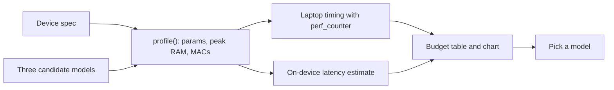

:::objectives
- Write a `profile()` function that reports parameters, peak activations, and MACs for any small PyTorch model.
- Time a model properly with `time.perf_counter`: warm up, repeat, and report the median and the worst case.
- Turn MACs into an on-device latency estimate and check it against a deadline.
- Build a budget table that counts the firmware around the model, then pick a model with evidence.
:::

Your team is building a wrist-worn gesture remote on an Arduino Nano 33 BLE Sense. It reads the accelerometer at 62.5 Hz, classifies the last 2 seconds of motion as **idle**, **snake**, **updown**, or **wave**, and sends the gesture name to a phone over Bluetooth. It makes a new prediction every 250 ms, so a wave is noticed within a quarter of a second.

Three teammates each propose a model. One copied a convolutional network from a desktop activity-recognition tutorial. One wrote a small CNN. One wrote a small dense network. All three reach similar accuracy on your test set. Your job is to decide which ones can actually ship, with numbers to back the decision.



By the end you'll have a stacked chart of flash and RAM for each candidate and a pass or fail verdict on every limit. The same notebook works for any model you build later in the course, including your capstone.

## Step 1: Write the device down as numbers

A budget starts with the fixed facts. The window size and sample rate set the input shape (125 samples × 3 axes), the prediction rate sets the deadline, and the board sets the limits.

The Arduino IDE reports 983,040 bytes (960 KB) of program space for this board, because a bootloader keeps the rest of the 1 MB. The RAM is the full 256 KB.

```python run
import time
import statistics
import torch
from torch import nn
import matplotlib.pyplot as plt

torch.manual_seed(0)
torch.set_num_threads(1)          # one core, like the microcontroller

SAMPLE_HZ = 62.5
WINDOW_S = 2.0
AXES = 3
SAMPLES = int(SAMPLE_HZ * WINDOW_S)   # 125
CLASSES = 4                            # idle, snake, updown, wave
HOP_MS = 250                           # a new prediction every 250 ms

FLASH_KB = 960                         # program space the Arduino IDE reports
RAM_KB = 256
CLOCK_HZ = 64_000_000

print(f"input: {AXES} axes x {SAMPLES} samples = {AXES * SAMPLES} values per window")
print(f"deadline: {HOP_MS} ms per prediction")
```

375 values per window is the same frame size that appears in Edge Impulse's example output for these four gestures, so these are realistic numbers.

## Step 2: The three candidates

Each model takes a tensor shaped `(batch, axes, samples)` and returns four scores.

```python run
candidates = {
    "desktop CNN": nn.Sequential(
        nn.Conv1d(AXES, 64, 9), nn.ReLU(),
        nn.Conv1d(64, 128, 9), nn.ReLU(),
        nn.Conv1d(128, 128, 9), nn.ReLU(),
        nn.AdaptiveAvgPool1d(1), nn.Flatten(),
        nn.Linear(128, CLASSES),
    ),
    "small CNN": nn.Sequential(
        nn.Conv1d(AXES, 16, 5), nn.ReLU(), nn.MaxPool1d(2),
        nn.Conv1d(16, 32, 5), nn.ReLU(), nn.MaxPool1d(2),
        nn.Flatten(), nn.Linear(32 * 28, CLASSES),
    ),
    "small dense": nn.Sequential(
        nn.Flatten(),
        nn.Linear(AXES * SAMPLES, 32), nn.ReLU(),
        nn.Linear(32, 16), nn.ReLU(),
        nn.Linear(16, CLASSES),
    ),
}
for name, model in candidates.items():
    model.eval()
    out = model(torch.zeros(1, AXES, SAMPLES))
    print(f"{name:12} output shape {tuple(out.shape)}")
```

All three produce one row of four scores, so they're drop-in replacements for each other. That's what makes a fair comparison possible.

## Step 3: Profile parameters, peak activations, and MACs

This is the counting from the notes, wrapped in one function. A forward hook records each layer's input and output sizes and adds up MACs for `Conv1d` and `Linear` layers. For a 1-D convolution, each weight is used once per output position, so the MACs are `output_length × kernel × c_in × c_out`.

```python run
def profile(model, input_shape):
    live, macs = [], 0
    def record(layer, inputs, output):
        nonlocal macs
        live.append(inputs[0].numel() + output.numel())
        if isinstance(layer, nn.Conv1d):
            macs += output.shape[2] * layer.kernel_size[0] * layer.in_channels * layer.out_channels
        elif isinstance(layer, nn.Linear):
            macs += layer.in_features * layer.out_features
    hooks = [m.register_forward_hook(record) for m in model
             if not isinstance(m, (nn.ReLU, nn.Flatten))]
    with torch.no_grad():
        model(torch.zeros(1, *input_shape))
    for h in hooks:
        h.remove()
    return {
        "params": sum(p.numel() for p in model.parameters()),
        "peak_values": max(live),     # numbers alive at once at the worst layer
        "macs": macs,
    }

profiles = {name: profile(m, (AXES, SAMPLES)) for name, m in candidates.items()}

print(f"{'model':12} {'params':>9} {'int8 KB':>8} {'fp32 KB':>8} {'peak int8 KB':>13} {'MACs':>11}")
for name, p in profiles.items():
    print(f"{name:12} {p['params']:9,} {p['params']/1024:8.1f} {p['params']*4/1024:8.1f} "
          f"{p['peak_values']/1024:13.1f} {p['macs']:11,}")
```

Read across the rows. The desktop CNN has about 35 times the parameters of the small CNN and over 130 times the MACs. Its third convolution alone has 128 × 128 × 9 weights, because convolution parameters grow with input channels times output channels. The small dense network has the fewest MACs by far: a dense layer uses each weight exactly once.

In float32 the desktop CNN's weights take about 874 KB. That's 91% of the program space before a single line of firmware.

## Step 4: Time each model on your laptop, the careful way

`time.perf_counter()` is Python's high-resolution clock for measuring short intervals. The careful recipe has three parts. Run a few **warm-up** calls first, because the first call pays one-time costs such as memory allocation. Time **many** calls, because any single run can be delayed by something else on the machine. Report the **median** for typical speed and a high percentile for the bad cases.

```python run alt="Histogram of 300 inference times for the small CNN on a laptop. Most runs cluster tightly at a few tens of microseconds, with a small tail of slower runs. The very first call, marked with a dashed line, is slower than nearly all of them." caption="300 timed runs of the small CNN on the machine that built this page. Your Colab numbers will differ."
def time_model(model, input_shape, warmup=20, runs=300):
    x = torch.randn(1, *input_shape)
    times_us = []
    with torch.no_grad():
        for i in range(warmup + runs):
            start = time.perf_counter()
            model(x)
            times_us.append((time.perf_counter() - start) * 1e6)
    return times_us[0], times_us[warmup:]      # the very first call, then the timed runs

laptop = {}
for name, model in candidates.items():
    first, runs = time_model(model, (AXES, SAMPLES))
    runs_sorted = sorted(runs)
    laptop[name] = statistics.median(runs)
    p95 = runs_sorted[int(0.95 * len(runs_sorted))]
    print(f"{name:12} first call {first:7.0f} us   median {laptop[name]:6.0f} us   95th percentile {p95:6.0f} us")

first, runs = time_model(candidates["small CNN"], (AXES, SAMPLES))
plt.figure(figsize=(7, 3.4))
plt.hist(runs, bins=40, color="#2a78d6")
plt.axvline(first, color="#d64545", linestyle="--", label=f"first call: {first:.0f} us")
plt.axvline(statistics.median(runs), color="#333", label="median")
plt.xlabel("Time per inference (microseconds)")
plt.ylabel("Runs")
plt.legend(frameon=False)
plt.tight_layout()
```

On a laptop every candidate finishes in well under a millisecond, and the first call is the slowest, which is why it's thrown away. Now compare the medians with the MAC counts. The MAC ratios between models are far bigger than the time ratios. For tiny models, a laptop spends most of each call on PyTorch's own overhead, not arithmetic, so laptop timing can't rank them the way a microcontroller would.

:::warning
**Timing mistakes that give you a meaningless number**

-   **Timing one call.** You get the warm-up cost, or a moment when the operating system was busy. Always repeat and take the median.
-   **Using `time.time()`.** It follows the wall clock, which can be adjusted while your code runs, and on some systems it ticks too coarsely for microsecond work. Use `time.perf_counter()` for intervals.
-   **Forgetting `torch.no_grad()`.** Without it PyTorch records extra information for training, so you time work the device will never do.
:::

## Step 5: Estimate the time on the microcontroller

To predict the board, go back to MACs. Using the planning figure of one to two cycles per int8 MAC on a 64 MHz Cortex-M4, the estimate is `MACs × cycles ÷ clock`. The raw-data feature block does almost no work, but we'll reserve 5 ms for reading the window and scaling it. The team's rule: DSP plus inference may use at most half the 250 ms hop, leaving the rest for Bluetooth and for sleeping.

```python run
DSP_MS = 5
LIMIT_MS = HOP_MS / 2

estimates = {}
for name, p in profiles.items():
    low = p["macs"] * 1 / CLOCK_HZ * 1000 + DSP_MS
    high = p["macs"] * 2 / CLOCK_HZ * 1000 + DSP_MS
    estimates[name] = high                       # plan for the slow end
    verdict = "fits" if high <= LIMIT_MS else "MISSES the deadline"
    model_only_us = p["macs"] * 2 / CLOCK_HZ * 1e6
    ratio = model_only_us / laptop[name]          # compare the model alone with the laptop
    print(f"{name:12} {low:6.1f} to {high:6.1f} ms on the board  (model alone: {ratio:,.0f}x the laptop)  {verdict}")
```

The desktop CNN needs roughly 360 to 730 ms per prediction, three to six times the 125 ms limit, so it fails even in int8. The other two need about 5 to 11 ms, most of it the DSP allowance. The ratio column is the warning from the notes in numbers: for the model alone, the board is somewhere between tens and thousands of times slower than the laptop, and the factor changes from model to model.

## Step 6: Count the whole firmware, then decide

The model is only one line of the budget. The Arduino core and Mbed OS, the Bluetooth library, the Edge Impulse SDK, the stack, and the sensor buffers all need room. The fixed numbers below are rough figures for this board; replace them with your own. When you compile, the Arduino IDE prints lines like "Sketch uses … bytes of program storage space" and "Global variables use … bytes of dynamic memory", and those are the numbers to use.

```python run alt="Two stacked bar charts. Flash: the desktop CNN in float32 goes past the 960 KB limit; in int8 it fits; the small CNN and small dense models use well under half. RAM: all candidates stay far below 256 KB, dominated by the operating system and Bluetooth, not the model." caption="Flash and RAM for each candidate against the board's limits. Grey and blue are the firmware; orange is the model."
FIXED_FLASH_KB = {"Arduino core + Mbed OS": 85, "Bluetooth library": 200, "Edge Impulse SDK + DSP": 60}
FIXED_RAM_KB = {"Arduino core + Mbed OS": 45, "Bluetooth": 20, "stack + serial": 16}
WINDOW_KB = AXES * SAMPLES * 4 / 1024        # the SDK takes the raw window as float32

rows = []
for name, p in profiles.items():
    for dtype, nbytes in [("int8", 1), ("float32", 4)]:
        model_flash = p["params"] * nbytes / 1024
        arena = p["peak_values"] * nbytes / 1024
        flash = sum(FIXED_FLASH_KB.values()) + model_flash
        ram = sum(FIXED_RAM_KB.values()) + 2 * WINDOW_KB + arena   # raw window + features
        rows.append((f"{name}\n{dtype}", model_flash, arena, flash, ram, estimates[name]))

print(f"{'candidate':22} {'flash KB':>9} {'of 960':>7} {'RAM KB':>7} {'of 256':>7} {'ms':>6}")
for label, _, _, flash, ram, ms in rows:
    ok = flash <= 0.8 * FLASH_KB and ram <= 0.8 * RAM_KB and ms <= LIMIT_MS
    print(f"{label.replace(chr(10), ' '):22} {flash:9.0f} {flash/FLASH_KB:6.0%} {ram:7.0f} {ram/RAM_KB:6.0%} "
          f"{ms:6.1f}  {'PASS' if ok else 'FAIL'}")

fig, (ax1, ax2) = plt.subplots(1, 2, figsize=(9, 4.2), sharey=True)
labels = [r[0] for r in rows]
fixed_flash = sum(FIXED_FLASH_KB.values())
fixed_ram = sum(FIXED_RAM_KB.values()) + 2 * WINDOW_KB
ax1.barh(labels, [fixed_flash] * len(rows), color="#9aa5b1", label="firmware")
ax1.barh(labels, [r[1] for r in rows], left=fixed_flash, color="#eb6834", label="model weights")
ax1.axvline(FLASH_KB, color="#333", linestyle="--")
ax1.set_xlim(0, 1300)
ax1.set_title("Flash (KB), limit 960")
ax1.legend(frameon=False, loc="lower right")
ax2.barh(labels, [fixed_ram] * len(rows), color="#2a78d6", label="firmware + buffers")
ax2.barh(labels, [r[2] for r in rows], left=fixed_ram, color="#eb6834", label="activations")
ax2.axvline(RAM_KB, color="#333", linestyle="--")
ax2.set_xlim(0, 280)
ax2.set_title("RAM (KB), limit 256")
ax2.legend(frameon=False, loc="lower right")
ax1.invert_yaxis()
plt.tight_layout()
```

The pass rule keeps 20% of flash and RAM free, because every real project grows: a bug fix, a logging feature, a bigger Bluetooth buffer. Read the verdicts:

-   **Desktop CNN, float32** fails flash outright. **Desktop CNN, int8** fits in memory but fails the deadline, as Step 5 showed.
-   **Small CNN** and **small dense** pass everything in both data types, with lots of room.

Notice where the RAM goes. For these gesture models, the operating system and Bluetooth use far more RAM than the model. That's normal for motion sensing. Image and audio models are where activations take over, as you'll see in the practice exercises.

With two models passing, budget isn't the tiebreaker anymore. Pick by accuracy on real-world data (next module) and by energy: the small dense network does about 14 times fewer MACs than the small CNN, so the chip can sleep longer between predictions.

## The finished notebook

Put the steps together into one file you can reuse. Change `candidates` and the constants, and run it again for any device.

```python run title="gesture_budget.py"
import torch
from torch import nn

AXES, SAMPLES, CLASSES = 3, 125, 4
HOP_MS, CLOCK_HZ, CYCLES_PER_MAC, DSP_MS = 250, 64_000_000, 2, 5
FLASH_KB, RAM_KB, HEADROOM = 960, 256, 0.8
FIXED_FLASH_KB, FIXED_RAM_KB = 85 + 200 + 60, 45 + 20 + 16
WINDOW_KB = AXES * SAMPLES * 4 / 1024

def profile(model, input_shape):
    live, macs = [], 0
    def record(layer, inputs, output):
        nonlocal macs
        live.append(inputs[0].numel() + output.numel())
        if isinstance(layer, nn.Conv1d):
            macs += output.shape[2] * layer.kernel_size[0] * layer.in_channels * layer.out_channels
        elif isinstance(layer, nn.Linear):
            macs += layer.in_features * layer.out_features
    hooks = [m.register_forward_hook(record) for m in model if not isinstance(m, (nn.ReLU, nn.Flatten))]
    with torch.no_grad():
        model(torch.zeros(1, *input_shape))
    for h in hooks:
        h.remove()
    return sum(p.numel() for p in model.parameters()), max(live), macs

def budget(name, model, bytes_per_value=1):
    params, peak, macs = profile(model, (AXES, SAMPLES))
    flash = FIXED_FLASH_KB + params * bytes_per_value / 1024
    ram = FIXED_RAM_KB + 2 * WINDOW_KB + peak * bytes_per_value / 1024
    ms = macs * CYCLES_PER_MAC / CLOCK_HZ * 1000 + DSP_MS
    checks = {
        "flash": flash <= HEADROOM * FLASH_KB,
        "RAM": ram <= HEADROOM * RAM_KB,
        "deadline": ms <= HOP_MS / 2,
    }
    failed = [k for k, ok in checks.items() if not ok]
    print(f"{name:20} flash {flash:5.0f} KB  RAM {ram:4.0f} KB  {ms:6.1f} ms  ->",
          "PASS" if not failed else "FAIL: " + ", ".join(failed))

small_dense = nn.Sequential(nn.Flatten(), nn.Linear(AXES * SAMPLES, 32), nn.ReLU(),
                            nn.Linear(32, 16), nn.ReLU(), nn.Linear(16, CLASSES))
budget("small dense, int8", small_dense, 1)
budget("small dense, float32", small_dense, 4)
```

:::quiz
Q: Why does the notebook throw away the warm-up calls before computing the median?
- [ ] Warm-up calls are always faster and would make the model look too good
  It's the other way around: the first calls are usually the slowest.
- [x] The first calls include one-time costs that the device won't pay on every prediction
  Memory allocation and setup happen once. Including them would make typical latency look worse than it is.
- [ ] `time.perf_counter()` is inaccurate for the first few calls
  The clock is fine; it's the model call that's slower at first.

Q: The desktop CNN in int8 uses about 59% of flash and well under 256 KB of RAM. Why does it still fail?
- [ ] Int8 models can't run on a Cortex-M4
  Int8 is the format microcontroller runtimes are best at.
- [x] Its 23 million MACs take hundreds of milliseconds, far past the 125 ms limit
  It fits in memory, but at one to two cycles per MAC on a 64 MHz chip, it can't keep up with a prediction every 250 ms.
- [ ] Its parameters push RAM over the limit
  Parameters live in flash. RAM holds activations, and this model's are small.

Q: The small CNN and small dense both pass. Why would you lean toward the dense network if accuracy is equal?
- [x] It does far fewer MACs, so the chip finishes sooner and can sleep longer, which saves battery
  Fewer operations means less active time per prediction. Module 7 turns that into days of battery life.
- [ ] It has fewer parameters, so it uses less flash
  It actually has about twice the parameters of the small CNN; both are tiny compared with the firmware.
- [ ] Dense layers are always more accurate than convolutions on motion data
  Neither is always better; that's why you test both on real data.
:::

:::takeaways
- Write the device spec as constants first: input shape, deadline, flash, RAM, and clock.
- One `profile()` function with forward hooks gives parameters, peak activations, and MACs for any sequential model.
- Time with `time.perf_counter()`: warm up, repeat, report the median and a high percentile.
- Laptop timings can't predict microcontroller timings, even in relative terms, for tiny models. Estimate from MACs and confirm on the board.
- Count the firmware around the model and keep about 20% headroom. For motion models, the OS and Bluetooth usually outweigh the model.
:::

## Ideas to extend it

-   Add a fourth candidate that reads 6 axes (accelerometer and gyroscope) at 100 Hz, and see which limits move.
-   Replace the fixed numbers with the "Sketch uses" and "Global variables use" lines from compiling an empty sketch with the Bluetooth library on your board.
-   Train the small dense network on Edge Impulse and compare its On-device performance estimate with your `profile()` numbers.

## Further reading

-   [Arduino Memory Guide](https://docs.arduino.cc/learn/programming/memory-guide) explains flash, SRAM, and how to read the memory report the IDE prints after compiling.
-   [Python `time` module](https://docs.python.org/3/library/time.html) documents `perf_counter()` and why it suits short measurements.
-   [Edge Impulse: Deployment](https://docs.edgeimpulse.com/studio/projects/deployment) shows the int8 and float32 model versions, the EON Compiler, and the resource estimates for your chosen target.
