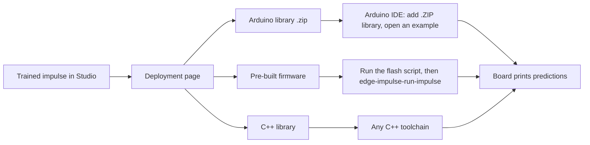

:::objectives
- Choose between Edge Impulse's Arduino library, pre-built firmware, and C++ library, and say what each one contains.
- Read the core of an Edge Impulse Arduino sketch: `signal_t`, `run_classifier()`, and the result struct.
- Run a parity check that proves the board computes the same scores as Studio.
- Explain data drift and show it with a lab-versus-field confusion matrix.
- Order your tests from Studio to the field, and say which bugs each one catches.
:::

Model testing in Edge Impulse says 98%. You flash the board, strap it to your wrist, and wave. The Serial Monitor says **snake**. You wave again: **idle**. Up and down: **snake**.

Nothing about the model changed between the test page and your wrist. What changed was the data. In the lab you held the board flat, the way you held it while recording training samples. On a wrist it sits tilted, so gravity and motion show up on different axes. The model was never shown that, and it fails in a specific, predictable pattern you can read off a confusion matrix.

This lesson covers both halves of the problem: getting the model onto the board correctly, and measuring how good it is once it's there.

## What Edge Impulse builds when you click Build

The **Deployment** page in Edge Impulse Studio has a search box ("Search deployment options") and a long list of targets. Options that don't support your project's sensor type are greyed out and labeled "Not supported". Three matter for this course's boards:

| Option | What you download | When to use it |
| --- | --- | --- |
| **Arduino library** | A `.zip` with your impulse (DSP code, model, and SDK) as an Arduino library, plus example sketches | You want to write your own sketch around the model, for example to light an LED or send Bluetooth messages |
| **Pre-built firmware** (shown under your board's name) | A ready-to-flash binary for a fully supported board such as the Nano 33 BLE Sense | You want to see the model running in minutes, with no code |
| **C++ library** | The same impulse as plain C++ source | Your board isn't an Arduino, or you use another build system |

Below the list, **Model optimizations** lets you pick **Quantized (int8)** or **Unoptimized (float32)**, and the TFLite or **EON Compiler** runtime. Studio estimates latency, RAM, and flash for each choice before you build, so you can check them against the budget from the last module.



For the **Arduino library**, install the `.zip` with **Sketch › Include Library › Add .ZIP Library…**, then open **File › Examples › *your project name*_inferencing**. On a Nano 33 BLE Sense there are examples for the accelerometer, microphone, and camera. Rev2 boards have their own `nano_ble33_sense_rev2` versions of the motion examples, because the Rev2 uses a different motion sensor.

For **pre-built firmware**, the downloaded `.zip` contains flash scripts (`flash_windows.bat`, `flash_mac.command`, `flash_linux.sh`). After flashing, `edge-impulse-run-impulse` prints predictions in your terminal; add `--continuous` to classify without pauses on boards that support it.

## One function call does the work

Here is the heart of Edge Impulse's accelerometer example for the Nano 33 BLE Sense. It fills a buffer at the sampling interval the model was trained on, wraps the buffer in a `signal_t`, and calls `run_classifier()`:

```arduino
float buffer[EI_CLASSIFIER_DSP_INPUT_FRAME_SIZE] = { 0 };

for (size_t ix = 0; ix < EI_CLASSIFIER_DSP_INPUT_FRAME_SIZE; ix += 3) {
    uint64_t next_tick = micros() + (EI_CLASSIFIER_INTERVAL_MS * 1000);
    IMU.readAcceleration(buffer[ix], buffer[ix + 1], buffer[ix + 2]);
    buffer[ix + 0] *= CONVERT_G_TO_MS2;    // the IMU reports g; training data was m/s^2
    buffer[ix + 1] *= CONVERT_G_TO_MS2;
    buffer[ix + 2] *= CONVERT_G_TO_MS2;
    delayMicroseconds(next_tick - micros());
}

signal_t signal;
int err = numpy::signal_from_buffer(buffer, EI_CLASSIFIER_DSP_INPUT_FRAME_SIZE, &signal);

ei_impulse_result_t result = { 0 };
err = run_classifier(&signal, &result, false);

for (size_t ix = 0; ix < EI_CLASSIFIER_LABEL_COUNT; ix++) {
    Serial.print(result.classification[ix].label);
    Serial.print(": ");
    Serial.println(result.classification[ix].value, 5);
}
```

Every name in capitals comes from the generated library: `EI_CLASSIFIER_DSP_INPUT_FRAME_SIZE` is 375 for a 2-second, 3-axis window at 62.5 Hz, and `EI_CLASSIFIER_INTERVAL_MS` is the gap between samples (16 ms). Two lines decide whether the board sees the same kind of data as training: the unit conversion, and the wait that keeps the sample rate right. Get either wrong and the model receives numbers it has never seen. The result also carries `result.timing.dsp` and `result.timing.classification` in milliseconds, which are your real latency measurements.

## Test 1 on the board: does it agree with Studio?

Before testing accuracy, prove the deployment is correct. The Arduino library includes a **static_buffer** example for exactly this. In Studio, open **Live classification**, load a test sample, click a row under the detailed result, and use **Copy to clipboard** next to **Raw features**. Paste those numbers into the `features[]` array in the sketch, upload it, and open the Serial Monitor at 115,200 baud.

The board should print scores that match what Studio showed for the same window, to within small rounding differences. If they don't, the problem is in the build, not the data: a float32 model tested in Studio but an int8 model deployed, a stale library still installed from an older build, or a sketch from a different project. This check takes ten minutes and rules out a whole class of bugs before you spend an afternoon field testing.

## Why the lab score doesn't travel: data drift

**Data drift** means the data a deployed model sees differs from the data it was trained and tested on. For TinyML the usual causes are physical: sensor placement and orientation, a different sample rate, a different user, background noise, lighting, temperature, or a new board revision with a different sensor.

To see it happen, here's a small simulation of the gesture remote. Each 2-second window gets nine features (per axis: the average, the strength of the motion, and the dominant frequency), and a small neural network learns the four classes. The training and test data come from the lab, with the board held roughly flat.

```python run
import numpy as np
from sklearn.neural_network import MLPClassifier
from sklearn.preprocessing import StandardScaler
from sklearn.pipeline import make_pipeline
from sklearn.metrics import accuracy_score

HZ, N = 62.5, 125                         # 2 s windows at 62.5 Hz
t = np.arange(N) / HZ
CLASSES = ["idle", "snake", "updown", "wave"]
rng = np.random.default_rng(1)

def window(gesture, tilt_deg=0.0):
    """One simulated accelerometer window in m/s^2, shape (125, 3)."""
    f, a, ph = rng.uniform(1.5, 2.5), rng.uniform(2, 6), rng.uniform(0, 2 * np.pi)
    x, y, z = np.zeros(N), np.zeros(N), np.full(N, 9.81)      # gravity on z when flat
    if gesture == "wave":
        x += a * np.sin(2 * np.pi * f * t + ph)
    if gesture == "updown":
        z += a * np.sin(2 * np.pi * f * t + ph)
    if gesture == "snake":
        x += a * np.sin(np.pi * f * t + ph)
        y += a * np.sin(2 * np.pi * f * t + ph)
    if gesture == "idle":
        x += 0.8 * np.sin(2 * np.pi * 0.3 * t + ph)
    th = np.radians(tilt_deg + rng.normal(0, 8))               # how the board is worn
    x, z = x * np.cos(th) + z * np.sin(th), -x * np.sin(th) + z * np.cos(th)
    return np.stack([x, y, z], axis=1) + rng.normal(0, 0.8, (N, 3))

def features(w):
    freqs = np.fft.rfftfreq(N, 1 / HZ)
    out = []
    for axis in range(3):
        motion = w[:, axis] - w[:, axis].mean()
        out += [w[:, axis].mean(), np.sqrt(np.mean(motion ** 2)),
                freqs[np.abs(np.fft.rfft(motion)).argmax()]]
    return out

def dataset(n_per_class, tilt_deg=0.0):
    X = [features(window(g, tilt_deg)) for g in CLASSES for _ in range(n_per_class)]
    y = [g for g in CLASSES for _ in range(n_per_class)]
    return np.array(X), np.array(y)

X_train, y_train = dataset(60)
X_lab, y_lab = dataset(30)
model = make_pipeline(StandardScaler(), MLPClassifier(hidden_layer_sizes=(16,), max_iter=2000, random_state=0))
model.fit(X_train, y_train)
print(f"lab test accuracy: {accuracy_score(y_lab, model.predict(X_lab)):.0%}")
```

The lab test set is held out from training, so this is an honest lab number. Now keep the model fixed and change one thing: how far the board is tilted when it's worn.

```python run alt="Line chart of accuracy against how far the board is tilted, from 0 to 60 degrees. Accuracy stays near 98% up to about 20 degrees, then falls steeply to around 50% at 50 to 60 degrees." caption="Same model, same gestures, different placement"
import matplotlib.pyplot as plt

tilts = [0, 10, 20, 30, 40, 50, 60]
accs = []
for tilt in tilts:
    X_t, y_t = dataset(30, tilt_deg=tilt)
    accs.append(accuracy_score(y_t, model.predict(X_t)))
    print(f"tilt {tilt:2d} degrees: {accs[-1]:.0%}")

plt.figure(figsize=(7, 3.6))
plt.plot(tilts, accs, marker="o", color="#2a78d6", linewidth=2)
plt.axhline(0.25, color="#999", linestyle=":", linewidth=1)
plt.text(1, 0.27, "random guessing (4 classes)", color="#666", fontsize=9)
plt.ylim(0, 1.05)
plt.xlabel("Board tilt when worn (degrees)")
plt.ylabel("Accuracy")
plt.title("A model tested flat, worn at an angle")
plt.grid(alpha=0.25)
plt.tight_layout()
```

The model handles small tilts, because the training data had a little wobble in it. Past about 20 degrees, accuracy falls off a cliff. A wrist is easily 40 degrees off flat. Note what didn't happen: no error message, no crash, no warning. The model returns confident-looking scores the whole time.

## Read the confusion matrix, not the headline number

An accuracy of 62% could mean every class is a bit worse, or one class is perfect and another is never recognized. A **confusion matrix** tells you which. Each row is the true class, each column is what the model predicted, and the diagonal holds the correct answers. Edge Impulse's Model testing page uses the same layout.

```python run alt="Two confusion matrices side by side. In the lab matrix almost all counts are on the diagonal. In the field matrix at 40 degrees tilt, idle and snake stay mostly correct, but many updown windows are predicted as snake, and wave windows are spread across idle, snake, and updown." caption="Lab test (left) and the same model worn at about 40 degrees (right)"
from sklearn.metrics import confusion_matrix, ConfusionMatrixDisplay

X_field, y_field = dataset(30, tilt_deg=40)
fig, axes = plt.subplots(1, 2, figsize=(9.5, 4))
for ax, (title, X_, y_) in zip(axes, [("Lab, held flat", X_lab, y_lab), ("Field, worn at 40 degrees", X_field, y_field)]):
    cm = confusion_matrix(y_, model.predict(X_), labels=CLASSES)
    ConfusionMatrixDisplay(cm, display_labels=CLASSES).plot(ax=ax, cmap="Blues", colorbar=False)
    ax.set_title(f"{title}: {accuracy_score(y_, model.predict(X_)):.0%}")
plt.tight_layout()

cm = confusion_matrix(y_field, model.predict(X_field), labels=CLASSES)
for i, label in enumerate(CLASSES):
    print(f"{label:7} recall {cm[i, i] / cm[i].sum():.0%}   (of {cm[i].sum()} real {label} windows)")
```

**Recall** for a class is the share of its real windows the model got right: the diagonal cell divided by its row total. In the field, idle and snake survive while updown and wave collapse, with snake the most common wrong answer. That pattern has a physical explanation: tilting the board mixes the x and z axes, so a wave and an up-down motion both show up on two axes at once, which is what snake looks like in the training data.

The matrix also points at the fix. You don't need a bigger model; you need training data recorded the way the device is worn:

```python run
X_mixed, y_mixed = [], []
for tilt in [0, 20, 40, 60]:                    # record at several placements
    X_part, y_part = dataset(15, tilt_deg=tilt)
    X_mixed.append(X_part); y_mixed.append(y_part)
model_v2 = make_pipeline(StandardScaler(), MLPClassifier(hidden_layer_sizes=(16,), max_iter=2000, random_state=0))
model_v2.fit(np.vstack(X_mixed), np.concatenate(y_mixed))

print(f"v2 lab accuracy:   {accuracy_score(y_lab, model_v2.predict(X_lab)):.0%}")
print(f"v2 field accuracy: {accuracy_score(y_field, model_v2.predict(X_field)):.0%}")
```

Same network, same number of training windows, much better field accuracy. Collecting data where and how the device will be used is the single most effective fix for drift.

## A test ladder from Studio to the field

Each kind of test catches different mistakes, so run them in order and don't skip rungs:

| Rung | Where | Catches |
| --- | --- | --- |
| 1. Model testing | Studio, on held-out test data | Overfitting, weak classes, bad labels |
| 2. Parity check | Board, with `static_buffer` | Build mistakes: wrong model version, stale library, int8 versus float32 surprises |
| 3. Bench test | Board, live sensor, at your desk | Wrong units, wrong sample rate, sensor wiring, latency |
| 4. Field test | Board, real placement, real users and places | Data drift: placement, people, noise, lighting, weather |

Only rung 4 measures what you care about. The others make sure that when rung 4 goes badly, you know the cause is the data and not a bug.

:::video uUh61R8Hu0o
Shawn Hymel from Edge Impulse downloads a model as an Arduino library, installs it, and runs it on a Nano 33 BLE Sense. Watch how the raw accelerometer readings are put into a buffer before `run_classifier()` is called; this is the step where a wrong unit or sample rate sneaks in.
:::

:::warning
**Three ways to fool yourself after deployment**

1.  **Reusing the Studio score as the device's accuracy.** It measures rung 1 only. Report field accuracy separately, with the conditions you tested.
2.  **Testing one model version and deploying another.** Model testing lets you test Unoptimized (float32) or Quantized (int8). Test the one you're going to ship.
3.  **Changing how the sketch samples.** Reading the sensor as fast as the loop runs, or forgetting the g to m/s² conversion, gives the model data at a different rate or scale from training. Keep the example's sampling loop.
:::

:::quiz
Q: The board's scores for a pasted `static_buffer` sample differ completely from Studio's for the same sample. What's the most likely cause?
- [ ] Data drift in the field
  The parity check uses the exact same numbers as Studio, so drift can't be the cause.
- [x] A build mismatch, such as a different model version or an old library still installed
  Same input and different output means the code on the board isn't the impulse you tested.
- [ ] The Serial Monitor's baud rate is wrong
  A wrong baud rate gives garbled text, not believable but different scores.

Q: In a field confusion matrix, the "wave" row reads 8 correct out of 30, with most of the rest in the "snake" column. What does that tell you?
- [x] Wave's recall is about 27%, and the model mostly mistakes waves for snakes
  The row is the true class: 8 of 30 right, and the off-diagonal cells say where the rest went.
- [ ] Snake's recall is low
  Snake's recall is read from the snake row, not from the snake column.
- [ ] The model is 27% accurate overall
  Overall accuracy needs every row; one row gives one class's recall.

Q: Your model scores 98% in the lab and 64% on a wrist. Which change is most likely to help?
- [ ] A bigger network with more layers
  The model already separates lab data well; more capacity doesn't teach it about wrist placement.
- [ ] Switching from int8 to float32
  Quantization costs at most a point or two here; it didn't cause a 34-point drop.
- [x] Recording training data with the board worn the way users will wear it
  The drop comes from data the model never saw. Showing it that data is the direct fix.
:::

:::takeaways
- The Arduino library gives you code to build on; pre-built firmware gives a quick demo with `edge-impulse-run-impulse`; the C++ library works with any toolchain.
- `run_classifier()` takes a `signal_t` and fills an `ei_impulse_result_t` with labels, scores, and DSP and classification times.
- Run a `static_buffer` parity check first: same input, same output, or the build is wrong.
- Data drift is a change between training and deployment data, and for TinyML it's usually physical: placement, rate, users, environment.
- Read per-class recall from a confusion matrix; the pattern of mistakes usually points to the cause and the fix.
:::

## Further reading

-   [Edge Impulse: Deployment](https://docs.edgeimpulse.com/studio/projects/deployment) lists every deployment target and the int8, float32, and EON Compiler options.
-   [Edge Impulse: Running your impulse on Arduino](https://docs.edgeimpulse.com/hardware/deployments/run-arduino-2-0) walks through installing the library and the `static_buffer` parity check step by step.
-   [Edge Impulse: Model testing](https://docs.edgeimpulse.com/studio/projects/model-testing) explains the test set, per-class accuracy, and how to test the int8 version.
