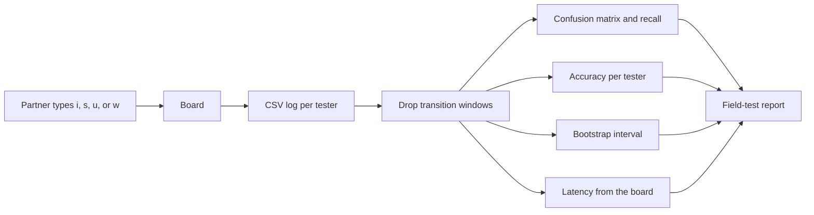

:::objectives
- Extend Edge Impulse's accelerometer example so each prediction is logged as a CSV line with the true label.
- Clean a field log by dropping the windows that straddle a change of gesture.
- Compute a confusion matrix, per-class recall and precision, and accuracy per tester.
- Put an honest uncertainty range on field accuracy by resampling whole blocks, not single windows.
- Check on-device latency from the timings the board reports.
:::

Studio's Model testing page can't tell you how the gesture remote performs on three different people, worn on a wrist, in a hallway. A field test can, but only if every prediction is written down next to what the person was really doing. That pairing is the whole job of this build.

Here's the finished output: a report you can paste into a design doc.



## Step 1: Log every prediction with the truth next to it

Start from the `nano_ble33_sense_accelerometer` example in your project's Arduino library (on a Rev2 board, the `nano_ble33_sense_rev2` version). Keep its sampling loop exactly as it is, since that loop sets the units and sample rate. Add two things: a way for a partner to mark which gesture the tester is doing, and one CSV line per prediction.

```arduino title="field_logger.ino"
/* Field-test logger for an Edge Impulse gesture model on a Nano 33 BLE Sense.
   A partner types i, s, u, or w in the Serial Monitor at the start of each block. */
#include <gesture_remote_inferencing.h>   // use the header named after YOUR project
#include <Arduino_LSM9DS1.h>              // Rev2 boards: #include <Arduino_BMI270_BMM150.h>

#define CONVERT_G_TO_MS2 9.80665f

const char *truth = "none";
int block = 0;

void setup() {
    Serial.begin(115200);
    while (!Serial);                       // waits for USB; remove for battery use
    if (!IMU.begin()) {
        Serial.println("Failed to initialize IMU!");
        while (1);
    }
    Serial.println("ms,block,truth,label,score,dsp_ms,nn_ms");
}

void loop() {
    // 1. Has the partner started a new block?
    while (Serial.available()) {
        char c = Serial.read();
        const char *next = nullptr;
        if (c == 'i') next = "idle";
        if (c == 's') next = "snake";
        if (c == 'u') next = "updown";
        if (c == 'w') next = "wave";
        if (next) { truth = next; block++; }
    }

    // 2. Record one window at the trained sample rate (unchanged from the example)
    float buffer[EI_CLASSIFIER_DSP_INPUT_FRAME_SIZE] = { 0 };
    for (size_t ix = 0; ix < EI_CLASSIFIER_DSP_INPUT_FRAME_SIZE; ix += 3) {
        uint64_t next_tick = micros() + (EI_CLASSIFIER_INTERVAL_MS * 1000);
        IMU.readAcceleration(buffer[ix], buffer[ix + 1], buffer[ix + 2]);
        buffer[ix + 0] *= CONVERT_G_TO_MS2;
        buffer[ix + 1] *= CONVERT_G_TO_MS2;
        buffer[ix + 2] *= CONVERT_G_TO_MS2;
        delayMicroseconds(next_tick - micros());
    }

    // 3. Classify it
    signal_t signal;
    numpy::signal_from_buffer(buffer, EI_CLASSIFIER_DSP_INPUT_FRAME_SIZE, &signal);
    ei_impulse_result_t result = { 0 };
    if (run_classifier(&signal, &result, false) != EI_IMPULSE_OK) {
        Serial.println("# classifier error");
        return;
    }

    // 4. Log the top label as one CSV line
    size_t best = 0;
    for (size_t ix = 1; ix < EI_CLASSIFIER_LABEL_COUNT; ix++) {
        if (result.classification[ix].value > result.classification[best].value) best = ix;
    }
    Serial.print(millis());                              Serial.print(',');
    Serial.print(block);                                 Serial.print(',');
    Serial.print(truth);                                 Serial.print(',');
    Serial.print(result.classification[best].label);     Serial.print(',');
    Serial.print(result.classification[best].value, 3);  Serial.print(',');
    Serial.print(result.timing.dsp);                     Serial.print(',');
    Serial.println(result.timing.classification);
}
```

Upload it, open the Serial Monitor at 115,200 baud, and have your partner type a letter in the message box and press Enter each time the tester switches gesture. The output looks like this:

```text
ms,block,truth,label,score,dsp_ms,nn_ms
5021,1,idle,wave,0.513,15,1
7042,1,idle,idle,0.911,15,1
9060,1,idle,idle,0.673,16,2
```

The `block` number goes up with every key press, even if the gesture is the same as before. That matters in Step 3. Save each tester's lines as a file (`field_A.csv`, `field_B.csv`, …), by copying from the Serial Monitor or by using a serial terminal program that logs to a file.

:::note
This simple loop records a window, then classifies it, so it ignores motion during the few milliseconds of classification. For a field test that's fine. For the product, the `nano_ble33_sense_accelerometer_continuous` example records and classifies at the same time.
:::

## Step 2: Load the logs

So the notebook runs before you have hardware, the next cell writes three logs in exactly the sketch's format. Tester A held the board flat, as in training; testers B and C wore it on the wrist. The predictions are simulated from a realistic error pattern; replace these files with your own and every later cell works unchanged.

```python run
import numpy as np
import pandas as pd

CLASSES = ["idle", "snake", "updown", "wave"]
rng = np.random.default_rng(7)
# chance of each predicted label (columns) for each true label (rows)
pattern = {
    "flat":  [[.96, .02, .01, .01], [.01, .95, .02, .02], [.02, .02, .94, .02], [.03, .02, .01, .94]],
    "wrist": [[.92, .06, .01, .01], [.01, .94, .03, .02], [.05, .30, .62, .03], [.10, .25, .15, .50]],
}
for tester, placement in {"A": "flat", "B": "wrist", "C": "wrist"}.items():
    lines, ms, block = ["ms,block,truth,label,score,dsp_ms,nn_ms"], 3000, 0
    for round_ in range(2):
        for g in rng.permutation(CLASSES):
            block += 1
            for k in range(12):                                   # about 24 s per block
                ms += 2000 + int(rng.integers(15, 22))
                probs = [.25] * 4 if k == 0 else pattern[placement][CLASSES.index(g)]
                pred = CLASSES[rng.choice(4, p=probs)]
                score = rng.uniform(0.55, 0.99) if pred == g else rng.uniform(0.4, 0.9)
                lines.append(f"{ms},{block},{g},{pred},{score:.3f},{int(rng.normal(16, 0.6))},{rng.choice([1, 1, 1, 2])}")
    with open(f"field_{tester}.csv", "w") as f:
        f.write("\n".join(lines) + "\n")

frames = []
for tester in ["A", "B", "C"]:
    df = pd.read_csv(f"field_{tester}.csv")
    df["tester"] = tester
    frames.append(df)
log = pd.concat(frames, ignore_index=True)
print(log.head())
print(f"\n{len(log)} predictions from {log.tester.nunique()} testers")
```

Each row is one 2-second window. Lines arrive about 2,015 ms apart: 2,000 ms of sampling plus DSP, classification, and printing.

## Step 3: Drop the windows that straddle a change

When your partner presses a key, the tester hasn't started the new gesture yet. The first window of every block is mostly reaction time and the end of the old gesture. Scoring it would blame the model for a human delay, so drop the first prediction of each block. This is why the sketch counts blocks rather than relying on the label: two blocks in a row can have the same gesture.

```python run
first_of_block = log.groupby(["tester", "block"]).head(1).index
clean = log.drop(first_of_block).copy()
clean["correct"] = clean["truth"] == clean["label"]

print(f"kept {len(clean)} of {len(log)} predictions")
print(f"accuracy before cleaning: {(log.truth == log.label).mean():.1%}")
print(f"accuracy after cleaning:  {clean.correct.mean():.1%}")
```

Cleaning raises accuracy by several points, and it's the honest number: it measures the model on windows that contain one gesture.

## Step 4: Confusion matrix and per-class scores

Overall accuracy hides which gestures fail. Build the matrix and compute two scores per class: **recall** (of the real waves, how many were called wave) and **precision** (of the windows called wave, how many really were).

```python run alt="Confusion matrix for all three testers combined. Idle and snake are mostly on the diagonal. Updown loses 13 windows to snake, and wave loses 10 windows to updown and 7 to snake." caption="Field results for all testers, transition windows removed"
import matplotlib.pyplot as plt
from sklearn.metrics import confusion_matrix, ConfusionMatrixDisplay

cm = confusion_matrix(clean.truth, clean.label, labels=CLASSES)
ConfusionMatrixDisplay(cm, display_labels=CLASSES).plot(cmap="Blues", colorbar=False)
plt.title("Field test, testers A, B, and C")
plt.tight_layout()

for i, c in enumerate(CLASSES):
    recall = cm[i, i] / cm[i, :].sum()
    precision = cm[i, i] / cm[:, i].sum()
    print(f"{c:7}  recall {recall:5.1%}   precision {precision:5.1%}")
```

Wave and updown are the weak classes, with the lowest recall. Snake has the lowest precision, because it collects many of the mistakes: when the model is unsure about a tilted up-down, it says snake. A user would experience this as "the remote keeps doing the snake action when I move it up and down".

## Step 5: Accuracy for each tester

Now split by tester. If the problem is placement, it should show up as a difference between the flat and wrist sessions.

```python run alt="Bar chart of accuracy per tester. Tester A, who held the board flat, is about 93%. Testers B and C, who wore it on the wrist, are about 80% and 73%." caption="The same model on three testers"
by_tester = clean.groupby("tester")["correct"].mean()
print(by_tester.map("{:.1%}".format))

plt.figure(figsize=(5.5, 3.4))
bars = plt.bar(["A (flat)", "B (wrist)", "C (wrist)"], by_tester.values, color=["#1baf7a", "#eb6834", "#eb6834"])
plt.bar_label(bars, labels=[f"{v:.0%}" for v in by_tester.values], padding=2)
plt.ylim(0, 1.1)
plt.ylabel("Accuracy")
plt.tight_layout()
```

Tester A, holding the board the way training data was recorded, gets lab-like accuracy. Both wrist testers are far lower. One field number for "the model" would have averaged these together and hidden the cause.

## Step 6: How sure are you about that number?

A field test is a sample, and the accuracy you measured would come out a bit different if you ran it again. A **bootstrap** estimates how much: resample your data with replacement thousands of times and see how much the accuracy moves.

There's a trap. Windows from the same block are not independent: same person, same minute, same way of wearing the board. Resampling single windows pretends you have hundreds of independent trials and gives a falsely narrow range. Resample **whole blocks** instead.

```python run alt="Two overlapping histograms of bootstrapped accuracy. Resampling single windows gives a narrow peak. Resampling whole blocks gives a wider spread over roughly the same center." caption="Resampling blocks gives a wider and more honest range than resampling windows"
blocks = clean.groupby(["tester", "block"])["correct"].agg(["sum", "count"]).reset_index()
boot_blocks, boot_windows = [], []
correct = clean["correct"].to_numpy()
for _ in range(2000):
    pick = blocks.sample(len(blocks), replace=True, random_state=int(rng.integers(1_000_000)))
    boot_blocks.append(pick["sum"].sum() / pick["count"].sum())
    boot_windows.append(rng.choice(correct, len(correct)).mean())

lo_b, hi_b = np.percentile(boot_blocks, [2.5, 97.5])
lo_w, hi_w = np.percentile(boot_windows, [2.5, 97.5])
print(f"{len(blocks)} blocks, {len(clean)} windows")
print(f"95% range, resampling windows: {lo_w:.1%} to {hi_w:.1%}")
print(f"95% range, resampling blocks:  {lo_b:.1%} to {hi_b:.1%}")

plt.figure(figsize=(7, 3.4))
bins = np.arange(0.65, 1.0, 0.01)
plt.hist(boot_windows, bins=bins, alpha=0.6, color="#2a78d6", label="resampling windows")
plt.hist(boot_blocks, bins=bins, alpha=0.6, color="#eb6834", label="resampling blocks")
plt.xlabel("Field accuracy in a resampled test")
plt.ylabel("Count")
plt.legend(frameon=False)
plt.tight_layout()
```

The block-based range is wider. With 24 blocks you know field accuracy to within several percentage points, not to one decimal place. To narrow it, add more blocks: more testers, more sessions, more places. More windows from the same block barely help.

## Step 7: Latency, measured on the board

The log also carries the board's own timings. They replace the estimates from the budget module with measurements.

```python run
total_ms = clean["dsp_ms"] + clean["nn_ms"]
print(f"DSP:            median {clean.dsp_ms.median():.0f} ms, max {clean.dsp_ms.max()} ms")
print(f"classification: median {clean.nn_ms.median():.0f} ms, max {clean.nn_ms.max()} ms")
print(f"total:          99th percentile {total_ms.quantile(0.99):.0f} ms against a 125 ms limit")
```

For this motion model, DSP takes far longer than the neural network, and the whole thing uses a small slice of the budget.

## The finished report

Put it together as one script you run after every field session. It reads all `field_*.csv` files in the folder and prints a summary with pass or fail against the targets you set before testing.

```python run title="field_report.py"
import glob
import numpy as np
import pandas as pd

CLASSES = ["idle", "snake", "updown", "wave"]
TARGET_RECALL = 0.80          # every class, every tester group
LIMIT_MS = 125

frames = [pd.read_csv(path).assign(tester=path[-5]) for path in sorted(glob.glob("field_*.csv"))]
log = pd.concat(frames, ignore_index=True)
clean = log.drop(log.groupby(["tester", "block"]).head(1).index).copy()
clean["correct"] = clean.truth == clean.label

print(f"FIELD TEST: {clean.tester.nunique()} testers, {clean.groupby(['tester', 'block']).ngroups} blocks, {len(clean)} windows")
print(f"overall accuracy {clean.correct.mean():.1%}")
failures = []
for c in CLASSES:
    recall = clean[clean.truth == c].correct.mean()
    flag = "ok" if recall >= TARGET_RECALL else "BELOW TARGET"
    if recall < TARGET_RECALL:
        failures.append(c)
    print(f"  {c:7} recall {recall:5.1%}  {flag}")
for t, acc in clean.groupby("tester").correct.mean().items():
    print(f"  tester {t}: {acc:.1%}")
worst_ms = (clean.dsp_ms + clean.nn_ms).max()
print(f"worst latency {worst_ms} ms ({'ok' if worst_ms <= LIMIT_MS else 'OVER'})")
print("RESULT:", "PASS" if not failures else "FAIL, collect wrist-worn data for " + ", ".join(failures))
```

The verdict names the next action. That's the point of writing targets down before the test: the report tells you what to do, not just how you did.

:::quiz
Q: Why does the sketch print a `block` number instead of relying on changes in the `truth` column?
- [ ] Block numbers take less space in the log
  Space isn't the issue; the two columns are about the same size.
- [x] Two blocks in a row can be the same gesture, and the first window of each must still be dropped
  If round 1 ends with wave and round 2 starts with wave, the truth never changes, but the tester still paused.
- [ ] The Serial Monitor can't send letters reliably
  It sends them fine; the block counter is about cleaning the log afterwards.

Q: Resampling windows gives a 95% range of 77% to 86%. Resampling blocks gives 75% to 88%. Which should go in the report?
- [ ] The windows range, because it's narrower and more precise
  Narrower only because it treats correlated windows as independent trials, which they aren't.
- [x] The blocks range, because windows from one block share a person, a time, and a placement
  Blocks are closer to independent trials, so their spread is the honest uncertainty.
- [ ] Neither; report the single accuracy number
  A single number without a range invites people to read differences that are just noise.

Q: Updown has recall 74% and snake has precision 71%. What does a user notice?
- [x] Up-down moves often trigger the wrong action, frequently the snake action
  Low updown recall means up-downs are missed; low snake precision means many "snake" outputs weren't snakes.
- [ ] Snakes are usually missed
  Snake recall is high; precision is what's low.
- [ ] Nothing, because overall accuracy is above 80%
  Users experience individual classes, not the average.
:::

:::takeaways
- Log the truth on the device, next to each prediction, so field results can be scored without guesswork.
- Drop windows that straddle a change; they measure human reaction time, not the model.
- Report per-class recall and precision, and split by tester or condition to find the cause.
- Bootstrap over blocks, not windows, to get an honest uncertainty range.
- Write pass targets before testing so the report tells you what to do next.
:::

## Ideas to extend it

-   Add a column for `result.classification` scores of all four classes, and plot how often the right class was second.
-   Have the sketch flash the built-in LED when it predicts wave, so the tester sees mistakes live.
-   Add a fourth tester in a noisy place, such as walking down a corridor, and see whether idle survives.

## Further reading

-   [Edge Impulse: Live classification](https://docs.edgeimpulse.com/studio/projects/live-classification) shows how to record new samples from the device and move misclassified ones into your training set.
-   [scikit-learn: confusion_matrix](https://scikit-learn.org/stable/modules/generated/sklearn.metrics.confusion_matrix.html) documents the function and the row and column convention.
