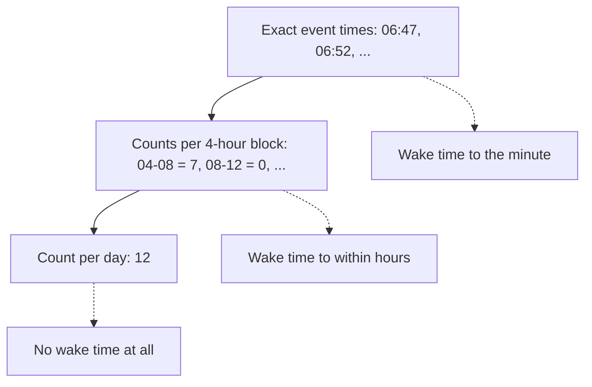

:::objectives
- Compute average current and battery life for always-on and duty-cycled devices.
- Solve for the longest wake interval that still meets a battery-life target.
- Decide which change (active current, active time, or sleep current) helps a given device most.
- Check whether a radio can even carry a data stream before costing it.
- Minimize a message to its purpose and measure what coarser timestamps hide.
:::

The first four exercises are power; the last two are privacy. Every solution runs on its own. All currents are planning figures given in the task, so focus on the method.

## Warm-up

1.  A 220 mAh coin cell powers a device averaging 50 µA. How many days does it last?
2.  Two AA cells give 2,000 usable mAh. The device averages 1 mA. How many days?

:::solution
1.  50 µA = 0.05 mA. 220 ÷ 0.05 = 4,400 hours = **about 183 days**.
2.  2,000 ÷ 1 = 2,000 hours = **about 83 days**.

Always convert µA to mA before dividing, or your answer is off by a factor of a thousand.
:::

### Exercise 1: The cost of always listening

A keyword spotter must hear every word, so its microphone never sleeps. The microphone draws 0.6 mA all the time. The CPU runs DSP and the model 25% of the time at 5 mA, and sleeps the rest at 3 µA. Compute the average current and the battery life on a 220 mAh coin cell and on 2,000 usable mAh of AA cells.

```text
average 1.852 mA
coin cell: 5 days
2 x AA:    45 days
```

:::hint
Add the microphone's constant current to the CPU's duty-cycled average: `0.6 + 0.25 * 5 + 0.75 * 0.003`.
:::

:::solution
```python run
mic = 0.6
cpu = 0.25 * 5.0 + 0.75 * 0.003
avg = mic + cpu
print(f"average {avg:.3f} mA")
print(f"coin cell: {220 / avg / 24:.0f} days")
print(f"2 x AA:    {2000 / avg / 24:.0f} days")
```

Always-on audio is expensive even with a tiny model, because the microphone and the constant processing never stop. That's why products use a low-power trigger first, such as a sound-level detector or a very small "is anyone speaking?" model, and wake the full keyword spotter only when it fires.
:::

### Exercise 2: How long can it sleep?

A soil monitor wakes every `T` seconds, spends 120 ms at 5 mA sensing and classifying, and sleeps at 5 µA otherwise. It runs on a coin cell with 176 mAh usable (220 mAh at 80%). Find the smallest whole number `T` that makes it last at least 365 days, and plot battery life against `T` from 1 to 120 seconds.

```text
smallest interval for one year: 40 s (average 0.0200 mA, 367 days)
```

:::hint
For a given `T`, the average is `(5 * 0.12 + 0.005 * (T - 0.12)) / T` in mA. Loop `T` upward from 1 and stop at the first one where `176 / avg / 24 >= 365`.
:::

:::solution
```python run alt="Line chart of coin-cell life in days against wake interval from 1 to 120 seconds. Life rises steeply at first, crosses one year at 40 seconds, and reaches about 730 days at 120 seconds as the curve flattens." caption="Longer intervals help a lot at first, then sleep current takes over"
import matplotlib.pyplot as plt

USABLE = 176
def life_days(T):
    avg = (5 * 0.12 + 0.005 * (T - 0.12)) / T
    return USABLE / avg / 24, avg

for T in range(1, 121):
    days, avg = life_days(T)
    if days >= 365:
        print(f"smallest interval for one year: {T} s (average {avg:.4f} mA, {days:.0f} days)")
        break

Ts = list(range(1, 121))
plt.figure(figsize=(6.5, 3.4))
plt.plot(Ts, [life_days(T)[0] for T in Ts], color="#2a78d6", linewidth=2)
plt.axhline(365, color="#333", linestyle="--")
plt.xlabel("Wake interval T (s)")
plt.ylabel("Coin-cell life (days)")
plt.tight_layout()
```

The curve flattens because, as `T` grows, the active part (`0.6 / T` mA) shrinks toward zero while the 5 µA sleep part stays. However long you sleep, this design can't beat 176 mAh ÷ 0.005 mA ≈ 1,467 days.
:::

### Exercise 3: Which fix is worth it?

Two devices both draw 5 mA for 200 ms when awake and 10 µA asleep, with 176 mAh usable. One wakes every second (busy), the other every 60 seconds (idle). For each, compute how many times longer the battery lasts if you halve (a) the active current, (b) the active time, or (c) the sleep current.

:::hint
Write `life(active_ma, active_s, period_s, sleep_ma)` once, then call it with one value halved at a time and divide by the original.
:::

:::solution
```python run
def life(active_ma, active_s, period_s, sleep_ma, usable=176):
    avg = (active_ma * active_s + sleep_ma * (period_s - active_s)) / period_s
    return usable / avg / 24

for name, period in [("busy, every 1 s", 1), ("idle, every 60 s", 60)]:
    base = life(5, 0.2, period, 0.010)
    print(f"{name}: {base:.0f} days")
    print(f"   halve active current: x{life(2.5, 0.2, period, 0.010) / base:.2f}")
    print(f"   halve active time:    x{life(5, 0.1, period, 0.010) / base:.2f}")
    print(f"   halve sleep current:  x{life(5, 0.2, period, 0.005) / base:.2f}")
```

For the busy device, halving active current or time nearly doubles life, and sleep current is irrelevant. For the idle device, all three matter and none comes close to doubling, because active and sleep are similar in size. There's no universal "best optimization": compute it for your duty cycle before spending a week on one.
:::

### Exercise 4: Can the radio even keep up?

A device's radio can send about 10 KB per second while drawing 8 mA. Compare three plans for a day: stream raw audio (16,000 samples per second, 2 bytes each), stream raw accelerometer data (62.5 Hz, 3 axes, 2 bytes), and send 300 labels of 20 bytes. For each, print the radio-on seconds needed per day and the radio's daily charge in mAh, and flag any plan that needs the radio on for more than 100% of the time.

:::hint
Radio seconds = bytes ÷ 10,240. Charge in mAh = 8 × seconds ÷ 3,600. Compare seconds with 86,400.
:::

:::solution
```python run
RATE_BPS, RADIO_MA, DAY = 10 * 1024, 8.0, 86_400
plans = {
    "raw audio": 16_000 * 2 * DAY,
    "raw accelerometer": 62.5 * 3 * 2 * DAY,
    "300 labels": 300 * 20,
}
for name, nbytes in plans.items():
    seconds = nbytes / RATE_BPS
    note = "IMPOSSIBLE: more airtime than the day has" if seconds > DAY else f"{seconds / DAY:.2%} of the day"
    print(f"{name:18} {seconds:12,.1f} s  {RADIO_MA * seconds / 3600:8.2f} mAh/day  {note}")
```

Raw audio needs more than three seconds of airtime per second, so no amount of battery would save it. Raw accelerometer data fits, but at about 7 mAh a day the radio alone would empty a coin cell in about a month. Labels cost almost nothing. Check feasibility before cost: some designs fail on bandwidth before energy even comes into it.
:::

### Exercise 5: Minimize a doorbell's message

A smart doorbell classifies sounds and visitors on the device. Its app shows one thing: **how many visitors came each day**. Here is what the firmware currently sends for every visitor:

```python
msg = {
    "device_serial": "DB-2291-0047",
    "wifi_mac": "a4:cf:12:9e:30:b1",
    "gps": [51.50721, -0.12758],
    "timestamp": "2026-03-04T16:42:31",
    "event": "visitor",
    "confidence": 0.93,
    "face_crop_jpeg_b64": "/9j/4AAQSkZJRgABAQ...",
    "audio_clip_s": 4.0,
    "firmware": "1.4.2",
}
```

Write `minimize(msg)` that returns only what the purpose needs, with the time coarsened to the date. Print both versions with their sizes as JSON. Then list, in a comment, one field you removed that a support engineer might argue for, and how you'd meet their need differently.

:::hint
The app needs a device to attribute the count to, a date, and the event. A random per-install ID can replace the serial and MAC. `msg["timestamp"][:10]` gives the date.
:::

:::solution
```python run
import json

msg = {
    "device_serial": "DB-2291-0047",
    "wifi_mac": "a4:cf:12:9e:30:b1",
    "gps": [51.50721, -0.12758],
    "timestamp": "2026-03-04T16:42:31",
    "event": "visitor",
    "confidence": 0.93,
    "face_crop_jpeg_b64": "/9j/4AAQSkZJRgABAQ...",
    "audio_clip_s": 4.0,
    "firmware": "1.4.2",
}

def minimize(m, install_id="inst-7f3a"):
    return {"install": install_id, "date": m["timestamp"][:10], "event": m["event"]}

before, after = json.dumps(msg), json.dumps(minimize(msg))
print(f"before ({len(before)} bytes): {before}")
print(f"after  ({len(after)} bytes): {after}")
# Removed "firmware": support wants it to debug. Send it once a week in a
# separate health message with no event data, instead of on every visit.
```

The face crop, location, hardware identifiers, and minute-level time all go. Better still, the device could count visitors itself and send one message per day, which removes even the timing of individual visits.
:::

### Exercise 6: How much does a timestamp reveal?

A bedroom motion sensor reports events for 14 days. An observer wants each day's wake-up time. The next cell makes the data. Compare three versions of what the device could send: (a) every event with its exact time, (b) counts per 4-hour block, (c) one count per day. For each, estimate wake-up time each day as best you can and print the average error in minutes, or say that it can't be estimated.



:::hint
For (a), the first event of each day is the estimate. For (b), the best you can do is the middle of the first block with any events. For (c), there's no time information at all.
:::

:::solution
```python run
import numpy as np

rng = np.random.default_rng(2)
true_wake = rng.normal(6.75, 0.25, 14)                  # hours, about 6:45
events = []
for day, w in enumerate(true_wake):
    morning = w + np.concatenate([[0], rng.uniform(0.05, 2, 6)])
    evening = rng.uniform(17, 23, 5)
    events += list(day * 24 + np.sort(np.concatenate([morning, evening])))
events = np.array(events)

est_a, est_b = [], []
for day in range(14):
    today = events[(events >= day * 24) & (events < day * 24 + 24)] - day * 24
    est_a.append(today.min())                                 # (a) first exact event
    counts = np.histogram(today, bins=6, range=(0, 24))[0]    # (b) six 4-hour blocks
    first_block = np.argmax(counts > 0)
    est_b.append(first_block * 4 + 2)                         # middle of that block

err = lambda est: np.mean(np.abs(np.array(est) - true_wake)) * 60
print(f"(a) exact times:      average error {err(est_a):5.1f} minutes")
print(f"(b) 4-hour counts:    average error {err(est_b):5.1f} minutes, and only 'between 4 and 8 am'")
print(f"(c) daily count:      no wake-up time can be estimated")
```

Exact times give the wake-up time to the minute, every day. Four-hour counts still say "an early riser" but blur the time by about three-quarters of an hour. A daily count says only how active the room was. Pick the coarsest level that still serves the product; if the app only shows daily activity, (c) is the honest choice.
:::

### Challenge: A classroom noise monitor

A school wants a battery sensor in every classroom that classifies sound as **quiet**, **talking**, or **loud** and shows teachers a weekly chart. Write a half-page plan with numbers:

-   the duty cycle (does it need to listen continuously, or can it sample, say, 10 seconds every minute?), the average current, and the battery life on the cells you choose;
-   exactly what each message contains, how often it's sent, and who can see it;
-   one way the data could still be misused (for example, to judge a particular teacher), and the design choice that prevents it;
-   what happens to any audio, including during development and testing.

:::hint
Reuse the calculator from the build-along with a microphone state added. For privacy, ask what the weekly chart needs: probably counts per class per hour, aggregated across days, with no audio ever stored.
:::
