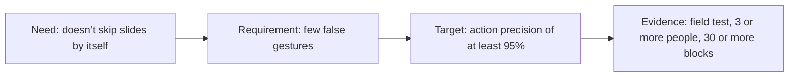
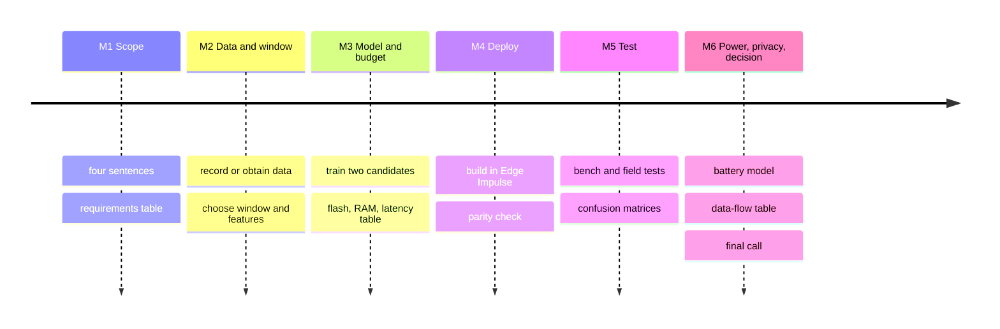

:::objectives
- Pick a capstone device that fits your hardware, time, and interests.
- Scope it in four sentences: who, what decision, cost of mistakes, smallest useful version.
- Turn each need into a requirement with a number and a test.
- Set up the design doc template and fill in its first two sections.
- Check that every dataset you plan to use is yours or licensed for your use.
:::

Here's the kind of sentence your capstone has to earn:

> This wrist-worn gesture remote recognizes four gestures with at least 85% recall each on people it has never seen, uses under 80% of an nRF52840's flash and RAM, answers within 250 ms, runs 30 days on a coin cell, and transmits nothing but gesture names.

Every number in it needs a calculation or a measurement behind it. That's the capstone: a design doc for a small edge-AI device, where each claim about memory, speed, accuracy, power, and privacy points to evidence you produced. The modules gave you a tool for each claim. Now you put them in one place for one device.

## What you'll hand in

1.  **A design doc** (Markdown, Google Docs, or similar), using the template below.
2.  **A Colab notebook** with your budget, power, and test calculations, so a reader can rerun every number.
3.  **Your model and data evidence**: an Edge Impulse project (you can make it public or export it), or your notebook's training code, plus your field logs if you have hardware.
4.  **A five-minute presentation**, covered in the last lesson.

You can do the capstone on one of two tracks. On the **hardware track** you deploy to a real board: an Arduino Nano 33 BLE Sense, a micro:bit V2 with micro:bit CreateAI, or your phone connected to Edge Impulse as a sensor (on the **Devices** page, **Connect a new device** offers a mobile phone option). On the **simulation track** you train and test in Colab and Edge Impulse with recorded or simulated data, and budget against the nRF52840's published limits. Both tracks can earn full marks. What loses marks is presenting a simulated number as if it were measured.

## Five devices to choose from

| Device | Sensor and task | The hard part | Level |
| --- | --- | --- | --- |
| **Gesture remote** | Accelerometer; 4 or 5 gestures | Placement drift between people and wrists | Starter |
| **"Lights on / lights off" keyword spotter** | Microphone; 2 keywords plus unknown and noise | Always-on listening power; other people's speech | Intermediate |
| **Machine-vibration monitor** | Accelerometer on a fan or washing machine; normal versus anomaly | You have few or no examples of real faults | Intermediate |
| **Wildlife camera trap** | Camera, 96×96 grayscale; animal, person, empty | RAM for images; hikers in photos; data licences | Advanced |
| **Sound alert for Deaf users** (doorbell, smoke alarm) | Microphone; event detection | A missed alarm is dangerous; strict latency | Advanced |

Some notes to help you choose:

-   The **gesture remote** has the clearest path: everything from modules 5 to 7 applies directly, and you can record data with a Nano, a micro:bit, or a phone in an afternoon.
-   The **keyword spotter** forces the power question from module 7: you can't sleep through a word.
-   The **vibration monitor** is an anomaly-detection problem: you train on normal data and flag what doesn't fit. Simulated faults are fine if you say so.
-   The **camera trap** needs a stride-2 first layer or similar to fit in RAM (module 5) and an on-device policy for photos of people (module 7). Public camera-trap images, such as those on LILA BC, come with licences you must read and follow.
-   The **sound alert** is for people who rely on it, so recall and latency targets are strict. Your doc must say plainly that it does not replace a certified smoke alarm.

:::video PVk9RUW1Hwo
A student team presents its final project from Harvard's TinyML course: recognizing air-guitar gestures on a microcontroller. Watch how they state the problem, describe the data they collected, and report evaluation results. Note what you'd want to see that they don't show, such as memory or power numbers; your doc should include those.
:::

## Scope it in four sentences

Most capstone trouble starts with a vague goal ("detect gestures"). Answer these four questions in one sentence each before you collect any data:

1.  **Who uses it, and where?** Be specific about bodies, rooms, weather, and noise.
2.  **What decision does it make, and how often?** This sets the window, the hop, and the deadline.
3.  **What does each kind of mistake cost?** A missed event (false negative) and a false alarm (false positive) usually cost different things.
4.  **What's the smallest version that would still be useful?** That's your first milestone. Extras come after it works.

Here is the gesture remote, scoped:

> 1. A student wears it on either wrist while presenting, standing or walking, indoors.
> 2. Every 250 ms it decides between idle, next-slide (wave), previous-slide (snake), and pointer (updown).
> 3. A false gesture jumps the slides, which is embarrassing and confusing, while a missed gesture just means waving again, so false positives cost more.
> 4. Smallest useful version: two gestures (next and previous) plus idle, on one wrist.

Sentence 3 changes the design. Since false gestures cost more, the remote should require a high score before acting, and the doc should report **precision** for the action gestures as a headline target, not just recall.

## Turn each need into a number and a test

A requirement is only useful if you can check it. For each one, write the target and the test that will prove it:



For the gesture remote, the requirements table starts like this:

| Requirement | Target | Evidence |
| --- | --- | --- |
| Few false actions | Precision ≥ 95% for wave and snake | Field-test confusion matrix (module 6) |
| Recognises real gestures | Recall ≥ 85% per gesture, every tester | Field test split by tester |
| Feels responsive | DSP + inference ≤ 125 ms, worst case | Board timings from the log (module 6), estimate first (module 5) |
| Fits the board | Flash and RAM ≤ 80% of 960 KB and 256 KB | Budget table (module 5), then the compile report |
| Lasts a term | ≥ 30 days on its battery | Power model (module 7), then a measured current |
| Private by design | Sends only gesture names; stores no raw motion | Data-flow table and message examples (module 7) |

Notice every target has a source. If you can't name the evidence, the requirement isn't finished.

## The design doc template

Copy this into your document and keep it as your table of contents. Sections 1 and 2 are due at the end of this lesson; the next lesson fills the rest milestone by milestone.

```text
DESIGN DOC: <device name>                 Track: hardware / simulation

1. Problem and users        Your four scoping sentences.
2. Requirements             Table: requirement | target | evidence.
3. Data                     Sources, amounts per class, who recorded it, consent,
                            licences for anything you didn't record yourself.
4. Sensor and window        Sensor, sample rate, window length, hop, features (DSP).
5. Model                    Candidates you tried, the one you chose, and why.
6. Budget                   Flash, RAM, and latency table against the target board,
                            estimate first, measurement when you have one.
7. Deployment               Edge Impulse option (Arduino library, firmware, C++),
                            int8 or float32, and the parity check result.
8. Test plan and results    The test ladder: model testing, parity, bench, field.
                            Confusion matrix, per-class and per-condition results.
9. Power                    States, currents, duty cycle, battery life.
10. Privacy                 What is sensed, what is kept, what leaves, who sees it,
                            what still leaks, and what you did about it.
11. Risks and limits        What you didn't test, and where it will probably fail.
12. Decision                Ship / revise / stop, with the numbers that decide it.
```

Section 11 matters more than it looks. A plan that names its own weak spots ("never tested on left wrists", "battery life is modeled, not measured") is far more useful, and scores higher, than one that claims everything works.

## Data you're allowed to use

You can use data you record yourself, with the agreement of everyone who appears in it, and public datasets whose licence allows your use. Before using any dataset you didn't make, write down three things in section 3: where it came from, its licence, and anything the licence requires (often, credit to the authors). Don't scrape images or audio from websites or videos. If you record other people's voices or faces, tell them what it's for, keep the raw files private, and delete them when the project ends.

## Milestones

The next lesson walks through each one with a starter notebook:



:::quiz
Q: A keyword spotter's team writes the requirement "works well in noisy rooms". What's missing?
- [ ] Nothing; it's clear what they mean
  "Well" and "noisy" can't be tested, so nobody can say whether the device meets it.
- [x] A target number and the test that checks it
  For example: recall ≥ 85% for each keyword at a stated noise level, from a field test in three real rooms.
- [ ] The name of the microcontroller
  The board belongs in the budget section, not in this requirement.

Q: For a smoke-alarm sound alert, which mistake should the targets guard hardest against?
- [x] Missed alarms (false negatives)
  A missed alarm could leave someone unaware of a fire, so recall is the headline target, even at the cost of some false alerts.
- [ ] False alerts (false positives)
  They're annoying, but far less harmful than missing a real alarm.
- [ ] Both equally
  The costs aren't equal, and the targets should say so.

Q: You're on the simulation track. Your battery life comes from the power model in module 7. How should the doc present it?
- [ ] As the device's battery life
  That hides that it's a model with assumed currents.
- [x] As an estimate, with the assumed currents listed and "not measured" in Risks and limits
  Honest labeling is what makes a simulated number useful, and it's what the rubric rewards.
- [ ] Leave it out, since it isn't measured
  An estimate with stated assumptions is still valuable evidence.
:::

:::takeaways
- The capstone is a design doc where every claim about accuracy, memory, latency, power, and privacy points to evidence.
- Scope with four sentences: who and where, what decision how often, what mistakes cost, smallest useful version.
- Each requirement needs a target number and a named test.
- Simulated and measured numbers are both welcome, as long as each is labeled for what it is.
- Use only data you recorded with consent or data licensed for your use, and record the licence.
:::

## Further reading

-   [Edge Impulse: Devices](https://docs.edgeimpulse.com/studio/projects/devices) explains how to connect a development board, your phone, or your computer to collect data.
-   [micro:bit CreateAI](https://createai.microbit.org/) trains movement models from a micro:bit's motion data and lets you use them in MakeCode, a good path for the gesture remote.
-   [LILA BC](https://lila.science/) hosts public camera-trap and other conservation datasets, each with its own licence to read before use.
