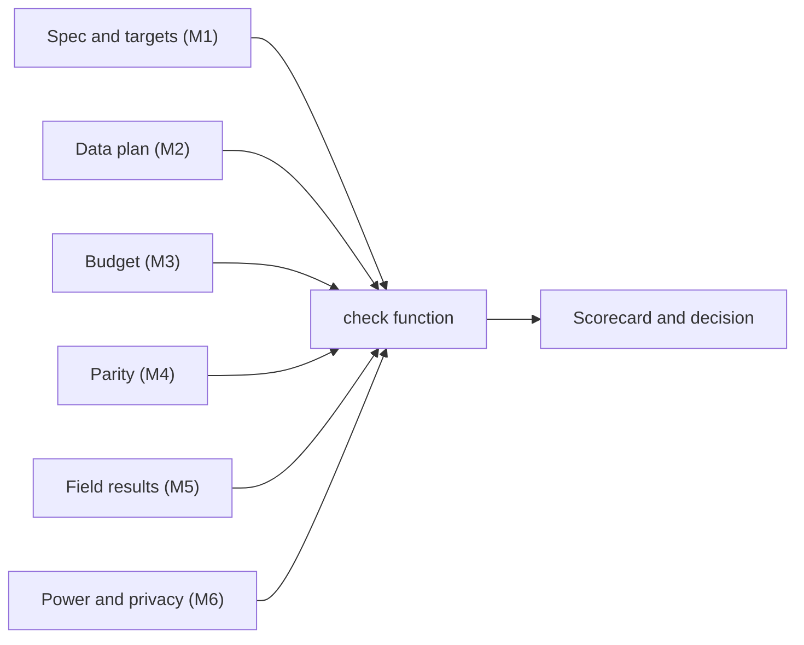

:::objectives
- Keep every number in your design doc in one notebook that checks it against a target.
- Plan how much data to record from a target number of windows.
- Fill the budget, test, power, and privacy sections from the tools you built in modules 5 to 7.
- Write the device firmware skeleton around `run_classifier()` with a decision threshold and a logging switch.
- Produce a scorecard that labels every result as measured or estimated, and use it to decide what to do next.
:::

A design doc goes stale the moment a number in it changes by hand. Change the model, and the flash figure in section 6, the latency in section 6, and the battery life in section 9 all move. If those numbers live in three places, one of them will be wrong when you present.

The fix is a single plan notebook. Every number goes in once, every check runs from it, and the doc's tables are copied from its output. This lesson builds that notebook for the gesture remote from the last lesson, one milestone at a time. You'll then swap in your own device.



## Milestone 1: Spec, targets, and a check function

Copy your four scoping sentences into the doc, then put the requirements table's targets into code. The `check()` function records each result with its source and whether it was **measured** or **estimated**. That label is what keeps the simulation track honest.

```python run
import numpy as np
import matplotlib.pyplot as plt

NAME = "Gesture remote"
CLASSES = ["idle", "snake", "updown", "wave"]
ACTIONS = ["snake", "updown", "wave"]          # gestures that trigger something
TARGETS = {
    "flash share": 0.80, "RAM share": 0.80, "latency ms": 125,
    "battery days": 30, "recall": 0.85, "action precision": 0.95,
}
results = []

def check(section, name, value, target, higher_is_better, kind, source):
    ok = value >= target if higher_is_better else value <= target
    results.append(dict(section=section, name=name, value=value, target=target,
                        higher=higher_is_better, ok=ok, kind=kind, source=source))
    sign = ">=" if higher_is_better else "<="
    print(f"[{'PASS' if ok else 'FAIL'}] {name:24} {value:8.3g}  target {sign} {target:<6g}  ({kind}: {source})")

print(f"{NAME}: {len(TARGETS)} targets set")
```

Nothing is checked yet. The point of writing targets first is that you can't quietly move them after seeing results.

## Milestone 2: Plan the data and the window

The window and hop come from your scoping sentence about decisions. How much to record comes from how many windows you want. A recording of `d` seconds, cut into windows of `w` seconds every `h` seconds, gives `(d − w) / h + 1` windows, but overlapping windows from the same recording are not independent examples. Plan by **sessions** (people and placements) first, then minutes.

```python run
HZ, WINDOW_S, AXES, HOP_MS = 62.5, 2.0, 3, 250

def windows_from(seconds, window_s=WINDOW_S, hop_s=0.5):
    return int((seconds - window_s) / hop_s) + 1

people, placements = 6, 2                    # left and right wrist
minutes_each = 2                             # per gesture, per person, per placement
per_class = people * placements * windows_from(minutes_each * 60)
print(f"input: {int(HZ * WINDOW_S)} samples x {AXES} axes; a new prediction every {HOP_MS} ms")
print(f"{people} people x {placements} placements x {minutes_each} min per gesture")
print(f"  = {people * placements * minutes_each} min of recording per gesture, about {per_class:,} windows")
print(f"  hold out 2 people entirely for testing -> test on {2 * placements * windows_from(minutes_each * 60):,} windows per gesture from unseen people")
```

Hold out whole people, not random windows, for the test set. If one person's windows are in both training and test, the test score measures how well the model remembers that person.

In the doc's section 3, list who recorded data, that they agreed, and where the files are kept. In Edge Impulse, the **Data acquisition** page shows your samples and the train/test split.

## Milestone 3: Train two candidates and fill the budget

Train at least two models (in Edge Impulse, or in Colab as in module 5), and run `profile()` from the build-along in module 5 on each. Paste its output into `MODEL`. The firmware figures are placeholders until you compile; on the hardware track, replace them with the Arduino IDE's "Sketch uses … bytes" and "Global variables use … bytes" lines.

```python run
BOARD = {"flash_kb": 960, "ram_kb": 256, "clock_hz": 64e6}
FIRMWARE = {"flash_kb": 345, "ram_kb": 81}                 # placeholder: core, Bluetooth, SDK, buffers
MODEL = {"params": 12_628, "peak_values": 407, "macs": 12_576, "bytes": 1}   # small dense, int8
CYCLES_PER_MAC, DSP_MS = 2, 5

flash = FIRMWARE["flash_kb"] + MODEL["params"] * MODEL["bytes"] / 1024
ram = FIRMWARE["ram_kb"] + MODEL["peak_values"] * MODEL["bytes"] / 1024
latency = MODEL["macs"] * CYCLES_PER_MAC / BOARD["clock_hz"] * 1000 + DSP_MS

check("6 Budget", "flash share", flash / BOARD["flash_kb"], TARGETS["flash share"], False, "estimate", "module 5 profile + placeholder firmware")
check("6 Budget", "RAM share", ram / BOARD["ram_kb"], TARGETS["RAM share"], False, "estimate", "module 5 profile + placeholder firmware")
check("6 Budget", "latency ms (estimate)", latency, TARGETS["latency ms"], False, "estimate", "MACs x 2 cycles at 64 MHz + 5 ms DSP")
```

Record in section 5 why you chose this candidate over the other. "It passed the budget with room to spare and matched the CNN's accuracy on held-out people" is a good reason. "It was the first one I tried" is not.

## Milestone 4: Deploy, run the parity check, and write the firmware

In Edge Impulse Studio, open **Deployment**, choose **Arduino library**, pick **Quantized (int8)** under the model optimizations, note the estimated latency, RAM, and flash, and click **Build**. Install the `.zip` with **Sketch › Include Library › Add .ZIP Library…**, run the `static_buffer` example on a few test samples, and record the result.

On the simulation track, do the deployment build in Studio anyway (it's free) and record the estimates; skip the board run and say so.

```python run
PARITY = {"samples": 5, "max_diff": 0.03, "flips_with_margin": 0}    # from module 6, exercise 3
check("7 Deployment", "parity max difference", PARITY["max_diff"], 0.05, False, "measured", "static_buffer on 5 test samples")
check("7 Deployment", "label flips (margin>0.1)", PARITY["flips_with_margin"], 0, False, "measured", "static_buffer on 5 test samples")
```

Then write the product firmware. It's the field logger from module 6 with three changes: it acts on gestures, it only acts when the top score clears a threshold (because false actions cost more than misses), and logging is a switch you turn off before shipping.

```arduino title="gesture_remote.ino"
#include <gesture_remote_inferencing.h>   // the header named after YOUR Edge Impulse project
#include <Arduino_LSM9DS1.h>              // Rev2 boards: #include <Arduino_BMI270_BMM150.h>

#define CONVERT_G_TO_MS2 9.80665f
#define ACT_THRESHOLD    0.50f            // start low; tune it from field data
#define FIELD_LOG        1                // 1 while testing; 0 before shipping

void setup() {
    Serial.begin(115200);                 // no "while (!Serial)": it must run on battery
    pinMode(LED_BUILTIN, OUTPUT);
    if (!IMU.begin()) {
        while (1);
    }
}

void act(const char *label) {
    // Milestone 6: send the label over Bluetooth here. For now, blink.
    digitalWrite(LED_BUILTIN, HIGH);
    delay(50);
    digitalWrite(LED_BUILTIN, LOW);
}

void loop() {
    float buffer[EI_CLASSIFIER_DSP_INPUT_FRAME_SIZE] = { 0 };
    for (size_t ix = 0; ix < EI_CLASSIFIER_DSP_INPUT_FRAME_SIZE; ix += 3) {
        uint64_t next_tick = micros() + (EI_CLASSIFIER_INTERVAL_MS * 1000);
        IMU.readAcceleration(buffer[ix], buffer[ix + 1], buffer[ix + 2]);
        buffer[ix + 0] *= CONVERT_G_TO_MS2;
        buffer[ix + 1] *= CONVERT_G_TO_MS2;
        buffer[ix + 2] *= CONVERT_G_TO_MS2;
        delayMicroseconds(next_tick - micros());
    }

    signal_t signal;
    numpy::signal_from_buffer(buffer, EI_CLASSIFIER_DSP_INPUT_FRAME_SIZE, &signal);
    ei_impulse_result_t result = { 0 };
    if (run_classifier(&signal, &result, false) != EI_IMPULSE_OK) {
        return;
    }

    size_t best = 0;
    for (size_t ix = 1; ix < EI_CLASSIFIER_LABEL_COUNT; ix++) {
        if (result.classification[ix].value > result.classification[best].value) best = ix;
    }
    const char *label = result.classification[best].label;
    float score = result.classification[best].value;

    if (strcmp(label, "idle") != 0 && score >= ACT_THRESHOLD) {
        act(label);
    }

#if FIELD_LOG
    Serial.print(millis());       Serial.print(',');
    Serial.print(label);          Serial.print(',');
    Serial.print(score, 3);       Serial.print(',');
    Serial.print(result.timing.dsp + result.timing.classification);
    Serial.println();
#endif
}
```

`#if FIELD_LOG` removes the logging code entirely when set to 0, so no motion-derived data goes out over USB in the shipped device. That's a privacy decision written into the build, and section 10 of your doc should mention it.

## Milestone 5: Test, then paste the results in

Run the field test from module 6: at least three people, both wrists, labeled blocks, transition windows dropped. Paste the confusion matrix from `field_report.py` here. On the simulation track, test on simulated "field" data with a stated change, such as tilt, and label it as simulated.

```python run
FIELD_CM = np.array([        # rows = truth, columns = prediction, in CLASSES order
    [118,   1,   1,   0],
    [  2, 108,   4,   6],
    [  3,   5, 105,   7],
    [  4,   3,   6, 107],
])
SOURCE = "field test: 4 testers, 2 wrists, 48 blocks"

for i, c in enumerate(CLASSES):
    check("8 Tests", f"recall {c}", FIELD_CM[i, i] / FIELD_CM[i].sum(), TARGETS["recall"], True, "measured", SOURCE)
for c in ACTIONS:
    i = CLASSES.index(c)
    check("8 Tests", f"precision {c}", FIELD_CM[i, i] / FIELD_CM[:, i].sum(), TARGETS["action precision"], True, "measured", SOURCE)
check("6 Budget", "latency ms (board p99)", 18, TARGETS["latency ms"], False, "measured", "timings in the field log")
```

Recall passes for every gesture, but precision for the three action gestures falls short of 95%. Users would see a wrong slide change roughly once every ten actions. That's a real finding, and it's exactly what the threshold in the firmware is for.

## Milestone 6: Power, privacy, and the decision

Fill in the power model from module 7 with this device's states. A gesture remote can't sleep through gestures, so its accelerometer stays on and the CPU wakes for every sample.

```python run
BATTERY_MAH, USABLE = 220, 0.8                        # CR2032
CURRENTS_MA = {                                       # average contribution of each part
    "accelerometer, always on": 0.20,
    "CPU: model every 250 ms": 5.0 * 6 / 250,
    "CPU: waking to read samples": 5.0 * (16 * 0.1) / 250,
    "Bluetooth connection": 0.05,
    "chip sleep": 0.003,
}
avg_ma = sum(CURRENTS_MA.values())
days = BATTERY_MAH * USABLE / avg_ma / 24
for part, ma in CURRENTS_MA.items():
    print(f"  {part:30} {ma * 1000:6.0f} µA")
check("9 Power", "battery days", days, TARGETS["battery days"], True, "estimate", "module 7 model, planning currents")

DATA_FLOW = [   # item, leaves the device?, how long it's kept
    ("raw accelerometer window", False, "overwritten every 2 s"),
    ("gesture label", True, "sent once, not stored"),
    ("field-test logs (development)", False, "deleted at project end"),
]
leaving = [item for item, leaves, _ in DATA_FLOW if leaves]
check("10 Privacy", "kinds of data leaving", len(leaving), 1, False, "design", "data-flow table")
```

The battery estimate fails: about 18 days on a coin cell against a 30-day target, with the always-on accelerometer the largest part. That gives you three honest options for the doc: a bigger battery (a small rechargeable cell), a smarter design (stop classifying after a minute of idle and wake on motion), or a revised target. Write which you chose and why.

Now draw the scorecard. Each bar is the result divided by its target, flipped where lower is better, so anything at or past 1.0 passes. Hatched bars are estimates.

```python run alt="Horizontal bar chart scoring every requirement as a fraction of its target, with a dashed pass line at 1.0. Budget, latency, parity, recall, and privacy bars pass. The three action-precision bars fall just short of 1.0, and the battery-days bar reaches about 0.6. Estimated results are hatched." caption="The gesture remote's scorecard: what passes, what fails, and what is only estimated"
def score(r):
    if r["target"] == 0:                       # "zero allowed": pass is 1, fail is 0
        return 1.0 if r["ok"] else 0.0
    return r["value"] / r["target"] if r["higher"] else r["target"] / max(r["value"], 1e-9)

shown = results
fig, ax = plt.subplots(figsize=(7.5, 5.2))
for i, r in enumerate(shown):
    s = min(score(r), 2.0)
    ax.barh(i, s, color="#1baf7a" if r["ok"] else "#d64545",
            hatch="//" if r["kind"] == "estimate" else None, edgecolor="white")
ax.axvline(1.0, color="#333", linestyle="--")
ax.set_yticks(range(len(shown)), [r["name"] for r in shown])
ax.invert_yaxis()
ax.set_xlim(0, 2.05)
ax.set_xlabel("Result as a fraction of target (capped at 2; 1.0 or more passes)")
plt.tight_layout()

failing = [r["name"] for r in results if not r["ok"]]
estimates = [r["name"] for r in results if r["kind"] == "estimate"]
print("DECISION:", "SHIP" if not failing else "REVISE")
print("  failing:", ", ".join(failing) if failing else "none")
print("  still estimates, to measure:", ", ".join(estimates))
```

The decision is **revise**, with a to-do list written by the notebook: raise `ACT_THRESHOLD` and re-measure precision (accepting some recall loss), fix the battery plan, and turn the estimated budget numbers into measurements by compiling the sketch.

## The full starter

Here is the whole plan as one file to copy into Colab and adapt. Replace every number with yours, keep the `kind` label honest, and paste its printed output into your doc.

```python run title="device_plan.py"
import numpy as np

NAME, CLASSES, ACTIONS = "Gesture remote", ["idle", "snake", "updown", "wave"], ["snake", "updown", "wave"]
TARGETS = {"flash share": 0.80, "RAM share": 0.80, "latency ms": 125, "battery days": 30,
           "recall": 0.85, "action precision": 0.95}
BOARD = {"flash_kb": 960, "ram_kb": 256, "clock_hz": 64e6}
FIRMWARE = {"flash_kb": 345, "ram_kb": 81}
MODEL = {"params": 12_628, "peak_values": 407, "macs": 12_576, "bytes": 1}
FIELD_CM = np.array([[118, 1, 1, 0], [2, 108, 4, 6], [3, 5, 105, 7], [4, 3, 6, 107]])
CURRENTS_MA = {"accelerometer": 0.20, "model": 0.12, "sampling": 0.032, "bluetooth": 0.05, "sleep": 0.003}
BATTERY_MAH, USABLE = 220, 0.8

rows = []
def check(name, value, target, higher, kind):
    ok = value >= target if higher else value <= target
    rows.append((name, value, target, ok, kind))

check("flash share", (FIRMWARE["flash_kb"] + MODEL["params"] * MODEL["bytes"] / 1024) / BOARD["flash_kb"], TARGETS["flash share"], False, "estimate")
check("RAM share", (FIRMWARE["ram_kb"] + MODEL["peak_values"] * MODEL["bytes"] / 1024) / BOARD["ram_kb"], TARGETS["RAM share"], False, "estimate")
check("latency ms", MODEL["macs"] * 2 / BOARD["clock_hz"] * 1000 + 5, TARGETS["latency ms"], False, "estimate")
for i, c in enumerate(CLASSES):
    check(f"recall {c}", FIELD_CM[i, i] / FIELD_CM[i].sum(), TARGETS["recall"], True, "measured")
for c in ACTIONS:
    i = CLASSES.index(c)
    check(f"precision {c}", FIELD_CM[i, i] / FIELD_CM[:, i].sum(), TARGETS["action precision"], True, "measured")
check("battery days", BATTERY_MAH * USABLE / sum(CURRENTS_MA.values()) / 24, TARGETS["battery days"], True, "estimate")

print(f"PLAN: {NAME}")
for name, value, target, ok, kind in rows:
    print(f"  {'PASS' if ok else 'FAIL'}  {name:18} {value:7.3g}  (target {target:g}, {kind})")
fails = [r[0] for r in rows if not r[3]]
print("DECISION:", "SHIP" if not fails else "REVISE: " + ", ".join(fails))
```

:::video Klapmal6cRM
Shawn Hymel runs a keyword-spotting model with the Edge Impulse Arduino library and compares two ways to do it: a blocking method (sample, extract features, classify, repeat) and a continuous method that keeps sampling while the model runs. The firmware above uses the blocking method. If your capstone uses audio, or can't afford to miss motion during classification, watch how the continuous method works.
:::

:::quiz
Q: Why does `check()` record whether each result is measured or estimated?
- [ ] So the chart can use two colors
  The hatching is a side effect; the real reason is about honesty.
- [x] So nobody mistakes a modeled number for a measurement, and the doc lists what still needs measuring
  On the simulation track especially, the label is what makes the plan trustworthy.
- [ ] Because estimates always fail
  Estimates can pass or fail; the label says how much to trust them.

Q: Recall passes but action precision fails. Which firmware change is the direct response?
- [x] Raise `ACT_THRESHOLD`, then re-measure precision and recall
  A higher threshold suppresses low-confidence actions, trading some recall for precision.
- [ ] Lower `ACT_THRESHOLD`
  That would let even more uncertain predictions act, lowering precision further.
- [ ] Turn `FIELD_LOG` off
  Logging doesn't change predictions; it only affects what's printed.

Q: Why plan data by people and placements rather than just total minutes?
- [ ] Edge Impulse requires at least six people
  It has no such rule.
- [x] Windows from the same recording are similar, so new people and placements add far more variety than more minutes from one person
  Drift comes from people and placement; the plan has to cover them, and the test set should hold out whole people.
- [ ] Longer recordings use too much flash
  Training data never goes on the device.
:::

:::takeaways
- Put every number in one plan notebook, check it against a target, and copy the doc's tables from its output.
- Label every result as measured, estimated, or a design choice.
- Plan data by people and placements, and hold out whole people for testing.
- Build the firmware around `run_classifier()` with a decision threshold and a compile-time logging switch.
- A FAIL is a normal outcome. The plan's job is to make the next step obvious.
:::
