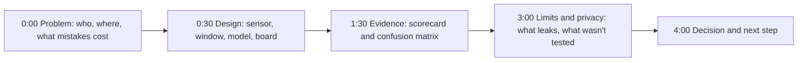

:::objectives
- Complete a final test pass that covers accuracy, timing, power, privacy, and failure behavior.
- Tune a decision threshold from field data and handle the case where no threshold meets every target.
- Polish the design doc so every number has a source and every estimate is labeled.
- Present the plan in five minutes, with evidence a reviewer can check.
- Grade your own work against the rubric and plan what to learn next.
:::

Picture the review. Someone who has never seen your device reads the doc for ten minutes, then asks three questions: *How do you know that number? What didn't you test? What result would make you stop?* A strong capstone has answers to all three already written down. This lesson gets you there.

## The final test pass

By now you have budget estimates, a parity check, and field results. Before you present, run the tests that only make sense on a nearly finished design. On the simulation track, do the ones you can and list the rest under **Risks and limits**.

| Test | What it proves | Pass target (gesture remote) | Evidence |
| --- | --- | --- | --- |
| Unseen-person test | Accuracy holds for people not in training | Recall ≥ 85% for each held-out person | Field log per person |
| New-place test | Accuracy holds in a new environment | Within 5 points of the main field test | Field log from the new place |
| Compile report | The budget estimate was right | Flash and RAM ≤ 80% | Arduino IDE "Sketch uses" and "Global variables use" lines |
| Soak test | It runs for hours without crashing or slowing | 4 hours, no resets, latency p99 unchanged | Log with timestamps |
| Current measurement | The power model's biggest line is right | Measured average within 30% of the model | USB power meter or current profiler reading |
| Privacy test | Only what the data-flow table says leaves the device | With `FIELD_LOG` 0, nothing but labels is sent | A Bluetooth scanner app or serial capture |
| Failure test | It fails safely | Sensor unplugged or low battery: no false actions | Bench notes |

The privacy test deserves a word. Don't trust the code to do what you think it does; watch what actually goes out. A free Bluetooth scanner app on a phone can show what the device sends, and the Serial Monitor shows what goes over USB.

## Tune the threshold, and face the trade-off

The last lesson ended with action precision below its 95% target and a firmware threshold to tune. Precision and recall pull against each other: raising the threshold blocks more wrong actions but also more right ones. The field log has a score for every window, so you can test every threshold without going back into the field.

The next cell rebuilds a log with scores that matches the confusion matrix from the last lesson. Use your own `field_*.csv` files in its place.

```python run
import numpy as np
import matplotlib.pyplot as plt

CLASSES = ["idle", "snake", "updown", "wave"]
ACTIONS = ["snake", "updown", "wave"]
FIELD_CM = np.array([[118, 1, 1, 0], [2, 108, 4, 6], [3, 5, 105, 7], [4, 3, 6, 107]])

rng = np.random.default_rng(23)
truth, pred, score = [], [], []
for i, t in enumerate(CLASSES):
    for j, p in enumerate(CLASSES):
        n = FIELD_CM[i, j]
        truth += [t] * n
        pred += [p] * n
        # right answers tend to have high scores, wrong ones middling scores
        score += list(rng.beta(9, 1.5, n) if i == j else rng.beta(4, 3, n))
truth, pred, score = np.array(truth), np.array(pred), np.array(score)
print(f"{len(truth)} field windows; median score when right {np.median(score[pred == truth]):.2f}, when wrong {np.median(score[pred != truth]):.2f}")
```

For each threshold, an action happens only when the top label is an action gesture **and** its score clears the threshold. Precision counts how many actions were right; recall counts how many real gestures led to the right action.

```python run alt="Line chart against decision threshold from 0.4 to 0.95. Action precision rises from about 92% to 100%, crossing the 95% target between 0.60 and 0.65. Recall for snake, updown, and wave falls from about 90% to under 25%, and updown drops below the 85% target at 0.65. No threshold has every line on the right side of its target." caption="Raising the threshold buys precision with recall"
thresholds = np.round(np.arange(0.40, 0.96, 0.05), 2)
precision, recalls = [], {c: [] for c in ACTIONS}
for th in thresholds:
    acted = np.isin(pred, ACTIONS) & (score >= th)
    precision.append((acted & (pred == truth)).sum() / acted.sum())
    for c in ACTIONS:
        recalls[c].append(((pred == c) & (truth == c) & (score >= th)).sum() / (truth == c).sum())

plt.figure(figsize=(7.5, 4))
plt.plot(thresholds, precision, color="#333", linewidth=2.5, label="action precision")
for c, color in zip(ACTIONS, ["#2a78d6", "#eb6834", "#1baf7a"]):
    plt.plot(thresholds, recalls[c], color=color, linewidth=1.8, label=f"recall {c}")
plt.axhline(0.95, color="#333", linestyle="--", linewidth=1)
plt.axhline(0.85, color="#999", linestyle="--", linewidth=1)
plt.xlabel("ACT_THRESHOLD")
plt.ylabel("Rate")
plt.ylim(0, 1.02)
plt.legend(frameon=False, loc="lower left")
plt.grid(alpha=0.25)
plt.tight_layout()

print(" th   precision  " + "  ".join(f"{c:>7}" for c in ACTIONS))
for k, th in enumerate(thresholds):
    both = precision[k] >= 0.95 and min(recalls[c][k] for c in ACTIONS) >= 0.85
    print(f"{th:.2f}   {precision[k]:7.1%}   " + "  ".join(f"{recalls[c][k]:7.1%}" for c in ACTIONS) + ("  <- meets both" if both else ""))
```

No threshold meets both targets. At 0.65, precision reaches about 97%, but updown's recall drops to about 83%. This happens in real projects, and the doc has to make a call rather than hide it. Go back to your scoping sentences: for the gesture remote, a false action costs more than a missed one. So the defensible decision is to set the threshold to 0.65, keep the precision target, and lower the recall target to 80% **with that reason written next to it**, while listing "more wrist-worn updown data" as the next improvement. Changing a target after seeing results is only acceptable when you say so openly and tie it to a reason you wrote down before testing.

## Polish the doc

Before presenting, read the doc once with each of these questions:

-   **Does every number have a source?** A calculation in the notebook, a measurement with a date, or a cited datasheet. "About 5 mA" with no source is not evidence.
-   **Is every estimate labeled?** Use the scorecard's measured, estimated, and design labels in your tables.
-   **Are units and data types attached?** "218 KB (int8 weights)", not "218".
-   **Does section 11 name real weaknesses?** Untested conditions, modeled-not-measured numbers, small numbers of testers.
-   **Does section 12 make a decision?** Ship, revise, or stop, with the numbers that decide it.
-   **Can someone rerun it?** Share the notebook and say where the data is (or why it can't be shared).

Then write a **one-page summary** at the top: the device in one sentence, the scorecard chart, the three most important results, and the decision.

## Present it in five minutes



-   Spend the most time on evidence. One confusion matrix and the scorecard beat ten slides of architecture.
-   If you have hardware, show a 20-second video of the device working, including one mistake. It's more convincing than a perfect demo.
-   Say "estimated" and "measured" out loud when you quote a number.
-   End on the decision, not on "thank you". "We'd ship after one more round of wrist data, because…" is a strong last line.

## The rubric

| Criterion | Points | Excellent | Developing |
| --- | --- | --- | --- |
| Problem and requirements | 10 | Four scoping sentences; every requirement has a target and a named test | Goals are vague or untestable |
| Data and rights | 10 | Sources, amounts, consent, and licences recorded; test set holds out whole people or places | Unclear where data came from, or test data overlaps training |
| Model and budget | 15 | Two or more candidates compared; flash, RAM, and latency budgeted against a named board with headroom | One model, no budget, or model size only |
| Deployment and parity | 10 | Edge Impulse build recorded with int8/float32 choice; parity check done or its absence explained | Deployment described vaguely |
| Testing and accuracy | 20 | Test ladder followed; per-class and per-condition results; uncertainty from blocks; threshold tuned | Single accuracy number from the training tool |
| Power | 10 | States, currents, duty cycle, and battery life, with the biggest cost identified and addressed | No power analysis, or an unexplained figure |
| Privacy | 15 | Data-flow table; minimized messages; remaining leaks named with mitigations | "Data stays on the device" with no analysis |
| Honesty and limits | 10 | Every number labeled measured or estimated; real weaknesses listed; a clear decision | Simulated results presented as measured |

The total is 100. Notice that honesty is graded on its own and also runs through every other row. A simulation-track plan that labels everything clearly can outscore a hardware plan that overclaims.

## Reflect

Write a short paragraph for each before you hand in:

1.  Which number surprised you most when you measured or computed it, and what had you assumed instead?
2.  Which limit (flash, RAM, latency, accuracy, power, or privacy) shaped your design most? Would that change on a different board?
3.  What would you test next with one more week and one more person to help?
4.  Who could be harmed if this device were deployed widely with its current weaknesses, and what would you change first?

## Where to go next

-   **Go deeper on TinyML.** Harvard's TinyML professional certificate on edX (edX courses can usually be audited for free) covers the same pipeline with TensorFlow Lite Micro, and the Coursera course *Introduction to Embedded Machine Learning* from Edge Impulse is the source of several videos in this course.
-   **Fit bigger models.** MIT's EfficientML.ai lectures cover pruning, quantization, and MCUNet in depth; the lecture below is the one on microcontrollers.
-   **Read the book.** *TinyML* by Pete Warden and Daniel Situnayake (O'Reilly) builds keyword spotting, person detection, and gesture projects step by step.
-   **Build the next version.** Take your "revise" list and do it. A second field test that shows the fix worked is the best addition to a portfolio.

:::video vyd1bFxPjL8
A full MIT lecture from Song Han's EfficientML.ai course on MCUNet and TinyML. It's long, so treat it as a next step. Watch for how the peak activation memory you computed by hand in module 5 drives their whole design: they search for network shapes and memory schedules that fit a microcontroller's RAM.
:::

## Further reading

-   [Harvard TinyML on edX](https://www.edx.org/certificates/professional-certificate/harvardx-tiny-machine-learning) is the professional certificate series that grew out of Harvard's TinyML course.
-   [Introduction to Embedded Machine Learning](https://www.coursera.org/learn/introduction-to-embedded-machine-learning) is Edge Impulse's course on Coursera, taught with the same tools you used here.
-   [TinyMLedu](https://tinyml.seas.harvard.edu/) is the Harvard-led open education initiative behind those courses, with free materials and links for teachers and learners.
