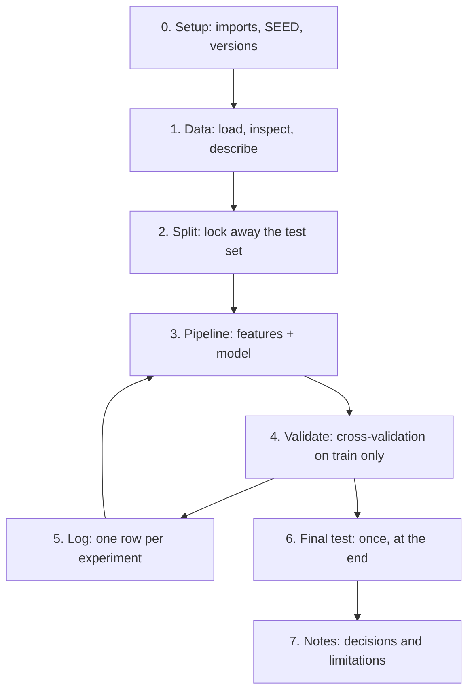

:::objectives
- Explain why a notebook must survive **Restart session and run all**, and spot the hidden-state bug that breaks it.
- Lay out a project notebook in the section order this course uses.
- Record each experiment (model, validation scheme, mean and spread of the score) in a CSV log you can sort later.
- Save notebooks and output files somewhere that outlives a Colab runtime.
- Fix the three scikit-learn errors you'll see most often.
:::

Notebooks let you run cells in any order, and that freedom is how most notebook bugs are born. Here is a tiny table of patients and a cell that removes the `age` column:

```python run
import pandas as pd

patients = pd.DataFrame({"age": [34, 51, 29], "bmi": [22.1, 30.4, 25.0], "visits": [2, 5, 1]})
```

```python run
patients = patients.drop(columns="age")
print(patients.columns.tolist())
```

That worked. Now imagine you tweak something below, scroll back up, and run the same cell again:

```python run raises
patients = patients.drop(columns="age")
print(patients.columns.tolist())
```

The code didn't change; the *state* did. The first run already removed `age`, so the second run has nothing to drop. The reverse problem is sneakier: a notebook that only works because you once ran a cell you've since deleted. Both bugs disappear under one test.

## The one test every notebook must pass

Before you trust a result or share a notebook, choose **Runtime › Restart session and run all** in Colab (in JupyterLab, **Kernel › Restart Kernel and Run All Cells**). That throws away every variable and runs the cells top to bottom, exactly as someone else would. If it finishes without errors and prints the same numbers, the notebook is reproducible. If it doesn't, you've just found a bug before your reader did.

Two rules make the test easy to pass. Never let a cell modify a variable it also reads, as the `drop` cell did; write `features = patients.drop(columns="age")` instead, so rerunning it is harmless. And put every import and constant in the first cell, so no later cell depends on something you typed once and forgot.

## A template for every project in this course

Every Build-along and the capstone follow the same section order. The order matters more than the headings: data flows down the page, and the test set is touched exactly once, near the end.



The loop from **Log** back to **Pipeline** is where you'll spend most of your time: change one thing, validate, log, repeat. The arrow to **Final test** is taken once. Use text cells (**+ Text** in Colab) for the numbered headings, so the table of contents in Colab's left sidebar becomes a map of your project.

Section 0 always looks like this:

```python run title="0. Setup"
import sys
import numpy as np
import sklearn
from sklearn.datasets import load_diabetes
from sklearn.model_selection import KFold, cross_val_score

SEED = 0
print("Python", sys.version.split()[0], "| scikit-learn", sklearn.__version__)
```

## Keep an experiment log

Two weeks into a project, nobody remembers whether the 0.47 came from five folds or ten, or which preprocessing it used. A log fixes that. This function appends one row per experiment to a CSV file, including the spread of the fold scores, not just the mean:

```python run title="5. Log"
import csv
import datetime
import os

LOG = "experiments.csv"

def log_experiment(name, cv_label, metric, scores, notes=""):
    """Append one experiment to the CSV log and return the row."""
    row = {
        "date": datetime.date.today().isoformat(),
        "model": name,
        "cv": cv_label,
        "metric": metric,
        "mean": round(float(np.mean(scores)), 4),
        "std": round(float(np.std(scores)), 4),
        "sklearn": sklearn.__version__,
        "notes": notes,
    }
    new_file = not os.path.exists(LOG)
    with open(LOG, "a", newline="") as handle:
        writer = csv.DictWriter(handle, fieldnames=row.keys())
        if new_file:
            writer.writeheader()
        writer.writerow(row)
    return row
```

Now run two quick experiments on the diabetes data and log both:

```python run
from sklearn.linear_model import Ridge
from sklearn.neighbors import KNeighborsRegressor
from sklearn.pipeline import make_pipeline
from sklearn.preprocessing import StandardScaler

X, y = load_diabetes(return_X_y=True)
cv = KFold(n_splits=5, shuffle=True, random_state=SEED)

candidates = {
    "ridge(alpha=1)": make_pipeline(StandardScaler(), Ridge(alpha=1.0)),
    "knn(k=15)": make_pipeline(StandardScaler(), KNeighborsRegressor(n_neighbors=15)),
}
for name, model in candidates.items():
    scores = cross_val_score(model, X, y, cv=cv, scoring="r2")
    log_experiment(name, "KFold(5, shuffle, seed 0)", "r2", scores, notes="scaled inputs")

print(pd.read_csv(LOG).to_string(index=False))
```

`pd.read_csv(LOG)` turns the log back into a DataFrame, so later you can sort by `mean`, filter by `cv`, or plot every experiment you ever ran. Rerunning a cell adds rows rather than replacing them. That's deliberate: the log is a history, and a rerun with a different result is worth knowing about.

## Save work somewhere that survives

Colab saves the **notebook** to Drive automatically, and **File › Revision history** lets you roll back. Files your code writes, like `experiments.csv`, are different: they live on the runtime's disk under `/content`, and they're deleted when the runtime is recycled. To keep them, mount your Drive and write there:

```python
from google.colab import drive
drive.mount("/content/drive")          # asks you to approve access the first time

LOG = "/content/drive/MyDrive/ml-eval/experiments.csv"
os.makedirs(os.path.dirname(LOG), exist_ok=True)
```

That block only works inside Colab, which is why it isn't run on this page. For extra copies, **File › Download › Download .ipynb** saves the notebook to your computer, and **File › Save a copy in GitHub** pushes it to a repository you own.

## Read scikit-learn errors from the bottom up

A traceback can run to thirty lines, but the useful part is almost always the **last line** (what went wrong) and the **last line that mentions your own file** (where). Here are the three errors you'll meet most, each produced on purpose.

**Text where a number should be.**

```python run raises
from sklearn.linear_model import LogisticRegression

X_text = pd.DataFrame({"plan": ["basic", "premium", "basic", "standard"], "hours": [3.0, 12.5, 1.0, 7.5]})
y_small = [1, 0, 1, 0]
LogisticRegression().fit(X_text, y_small)
```

Models only accept numbers, and the message even quotes the offending value. The fix is to encode the column, with `OneHotEncoder` inside a `ColumnTransformer`, which is Module 2's first topic.

**A blank cell.**

```python run raises
X_blank = pd.DataFrame({"hours": [3.0, None, 1.0, 7.5]})
LogisticRegression().fit(X_blank, y_small)
```

Read the full message under the traceback: scikit-learn names the estimator that rejected the NaN and suggests the two usual fixes, imputing (a `SimpleImputer` in the pipeline) or switching to a model that handles missing values natively, like `HistGradientBoostingClassifier`.

**Using a step before fitting it.**

```python run raises
StandardScaler().transform(X_blank.fillna(0))
```

`transform` applies what `fit` learned, and a fresh scaler hasn't learned anything. In practice this usually means you built a new object instead of reusing the fitted one, or you called `fit` on a copy.

:::tip
When an error makes no sense, check two things before anything else: `X.dtypes` (is a "number" column secretly text?) and `X.shape` (did a step drop rows or columns you expected to keep?). Those two lines explain a surprising share of confusing failures.
:::

## When you're stuck for more than ten minutes

1.  **Restart and run all.** A surprising number of bugs are stale state.
2.  **Read the last line of the traceback,** then find the last line that mentions your code.
3.  **Shrink the problem.** Copy the failing part into a new cell with five rows of made-up data. If the error survives, you have a *minimal reproducer*; if it vanishes, the difference between the two versions is your clue.
4.  **Search the exact message** in quotes, without your variable names, and check the scikit-learn page for the function you called.
5.  **Ask with the reproducer,** your versions from section 0, and what you expected to happen. Someone can answer that in a minute; "my model doesn't work" can't be answered at all.

:::quiz
Q: Which of these cells gives the same result no matter how many times you run it?
- [ ] `df["income"] = df["income"] / 1000`
  Each run divides again, so after three runs every income is a billion times too small, and nothing warns you.
- [ ] `df = df.drop(columns="age")`
  The second run raises `KeyError`, because the first run already removed the column.
- [x] `adults = df[df["age"] > 18]`
  It reads `df` and writes a different name, so `df` never changes and every rerun computes the same `adults`.

Q: Your experiment log in `/content/experiments.csv` is gone the next morning, but the notebook is fine. Why?
- [ ] Colab deletes CSV files on purpose
  It deletes the whole runtime disk, not CSV files in particular.
- [x] The notebook is saved in Drive, but files under `/content` live on the runtime, which was recycled
  Mount Drive and write the log to a path under `/content/drive/MyDrive`.
- [ ] `csv.DictWriter` doesn't save until the notebook closes
  The `with` block closes the file and writes it to disk immediately.
:::

:::takeaways
- **Restart session and run all** is the test of a reproducible notebook; cells that overwrite their own inputs fail it.
- Follow the template: setup, data, split, pipeline, validate, log, final test once, notes.
- Log every experiment with its validation scheme and the std of the fold scores, not just the mean.
- Notebooks save to Drive; files under `/content` don't. Mount Drive for anything you want to keep.
- Read tracebacks from the bottom; check `X.dtypes` and `X.shape` first.
:::

## Further reading

- [Crafting a minimal reproducer for scikit-learn](https://scikit-learn.org/stable/developers/minimal_reproducer.html): the maintainers' guide to shrinking a bug report until it's answerable.
- [External data: local files, Drive, Sheets, and Cloud Storage](https://colab.research.google.com/notebooks/io.ipynb): Colab's official notebook on reading and writing files, including mounting Drive.
- [scikit-learn FAQ](https://scikit-learn.org/stable/faq.html): answers to the questions people ask most, from missing values to string features.
