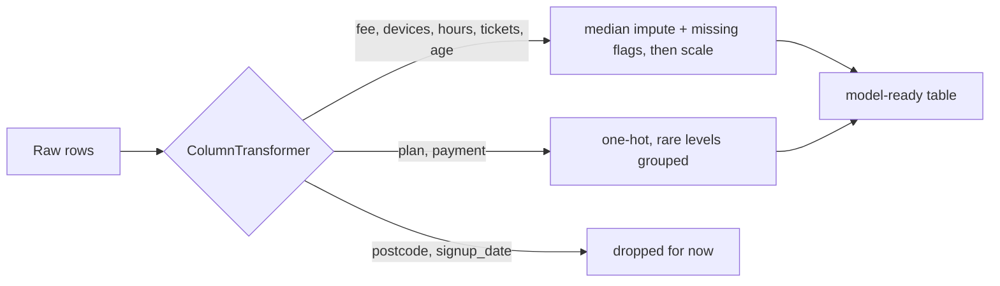

:::objectives
- Explain what `fit` stores and what `transform` reuses, and why that keeps training and prediction consistent.
- Build a `ColumnTransformer` that imputes, scales, and one-hot encodes a mixed-type DataFrame, including categories it has never seen.
- Turn hand-written feature code into pipeline steps with `FunctionTransformer` and a custom transformer class.
- Show, with numbers, how preprocessing that learns from labels leaks when it runs outside cross-validation.
:::

A churn model for a video-streaming service was trained in a notebook with a cell like this, run once on the whole table. It contains a bug that takes months to show up:

```python
df["tenure_days"] = (pd.Timestamp("2025-10-01") - df["signup_date"]).dt.days
df["age"] = df["age"].fillna(df["age"].median())
```

Months later, the app team sends five new customers to score. The model expects a `tenure_days` column that the raw rows don't have, so someone copies the cell into the scoring script. Now the missing ages are filled with the median of *those five customers*, a number that has nothing to do with the one the model was trained on. Nothing crashes. The predictions are just quietly wrong.

The fix is to make feature engineering part of the model object, so that one `fit` learns everything from training rows and one `predict` replays it on any rows you hand it. Every lesson in this module uses a synthetic version of that streaming service's data, so we know the true rules behind it:

```python run
import numpy as np
import pandas as pd
from sklearn.model_selection import train_test_split

def make_churn(n=1500, seed=7):
    """Synthetic subscribers of a video-streaming service, snapshot 2025-10-01."""
    rng = np.random.default_rng(seed)
    plan = rng.choice(["basic", "standard", "premium"], n, p=[0.5, 0.32, 0.18])
    fee = np.select([plan == "basic", plan == "standard"], [7.99, 12.99], 18.99)
    devices = rng.integers(1, 6, n)
    hours = rng.lognormal(2.6, 0.9, n).round(1)
    tickets = rng.poisson(0.6, n)
    age = rng.integers(16, 76, n).astype(float)
    payment = rng.choice(["card", "paypal", "gift_card", "crypto"], n, p=[0.6, 0.3, 0.08, 0.02])
    postcode = np.array([f"P{k:03d}" for k in rng.integers(0, 300, n)])
    signup = pd.Timestamp("2023-01-01") + pd.to_timedelta(rng.integers(0, 1000, n), unit="D")
    tenure = (pd.Timestamp("2025-10-01") - signup).days.to_numpy()
    logit = 2 * (1.5 - 1.3 * np.log1p(hours / devices) + 0.5 * tickets
                 + 0.6 * (plan == "basic") + 1.0 * (payment == "gift_card")
                 - 0.002 * tenure + 1.5 * ((tickets >= 2) & (tenure < 365))
                 + 0.002 * (age - 45) ** 2)
    df = pd.DataFrame({"plan": plan, "monthly_fee": fee, "devices": devices,
                       "watch_hours": hours, "support_tickets": tickets, "age": age,
                       "payment": payment, "postcode": postcode, "signup_date": signup})
    df["churned"] = (rng.random(n) < 1 / (1 + np.exp(-logit))).astype(int)
    df.loc[rng.random(n) < 0.08, "age"] = np.nan
    df.loc[rng.random(n) < 0.05, "watch_hours"] = np.nan
    return df

df = make_churn()
X, y = df.drop(columns="churned"), df["churned"]
X_train, X_test, y_train, y_test = train_test_split(X, y, test_size=0.25, stratify=y, random_state=0)
print(X_train.head(3).to_string())
print("churn rate:", round(y.mean(), 3), "| blanks:", X.isna().sum()[lambda s: s > 0].to_dict())
```

Read the `logit` line once: churn depends on viewing hours per device, support tickets, plan, payment type, tenure, and age. **Postcode has no effect at all.** Remember that; it will matter at the end.

## `fit` learns, `transform` replays

Every scikit-learn preprocessor follows one contract. `fit` looks at training data and stores what it learned in attributes whose names end in an underscore. `transform` uses those stored values and learns nothing new. Step through a stripped-down imputer written in plain Python and watch where `median_` comes from:

:::trace Where the fill value comes from
```python
class MedianFiller:
    def fit(self, values):
        known = sorted(v for v in values if v is not None)
        self.median_ = known[len(known) // 2]
        return self

    def transform(self, values):
        return [self.median_ if v is None else v for v in values]

train_ages = [23, None, 41, 35, 67]
filler = MedianFiller().fit(train_ages)
print(filler.transform([None, 19]))
print(filler.transform([None, None, 80]))
```
:::

Both batches get 41, the training median, whatever else is in the batch. That is the property the streaming team's notebook lost. Suppose the five new customers came from a campus promotion; here is how far apart the two fill values end up:

```python run
signups = pd.DataFrame({"age": [17, 19, np.nan, 22, np.nan]})   # five students from a campus promotion
print("median age, training rows:", X_train["age"].median())
print("median age, 5 new rows:   ", signups["age"].median())
```

## Route each column to its own steps

Numbers need imputing and scaling; text categories need encoding; some columns shouldn't reach the model at all. `ColumnTransformer` sends each group of columns through its own steps and glues the results side by side:



```python run
from sklearn.compose import ColumnTransformer
from sklearn.impute import SimpleImputer
from sklearn.pipeline import make_pipeline
from sklearn.preprocessing import OneHotEncoder, StandardScaler

NUMERIC = ["monthly_fee", "devices", "watch_hours", "support_tickets", "age"]
CATEGORICAL = ["plan", "payment"]

numeric_steps = make_pipeline(SimpleImputer(strategy="median", add_indicator=True), StandardScaler())
categorical_steps = OneHotEncoder(handle_unknown="infrequent_if_exist", min_frequency=30, sparse_output=False)

prep = ColumnTransformer(
    [("num", numeric_steps, NUMERIC), ("cat", categorical_steps, CATEGORICAL)],
    remainder="drop",
).set_output(transform="pandas")

table = prep.fit_transform(X_train)
print(table.columns.tolist())
print(table.iloc[:2].round(2).to_string())
```

Three details in that output are worth knowing:

- `add_indicator=True` appended `missingindicator_watch_hours` and `missingindicator_age`, flags that record *that* a value was blank. (They start as 0/1; the scaler then rescales them like every other numeric column, which is why they print as -0.23 and -0.29.) When blanks aren't random, say people who hide their age behave differently, the flag carries signal that the median alone erases.
- `min_frequency=30` merged `crypto` (25 training rows) into `payment_infrequent_sklearn`. A category with a handful of rows gives the model a coefficient it can't estimate well.
- `handle_unknown="infrequent_if_exist"` sends categories never seen in training into that same infrequent column instead of crashing.

`set_output(transform="pandas")` makes the transformer return a DataFrame with readable names, which makes debugging much easier than staring at a bare array.

## Write features as steps, not cells

Feature code that doesn't learn anything (dates to durations, ratios, logs) becomes a step with `FunctionTransformer`. Code that needs parameters, or that should report its output column names, is cleaner as a small class. The rules for a scikit-learn-compatible class are short: `__init__` only stores its arguments under the same names, `fit` returns `self` (and stores anything learned with a trailing underscore), and `transform` returns the new data.

```python run
from sklearn.base import BaseEstimator, TransformerMixin
from sklearn.preprocessing import FunctionTransformer

def per_device(frame):
    out = frame.copy()
    out["log_hours_per_device"] = np.log1p(out["watch_hours"] / out["devices"])
    return out

class TenureDays(TransformerMixin, BaseEstimator):
    """Replace signup_date with whole days of tenure at a fixed snapshot date."""

    def __init__(self, snapshot="2025-10-01"):
        self.snapshot = snapshot

    def fit(self, X, y=None):
        return self                      # nothing to learn, but fit must exist

    def transform(self, X):
        out = X.copy()
        out["tenure_days"] = (pd.Timestamp(self.snapshot) - out["signup_date"]).dt.days
        return out.drop(columns="signup_date")

features = make_pipeline(TenureDays(), FunctionTransformer(per_device))
print(features.fit_transform(X_train)[["tenure_days", "log_hours_per_device"]].head(3))
print(TenureDays(snapshot="2026-01-01").get_params())
```

Inheriting from `BaseEstimator` gives you `get_params` and `set_params` for free, which is what lets `clone`, cross-validation, and grid search copy your step and change its `snapshot`. That only works if `__init__` stores arguments unchanged. Converting `snapshot` to a `Timestamp` inside `__init__` looks harmless but breaks under a search: `GridSearchCV` changes settings with `set_params`, which assigns attributes directly and never runs `__init__`, so searched values would arrive as raw strings. Do conversions in `fit` or `transform`.

## When preprocessing learns from labels, leaking gets loud

Fitting a scaler on all rows leaks a little: test rows nudge the mean. Preprocessing that uses the **target** leaks a lot. *Target encoding* replaces each category with the average outcome for that category, which is a tempting way to handle a column like `postcode` with 300 levels. Done with pandas before cross-validation, each row's encoding includes its own label. Done with `TargetEncoder` inside the pipeline, each training row is encoded from the *other* folds (scikit-learn calls this cross fitting), and validation rows only see rates learned from training rows.

```python run alt="Grouped bar chart of ROC AUC on five cross-validation folds. Bars for the pandas encoding computed outside the pipeline sit near 0.89; bars for TargetEncoder inside the pipeline sit near 0.80, level with a dashed line showing the model that ignores postcode entirely." caption="Postcode carries no signal, yet encoding it outside the pipeline adds about 0.09 AUC on every fold."
import matplotlib.pyplot as plt
from sklearn.linear_model import LogisticRegression
from sklearn.model_selection import StratifiedKFold, cross_val_score
from sklearn.preprocessing import TargetEncoder

cv = StratifiedKFold(n_splits=5, shuffle=True, random_state=0)

def churn_model(extra):
    columns = ColumnTransformer([("num", numeric_steps, NUMERIC), ("cat", categorical_steps, CATEGORICAL), *extra])
    return make_pipeline(columns, LogisticRegression(max_iter=1000))

# Leaky: churn rate per postcode computed from every training label, before CV
rates = y_train.groupby(X_train["postcode"]).transform("mean")
leaky = cross_val_score(churn_model([("pc", "passthrough", ["postcode_rate"])]),
                        X_train.assign(postcode_rate=rates), y_train, cv=cv, scoring="roc_auc")
# Honest: the encoder is a pipeline step, refit inside every fold
honest = cross_val_score(churn_model([("pc", TargetEncoder(random_state=0), ["postcode"])]),
                         X_train, y_train, cv=cv, scoring="roc_auc")
without = cross_val_score(churn_model([]), X_train, y_train, cv=cv, scoring="roc_auc")

folds = np.arange(1, 6)
fig, ax = plt.subplots(figsize=(7, 3.2))
ax.bar(folds - 0.2, leaky, width=0.4, color="#eb6834", label="pandas encoding before CV (leaky)")
ax.bar(folds + 0.2, honest, width=0.4, color="#2a78d6", label="TargetEncoder in the pipeline")
ax.axhline(without.mean(), color="#52514e", linestyle="--", linewidth=1, label="no postcode at all")
ax.set_ylim(0.6, 1.0)
ax.set_xlabel("fold")
ax.set_ylabel("ROC AUC")
ax.legend(frameon=False, fontsize=8, loc="upper center", bbox_to_anchor=(0.5, -0.2), ncol=3)
ax.spines[["top", "right"]].set_visible(False)
plt.tight_layout()
plt.show()
print(f"leaky {leaky.mean():.3f} | in pipeline {honest.mean():.3f} | without postcode {without.mean():.3f}")
```

The leaky version looks like a real improvement on every fold, and it is pure fiction: we built the data, and postcode does nothing. With roughly four customers per postcode, a row's own label is a quarter of its "postcode rate", so the feature partly *is* the answer. Inside the pipeline, the encoder adds nothing, which is the truth. A score that jumps when you add a high-cardinality column deserves suspicion before celebration.

:::video 589nCGeWG1w
StatQuest walks through one-hot, label, and target encoding. What to watch for: the final section on K-fold target encoding, which is the same idea `TargetEncoder` uses to keep each row's own label out of its encoding.
:::

## Mistakes that slip past code review

:::warning
**Unknown categories crash the default encoder.** `OneHotEncoder()` uses `handle_unknown="error"`, so the first customer who pays with a method training never saw takes down your scoring job. Pick `"ignore"` (all zeros) or `"infrequent_if_exist"` (the rare bucket) on purpose.
:::

```python run raises
strict = OneHotEncoder().fit(X_train[["payment"]])
strict.transform(pd.DataFrame({"payment": ["apple_pay"]}))
```

:::warning
**`remainder="drop"` is the default.** Any column you forget to list silently disappears, and the model trains without it. List every column deliberately, or set `remainder="passthrough"` while exploring, and print `get_feature_names_out()` to see what actually reaches the model.
:::

:::quiz
Q: A pipeline's `SimpleImputer(strategy="median")` was fit on training data where the median age was 44. You call `predict` on a batch of new customers whose median age is 29. What value fills their missing ages?
- [x] 44
  `transform` replays `statistics_` learned at `fit` time; the new batch's own median is never computed.
- [ ] 29
  That's what the hand-written notebook cell did, and it's the inconsistency pipelines prevent.
- [ ] It depends on the batch size
  The fill value is fixed after `fit`, whatever the batch looks like.

Q: A custom transformer's `__init__` does `self.snapshot = pd.Timestamp(snapshot)`, and `transform` subtracts dates from `self.snapshot`. What happens when a grid search tries `snapshot` values `["2025-07-01", "2025-10-01"]`?
- [ ] It works, because the conversion runs for every candidate
  It would, if the search built each candidate by calling `__init__`; it doesn't.
- [x] The search sets each value with `set_params`, which skips `__init__`, so `transform` gets a plain string and the date arithmetic fails
  scikit-learn assigns searched values straight to attributes. Keep `__init__` to plain storage and convert inside `fit` or `transform`.
- [ ] `transform` runs before `fit`
  The order of calls doesn't change; the problem is where the conversion lives.

Q: Adding a target-encoded `postcode` raises cross-validated AUC from 0.80 to 0.89, but the encoding was computed with `groupby(...).transform("mean")` on all training rows. What should you do first?
- [ ] Keep it: postcode is clearly predictive
  The jump is what leakage looks like; you can't tell it apart from real signal yet.
- [x] Move the encoding into the pipeline as `TargetEncoder` and re-run the CV
  If the gain survives cross fitting, it's real. Here it vanishes.
- [ ] Use more folds so the estimate is more precise
  More folds give a more precise estimate of a leaky number.

Q: Which column is the best candidate for `min_frequency` grouping?
- [ ] `age`, a number with 60 distinct values
  `min_frequency` is a one-hot encoder setting for categories, not numbers.
- [x] `payment`, where one method appears in under 2% of rows
  A level with a few dozen rows gets a poorly estimated coefficient; grouping it is safer.
- [ ] `plan`, with three common levels
  Every level has hundreds of rows, so there's nothing rare to group.
:::

:::takeaways
- `fit` stores what it learns in attributes ending in `_`; `transform` replays them, so new rows are treated exactly like training rows.
- A `ColumnTransformer` routes each column group to its own steps; list columns deliberately, because unlisted ones are dropped.
- Set `handle_unknown` on purpose, and use `min_frequency` to merge rare levels.
- Feature code belongs in `FunctionTransformer` steps or small `BaseEstimator` classes whose `__init__` stores arguments unchanged.
- Anything that learns from labels, like target encoding, must be fitted inside cross-validation; outside it, a useless column can look like a breakthrough.
:::

## Further reading

- [Pipelines and composite estimators](https://scikit-learn.org/stable/modules/compose.html): the user guide for `Pipeline`, `ColumnTransformer`, `FunctionTransformer`, and parameter names inside nested steps.
- [Target Encoder's internal cross fitting](https://scikit-learn.org/stable/auto_examples/preprocessing/plot_target_encoder_cross_val.html): scikit-learn's own demonstration of why `fit_transform` and `fit().transform()` differ for this encoder.
- [Developing scikit-learn estimators](https://scikit-learn.org/stable/developers/develop.html): the full rules for writing your own transformer, including why `__init__` must not validate or convert.
