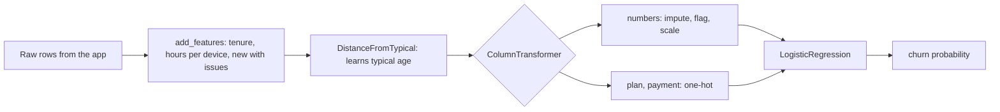

:::objectives
- Measure a raw-column baseline before engineering anything.
- Add stateless features with `FunctionTransformer` and a stateful one with a custom class.
- Use plots and tables of the training data to decide which features to build.
- Score rows straight from an app, with blanks and unseen categories, without any manual preparation.
- Package the model so another program can load it.
:::

The model you'll finish with takes a raw customer record, exactly as the app stores it, and returns a churn probability. Every arrow below is a pipeline step, so a single `fit` learns all of them from training rows:



Each step below adds one piece and re-runs the same 5-fold cross-validation on the training set, so you can see what every feature is worth. The test set stays locked until Step 6.

## Step 1: Data, split, and a raw-column baseline

The generator is the same one from the Notes lesson. Run it, split once, and score a pipeline that uses only the columns as they arrive.

```python run
import numpy as np
import pandas as pd
from sklearn.compose import ColumnTransformer
from sklearn.impute import SimpleImputer
from sklearn.linear_model import LogisticRegression
from sklearn.model_selection import StratifiedKFold, cross_val_score, train_test_split
from sklearn.pipeline import make_pipeline
from sklearn.preprocessing import OneHotEncoder, StandardScaler

def make_churn(n=1500, seed=7):
    rng = np.random.default_rng(seed)
    plan = rng.choice(["basic", "standard", "premium"], n, p=[0.5, 0.32, 0.18])
    fee = np.select([plan == "basic", plan == "standard"], [7.99, 12.99], 18.99)
    devices = rng.integers(1, 6, n)
    hours = rng.lognormal(2.6, 0.9, n).round(1)
    tickets = rng.poisson(0.6, n)
    age = rng.integers(16, 76, n).astype(float)
    payment = rng.choice(["card", "paypal", "gift_card", "crypto"], n, p=[0.6, 0.3, 0.08, 0.02])
    postcode = np.array([f"P{k:03d}" for k in rng.integers(0, 300, n)])
    signup = pd.Timestamp("2023-01-01") + pd.to_timedelta(rng.integers(0, 1000, n), unit="D")
    tenure = (pd.Timestamp("2025-10-01") - signup).days.to_numpy()
    logit = 2 * (1.5 - 1.3 * np.log1p(hours / devices) + 0.5 * tickets
                 + 0.6 * (plan == "basic") + 1.0 * (payment == "gift_card")
                 - 0.002 * tenure + 1.5 * ((tickets >= 2) & (tenure < 365))
                 + 0.002 * (age - 45) ** 2)
    df = pd.DataFrame({"plan": plan, "monthly_fee": fee, "devices": devices,
                       "watch_hours": hours, "support_tickets": tickets, "age": age,
                       "payment": payment, "postcode": postcode, "signup_date": signup})
    df["churned"] = (rng.random(n) < 1 / (1 + np.exp(-logit))).astype(int)
    df.loc[rng.random(n) < 0.08, "age"] = np.nan
    df.loc[rng.random(n) < 0.05, "watch_hours"] = np.nan
    return df

df = make_churn()
X, y = df.drop(columns="churned"), df["churned"]
X_train, X_test, y_train, y_test = train_test_split(X, y, test_size=0.25, stratify=y, random_state=0)
cv = StratifiedKFold(n_splits=5, shuffle=True, random_state=0)

RAW = ["monthly_fee", "devices", "watch_hours", "support_tickets", "age"]

def columns_step(numeric):
    """Impute, flag, and scale the numeric list; one-hot plan and payment; drop the rest."""
    return ColumnTransformer([
        ("num", make_pipeline(SimpleImputer(strategy="median", add_indicator=True), StandardScaler()), numeric),
        ("cat", OneHotEncoder(handle_unknown="infrequent_if_exist", min_frequency=30, sparse_output=False),
         ["plan", "payment"]),
    ])

def cv_auc(pipeline):
    return cross_val_score(pipeline, X_train, y_train, cv=cv, scoring="roc_auc").mean()

baseline = make_pipeline(columns_step(RAW), LogisticRegression(max_iter=1000))
print(f"raw columns only: CV AUC = {cv_auc(baseline):.3f}")
```

That's the number every feature has to beat. `columns_step` takes the list of numeric columns as an argument, because the list grows as we engineer features; building the transformer from a function means each version is a fresh object.

## Step 2: Turn dates and ratios into features

Two features need no learning at all. A signup date means nothing to a linear model, but *days since signup* does. And raw viewing hours mix up two things: a family sharing five screens at 40 hours is less engaged than one person at 40 hours, so we divide by devices and take a log to tame the long right tail.

```python run
from sklearn.preprocessing import FunctionTransformer

SNAPSHOT = pd.Timestamp("2025-10-01")

def add_features(frame):
    out = frame.copy()
    out["tenure_days"] = (SNAPSHOT - out["signup_date"]).dt.days
    out["log_hours_per_device"] = np.log1p(out["watch_hours"] / out["devices"])
    return out

STEP2 = RAW + ["tenure_days", "log_hours_per_device"]
step2 = make_pipeline(FunctionTransformer(add_features), columns_step(STEP2), LogisticRegression(max_iter=1000))
print(f"+ tenure and hours per device: CV AUC = {cv_auc(step2):.3f}")
```

A big jump from two lines of pandas. Because `add_features` sits inside the pipeline, it runs on validation folds, the test set, and next month's customers in exactly the same way. Note `out = frame.copy()`: a step that edits its input in place would change `X_train` itself the first time it runs.

## Step 3: Let the training data suggest features

Good features usually come from looking. Here are churn rates by age band and by a pair of conditions, computed **on training rows only**, so this exploration can't leak test information into our choices:

```python run alt="Bar chart of churn rate by age band. The youngest band (16 to 25) and the oldest (66 to 75) both churn at about 51 percent, while the middle bands from 36 to 65 sit near 22 percent, forming a U shape." caption="Churn by age is U-shaped, which a single linear age coefficient can't represent."
import matplotlib.pyplot as plt

bands = pd.cut(X_train["age"], bins=[15, 25, 35, 45, 55, 65, 75])
by_age = y_train.groupby(bands, observed=True).mean()

fig, ax = plt.subplots(figsize=(6.5, 2.8))
ax.bar([str(b) for b in by_age.index], by_age.values, color="#2a78d6")
ax.set_ylabel("churn rate")
ax.set_xlabel("age band")
ax.spines[["top", "right"]].set_visible(False)
plt.tight_layout()
plt.show()

first_year = (SNAPSHOT - X_train["signup_date"]).dt.days < 365
print(pd.crosstab(first_year, X_train["support_tickets"] >= 2, values=y_train, aggfunc="mean")
        .round(2).rename_axis(index="first year?", columns="2+ tickets?"))
```

Two findings. Churn is high at **both** ends of the age range, but logistic regression gives age one coefficient, so it can only say "older means more" or "older means less". A feature measuring *distance from the typical age* lets a straight line describe a U. And customers in their first year who filed two or more tickets churn far more than either condition alone would suggest; that's an **interaction**, which a linear model also can't build by itself.

The interaction is a fixed rule, so it joins `add_features`. The age distance needs a center, and the center should be *learned from training rows*, so it gets a small class with a real `fit`:

```python run
from sklearn.base import BaseEstimator, TransformerMixin

def add_features(frame):
    out = frame.copy()
    out["tenure_days"] = (SNAPSHOT - out["signup_date"]).dt.days
    out["log_hours_per_device"] = np.log1p(out["watch_hours"] / out["devices"])
    out["new_with_issues"] = ((out["tenure_days"] < 365) & (out["support_tickets"] >= 2)).astype(int)
    return out

class DistanceFromTypical(TransformerMixin, BaseEstimator):
    """Add |value - training median| for one column."""

    def __init__(self, column="age"):
        self.column = column

    def fit(self, X, y=None):
        self.center_ = X[self.column].median()      # learned from training rows only
        return self

    def transform(self, X):
        out = X.copy()
        out[f"{self.column}_gap"] = (out[self.column] - self.center_).abs()
        return out

FINAL = STEP2 + ["new_with_issues", "age_gap"]
churn_model = make_pipeline(
    FunctionTransformer(add_features),
    DistanceFromTypical("age"),
    columns_step(FINAL),
    LogisticRegression(max_iter=1000),
)
print(f"+ interaction and age gap: CV AUC = {cv_auc(churn_model):.3f}")
```

During cross-validation, `DistanceFromTypical` is cloned and refit inside each fold, so every fold computes its center from its own training part. Missing ages stay missing in `age_gap`, and the imputer downstream handles both columns.

## Step 4: Read what the model learned

Fit on the full training set and line up each output column with its coefficient. Inputs were scaled, so coefficients are roughly comparable in size.

```python run alt="Horizontal bar chart of the ten largest logistic regression coefficients. Log hours per device and tenure days have large negative weights; gift card payment, age gap, and support tickets have large positive weights." caption="Engineered features carry most of the weight. Negative means lower churn risk."
churn_model.fit(X_train, y_train)
names = churn_model[-2].get_feature_names_out()
coefs = pd.Series(churn_model[-1].coef_[0], index=names)
top = coefs.reindex(coefs.abs().sort_values().index)[-10:]

fig, ax = plt.subplots(figsize=(6.5, 3.4))
ax.barh(top.index.str.replace("num__", "").str.replace("cat__", ""), top.values,
        color=["#eb6834" if v > 0 else "#2a78d6" for v in top.values])
ax.axvline(0, color="#52514e", linewidth=0.8)
ax.set_xlabel("coefficient (scaled inputs)")
ax.spines[["top", "right"]].set_visible(False)
plt.tight_layout()
plt.show()
```

Because we generated this data, we can check the model against the truth: more viewing per device and longer tenure lower risk, gift cards and tickets raise it, and age matters through its gap from typical. Postcode never reached the model, which is right, since it carries no signal.

## Step 5: Score rows straight from the app

Here are three new customers as the app would send them, with a blank age, a payment method the training data never contained, and a postcode nobody in training had.

```python run
new_rows = pd.DataFrame({
    "plan": ["basic", "premium", "standard"],
    "monthly_fee": [7.99, 18.99, 12.99],
    "devices": [2, 2, 2],
    "watch_hours": [25.0, 12.0, 20.5],
    "support_tickets": [2, 0, 1],
    "age": [np.nan, 44.0, 71.0],
    "payment": ["card", "apple_pay", "card"],
    "postcode": ["P912", "P004", "P120"],
    "signup_date": pd.to_datetime(["2025-06-20", "2024-02-11", "2024-08-30"]),
})
risk = churn_model.predict_proba(new_rows)[:, 1]
print(new_rows[["plan", "support_tickets", "age", "payment"]].assign(churn_risk=risk.round(3)).to_string())
```

No preparation code, no crash. The blank age was filled with the training median, `apple_pay` landed in the infrequent bucket, and the unknown postcode was dropped with the rest of the unlisted columns. The first customer, a three-month-old basic account that has already filed two support tickets, is flagged as high risk; that is the first-year interaction at work. The 71-year-old gets a moderate score mostly through `age_gap`.

## Step 6: Open the test set once

Every choice so far was made with cross-validation on training rows. Now, and only now, score the 375 customers we set aside:

```python run
from sklearn.metrics import roc_auc_score

test_auc = roc_auc_score(y_test, churn_model.predict_proba(X_test)[:, 1])
print(f"test AUC = {test_auc:.3f}  (final CV AUC on training rows = {cv_auc(churn_model):.3f})")
```

The test score lands close to the cross-validated one, which is what you hope for when nothing leaked. If the test score had come out much *higher* than CV, that would be worth investigating too: it usually means a lucky split or a leak, not a better model.

## The finished program

In a real project the feature code lives in its own `.py` file, because a saved model only stores a *reference* to your custom class and function. When another program loads the model, Python must be able to import them by the same names, or loading fails with an `AttributeError` about a missing attribute on `__main__`. This script is laid out that way: run it with `python churn_pipeline.py`, or split the top half into `churn_features.py` and import from it.

```python title="churn_pipeline.py"
import joblib
import numpy as np
import pandas as pd
from sklearn.base import BaseEstimator, TransformerMixin
from sklearn.compose import ColumnTransformer
from sklearn.impute import SimpleImputer
from sklearn.linear_model import LogisticRegression
from sklearn.metrics import roc_auc_score
from sklearn.model_selection import train_test_split
from sklearn.pipeline import make_pipeline
from sklearn.preprocessing import FunctionTransformer, OneHotEncoder, StandardScaler

# ---- feature code (would live in churn_features.py) ----
SNAPSHOT = pd.Timestamp("2025-10-01")

def add_features(frame):
    out = frame.copy()
    out["tenure_days"] = (SNAPSHOT - out["signup_date"]).dt.days
    out["log_hours_per_device"] = np.log1p(out["watch_hours"] / out["devices"])
    out["new_with_issues"] = ((out["tenure_days"] < 365) & (out["support_tickets"] >= 2)).astype(int)
    return out

class DistanceFromTypical(TransformerMixin, BaseEstimator):
    def __init__(self, column="age"):
        self.column = column

    def fit(self, X, y=None):
        self.center_ = X[self.column].median()
        return self

    def transform(self, X):
        out = X.copy()
        out[f"{self.column}_gap"] = (out[self.column] - self.center_).abs()
        return out

# ---- data (same generator as the lesson) ----
def make_churn(n=1500, seed=7):
    rng = np.random.default_rng(seed)
    plan = rng.choice(["basic", "standard", "premium"], n, p=[0.5, 0.32, 0.18])
    fee = np.select([plan == "basic", plan == "standard"], [7.99, 12.99], 18.99)
    devices = rng.integers(1, 6, n)
    hours = rng.lognormal(2.6, 0.9, n).round(1)
    tickets = rng.poisson(0.6, n)
    age = rng.integers(16, 76, n).astype(float)
    payment = rng.choice(["card", "paypal", "gift_card", "crypto"], n, p=[0.6, 0.3, 0.08, 0.02])
    postcode = np.array([f"P{k:03d}" for k in rng.integers(0, 300, n)])
    signup = pd.Timestamp("2023-01-01") + pd.to_timedelta(rng.integers(0, 1000, n), unit="D")
    tenure = (pd.Timestamp("2025-10-01") - signup).days.to_numpy()
    logit = 2 * (1.5 - 1.3 * np.log1p(hours / devices) + 0.5 * tickets
                 + 0.6 * (plan == "basic") + 1.0 * (payment == "gift_card")
                 - 0.002 * tenure + 1.5 * ((tickets >= 2) & (tenure < 365))
                 + 0.002 * (age - 45) ** 2)
    df = pd.DataFrame({"plan": plan, "monthly_fee": fee, "devices": devices,
                       "watch_hours": hours, "support_tickets": tickets, "age": age,
                       "payment": payment, "postcode": postcode, "signup_date": signup})
    df["churned"] = (rng.random(n) < 1 / (1 + np.exp(-logit))).astype(int)
    df.loc[rng.random(n) < 0.08, "age"] = np.nan
    df.loc[rng.random(n) < 0.05, "watch_hours"] = np.nan
    return df

# ---- model ----
NUMERIC = ["monthly_fee", "devices", "watch_hours", "support_tickets", "age",
           "tenure_days", "log_hours_per_device", "new_with_issues", "age_gap"]
churn_model = make_pipeline(
    FunctionTransformer(add_features),
    DistanceFromTypical("age"),
    ColumnTransformer([
        ("num", make_pipeline(SimpleImputer(strategy="median", add_indicator=True), StandardScaler()), NUMERIC),
        ("cat", OneHotEncoder(handle_unknown="infrequent_if_exist", min_frequency=30, sparse_output=False),
         ["plan", "payment"]),
    ]),
    LogisticRegression(max_iter=1000),
)

if __name__ == "__main__":
    df = make_churn()
    X, y = df.drop(columns="churned"), df["churned"]
    X_train, X_test, y_train, y_test = train_test_split(X, y, test_size=0.25, stratify=y, random_state=0)
    churn_model.fit(X_train, y_train)

    joblib.dump(churn_model, "churn_model.joblib")
    loaded = joblib.load("churn_model.joblib")
    same = np.allclose(loaded.predict_proba(X_test), churn_model.predict_proba(X_test))
    print("reloaded model gives identical predictions:", same)
    print(f"test AUC = {roc_auc_score(y_test, loaded.predict_proba(X_test)[:, 1]):.3f}")
```

```text
reloaded model gives identical predictions: True
test AUC = 0.924
```

:::warning
Only load `.joblib` or pickle files you created or fully trust. Loading one runs code chosen by whoever saved it, so a model file from a stranger is as risky as a script from a stranger.
:::

:::quiz
Q: Why is the typical age learned in `DistanceFromTypical.fit` instead of hard-coded as 45 inside `add_features`?
- [ ] Hard-coding would raise an error inside a pipeline
  It would run fine; the problem is where the number comes from.
- [x] The center should come from training data, and inside cross-validation each fold should learn its own
  A value picked by looking at all the data is a small leak; learning it in `fit` keeps every fold honest.
- [ ] `FunctionTransformer` can't use constants
  `add_features` already uses the constant `SNAPSHOT`; constants are fine when they don't come from the data.

Q: The age-band chart and crosstab were computed on `X_train` only. What would go wrong if you used the full `df`?
- [x] Your feature choices would be informed by test rows, so the final test score would be slightly optimistic
  Looking is a form of fitting. Decisions made after seeing test labels leak into the test score.
- [ ] Nothing, since the chart doesn't train a model
  A human choosing features from the chart is part of the training process.
- [ ] The chart would crash on missing ages
  `pd.cut` puts blank ages in no band; the chart would still draw.

Q: A colleague loads `churn_model.joblib` in a scoring service and gets `AttributeError: Can't get attribute 'add_features' on <module '__main__'>`. What's the fix?
- [ ] Re-save the model with a different protocol
  The protocol isn't the issue; the file references a class the service can't find.
- [x] Put the class (and `add_features`) in an importable module and import it in both places before saving and loading
  The saved file stores the class's module and name. If those don't resolve in the loading program, it fails.
- [ ] Replace the custom class with a lambda
  Lambdas can't be pickled by name at all, which makes the problem worse.
:::

:::takeaways
- Measure a raw baseline first; every engineered feature then has a number to beat.
- Rules that need no data (dates to durations, ratios, interactions) go in a `FunctionTransformer`; anything learned from data goes in a class with a real `fit`.
- Explore on training rows only, because choosing features is part of fitting.
- A pipeline scores raw rows with blanks and unseen categories without extra code.
- Keep custom steps in an importable module so a saved model can be loaded elsewhere, and only load model files you trust.
:::

## Extend it

- Remove the redundant missing-value flags (`age_gap` is blank exactly when `age` is) by giving the gap column its own imputer without `add_indicator`.
- Swap `LogisticRegression` for `HistGradientBoostingClassifier` without the engineered features. Does a model that can learn curves and interactions on its own still need them?
- Add `TargetEncoder` for `postcode` inside `columns_step` and confirm with cross-validation that it adds nothing.

## Further reading

- [Model persistence](https://scikit-learn.org/stable/model_persistence.html): scikit-learn's guide to saving models, the security risks of pickle, and alternatives like skops.
- [FunctionTransformer](https://scikit-learn.org/stable/modules/generated/sklearn.preprocessing.FunctionTransformer.html): options such as `feature_names_out` and `inverse_func`.
- [Column Transformer with mixed types](https://scikit-learn.org/stable/auto_examples/compose/plot_column_transformer_mixed_types.html): another full pipeline on mixed data, with selection by dtype.
