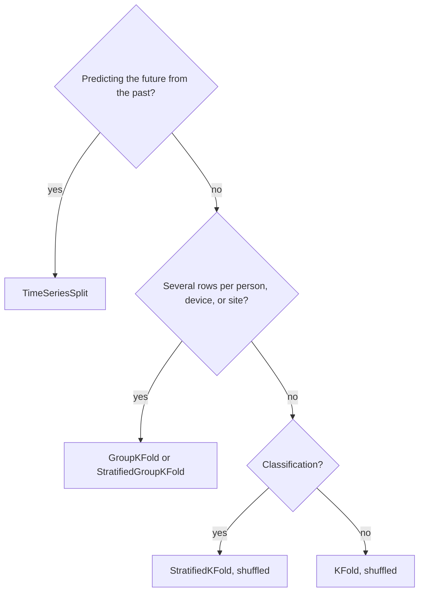

:::objectives
- Show how a single train/test split can reverse a model comparison.
- Explain how `KFold` assigns rows to folds, and when to shuffle.
- Choose between `KFold`, `StratifiedKFold`, `GroupKFold`, and `TimeSeriesSplit` from the structure of a dataset.
- Report several metrics at once with `cross_validate`, including their spread across folds.
- Explain why the best score from a search is optimistic, and how nested cross-validation fixes it.
:::

Two models, one 300-row dataset, forty different random 75/25 splits. Here's how often each model "wins":

```python run alt="Bar chart of 40 bars, one per random split, showing logistic regression's test accuracy minus k-NN's. About half the bars are positive and orange, about a quarter are negative and blue, and the rest are ties at zero. Bars range from about minus 0.08 to plus 0.11." caption="Each bar is one possible report. Pick a split, and you pick a winner."
import numpy as np
import pandas as pd
import matplotlib.pyplot as plt
from sklearn.datasets import make_classification
from sklearn.linear_model import LogisticRegression
from sklearn.model_selection import train_test_split
from sklearn.neighbors import KNeighborsClassifier
from sklearn.pipeline import make_pipeline
from sklearn.preprocessing import StandardScaler

X, y = make_classification(n_samples=300, n_features=10, n_informative=4, n_redundant=2,
                           flip_y=0.08, random_state=5)
logreg = make_pipeline(StandardScaler(), LogisticRegression())
knn = make_pipeline(StandardScaler(), KNeighborsClassifier(n_neighbors=15))

gaps, lr_scores = [], []
for seed in range(40):
    X_tr, X_te, y_tr, y_te = train_test_split(X, y, test_size=0.25, random_state=seed)
    lr_scores.append(logreg.fit(X_tr, y_tr).score(X_te, y_te))
    gaps.append(lr_scores[-1] - knn.fit(X_tr, y_tr).score(X_te, y_te))
gaps = np.array(gaps)

fig, ax = plt.subplots(figsize=(7, 2.6))
ax.bar(range(40), gaps, color=np.where(gaps > 0, "#eb6834", "#2a78d6"))
ax.axhline(0, color="#52514e", linewidth=0.8)
ax.set_xlabel("random split (seed)")
ax.set_ylabel("LR minus k-NN accuracy")
ax.spines[["top", "right"]].set_visible(False)
plt.tight_layout()
plt.show()
print(f"logistic regression wins {np.sum(gaps > 0)}, k-NN wins {np.sum(gaps < 0)}, ties {np.sum(gaps == 0)}")
print(f"logistic regression's own test accuracy ranged from {min(lr_scores):.2f} to {max(lr_scores):.2f}")
```

A test set of 75 rows is small, so which 75 rows you get moves accuracy by almost twenty points, and the "better" model changes with the seed. The fix isn't a bigger single test set (you rarely have spare data). It's to use **every** row for testing exactly once and look at the whole distribution of scores, which is what cross-validation does. The harder question, and the subject of this lesson, is *how* to carve the data so each test fold is a fair stand-in for the future.

## How `KFold` carves up the rows

With `n_splits=k`, `KFold` cuts the rows into k blocks of nearly equal size, uses each block once as the test fold, and trains on the rest. When the rows don't divide evenly, the first few folds get one extra row. Step through the sizing for 7 rows and 3 folds:

:::trace How 7 rows become 3 test folds
```python
n_rows, k = 7, 3
sizes = [n_rows // k] * k
for i in range(n_rows % k):
    sizes[i] += 1
start = 0
for fold, size in enumerate(sizes):
    test = list(range(start, start + size))
    print("fold", fold, "tests rows", test)
    start += size
```
:::

Without `shuffle=True`, the blocks are consecutive rows. That's fine if the rows are in random order and a disaster if they're sorted (by class, by date, by hospital), because a test fold can then contain kinds of rows the training folds never saw. Shuffle by default, with an integer `random_state`, unless order carries meaning, which is the time-series case below.

## Four splitters, four assumptions

Each splitter encodes a belief about how your data relates to the future data the model will meet. Here's how each one assigns 24 rows across four splits. The data has a rare class (triangles), and the rows come in groups of three, like three visits per patient (the gray stripes).

```python run alt="Four panels of colored grids, one per splitter, with four rows each for the four splits. KFold scatters orange test cells randomly. StratifiedKFold scatters them too, but each split contains one or two of the rare-class triangles. GroupKFold's orange test cells come in solid blocks of three that line up with the gray group stripes. TimeSeriesSplit's test block moves left to right, training only on rows before it, with later rows left white." caption="Orange is the test fold, light blue is training, white is unused. Gray stripes mark groups of three rows; triangles mark the rare class."
from matplotlib.colors import ListedColormap
from sklearn.model_selection import GroupKFold, KFold, StratifiedKFold, TimeSeriesSplit

n = 24
y_demo = np.random.default_rng(2).permutation([0] * 18 + [1] * 6)
groups_demo = np.repeat(np.arange(8), 3)          # 8 patients, 3 rows each

splitters = {
    "KFold(4, shuffle=True)": KFold(4, shuffle=True, random_state=0),
    "StratifiedKFold(4, shuffle=True)": StratifiedKFold(4, shuffle=True, random_state=0),
    "GroupKFold(4)": GroupKFold(4),
    "TimeSeriesSplit(4)": TimeSeriesSplit(4),
}
fig, axes = plt.subplots(2, 2, figsize=(9, 4.8))
for ax, (name, cv) in zip(axes.ravel(), splitters.items()):
    extra = {"groups": groups_demo} if "Group" in name else {}
    grid = np.full((5, n), np.nan)
    for i, (train, test) in enumerate(cv.split(np.zeros((n, 1)), y_demo, **extra)):
        grid[i, train], grid[i, test] = 0, 1
    ax.imshow(grid, aspect="auto", cmap=ListedColormap(["#d9e6f7", "#eb6834"]), vmin=0, vmax=1)
    ax.imshow(np.where(np.arange(5)[:, None] == 4, groups_demo % 2, np.nan), aspect="auto",
              cmap=ListedColormap(["#b8b6b0", "#6f6d68"]), vmin=0, vmax=1)
    ax.scatter(np.flatnonzero(y_demo), [4.85] * 6, marker="^", color="#0b0b0b", s=16, clip_on=False)
    ax.set_ylim(5.2, -0.5)
    ax.set_title(name, fontsize=10)
    ax.set_yticks(range(5), ["split 1", "split 2", "split 3", "split 4", "group"], fontsize=8)
    ax.set_xticks([])
plt.tight_layout()
plt.show()
```



**`StratifiedKFold`** keeps each class's share the same in every fold. With a rare class that matters a lot. Here 11 positives out of 150 rows go through plain shuffled `KFold` and through `StratifiedKFold`:

```python run
X_rare, y_rare = make_classification(n_samples=150, n_features=5, weights=[0.92], flip_y=0, random_state=0)
for cv in (KFold(5, shuffle=True, random_state=0), StratifiedKFold(5, shuffle=True, random_state=0)):
    print(f"{type(cv).__name__:<16} positives per test fold:", [int(y_rare[test].sum()) for _, test in cv.split(X_rare, y_rare)])
```

One `KFold` test fold has **no** positives at all, so recall and ROC AUC can't even be computed on it, while another has five. Stratifying removes that source of noise for free. (When you pass an integer for `cv` to a classifier, scikit-learn already uses stratified folds; pass a splitter object when you want shuffling and a seed.)

**`GroupKFold`** keeps every row of a group in the same fold. Use it whenever several rows come from one source and the model will meet *new* sources: patients, customers, devices, schools, recording sessions. If one patient's visits sit on both sides of a split, the model can score well by recognizing the patient rather than learning the disease. The Build-along measures exactly how much that inflates a score. `StratifiedGroupKFold` does both jobs at once.

**`TimeSeriesSplit`** trains only on rows that come *before* the test block, the way the model will be used. It assumes rows are sorted by time. Two options matter in practice: `gap=` leaves out rows between training and test (useful when a feature uses the last few days of data), and `test_size=` fixes the length of each test window.

## Several metrics, and how much they move

`cross_validate` returns one row per fold, for as many metrics as you ask for, plus fit times and, optionally, training scores:

```python run
from sklearn.model_selection import cross_validate

result = cross_validate(logreg, X, y, cv=StratifiedKFold(5, shuffle=True, random_state=0),
                        scoring=["accuracy", "balanced_accuracy", "roc_auc", "f1"], return_train_score=True)
folds = pd.DataFrame(result).drop(columns=["fit_time", "score_time"])
print(folds.round(3).to_string())
summary = folds.agg(["mean", "std"]).T.round(3)
print(summary.loc[["test_accuracy", "test_roc_auc", "train_roc_auc"]])
```

Report each metric as mean ± standard deviation across folds, and keep the per-fold table for later: comparing two models fold by fold (same folds for both) is far more sensitive than comparing their means. Two cautions about that standard deviation. The folds share most of their training rows, so the scores aren't independent, and the std understates the true uncertainty. And a big gap between `train_` and `test_` scores is your overfitting gauge; here the gap is small, which is what a well-regularized linear model looks like.

## When tuning is part of the model, you need two loops

`GridSearchCV` tries many settings and keeps the one with the best cross-validated score. That best score is the **maximum** of many noisy estimates, and a maximum of noisy numbers is biased upward. Reporting it as your model's performance is like reporting your best of twenty dice rolls as your average. **Nested cross-validation** wraps the whole search, tuning included, inside an outer loop whose test folds the search never sees:

```mermaid caption="Nested CV: the inner loop picks settings, the outer loop grades the whole procedure"
flowchart LR
    O["Outer fold k: train part"] --> I["Inner CV: GridSearchCV tries every setting"]
    I --> B["Refit best setting on the outer train part"]
    B --> S["Score once on outer fold k's test part"]
    S --> A["Average over outer folds"]
```

```python run
from sklearn.model_selection import GridSearchCV, cross_val_score
from sklearn.svm import SVC

search = GridSearchCV(make_pipeline(StandardScaler(), SVC()),
                      {"svc__C": [0.1, 1, 10, 100], "svc__gamma": [0.01, 0.03, 0.1, 0.3, 1]},
                      cv=StratifiedKFold(4, shuffle=True, random_state=0))
search.fit(X, y)
nested = cross_val_score(search, X, y, cv=StratifiedKFold(5, shuffle=True, random_state=10))
print(f"best_score_ from the search: {search.best_score_:.3f}  (optimistic)")
print(f"nested CV estimate:          {nested.mean():.3f} ± {nested.std():.3f}")
```

Passing a `GridSearchCV` to `cross_val_score` is all it takes: each outer fold runs a complete search on its training part. The nested number answers the question you actually care about: *how well does "tune an SVM this way, then train it" perform on new data?* The best settings can differ between outer folds, and that's fine, since you're grading the procedure. To get a final model, run the search once on all the training data.

:::video -8s9KuNo5SA start=15:25
Rob Mulla visualizes the folds that different scikit-learn splitters produce, much like the grid above. What to watch for: his group and time-based examples, and how he checks a split visually before trusting it.
:::

:::warning
**Passing `groups=` to the wrong splitter does nothing.** `cross_validate(model, X, y, groups=patients, cv=StratifiedKFold(5))` runs without an error, but `StratifiedKFold` ignores groups (scikit-learn only prints a `UserWarning`, which is easy to miss), so patients still straddle folds. Groups only take effect with a group-aware splitter such as `GroupKFold`.
:::

:::warning
**`TimeSeriesSplit` trusts your row order.** If the DataFrame isn't sorted by date, "the past" is a random mix and the scores mean nothing. Call `df.sort_values("date")` first, and check the date ranges of the first and last split.
:::

:::quiz
Q: A dataset has 2,000 X-rays from 400 patients (five each), and the model will be used on new patients. Which splitter?
- [ ] `StratifiedKFold(5, shuffle=True)`
  It balances classes but scatters each patient's X-rays across folds, so the model can recognize patients it has already seen.
- [x] `GroupKFold(5)` with `groups=patient_id`, or `StratifiedGroupKFold` if a class is rare
  Every X-ray of a patient lands in the same fold, so each test fold contains only new patients, like real use.
- [ ] `TimeSeriesSplit(5)`
  Nothing here is about predicting later time periods from earlier ones.

Q: Shuffled `KFold(5)` on a dataset with 11 positives gives one test fold with zero positives. What happens to ROC AUC on that fold?
- [ ] It equals 1.0
  AUC compares positives with negatives; with no positives there's nothing to compare.
- [x] It's undefined, so `cross_validate` returns `nan` for that fold
  Stratifying keeps two or three positives in every fold and avoids the problem.
- [ ] It equals the accuracy
  AUC and accuracy are different quantities; with one class present, AUC can't be computed.

Q: `GridSearchCV` reports `best_score_ = 0.89`. Nested CV of the same search gives 0.86. Which number goes in your report, and why?
- [x] 0.86, because the 0.89 was selected as the best of many noisy scores on the same folds
  Selecting the maximum makes it optimistic; the outer folds in nested CV never influenced the choice.
- [ ] 0.89, because it's the score of the best model
  It's the best score among the candidates, and the selection itself pushed it up.
- [ ] Their average, 0.875
  Averaging an optimistic estimate with an honest one is still optimistic.

Q: Which use of `cross_validate` gives the most useful comparison between two models?
- [ ] Each model with `cv=5` and its own random seed
  Different folds add noise to the comparison.
- [x] Both models with the same splitter object and integer seed, compared fold by fold
  Identical folds mean the differences come from the models, not from which rows were tested.
- [ ] Each model on a single train/test split with a large test set
  One split gives one number per model; as the opening chart showed, that number depends on the split.
:::

:::takeaways
- One random split can flip a model comparison; cross-validation tests every row once and shows the spread.
- Shuffle `KFold` unless row order means time; stratify classification folds, especially with a rare class.
- Group rows that share a source (patient, customer, device) with `GroupKFold`, and respect time order with `TimeSeriesSplit`.
- Use `cross_validate` for several metrics; report mean ± std, compare models fold by fold, and watch the train/test gap.
- The best score of a search is optimistic. Nested CV grades the whole tune-then-train procedure.
:::

## Further reading

- [Cross-validation: evaluating estimator performance](https://scikit-learn.org/stable/modules/cross_validation.html): the user guide, covering every splitter, `cross_validate`, and permutation tests.
- [Visualizing cross-validation behavior](https://scikit-learn.org/stable/auto_examples/model_selection/plot_cv_indices.html): scikit-learn's own fold-grid plots for more splitters than shown here.
- [Nested versus non-nested cross-validation](https://scikit-learn.org/stable/auto_examples/model_selection/plot_nested_cross_validation_iris.html): repeats the comparison above many times to show how consistent the optimism is.
