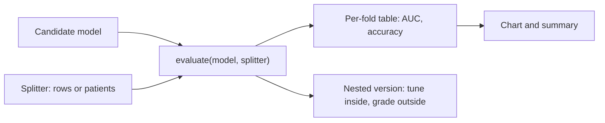

:::objectives
- Write a function that runs `cross_validate` and returns a tidy per-fold table.
- Compare two models under row-level and patient-level cross-validation, and explain why the ranking flips.
- Check programmatically that no patient appears in both the training and test part of a fold.
- Run nested cross-validation by hand, with group-aware folds in both loops.
:::

A clinic wants a model that flags a condition from routine visit measurements, and it will be used on **new** patients. The data has 601 visits from 60 patients, between 6 and 14 visits each. By the end you'll have a harness that produces this kind of table for any model and any splitter, and you'll know which of its rows to believe:



## Step 1: Generate the visits and look at their structure

Each patient has a personal baseline for six routine readings (think resting heart rate or a lab value that differs between people but barely changes between visits). Two markers carry the real, noisy signal. The diagnosis belongs to the patient, so it's the same at every visit.

```python run
import numpy as np
import pandas as pd

def make_visits(n_patients=60, seed=0):
    rng = np.random.default_rng(seed)
    rows = []
    for patient in range(n_patients):
        sick = int(rng.random() < 0.4)
        baseline = rng.normal(0, 1, size=6)                    # this patient's personal readings
        for _ in range(rng.integers(6, 15)):
            markers = rng.normal(1.0 if sick else 0.0, 1.2, size=2)
            readings = baseline + rng.normal(0, 0.3, size=6)
            rows.append([patient, *markers, *readings, sick])
    columns = ["patient", "marker_a", "marker_b"] + [f"reading_{i}" for i in range(6)] + ["diagnosis"]
    return pd.DataFrame(rows, columns=columns)

visits = make_visits()
X = visits.drop(columns=["patient", "diagnosis"])
y = visits["diagnosis"]
groups = visits["patient"]

print(visits.shape, "| patients:", groups.nunique(), "| visits per patient:", groups.value_counts().agg(["min", "max"]).tolist())
print("diagnoses per patient (should be 1):", visits.groupby("patient")["diagnosis"].nunique().max())
print(visits.head(3).round(2).to_string())
```

Notice the readings: a patient's six values stay close to their baseline at every visit. That makes each patient recognizable, and that's the trap.

## Step 2: Write the harness

The harness takes a model and a splitter, always passes `groups` (non-group splitters simply ignore it), and returns one tidy row per fold. Returning a DataFrame instead of printing means every later step can filter, average, and plot the same table.

```python run
import warnings
from sklearn.model_selection import cross_validate

def evaluate(model, cv, label):
    """Cross-validate model with splitter cv; return one row per fold."""
    with warnings.catch_warnings():
        warnings.simplefilter("ignore", UserWarning)        # non-group splitters warn that groups is unused
        result = cross_validate(model, X, y, cv=cv, groups=groups, scoring=["roc_auc", "accuracy"])
    return pd.DataFrame({
        "scheme": label,
        "fold": np.arange(1, len(result["test_roc_auc"]) + 1),
        "roc_auc": result["test_roc_auc"],
        "accuracy": result["test_accuracy"],
    })
```

Silencing that one warning is deliberate and narrow: the harness passes `groups` to every splitter on purpose, and the warning would otherwise print once per call. Never silence warnings wholesale in a notebook; you'd lose the ones that matter.

## Step 3: Run both models under both schemes

Two candidates: a scaled logistic regression, and a k-nearest-neighbors classifier, which predicts from the most similar visits it has stored. Two schemes: shuffle the *visits* into folds, or keep each *patient's* visits together.

```python run
from sklearn.linear_model import LogisticRegression
from sklearn.model_selection import StratifiedGroupKFold, StratifiedKFold
from sklearn.neighbors import KNeighborsClassifier
from sklearn.pipeline import make_pipeline
from sklearn.preprocessing import StandardScaler

models = {
    "logistic": make_pipeline(StandardScaler(), LogisticRegression()),
    "k-NN": make_pipeline(StandardScaler(), KNeighborsClassifier(n_neighbors=15)),
}
schemes = {
    "visits shuffled": StratifiedKFold(n_splits=5, shuffle=True, random_state=0),
    "patients together": StratifiedGroupKFold(n_splits=5, shuffle=True, random_state=0),
}
results = pd.concat(
    [evaluate(model, cv, scheme).assign(model=name)
     for scheme, cv in schemes.items() for name, model in models.items()],
    ignore_index=True,
)
print(results.groupby(["scheme", "model"])["roc_auc"].agg(["mean", "std"]).round(3))
```

Read it twice. With visits shuffled, k-NN looks like the clear winner. With patients kept together, it's clearly the *worse* model, and both models lose ground. Same data, same models; only the question changed.

Here's what happened. When a patient's visits sit on both sides of a fold, k-NN finds that patient's *other visits* among the nearest neighbors (their baselines match) and copies their diagnosis. That's memorizing patients, not detecting a condition, and it's useless for a new patient. Logistic regression can't memorize individuals as easily, so it's hurt less. The group-aware scheme asks the question the clinic actually has.

## Step 4: Prove the folds are clean

Trust, then verify. For each fold, count the patients who appear on both sides:

```python run
for scheme, cv in schemes.items():
    shared = []
    for train_idx, test_idx in cv.split(X, y, groups):
        shared.append(len(set(groups.iloc[train_idx]) & set(groups.iloc[test_idx])))
    print(f"{scheme:<18} patients in both train and test, per fold: {shared}")
```

With shuffled visits, nearly every test patient also has visits in training. With `StratifiedGroupKFold`, the overlap is zero in every fold. Keep a check like this in any project with grouped data; it takes four lines and catches a misconfigured splitter instantly.

## Step 5: Plot the folds, not just the means

```python run alt="Dot plot with four columns: logistic and k-NN under visits shuffled, then logistic and k-NN under patients together. Under visits shuffled, k-NN's five fold AUCs cluster tightly near 0.91 and logistic near 0.81. Under patients together, logistic's folds sit between about 0.71 and 0.85, while k-NN's spread widely from about 0.42 to 0.70." caption="Grouped folds lower both models and spread k-NN's scores widely. Each dot is one fold; bars mark the mean."
import matplotlib.pyplot as plt

order = [("visits shuffled", "logistic"), ("visits shuffled", "k-NN"),
         ("patients together", "logistic"), ("patients together", "k-NN")]
fig, ax = plt.subplots(figsize=(7, 3.2))
for x, (scheme, name) in enumerate(order):
    scores = results.query("scheme == @scheme and model == @name")["roc_auc"]
    color = "#2a78d6" if name == "logistic" else "#eb6834"
    ax.scatter([x] * len(scores), scores, color=color, alpha=0.75, s=36)
    ax.hlines(scores.mean(), x - 0.25, x + 0.25, color=color, linewidth=2.5)
ax.set_xticks(range(4), [f"{name}\n{scheme}" for scheme, name in order], fontsize=8)
ax.axvline(1.5, color="#b8b6b0", linewidth=0.8)
ax.set_ylabel("ROC AUC per fold")
ax.spines[["top", "right"]].set_visible(False)
plt.tight_layout()
plt.show()
```

The spread tells its own story. Under the honest scheme, k-NN's folds range widely, because with 12 patients per test fold, a handful of unusual patients can sink a fold. When fold scores vary this much, a single mean hides most of what you know.

## Step 6: Tune honestly with nested, group-aware CV

Both models have a setting worth tuning: k-NN's number of neighbors, and logistic regression's regularization strength `C`. Tuning has to respect patients too, in **both** loops, so we write the outer loop by hand and pass each outer training part's groups to the inner search:

```python run
from sklearn.metrics import roc_auc_score
from sklearn.model_selection import GridSearchCV

def nested_group_cv(estimator, grid, outer=schemes["patients together"]):
    rows = []
    for fold, (train_idx, test_idx) in enumerate(outer.split(X, y, groups), start=1):
        search = GridSearchCV(estimator, grid, scoring="roc_auc",
                              cv=StratifiedGroupKFold(n_splits=3, shuffle=True, random_state=1))
        search.fit(X.iloc[train_idx], y.iloc[train_idx], groups=groups.iloc[train_idx])
        score = roc_auc_score(y.iloc[test_idx], search.predict_proba(X.iloc[test_idx])[:, 1])
        rows.append({"fold": fold, "roc_auc": score, **search.best_params_})
    return pd.DataFrame(rows)

tuned_lr = nested_group_cv(models["logistic"], {"logisticregression__C": [0.01, 0.1, 1, 10]})
tuned_knn = nested_group_cv(models["k-NN"], {"kneighborsclassifier__n_neighbors": [5, 15, 45, 135]})
print(tuned_lr.round(3).to_string(index=False))
print(tuned_knn.round(3).to_string(index=False))
print(f"\nnested estimate  logistic: {tuned_lr.roc_auc.mean():.3f}   k-NN: {tuned_knn.roc_auc.mean():.3f}")
```

Two things to read in those tables. First, the outer test folds never influenced the choice of `C` or `k`, so the means at the bottom are honest estimates of "tune, then train" for each model. Second, look at the chosen settings. Logistic regression picks the smallest `C` every time, and k-NN picks the largest `k` in four folds out of five, averaging over so many neighbors that one patient's other visits can't dominate. Both winners sit at the edge of their grids, which means the grids were too narrow; Module 4 deals with that. Tuning barely moved logistic regression (0.758 against 0.761 untuned) but recovered much of k-NN's score (0.725 against 0.614).

So which model? Logistic regression still leads, 0.758 to 0.725, but that gap is smaller than either model's fold-to-fold spread of about 0.05. A defensible recommendation says exactly that: **logistic regression**, because it's at least as accurate on new patients, simpler, and steadier across folds, with the note that tuned k-NN is close and that more patients would sharpen the comparison. Compare that with where we started: row-level CV would have shipped k-NN with a claimed AUC of 0.91.

:::video XXFLFWHP9Nc
Sebastian Raschka explains nested cross-validation for choosing between algorithms. What to watch for: his point that the outer loop grades the whole tuning procedure, which is why the chosen settings are allowed to differ from fold to fold.
:::

## The finished program

Here's the whole harness in one cell, ready to reuse with another dataset: replace `make_visits`, the `models` dictionary, and the grids.

```python run title="cv_harness.py"
import warnings
import numpy as np
import pandas as pd
from sklearn.linear_model import LogisticRegression
from sklearn.metrics import roc_auc_score
from sklearn.model_selection import GridSearchCV, StratifiedGroupKFold, StratifiedKFold, cross_validate
from sklearn.neighbors import KNeighborsClassifier
from sklearn.pipeline import make_pipeline
from sklearn.preprocessing import StandardScaler

visits = make_visits()                                   # defined in Step 1
X, y, groups = visits.drop(columns=["patient", "diagnosis"]), visits["diagnosis"], visits["patient"]
ROWS = StratifiedKFold(n_splits=5, shuffle=True, random_state=0)
PATIENTS = StratifiedGroupKFold(n_splits=5, shuffle=True, random_state=0)

def evaluate(model, cv):
    with warnings.catch_warnings():
        warnings.simplefilter("ignore", UserWarning)
        return cross_validate(model, X, y, cv=cv, groups=groups, scoring="roc_auc")["test_score"]

def leaked_patients(cv):
    return sum(len(set(groups.iloc[tr]) & set(groups.iloc[te])) for tr, te in cv.split(X, y, groups))

def nested(estimator, grid):
    scores = []
    for tr, te in PATIENTS.split(X, y, groups):
        search = GridSearchCV(estimator, grid, scoring="roc_auc",
                              cv=StratifiedGroupKFold(n_splits=3, shuffle=True, random_state=1))
        search.fit(X.iloc[tr], y.iloc[tr], groups=groups.iloc[tr])
        scores.append(roc_auc_score(y.iloc[te], search.predict_proba(X.iloc[te])[:, 1]))
    return np.array(scores)

candidates = {
    "logistic": (make_pipeline(StandardScaler(), LogisticRegression()), {"logisticregression__C": [0.01, 0.1, 1, 10]}),
    "k-NN": (make_pipeline(StandardScaler(), KNeighborsClassifier(n_neighbors=15)),
             {"kneighborsclassifier__n_neighbors": [5, 15, 45, 135]}),
}
assert leaked_patients(PATIENTS) == 0, "a patient appears on both sides of a fold"
columns = {}
for name, (model, grid) in candidates.items():
    nested_scores = nested(model, grid)
    columns[name] = {
        "AUC, visits shuffled": evaluate(model, ROWS).mean(),
        "AUC, patients together": evaluate(model, PATIENTS).mean(),
        "nested AUC (tuned)": nested_scores.mean(),
        "nested std": nested_scores.std(),
    }
print(pd.DataFrame(columns).round(3))
```

:::quiz
Q: Under shuffled visits, k-NN scored about 0.91 AUC; under patient-level folds, about 0.61. Which number estimates performance for the clinic's new patients?
- [ ] 0.91, because it uses more varied training data in each fold
  It's higher because test patients' other visits were in training, which won't happen with new patients.
- [x] The patient-level 0.61, because each test fold contains only patients the model never saw
  The evaluation has to mirror deployment, and deployment means new patients.
- [ ] The average of the two, since each scheme has some bias
  Averaging with a leaky estimate just imports part of the leak.

Q: Why does the nested loop pass `groups=groups.iloc[train_idx]` to `search.fit`?
- [x] So the inner cross-validation also keeps each patient's visits together while choosing settings
  Without it, the inner search would tune on leaky folds and favor settings that memorize patients, like small `k`.
- [ ] Because `GridSearchCV` crashes without groups
  It runs fine without them; it just tunes on the wrong kind of folds.
- [ ] To make the outer folds stratified
  The outer splitter already handles stratification; this argument is about the inner search.

Q: k-NN picked `k=135`, the largest value in the grid, in four of five outer folds. What should you do next?
- [ ] Report `k=135` as the optimal setting
  You only know it's the best of the values you tried; larger values might be better still.
- [x] Extend the grid past 135 and check whether the score keeps improving
  A best value on the edge of the grid means the search range was too narrow.
- [ ] Drop k-NN, since the tuning didn't converge
  Nothing failed; the search is telling you where to look next.
:::

:::takeaways
- A harness that returns a per-fold DataFrame makes every comparison filterable, plottable, and repeatable.
- Shuffling rows from repeat patients (or customers, devices, schools) lets a model score by recognizing them, and can reverse a model ranking.
- Verify group-aware folds with a set intersection; zero shared groups is the requirement.
- Plot fold scores, not just means; a wide spread is information.
- In nested CV with groups, both loops must be group-aware, so pass the training part's groups to the inner search.
:::

## Extend it

- Swap `make_visits` for data with a time column and replace both splitters with `TimeSeriesSplit`; check that every test date comes after every training date.
- Add a `RandomForestClassifier` to `candidates`. Does it memorize patients as much as k-NN does?
- Report a confidence interval for the patient-level AUC with `RepeatedStratifiedKFold`-style repeats of `StratifiedGroupKFold` under five seeds.

## Further reading

- [StratifiedGroupKFold](https://scikit-learn.org/stable/modules/generated/sklearn.model_selection.StratifiedGroupKFold.html): how it balances classes while keeping groups intact, and when it can't do both perfectly.
- [Model Evaluation, Model Selection, and Algorithm Selection in Machine Learning](https://arxiv.org/abs/1811.12808): Raschka's long-form paper behind the video, with the statistics of holdout, cross-validation, and nested CV.
- [Cross-validation failure: small sample sizes lead to large error bars](https://arxiv.org/abs/1706.07581): Gaël Varoquaux on why fold scores from small datasets vary as much as Step 5's chart shows.
