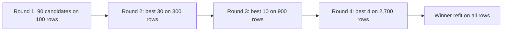

:::objectives
- Estimate the cost of a search (candidates × folds × seconds per fit) before running it.
- Explain why random search finds good values of the settings that matter faster than a grid.
- Choose distributions such as `loguniform` and `randint`, and know when a list is the better choice.
- Use `HalvingRandomSearchCV` and early stopping to spend compute only on promising candidates.
- Recognize when repeated searching has started fitting noise in the validation folds.
:::

Here is a grid that looks modest for a gradient-boosted model: five learning rates, five tree sizes, four leaf sizes, four regularization strengths, three iteration counts.

```python run
import os
os.environ["OMP_NUM_THREADS"] = "1"        # one CPU thread per fit: steadier timings for comparing searches
import time
import numpy as np
import matplotlib.pyplot as plt
from sklearn.model_selection import ParameterGrid

grid = {
    "learning_rate": [0.01, 0.03, 0.1, 0.3, 1.0],
    "max_leaf_nodes": [7, 15, 31, 63, 127],
    "min_samples_leaf": [5, 20, 50, 100],
    "l2_regularization": [0, 0.1, 1, 10],
    "max_iter": [100, 300, 1000],
}
n_candidates = len(ParameterGrid(grid))
fits = n_candidates * 5
print(f"{n_candidates} combinations x 5 folds = {fits} fits")
print(f"at 0.5 s per fit: {fits * 0.5 / 3600:.1f} hours")
```

Almost an hour, for one model, before you've looked at a single result. And the cost isn't only time. The winner is whichever of 1,200 noisy cross-validation scores came out highest, so part of its lead is luck. This lesson is about spending a search budget where it counts, and about not fooling yourself with the result.

## Count before you search

The cost of any search is **candidates × folds × seconds per fit**, plus one refit at the end. Time one fit first (`%time model.fit(X, y)` in Colab), then size the search to the minutes you're willing to wait. Grids grow multiplicatively: adding one more 4-value setting to the grid above turns 1,200 into 4,800. So the first decision is how *many* candidates to try, and the second is which ones.

## Random search covers what matters

Usually only one or two hyperparameters drive most of the score, and you don't know in advance which. A 3 × 3 grid tests only **three** distinct values of each setting; nine random points test **nine** distinct values of each. In the picture below, setting `a` matters (the score peaks sharply near 0.72) and setting `b` barely does.

```python run alt="Two panels. Left: the square of possible settings with a 3 by 3 grid of blue squares and 9 scattered orange circles. Right: the validation score as a function of setting a, a curve with a sharp peak near 0.72. The grid's three a values all miss the peak; one of the random points lands close to it." caption="Nine trials each. The grid spends them on three values of the setting that matters; random search spends them on nine."
def score(a):
    return 0.70 + 0.2 * np.exp(-((a - 0.72) / 0.07) ** 2)    # only a matters

grid_a, grid_b = np.meshgrid([0.17, 0.5, 0.83], [0.17, 0.5, 0.83])
rng = np.random.default_rng(3)
rand_a, rand_b = rng.uniform(0, 1, 9), rng.uniform(0, 1, 9)

fig, (left, right) = plt.subplots(1, 2, figsize=(8, 3.2))
left.scatter(grid_a, grid_b, marker="s", color="#2a78d6", s=50, label="grid")
left.scatter(rand_a, rand_b, color="#eb6834", s=40, label="random")
left.set_xlabel("setting a (matters)")
left.set_ylabel("setting b (barely matters)")
left.legend(frameon=False, fontsize=8, loc="upper left")
a_line = np.linspace(0, 1, 300)
right.plot(a_line, score(a_line), color="#52514e")
right.scatter(grid_a.ravel(), score(grid_a.ravel()), marker="s", color="#2a78d6", s=50)
right.scatter(rand_a, score(rand_a), color="#eb6834", s=40)
right.set_xlabel("setting a")
right.set_ylabel("validation score")
for ax in (left, right):
    ax.spines[["top", "right"]].set_visible(False)
plt.tight_layout()
plt.show()
print(f"best found by grid: {score(grid_a).max():.3f}   best found by random: {score(rand_a).max():.3f}")
```

This is the argument from Bergstra and Bengio's 2012 paper on random search, and it's why `RandomizedSearchCV` with a fixed `n_iter` is the sensible default. It also makes the budget a single number you choose, independent of how many settings you search over.

## Sample on the scale where the setting acts

Settings like `C`, `alpha`, `learning_rate`, and regularization strengths act multiplicatively: going from 0.001 to 0.01 matters about as much as going from 0.1 to 1. Sampling them uniformly wastes nearly every draw on the top decade.

```python run alt="Two histograms on a logarithmic x axis from 0.001 to 1. Uniform samples pile up almost entirely in the last decade between 0.1 and 1. Loguniform samples spread evenly across all three decades." caption="2,000 draws each. Uniform sampling barely visits the small values; loguniform gives each factor of ten equal attention."
from scipy.stats import loguniform, randint, uniform

draws_uniform = uniform(0.001, 0.999).rvs(2000, random_state=0)      # loc=0.001, scale=0.999
draws_log = loguniform(0.001, 1).rvs(2000, random_state=0)
bins = np.logspace(-3, 0, 25)

fig, ax = plt.subplots(figsize=(7, 2.6))
ax.hist(draws_uniform, bins=bins, alpha=0.75, color="#2a78d6", label="uniform(0.001, 1)")
ax.hist(draws_log, bins=bins, alpha=0.75, color="#eb6834", label="loguniform(0.001, 1)")
ax.set_xscale("log")
ax.set_xlabel("sampled value")
ax.legend(frameon=False, fontsize=8)
ax.spines[["top", "right"]].set_visible(False)
plt.tight_layout()
plt.show()
print(f"share below 0.01  uniform: {np.mean(draws_uniform < 0.01):.1%}   loguniform: {np.mean(draws_log < 0.01):.1%}")
```

The rules of thumb: `loguniform(low, high)` for positive settings that act by factors; `randint(low, high)` for integers on a linear scale (note that `high` is *excluded*); `uniform(loc, scale)` for fractions such as `max_features` (careful: the second argument is the width, not the upper end). For integers that act on a log scale, like a minimum leaf size, a plain **list** of log-spaced values works well, because `RandomizedSearchCV` samples lists uniformly. Here's a randomized search of a decision tree using all four:

```python run
from sklearn.datasets import make_classification
from sklearn.model_selection import RandomizedSearchCV, StratifiedKFold, cross_val_score
from sklearn.tree import DecisionTreeClassifier

X, y = make_classification(n_samples=3000, n_features=20, n_informative=6, n_redundant=4,
                           flip_y=0.1, random_state=0)
cv = StratifiedKFold(n_splits=5, shuffle=True, random_state=0)
tree = DecisionTreeClassifier(random_state=0)
space = {
    "max_depth": randint(2, 20),
    "min_samples_leaf": [1, 2, 5, 10, 20, 50, 100, 200],
    "max_features": uniform(0.1, 0.9),
    "ccp_alpha": loguniform(1e-5, 1e-1),
}

print(f"default tree:  AUC {cross_val_score(tree, X, y, cv=cv, scoring='roc_auc').mean():.3f}")
start = time.perf_counter()
random_search = RandomizedSearchCV(tree, space, n_iter=30, cv=cv, scoring="roc_auc", random_state=0).fit(X, y)
print(f"random search: AUC {random_search.best_score_:.3f} from 30 candidates in {time.perf_counter() - start:.1f} s")
```

An unpruned tree memorizes noise (this data has 10% flipped labels); the search finds depth, leaf size, and pruning that generalize.

## Successive halving: cheap auditions, expensive callbacks

Most random candidates are clearly bad, and you can tell that from a small sample of the data. **Successive halving** evaluates many candidates on a few rows, keeps the best third (with `factor=3`), triples their rows, and repeats until a handful compete on all the data.

```python run
from sklearn.experimental import enable_halving_search_cv  # noqa: F401  (unlocks the class below)
from sklearn.model_selection import HalvingRandomSearchCV

start = time.perf_counter()
halving = HalvingRandomSearchCV(tree, space, n_candidates=90, factor=3, min_resources=100,
                                cv=cv, scoring="roc_auc", random_state=0).fit(X, y)
print(f"halving search: AUC {halving.best_score_:.3f} from 90 candidates in {time.perf_counter() - start:.1f} s")
print("candidates per round:", halving.n_candidates_)
print("rows per round:      ", halving.n_resources_)
```



Three times the candidates for roughly the same time as the random search above. The import line is required because the halving classes are still marked experimental. Two settings matter: `min_resources` (too small, and early rounds are pure noise; some models can't even fit on a dozen rows) and `factor`. Halving's risk is that a setting which only shines with lots of data, like a deep tree, gets eliminated in round one.

## Early stopping: let the model choose its own length

For boosting, the number of iterations is a hyperparameter you shouldn't search at all. With `early_stopping=True`, `HistGradientBoostingClassifier` holds out `validation_fraction` of the training rows (10% by default) and stops once the validation loss hasn't improved for `n_iter_no_change` rounds. The curve shows why:

```python run alt="Line chart of validation log loss against boosting iterations from 1 to 300. The loss drops quickly to a minimum near iteration 18, then climbs steadily to about 0.83 by iteration 300. A dashed vertical line near iteration 26 marks where early stopping halted." caption="Past the minimum, every extra tree fits noise. Early stopping halts just after the bottom of the curve."
from sklearn.ensemble import HistGradientBoostingClassifier
from sklearn.metrics import log_loss
from sklearn.model_selection import train_test_split

X_tr, X_val, y_tr, y_val = train_test_split(X, y, test_size=0.25, stratify=y, random_state=0)
long_run = HistGradientBoostingClassifier(learning_rate=0.3, max_iter=300, early_stopping=False, random_state=0).fit(X_tr, y_tr)
val_loss = [log_loss(y_val, p) for p in long_run.staged_predict_proba(X_val)]
stopped = HistGradientBoostingClassifier(learning_rate=0.3, max_iter=300, early_stopping=True, random_state=0).fit(X_tr, y_tr)

fig, ax = plt.subplots(figsize=(7, 2.8))
ax.plot(range(1, 301), val_loss, color="#2a78d6")
ax.axvline(stopped.n_iter_, color="#eb6834", linestyle="--", label=f"early stopping: {stopped.n_iter_} iterations")
ax.set_xlabel("boosting iterations")
ax.set_ylabel("validation log loss")
ax.legend(frameon=False, fontsize=8)
ax.spines[["top", "right"]].set_visible(False)
plt.tight_layout()
plt.show()
print(f"loss after 300 iterations: {val_loss[-1]:.3f}   with early stopping: {log_loss(y_val, stopped.predict_proba(X_val)):.3f}")
```

So set `max_iter` generously as a ceiling, turn early stopping on, and spend your search on the learning rate and tree shape instead. Check `n_iter_` afterwards: if it equals `max_iter`, the ceiling was too low. One detail: on datasets under 10,000 rows the default `early_stopping="auto"` means *off*, so switch it on explicitly.

## Every search peeks at the same folds

Each candidate you score is a look at the validation folds, and the best of many looks is biased upward, even when there's nothing to find. Here a random search runs on data whose labels are pure coin flips:

```python run alt="Line chart of the best cross-validated accuracy found so far against the number of candidates tried, on random labels. It starts below 0.5 and climbs in steps to about 0.575 after 60 candidates, above the dashed 0.5 line that marks the true accuracy of any model." caption="On random labels, the true accuracy of every candidate is 0.5. The search's best score climbs anyway."
noise_rng = np.random.default_rng(0)
X_noise, y_noise = noise_rng.normal(size=(200, 10)), noise_rng.integers(0, 2, 200)
noise_search = RandomizedSearchCV(tree, space, n_iter=60, cv=cv, scoring="accuracy", random_state=1).fit(X_noise, y_noise)
best_so_far = np.maximum.accumulate(noise_search.cv_results_["mean_test_score"])

fig, ax = plt.subplots(figsize=(7, 2.6))
ax.step(range(1, 61), best_so_far, where="post", color="#eb6834")
ax.axhline(0.5, color="#52514e", linestyle="--", linewidth=1)
ax.set_xlabel("candidates tried")
ax.set_ylabel("best CV accuracy so far")
ax.spines[["top", "right"]].set_visible(False)
plt.tight_layout()
plt.show()
```

Real searches have the same bias on top of real signal, and so do *you*, every time you rerun a search after looking at the results. Three defenses: keep the search modest, estimate the final model with nested CV or an untouched test set, and decide the search space before you see the scores.

:::video G-fXV-o9QV8
DataMListic compares grid and random search in three minutes. What to watch for: the diagram of how many distinct values each method tries per hyperparameter, the same picture as the first chart in this lesson.
:::

:::warning
**Inside a pipeline, parameter names need the step prefix.** Searching `{"C": ...}` on `make_pipeline(StandardScaler(), LogisticRegression())` fails with `ValueError: Invalid parameter 'C' for estimator Pipeline(...)`. The name is `logisticregression__C` (step name, two underscores, parameter). Print `sorted(pipe.get_params())` to see every valid name.
:::

:::warning
**`best_score_` is not your model's performance.** It's the maximum over every candidate you tried, on the folds used to pick it. Report a nested-CV estimate or a test-set score instead.
:::

:::quiz
Q: A random search samples `C` from `uniform(0.001, 100)`. Roughly what share of candidates have `C` below 1?
- [ ] About half
  Half the draws would be below 50 on a uniform scale, not below 1.
- [x] About 1%
  A uniform draw from a range 100 wide lands below 1 about 1% of the time, so small values are almost never tried. Use `loguniform(0.001, 100)` instead.
- [ ] About 60%, since 3 of the 5 decades are below 1
  That's what `loguniform` would give; a uniform distribution ignores decades.

Q: A grid search over four settings with 5 values each, 5-fold CV, at 0.4 s per fit. How long will it take?
- [ ] About 8 seconds
  That counts 20 values, but grids multiply: 5 × 5 × 5 × 5 = 625 candidates.
- [x] About 21 minutes
  625 candidates × 5 folds × 0.4 s = 1,250 s, plus a final refit.
- [ ] About 2 minutes
  Check the multiplication: 625 × 5 = 3,125 fits.

Q: After early stopping, `model.n_iter_` equals `max_iter`. What does that tell you?
- [x] Validation loss was still improving when the ceiling stopped it, so `max_iter` should be raised
  Early stopping never triggered; the model may want more iterations.
- [ ] Early stopping worked perfectly
  When it triggers, `n_iter_` is below `max_iter`.
- [ ] The model overfit
  Overfitting would make validation loss rise, which triggers early stopping.

Q: You run `HalvingRandomSearchCV` on a `HistGradientBoostingClassifier(early_stopping=True)` with the default `min_resources`, and every fit fails with an error saying a test size of 1 is smaller than the number of classes. Why?
- [ ] Halving doesn't support classifiers
  It does; the problem is the size of the first round.
- [x] Round one used so few rows that the model's own internal validation split (or a CV fold) had only one or two rows
  Set `min_resources` to a size the model can actually learn from, such as a few hundred rows.
- [ ] `factor=3` is too large
  The factor sets how fast rows grow per round; the problem starts in round one.
:::

:::takeaways
- Cost = candidates × folds × seconds per fit. Count it before you run anything.
- Random search with a fixed `n_iter` covers the settings that matter better than a grid with the same budget.
- Sample multiplicative settings with `loguniform`; use `randint` or lists for integers.
- Successive halving auditions many candidates on few rows; set `min_resources` sensibly.
- Use early stopping instead of searching over the number of boosting iterations.
- The best score of a search is biased upward, more so the more candidates you try. Grade the final choice on data the search never saw.
:::

## Further reading

- [Tuning the hyper-parameters of an estimator](https://scikit-learn.org/stable/modules/grid_search.html): the user guide for every search class, including successive halving and how `factor` and `min_resources` interact.
- [Random Search for Hyper-Parameter Optimization](https://jmlr.org/papers/v13/bergstra12a.html): Bergstra and Bengio's paper, the source of the grid-versus-random argument.
- [Early stopping in gradient boosting](https://scikit-learn.org/stable/auto_examples/ensemble/plot_gradient_boosting_early_stopping.html): scikit-learn's example comparing training time and error with and without it.
