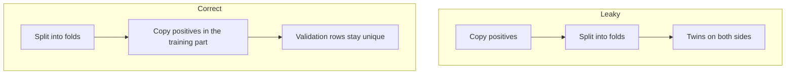

:::objectives
- Compute balanced class weights by hand and prove they equal per-row sample weights.
- Detect and fix oversampling that happens before the cross-validation split.
- Choose a decision threshold from out-of-fold probabilities and an explicit cost of each mistake.
- Explain why hard and soft voting disagree, and why stacking survives a weak member that soft voting doesn't.
- Judge a popular imbalance trick (undersampling plus bagging) against a plain baseline.
:::

Every exercise below has a trap that shows up in real projects. Write your answer before opening the hint, and run your code before opening the solution. All data is generated or bundled with scikit-learn, so every cell runs offline in Colab.

## Warm-up: what does a coin-flipping model score?

A model gives every row a random score. 2% of the rows are positive. Guess its ROC AUC and its average precision, then check.

```python run
import numpy as np
from sklearn.metrics import average_precision_score, roc_auc_score

rng = np.random.default_rng(1)
y = (rng.random(20_000) < 0.02).astype(int)
scores = rng.random(20_000)
print(f"positives {y.mean():.3f}   ROC AUC {roc_auc_score(y, scores):.3f}   "
      f"AP {average_precision_score(y, scores):.3f}")
```

ROC AUC sits at 0.5 whatever the imbalance. AP sits at the positive share. So "AP = 0.30" is weak on balanced data and fifteen times better than chance here.

### Exercise 1: Balanced weights by hand

A dataset has 940 negatives and 60 positives. Compute the weights `class_weight="balanced"` assigns, using the formula `n_samples / (n_classes * count_of_class)`. Then confirm with `compute_class_weight`, and show that fitting `LogisticRegression` with `class_weight="balanced"` gives the same coefficients as passing those weights row by row through `sample_weight`.

Sample output:

```text
by hand: 0.532 and 8.333
sklearn: [0.532 8.333]
same coefficients: True
```

:::hint
Index the weight array with the label array: `weights[y]` gives each row its class's weight. Compare coefficients with `np.allclose`.
:::

:::solution
```python run
import numpy as np
from sklearn.datasets import make_classification
from sklearn.linear_model import LogisticRegression
from sklearn.utils.class_weight import compute_class_weight

X, y = make_classification(n_samples=1000, weights=[0.94], flip_y=0, random_state=0)
n, counts = len(y), np.bincount(y)
print(f"by hand: {n / (2 * counts[0]):.3f} and {n / (2 * counts[1]):.3f}")

weights = compute_class_weight("balanced", classes=np.array([0, 1]), y=y)
print("sklearn:", weights.round(3))

a = LogisticRegression(class_weight="balanced").fit(X, y)
b = LogisticRegression().fit(X, y, sample_weight=weights[y])
print("same coefficients:", np.allclose(a.coef_, b.coef_) and np.allclose(a.intercept_, b.intercept_))
```

Each positive weighs 8.333 / 0.532 ≈ 15.7 times as much as a negative, which is exactly 940 / 60. The weights are chosen so that both classes contribute the same total weight (500 each) to the loss.
:::

### Exercise 2: The resampling leak

A teammate oversamples first and cross-validates second, and reports a wonderful AP. Something is wrong with this code:

```python
import numpy as np
from sklearn.datasets import make_classification
from sklearn.model_selection import StratifiedKFold, cross_val_score
from sklearn.neighbors import KNeighborsClassifier

X, y = make_classification(n_samples=2000, n_features=10, n_informative=4,
                           weights=[0.97], class_sep=0.8, random_state=5)
pos = np.flatnonzero(y == 1)
rows = np.r_[np.arange(len(y)), np.repeat(pos, 9)]   # each positive now appears 10 times
cv = StratifiedKFold(n_splits=5, shuffle=True, random_state=0)
ap = cross_val_score(KNeighborsClassifier(n_neighbors=3), X[rows], y[rows], cv=cv,
                     scoring="average_precision")
print(round(ap.mean(), 3))
```

Explain the problem, then report the AP from the teammate's version, from a correct version that oversamples only the training rows of each fold, and from no oversampling at all.

:::hint
Write the loop yourself: `for train, val in cv.split(X, y):`. Inside it, find the positives among `train`, repeat them, fit on the enlarged training set, and score `predict_proba` on `X[val]`, which you never touch.
:::

:::solution
```python run
import numpy as np
from sklearn.datasets import make_classification
from sklearn.metrics import average_precision_score
from sklearn.model_selection import StratifiedKFold, cross_val_score
from sklearn.neighbors import KNeighborsClassifier

X, y = make_classification(n_samples=2000, n_features=10, n_informative=4,
                           weights=[0.97], class_sep=0.8, random_state=5)
cv = StratifiedKFold(n_splits=5, shuffle=True, random_state=0)
knn = KNeighborsClassifier(n_neighbors=3)

pos = np.flatnonzero(y == 1)
rows = np.r_[np.arange(len(y)), np.repeat(pos, 9)]
leaky = cross_val_score(knn, X[rows], y[rows], cv=cv, scoring="average_precision")

correct = []
for train, val in cv.split(X, y):
    train_pos = train[y[train] == 1]
    grown = np.r_[train, np.repeat(train_pos, 9)]
    knn.fit(X[grown], y[grown])
    correct.append(average_precision_score(y[val], knn.predict_proba(X[val])[:, 1]))

plain = cross_val_score(knn, X, y, cv=cv, scoring="average_precision")
print(f"oversample first: AP {leaky.mean():.3f}")
print(f"oversample inside folds: AP {np.mean(correct):.3f}")
print(f"no oversampling: AP {plain.mean():.3f}")
```

When copies are made before splitting, most validation positives have an identical twin in the training folds, and a 3-nearest-neighbour model finds that twin at distance zero. The "0.94" measures memory, not skill. Done correctly, oversampling actually *lowers* AP for k-NN here, because the copies pile extra votes onto the exact training points instead of teaching anything new.
:::



### Exercise 3: A threshold from the cost of each mistake

A login-security model flags suspicious sign-ins for an extra verification step. A missed account takeover costs 15 units; an unnecessary verification costs 1. Using out-of-fold probabilities from a scaled logistic regression on `make_classification(n_samples=3000, n_features=8, n_informative=4, weights=[0.95], class_sep=1.0, random_state=21)`, compute the total cost at thresholds 0.01, 0.02, …, 0.99, plot it, and report the best threshold, its cost, and the cost at 0.5 and at the textbook value 1/16.

:::hint
`cross_val_predict(..., method="predict_proba")[:, 1]` gives one honest probability per row. For a threshold `t`, misses are `(proba < t) & (y == 1)` and false alarms are `(proba >= t) & (y == 0)`.
:::

:::solution
```python run alt="Total cost against threshold: high near 0, falling to a minimum around 0.12, then climbing steadily toward 1" caption="Out-of-fold cost at every threshold. The dotted line marks the textbook 1/16."
import matplotlib.pyplot as plt
import numpy as np
from sklearn.datasets import make_classification
from sklearn.linear_model import LogisticRegression
from sklearn.model_selection import StratifiedKFold, cross_val_predict
from sklearn.pipeline import make_pipeline
from sklearn.preprocessing import StandardScaler

X, y = make_classification(n_samples=3000, n_features=8, n_informative=4,
                           weights=[0.95], class_sep=1.0, random_state=21)
cv = StratifiedKFold(n_splits=5, shuffle=True, random_state=0)
model = make_pipeline(StandardScaler(), LogisticRegression())
proba = cross_val_predict(model, X, y, cv=cv, method="predict_proba")[:, 1]

def cost_at(t):
    return 15 * np.sum((proba < t) & (y == 1)) + np.sum((proba >= t) & (y == 0))

thresholds = np.round(np.arange(0.01, 1.0, 0.01), 2)
costs = np.array([cost_at(t) for t in thresholds])
best = thresholds[costs.argmin()]
print(f"best threshold {best:.2f}, cost {costs.min()}")
print(f"cost at 0.5: {cost_at(0.5)}   cost at 1/16: {cost_at(1 / 16)}")

fig, ax = plt.subplots(figsize=(6, 3))
ax.plot(thresholds, costs, lw=2, color="#2a78d6")
ax.axvline(1 / 16, ls=":", color="#52514e")
ax.set_xlabel("threshold")
ax.set_ylabel("total cost")
ax.grid(alpha=0.3)
```

The best threshold is about 0.12, and it costs about 40% less than 0.5. It differs from the textbook 1/16 because that formula assumes perfectly calibrated probabilities, which a logistic regression on this data only roughly gives. Note one subtle point: the minimum was picked on the same out-of-fold predictions it is reported on, so the 837 is a little optimistic. Wrapping the whole procedure in an outer cross-validation, as the Challenge does, fixes that.
:::

### Exercise 4: When hard and soft voting disagree

Fit a hard and a soft `VotingClassifier` with the same three members: scaled logistic regression, `KNeighborsClassifier(n_neighbors=9)`, and `DecisionTreeClassifier(max_depth=5, random_state=0)`. Use `make_classification(n_samples=1500, n_features=8, n_informative=4, flip_y=0.08, class_sep=0.8, random_state=4)` with a 60/40 split (`random_state=0`). Count the test rows where they disagree, print the three members' probabilities for a few of them, and say which voting rule is right more often on those rows.

:::hint
After fitting, the soft voter keeps its fitted members in `.estimators_`. Stack their `predict_proba(X_test)[:, 1]` columns side by side.
:::

:::solution
```python run
import numpy as np
from sklearn.datasets import make_classification
from sklearn.ensemble import VotingClassifier
from sklearn.linear_model import LogisticRegression
from sklearn.model_selection import train_test_split
from sklearn.neighbors import KNeighborsClassifier
from sklearn.pipeline import make_pipeline
from sklearn.preprocessing import StandardScaler
from sklearn.tree import DecisionTreeClassifier

X, y = make_classification(n_samples=1500, n_features=8, n_informative=4,
                           flip_y=0.08, class_sep=0.8, random_state=4)
X_train, X_test, y_train, y_test = train_test_split(X, y, test_size=0.4, random_state=0)
members = [
    ("logreg", make_pipeline(StandardScaler(), LogisticRegression())),
    ("knn", KNeighborsClassifier(n_neighbors=9)),
    ("tree", DecisionTreeClassifier(max_depth=5, random_state=0)),
]
hard = VotingClassifier(members, voting="hard").fit(X_train, y_train).predict(X_test)
soft_model = VotingClassifier(members, voting="soft").fit(X_train, y_train)
soft = soft_model.predict(X_test)

P = np.column_stack([m.predict_proba(X_test)[:, 1] for m in soft_model.estimators_])
differ = np.flatnonzero(hard != soft)
print(f"rows where they disagree: {len(differ)} of {len(y_test)}")
print("logreg  knn   tree  | mean | hard soft truth")
for i in differ[:5]:
    print("  ".join(f"{p:.2f}" for p in P[i]), f" | {P[i].mean():.2f} |  {hard[i]}    {soft[i]}    {y_test[i]}")
print(f"right on those rows: hard {np.sum(hard[differ] == y_test[differ])}, "
      f"soft {np.sum(soft[differ] == y_test[differ])}")
```

Look at rows where the tree says 1.00 or 0.00. A depth-5 tree's leaves are often pure, so it is extremely confident, and in a soft vote one extreme number can outweigh two members that lean mildly the other way. Hard voting ignores confidence and counts heads. On this data hard voting wins slightly on the rows where they disagree, which shows that soft voting is only better when every member's probabilities are reasonably calibrated.
:::

### Exercise 5: One weak member sinks the vote

Compare, with 5-fold AP on `make_classification(n_samples=2500, n_features=10, n_informative=5, weights=[0.92], class_sep=1.0, random_state=8)`: a `RandomForestClassifier(n_estimators=100, random_state=0)` alone, `GaussianNB` alone, a depth-1 tree alone, a soft vote of all three, and a stack of all three with a logistic-regression final estimator. Then print the stack's final coefficients.

:::hint
Use one `StratifiedKFold(n_splits=5, shuffle=True, random_state=0)` for every candidate. After fitting the stack on all the data, read `final_estimator_.coef_`.
:::

:::solution
```python run
from sklearn.datasets import make_classification
from sklearn.ensemble import RandomForestClassifier, StackingClassifier, VotingClassifier
from sklearn.linear_model import LogisticRegression
from sklearn.model_selection import StratifiedKFold, cross_val_score
from sklearn.naive_bayes import GaussianNB
from sklearn.tree import DecisionTreeClassifier

X, y = make_classification(n_samples=2500, n_features=10, n_informative=5,
                           weights=[0.92], class_sep=1.0, random_state=8)
cv = StratifiedKFold(n_splits=5, shuffle=True, random_state=0)
members = [
    ("forest", RandomForestClassifier(n_estimators=100, random_state=0)),
    ("bayes", GaussianNB()),
    ("stump", DecisionTreeClassifier(max_depth=1)),
]
candidates = dict(members)
candidates["soft vote"] = VotingClassifier(members, voting="soft")
candidates["stack"] = StackingClassifier(members, final_estimator=LogisticRegression(), cv=5)
for name, model in candidates.items():
    ap = cross_val_score(model, X, y, cv=cv, scoring="average_precision")
    print(f"{name:>9}: AP {ap.mean():.3f}")

stack = candidates["stack"].fit(X, y)
print("stack weights:", dict(zip(["forest", "bayes", "stump"], stack.final_estimator_.coef_[0].round(2).tolist())))
```

Soft voting gives every member an equal say, so two weak members drag the forest's AP down by almost 0.09. The stack *learns* how much to trust each member from out-of-fold predictions: it gives the forest a large weight, the Bayes model a small one, and the stump a slightly negative one, and ends up matching the forest. If you must vote, pass `weights=` or leave weak members out.
:::

### Exercise 6: Undersampling plus bagging, tested honestly

A popular recipe for rare classes: train many trees, each on *all* the positives plus an equally sized random sample of negatives, then average their probabilities. On `make_classification(n_samples=6000, n_features=10, n_informative=5, weights=[0.98], class_sep=1.0, random_state=2)` with a stratified 60/40 split, compare the test AP of 25 such balanced trees against one tree on all the training data and a `RandomForestClassifier(n_estimators=100)` on all the training data.

:::hint
Find the indices of positives and negatives in `y_train`. In each of 25 rounds, use `rng.choice(neg, size=len(pos), replace=False)`, fit a fresh `DecisionTreeClassifier`, and keep its `predict_proba(X_test)[:, 1]`. Average the 25 columns.
:::

:::solution
```python run
import numpy as np
from sklearn.datasets import make_classification
from sklearn.ensemble import RandomForestClassifier
from sklearn.metrics import average_precision_score
from sklearn.model_selection import train_test_split
from sklearn.tree import DecisionTreeClassifier

X, y = make_classification(n_samples=6000, n_features=10, n_informative=5,
                           weights=[0.98], class_sep=1.0, random_state=2)
X_train, X_test, y_train, y_test = train_test_split(
    X, y, test_size=0.4, stratify=y, random_state=0)
print(f"positives: {y_train.sum()} train, {y_test.sum()} test")

rng = np.random.default_rng(0)
pos, neg = np.flatnonzero(y_train == 1), np.flatnonzero(y_train == 0)
votes = []
for seed in range(25):
    rows = np.r_[pos, rng.choice(neg, size=len(pos), replace=False)]
    tree = DecisionTreeClassifier(random_state=seed).fit(X_train[rows], y_train[rows])
    votes.append(tree.predict_proba(X_test)[:, 1])

single = DecisionTreeClassifier(random_state=0).fit(X_train, y_train)
forest = RandomForestClassifier(n_estimators=100, random_state=0).fit(X_train, y_train)
print(f"one tree, all rows:       AP {average_precision_score(y_test, single.predict_proba(X_test)[:, 1]):.3f}")
print(f"25 balanced trees:        AP {average_precision_score(y_test, np.mean(votes, axis=0)):.3f}")
print(f"random forest, all rows:  AP {average_precision_score(y_test, forest.predict_proba(X_test)[:, 1]):.3f}")
```

The balanced bag roughly doubles a single tree's AP, but the forest trained on every row doubles it again. Each balanced tree saw only 184 rows and threw away 98% of the negatives, and with negatives this varied, that lost information matters. Undersampling shines when the data is too big to train on comfortably, not as a default.
:::

### Challenge: Compare strategies on a real cost, with no optimism

Use `load_diabetes`, with "high progression" (`target > 250`, about 15% of patients) as the positive class, and imagine flagging patients for an earlier follow-up, where a missed high-progression patient costs 5 and an unnecessary appointment costs 1. Write code that, for three strategies (plain logistic regression, `class_weight="balanced"` logistic regression, and a soft vote of logistic regression with 15-nearest-neighbours), reports with one outer 5-fold split: cross-validated AP, the average cost per fold at the 0.5 default, and the average cost per fold when the threshold is tuned *inside* each outer training fold with `TunedThresholdClassifierCV`.

:::hint
`TunedThresholdClassifierCV` is itself an estimator, so you can pass it to `cross_val_score` as the model. That gives nested evaluation: the threshold is chosen on each outer training fold and scored on the outer validation fold. Make your scorer return the negative cost.
:::

:::solution
```python run
from sklearn.datasets import load_diabetes
from sklearn.ensemble import VotingClassifier
from sklearn.linear_model import LogisticRegression
from sklearn.metrics import confusion_matrix, make_scorer
from sklearn.model_selection import StratifiedKFold, TunedThresholdClassifierCV, cross_val_score
from sklearn.neighbors import KNeighborsClassifier
from sklearn.pipeline import make_pipeline
from sklearn.preprocessing import StandardScaler

data = load_diabetes(as_frame=True)
X, y = data.data, (data.target > 250).astype(int)

def cost(y_true, y_pred):
    tn, fp, fn, tp = confusion_matrix(y_true, y_pred, labels=[0, 1]).ravel()
    return 5 * fn + fp

neg_cost = make_scorer(lambda yt, yp: -cost(yt, yp))
outer = StratifiedKFold(n_splits=5, shuffle=True, random_state=0)
strategies = {
    "plain": make_pipeline(StandardScaler(), LogisticRegression()),
    "balanced": make_pipeline(StandardScaler(), LogisticRegression(class_weight="balanced")),
    "vote": VotingClassifier([
        ("logreg", make_pipeline(StandardScaler(), LogisticRegression())),
        ("knn", make_pipeline(StandardScaler(), KNeighborsClassifier(n_neighbors=15))),
    ], voting="soft"),
}
print(f"positives: {y.sum()} of {len(y)}")
for name, model in strategies.items():
    ap = cross_val_score(model, X, y, cv=outer, scoring="average_precision").mean()
    at_half = -cross_val_score(model, X, y, cv=outer, scoring=neg_cost).mean()
    tuned = TunedThresholdClassifierCV(model, scoring=neg_cost, cv=5, random_state=0)
    at_tuned = -cross_val_score(tuned, X, y, cv=outer, scoring=neg_cost).mean()
    print(f"{name:>8}: AP {ap:.3f}   cost at 0.5 {at_half:5.1f}   cost tuned {at_tuned:5.1f}")
print(f"flag nobody: {5 * y.sum() / 5:.1f}   flag everybody: {(len(y) - y.sum()) / 5:.1f}")
```

Three things stand out. All three strategies rank about equally well (AP 0.55 to 0.57), so the ensemble buys nothing here. Tuning the threshold rescues the plain model, cutting its cost by about a third. And the balanced model at plain 0.5 is already about as good as any tuned threshold. That is not luck: balancing makes the classes' total weights equal, which acts like a miss costing 377/65 ≈ 5.8 times a false alarm, very close to the 5 we chose. With the cost known, a tuned threshold gets there without needing that coincidence.
:::
