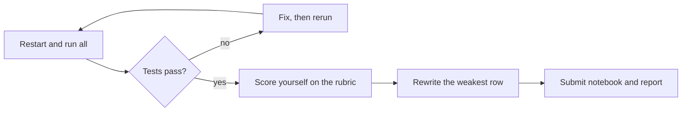

:::objectives
- Write unit tests that guard the evaluation itself: sealed test rows, pipelines, seeds, shuffled labels, and a calibration floor.
- Rewrite metric-heavy sentences as counts and decisions that a non-specialist can act on.
- Plan a short presentation that leads with the recommendation and shows the uncertainty.
- Grade your report against the rubric and reflect on the choices you made.
:::

Before anyone trusts your recommendation, a careful reviewer will ask some version of five questions. Did the test set stay sealed? Would the numbers come out the same if I ran it? Could the pipeline find signal in random labels? Are the probabilities usable? Is preprocessing inside the cross-validation? You've answered all of these once, by hand, in the build. This lesson turns the answers into tests that rerun every time you change the notebook, then turns the results into something a person can act on.

## Test the evaluation, not just the model

Unit tests are usually written for application code, but evaluation code breaks too: someone moves the scaler out of the pipeline to "speed things up", or a refactor quietly reuses the test rows. Each test below encodes one of the reviewer's questions. They use the starter project's data and settings; swap in your own loading and model functions.

```python run title="test_evaluation.py"
import sys
import unittest

import numpy as np
import pandas as pd
from sklearn.datasets import load_diabetes
from sklearn.linear_model import LogisticRegression
from sklearn.metrics import brier_score_loss
from sklearn.model_selection import (RepeatedStratifiedKFold, StratifiedKFold,
                                     cross_val_predict, cross_val_score, train_test_split)
from sklearn.pipeline import Pipeline, make_pipeline
from sklearn.preprocessing import StandardScaler

SEED = 42

def load_split():                                    # SWAP: your loading code
    data = load_diabetes(as_frame=True, scaled=False)
    y = (data.target > 200).astype(int)
    return train_test_split(data.data, y, test_size=0.25, stratify=y, random_state=SEED)

def make_model():                                    # SWAP: your final model
    return make_pipeline(StandardScaler(), LogisticRegression(C=0.1, max_iter=1000))

def cv_scores(model, X, y):
    folds = RepeatedStratifiedKFold(n_splits=5, n_repeats=2, random_state=SEED)
    return cross_val_score(model, X, y, cv=folds, scoring="average_precision")

class EvaluationTests(unittest.TestCase):
    @classmethod
    def setUpClass(cls):
        cls.X_dev, cls.X_test, cls.y_dev, cls.y_test = load_split()

    def test_test_rows_never_in_development(self):
        self.assertEqual(len(set(self.X_dev.index) & set(self.X_test.index)), 0)

    def test_preprocessing_lives_inside_the_pipeline(self):
        model = make_model()
        self.assertIsInstance(model, Pipeline)
        self.assertIsInstance(model.steps[0][1], StandardScaler)

    def test_same_seed_same_scores(self):
        first = cv_scores(make_model(), self.X_dev, self.y_dev)
        second = cv_scores(make_model(), self.X_dev, self.y_dev)
        np.testing.assert_allclose(first, second)

    def test_shuffled_labels_fall_to_chance(self):
        shuffled = pd.Series(np.random.default_rng(SEED).permutation(self.y_dev.to_numpy()),
                             index=self.y_dev.index)
        ap = cv_scores(make_model(), self.X_dev, shuffled).mean()
        self.assertLess(ap, self.y_dev.mean() + 0.1)

    def test_model_beats_baseline_brier(self):
        oof = cross_val_predict(make_model(), self.X_dev, self.y_dev, method="predict_proba",
                                cv=StratifiedKFold(5, shuffle=True, random_state=SEED))[:, 1]
        baseline = brier_score_loss(self.y_dev, np.full(len(self.y_dev), self.y_dev.mean()))
        self.assertLess(brier_score_loss(self.y_dev, oof), baseline)

suite = unittest.defaultTestLoader.loadTestsFromTestCase(EvaluationTests)
unittest.TextTestRunner(stream=sys.stdout, verbosity=2).run(suite)
```

All five pass. To see one earn its keep, break something on purpose: change `make_model` to return a bare `LogisticRegression` and rerun. The pipeline test fails immediately, before a scaler fitted on all the rows can quietly leak into your scores. A test that has never failed for you is a test you can't be sure works, so break each one once.

:::tip
In Colab, keep the tests in the last cell of the notebook and run **Runtime › Restart session and run all** before you submit. A notebook that only works when cells are run in a lucky order isn't reproducible.
:::

## Turn metrics into sentences people can act on

The person deciding whether to use the model probably doesn't think in average precision. They think in patients, follow-up appointments, and missed cases. Your report should translate.

| Weak | Strong |
| --- | --- |
| "The model achieved an AP of 0.758." | "Of every 2 patients the model flags, about 1 really is a fast progressor." |
| "Recall at the tuned threshold is 0.9." | "It misses about 1 in 10 fast progressors." |
| "Logistic regression outperformed boosting." | "The two models were within noise of each other; we chose the simpler one, as planned." |
| "The model is well calibrated." | "When it says 30%, about 30% of those patients turn out to be fast progressors." |
| "No significant subgroup differences." | "We couldn't detect a difference between groups, but with only about 25 to 45 fast progressors per group, a real gap of 10 points could have been missed." |

A small function keeps these sentences tied to the confusion matrix, so they update whenever the numbers do. These are the test-set counts from the build's final milestone.

```python run
def in_plain_words(tp, fp, fn, tn, unit="patients", positive="fast progressors"):
    total = tp + fp + fn + tn
    flagged = tp + fp
    print(f"Out of every 100 {unit}, the model flags about {100 * flagged / total:.0f}.")
    print(f"About {100 * tp / flagged:.0f} in every 100 flagged {unit} really are {positive}.")
    print(f"It catches {tp} of {tp + fn} {positive} and misses {fn}, "
          f"about 1 in {round((tp + fn) / fn)}." if fn else f"It catches all {tp} {positive}.")
    print(f"Every {positive[:-1]} caught costs about {flagged / tp:.1f} follow-ups.")

in_plain_words(tp=27, fp=27, fn=3, tn=54)
```

The last line is often the one a manager remembers: for each real case found, the clinic books about two appointments. That is the trade the threshold encodes, stated in the clinic's own currency.

## Present it in five slides

A comparison presentation has one job: help the audience make the decision. Lead with the answer, and show uncertainty instead of hiding it.

| Slide | Title as a full sentence | What's on it |
| --- | --- | --- |
| 1 | "We recommend the logistic model at a 21% threshold." | The decision, the recommendation, and the plain-words trade from above |
| 2 | "We tested on patients the model never saw." | The validation diagram: sealed test set, repeated folds, nested tuning |
| 3 | "Boosting was not clearly better, so we kept the simpler model." | The paired fold-difference chart from Milestone 4 |
| 4 | "We checked for leaks, bad probabilities, and weak subgroups." | Shuffled-label result, reliability diagram, slice table with intervals |
| 5 | "What this can't tell you yet." | Limitations and what you'd monitor after launch |

Notice that every title is a claim, not a topic. "Calibration" tells the audience what the slide is about; "The probabilities can be used as they are" tells them what to conclude.

:::video CzrCADdsXwE
What to watch for: how each slide's title states the takeaway, and how the speaker explains why each chart and table was chosen. The same habits apply when your "data" is a model comparison.
:::

## The rubric

Grade your own report before you hand it in. Each row is worth up to 3 points.

| Criterion | 3: excellent | 2: solid | 1: needs work |
| --- | --- | --- | --- |
| Plan and decision | Plan written first, with metric, costs, and decision rule; any changes reported | Plan present but partly written after results | No plan, or metric chosen after seeing scores |
| Validation | Sealed test opened once; repeated CV; group/time split where needed and justified | CV and a test set, but one gap (no repeats, or no group check) | Single split, or test set used for choices |
| Tuning budget | Nested, bounded search for each candidate; budget counted in advance | Tuned on CV but not nested; optimism acknowledged | Unbounded or test-set tuning |
| Imbalance and threshold | Weights vs threshold compared with evidence; threshold from costs, chosen inside CV | Reasonable choice with partial evidence | Default 0.5 with no discussion |
| Leakage checks | Shuffled labels, single-feature scan, duplicates/groups, all reported | Two of the three | None |
| Calibration | Reliability diagram and Brier for finalists; recalibrated when needed | One of the two | Probabilities used without checking |
| Interpretation | Permutation importance on held-out data and PDP/ICE, with honest caveats | One method, correctly computed | Impurity importances read as truth |
| Error analysis | Two or more slices, intervals, per-slice baseline, cautious conclusions | Slices without intervals or baseline | No slices |
| Recommendation and limits | Clear recommendation in plain words; uncertainty and limits specific to this data | Recommendation with generic limits | No clear recommendation |
| Reproducibility | Restart-and-run-all works; seeds fixed; tests pass | Runs, but needs manual steps | Doesn't run top to bottom |

27 to 30 is a report you could hand to a real team. Below 20 usually means one of the early rows (plan, validation, leakage) went wrong, and everything downstream inherited it.



## Reflect

Write a short paragraph for each of these at the end of your report. They are graded for honesty, not for having the "right" answer.

1.  Which decision in your plan would you change if you started again, and what result taught you that?
2.  Where did you feel tempted to change a choice after seeing results? What did you do?
3.  Which check (leakage, calibration, slices) changed your mind about something, if any?
4.  What would you need, in data or time, to make your weakest conclusion stronger?
5.  If this model were used for a year, what would you monitor, and what change would make you retrain it?

:::quiz
Q: Your unit test for "shuffled labels fall to chance" has never failed. What should you do?
- [x] Break the pipeline on purpose once (for example, select features on all rows before CV) and confirm the test catches it
  A test is only evidence if you've seen it fail when it should.
- [ ] Delete it, because it never finds anything
  A guard that hasn't fired yet is doing its job; the question is whether it would fire.
- [ ] Lower the tolerance until it fails
  That makes the test flaky without making it more meaningful.

Q: Which slide title is better for a decision-maker?
- [ ] "Model comparison results"
  It names a topic but leaves the audience to work out the conclusion.
- [x] "Boosting was not clearly better, so we kept the simpler model"
  It states the claim the chart supports, so the audience knows what to look for.
:::

## Keep going

You now have the habits that separate a model comparison from a leaderboard screenshot. Some directions from here:

-   **Fairness and subgroup metrics.** [Fairlearn](https://fairlearn.org/) turns your slice tables into a `MetricFrame` with many metrics per group, and adds tools for comparing and mitigating disparities.
-   **Interpretation in depth.** [Christoph Molnar's Interpretable Machine Learning](https://christophm.github.io/interpretable-ml-book/) covers SHAP values, accumulated local effects (a fix for partial dependence with correlated features), and more.
-   **Models in production.** [Chip Huyen's books page](https://huyenchip.com/books/) introduces *Designing Machine Learning Systems*, which picks up where this course stops: data drift, monitoring, and retraining.
-   **Visual explainers.** [MLU-Explain](https://mlu-explain.github.io/) has interactive articles on ROC curves, precision and recall, bias and variance, and cross-validation that make good refreshers.
-   **Practice on harder data.** Take the capstone notebook to a public dataset with real mess: missing values, dates, and repeat entities. Competitions are good practice too, as long as you remember that a public leaderboard is a test set that has been peeked at thousands of times.
