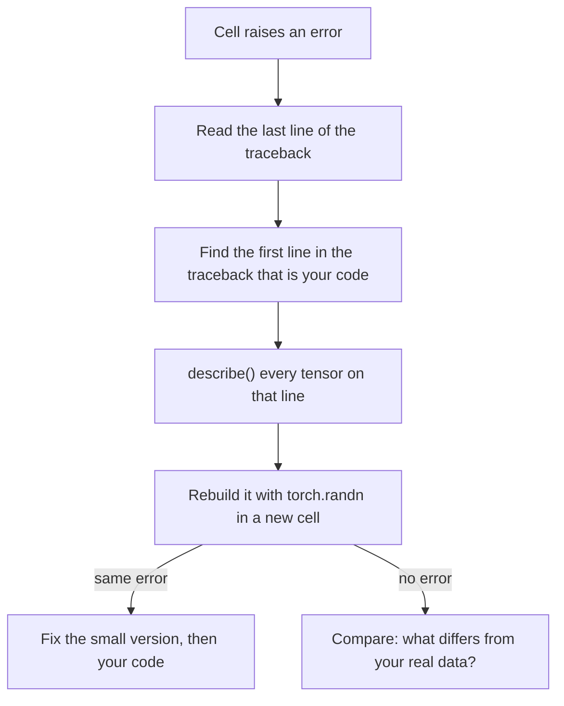

:::objectives
- Say what survives when a Colab runtime ends and what disappears with it.
- Save and reload a model's weights with `state_dict`, and keep the file in Google Drive.
- Seed PyTorch so two runs of the same cell give the same numbers.
- Lay out a notebook so **Restart session and run all** reproduces your results.
- Debug by checking shape, dtype, and device first, then shrinking the bug to a few lines.
:::

You start a training run, go get dinner, and come back to a notebook with a **Reconnect** button. Every cell is still there, the printed loss values are still there, and the trained model is gone. Forty minutes of GPU time left no trace except text.

That isn't bad luck. It's how Colab is designed, and once you know which parts are temporary, it stops costing you anything.

## What lives where

```mermaid caption="The notebook is saved in Drive; everything the code creates lives on a temporary machine"
flowchart LR
    subgraph Drive["Google Drive: kept"]
        N["your .ipynb notebook"]
        W["files under /content/drive/MyDrive"]
    end
    subgraph VM["Colab virtual machine: erased when the runtime ends"]
        V["Python variables and models"]
        F["files in /content"]
        G["GPU memory"]
    end
    V -->|"torch.save to a Drive path"| W
```

The notebook (your code, text, and the last outputs) autosaves to Drive. The machine running it is rented, and when the runtime ends, Colab throws the whole machine away: variables, trained models, downloaded datasets, and files you wrote to `/content`. The fix is to write anything you'd hate to lose to a path inside Google Drive.

## Save weights, not just code

A trained model is its architecture plus its numbers. The architecture is already in your code, so what you save is the numbers. Every PyTorch module has a **state dict**: an ordered dictionary from each parameter's name to its tensor.

```python run
import torch
import torch.nn as nn

torch.manual_seed(0)
model = nn.Sequential(nn.Linear(64, 32), nn.ReLU(), nn.Linear(32, 10))

for name, tensor in model.state_dict().items():
    print(f"{name:10s} {tuple(tensor.shape)}")
```

The names come from the positions in `nn.Sequential`: layer `0` is the first `Linear`, layer `1` is the ReLU (no weights, so it's missing), and layer `2` is the second `Linear`. Saving and loading is two lines each way:

```python run
torch.save(model.state_dict(), "digits_mlp.pt")

fresh = nn.Sequential(nn.Linear(64, 32), nn.ReLU(), nn.Linear(32, 10))   # random weights
fresh.load_state_dict(torch.load("digits_mlp.pt", weights_only=True))

x = torch.randn(5, 64)
print("same outputs:", torch.equal(model(x), fresh(x)))
```

`fresh` starts with different random weights, then `load_state_dict` overwrites every one of them, so both models now give identical outputs. Notice that you have to build `fresh` with the same layers first; the file holds numbers, not code. `weights_only=True` tells `torch.load` to accept only tensors and plain containers, which is what a state dict is, and refuse anything that could run code.

In Colab, mount your Drive once per session and save there instead. Colab asks for permission the first time:

```python
import os

import torch
from google.colab import drive

drive.mount("/content/drive")
save_dir = "/content/drive/MyDrive/dlcv"
os.makedirs(save_dir, exist_ok=True)
torch.save(model.state_dict(), f"{save_dir}/digits_mlp.pt")
```

Weights saved from a GPU remember they were on `cuda`. To load them on a machine without a GPU, add `map_location="cpu"` to `torch.load`.

## Same seed, same numbers

Neural networks are full of randomness: starting weights, the order batches are shuffled in, dropout. That's fine for learning and terrible for debugging, because you can't tell whether an edit helped or the dice just rolled differently. Setting a **seed** makes the random sequence repeat:

```python run
torch.manual_seed(42)
print(torch.randn(3))
torch.manual_seed(42)
print(torch.randn(3))
print(torch.randn(3))
```

The first two lines match because each starts from seed 42. The third differs, since it continues the sequence instead of restarting it. So the seed has to be set **before** the model is built, and the cells after it have to run in the same order every time.

PyTorch, NumPy, and Python's `random` module each keep their own generator, and scikit-learn uses `random_state` arguments. On a GPU, a few operations aren't bit-for-bit repeatable even with seeds, so tiny differences in the fourth decimal place between runs are normal there. Differences in the first decimal place mean something in your code changed.

## A notebook layout that survives a restart

Notebooks let you run cells in any order, which is how a notebook ends up "working" only because of a cell you since deleted. Two habits prevent that. First, every notebook in this course starts with one setup cell:

```python
# Setup: run this first, every time.
import random

import numpy as np
import torch
import torch.nn as nn

SEED = 0
random.seed(SEED)
np.random.seed(SEED)
torch.manual_seed(SEED)

device = "cuda" if torch.cuda.is_available() else "cpu"
config = {"lr": 0.1, "batch_size": 64, "epochs": 20}
print("device:", device, "| config:", config)
```

Imports, seeds, the device, and every number you might tune live in one place, so a change to the learning rate is a change to one line. Second, before you trust or share a result, use **Runtime › Restart session and run all** (some older guides call it Restart runtime). If the notebook still produces the same numbers from a cold start, the result is real.

Name notebooks after the lesson (`m4-l2-digits.ipynb`), keep them in one Drive folder, and use **File › Save a copy in Drive** whenever you open someone else's notebook, so your edits are saved to a copy you own.

## Debugging: shape, dtype, device

Most PyTorch errors are about one of three properties of a tensor: its **shape**, its **dtype**, or its **device**. When a line fails, print those three for every tensor on that line before you change anything. This helper does it in one call, and you'll reuse it all course:

```python run
def describe(name, t):
    print(f"{name:7s} shape={tuple(t.shape)!s:12s} dtype={str(t.dtype):14s} device={t.device}  "
          f"min={t.min().item():.2f} max={t.max().item():.2f} nan={torch.isnan(t).any().item()}")

labels = torch.tensor([3.0, 1.0, 4.0, 1.0])     # labels that came from a float NumPy array
logits = model(torch.randn(4, 64))
describe("logits", logits)
describe("labels", labels)
```

Read the dtype column. Classification losses in PyTorch expect class labels as whole numbers (`int64`), and these are `float32`. Here's the crash that mismatch causes, reproduced in three lines with nothing but random tensors:

```python run raises
import torch.nn.functional as F

F.cross_entropy(torch.randn(4, 10), torch.tensor([3.0, 1.0, 4.0, 1.0]))
```

That's the second habit: **shrink the bug**. Rebuild the failing line in a fresh cell using `torch.randn` with the same shapes and dtypes. If the small version fails the same way, you've found the cause without your data, your model, or your other 40 cells in the way, and the fix (here, `labels.long()`) takes seconds. If the small version works, the difference between it and your real code is where the bug lives.



When you ask someone for help, whether that's a forum like discuss.pytorch.org or a friend, send the small version, the full error message, and the output of `torch.__version__` and `device`. A three-line reproduction usually gets an answer in minutes; a whole notebook often gets none.

## How the rest of the course works

Modules 2 to 7 each have three lessons: **Notes** that teach the ideas with code you can run, a **Build-along** that uses them to make one complete thing, and **Practice** with exercises, hints, and worked solutions. Type the code into your own notebook rather than copying it. Every output on these pages came from really running the code, so if your numbers differ, that's a clue worth chasing, not a typo in the lesson.

:::warning
Saving with `torch.save(model, path)` (the whole model, not its `state_dict()`) also works, but it pickles the model's Python class. Rename a file or edit the class later and the checkpoint can stop loading. Save the state dict, and keep the architecture in code.
:::

:::quiz
Q: You saved `model.state_dict()` to Drive yesterday. Today, in a new session, you run `model.load_state_dict(torch.load(path, weights_only=True))` as the first line and get `NameError: name 'model' is not defined`. What's missing?
- [ ] The file, because Drive deletes `.pt` files overnight
  Files in Drive stay until you delete them. The error names `model`, not the file.
- [x] Building the model: the file holds weights, so you must create the same architecture first
  Run the cell that defines the layers, then load the weights into it.
- [ ] A call to `torch.manual_seed` before loading
  Seeds matter when weights are random. Loading replaces every weight, so the seed is irrelevant here.

Q: Two runs of the same notebook give accuracies of 0.912 and 0.874. You set `torch.manual_seed(0)` in the setup cell. Which is the most likely cause?
- [ ] GPU nondeterminism
  That causes differences in the fourth decimal place or so, not four percentage points.
- [x] Cells ran in a different order, or extra cells ran between the seed and the model, so the random sequence shifted
  The seed fixes the sequence from that point on. Restart the session and run all cells from the top to compare fairly.
- [ ] Setting the seed to 0 turns randomness off
  Zero is an ordinary seed value. It fixes the sequence; it doesn't remove the randomness.
:::

:::takeaways
- Colab keeps your notebook and throws away the machine. Save weights to a Google Drive path with `torch.save(model.state_dict(), path)`.
- Loading needs the same architecture built first: `model.load_state_dict(torch.load(path, weights_only=True))`.
- Seed before you build anything, and confirm results with **Restart session and run all**.
- For any error, check shape, dtype, and device, then shrink the failing line to a few lines of `torch.randn`.
:::

## Further reading

- [PyTorch: Saving and loading models](https://pytorch.org/tutorials/beginner/saving_loading_models.html): state dicts, checkpoints that also store the optimizer, and loading across devices.
- [PyTorch: Reproducibility](https://pytorch.org/docs/stable/notes/randomness.html): which sources of randomness exist and how far seeding can take you on a GPU.
- [Andrej Karpathy: A Recipe for Training Neural Networks](https://karpathy.github.io/2019/04/25/recipe/): a practitioner's checklist for catching silent bugs; you'll use several of its tricks in Module 4.
