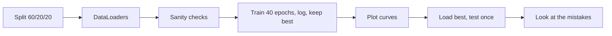

:::objectives
- Split data into training, validation, and test sets, and say what each one is for.
- Run two sanity checks before training: the starting loss and overfitting a single batch.
- Train with per-epoch logging and keep the checkpoint with the lowest validation loss.
- Plot loss and accuracy curves from a real run and read them.
- Score the test set once, and look at the actual mistakes.
:::

This build puts Modules 2 to 4 together into one complete, honest training run. The finished notebook trains a small network on the 1,797 scikit-learn digits, logs training and validation numbers every epoch, keeps the best weights it has seen, draws its own learning curves, and ends with one test-set score and a picture of every digit it got wrong. Here's the plan:



Start a Colab notebook called `m4-l2-digits.ipynb`. The whole run takes a few seconds on a CPU, so the GPU is optional here.

## Step 1: split three ways

You need three groups of examples, each with one job. The **training** set changes the weights. The **validation** set picks among choices: which epoch, which learning rate. The **test** set gives one final, unbiased score after every choice is made. Use the test set for decisions and it stops being unbiased, because you've tuned to it.

```python run
import copy
import math

import matplotlib.pyplot as plt
import torch
import torch.nn as nn
from sklearn.datasets import load_digits
from sklearn.model_selection import train_test_split
from torch.utils.data import DataLoader, TensorDataset

digits = load_digits()
X = torch.tensor(digits.images, dtype=torch.float32).unsqueeze(1) / 16.0
y = torch.tensor(digits.target)

idx = torch.arange(len(y)).numpy()
idx_train, idx_rest = train_test_split(idx, test_size=0.4, stratify=digits.target, random_state=0)
idx_val, idx_test = train_test_split(idx_rest, test_size=0.5, stratify=digits.target[idx_rest], random_state=0)
print("train:", len(idx_train), "| val:", len(idx_val), "| test:", len(idx_test))
```

Splitting index numbers instead of the data itself lets us cut `X` and `y` the same way with one list. `stratify` keeps all ten digits in the same proportions in every group, and `random_state` makes the split repeat exactly.

## Step 2: wrap the splits in loaders

```python run
torch.manual_seed(0)
train_loader = DataLoader(TensorDataset(X[idx_train], y[idx_train]), batch_size=64, shuffle=True)
val_loader = DataLoader(TensorDataset(X[idx_val], y[idx_val]), batch_size=256)
test_loader = DataLoader(TensorDataset(X[idx_test], y[idx_test]), batch_size=256)
print("training batches per epoch:", len(train_loader))
```

The data already sits in tensors, so `TensorDataset` replaces the custom class from the Notes. Only the training loader shuffles.

## Step 3: two checks before you train

The model is a small network with one hidden layer and dropout:

```python run
def make_model():
    return nn.Sequential(
        nn.Flatten(),
        nn.Linear(64, 128), nn.ReLU(),
        nn.Dropout(0.2),
        nn.Linear(128, 10),
    )


model = make_model()
loss_fn = nn.CrossEntropyLoss()
xb, yb = next(iter(train_loader))
with torch.no_grad():
    start_loss = loss_fn(model(xb), yb).item()
print(f"starting loss {start_loss:.3f} | uniform guess ln(10) = {math.log(10):.3f}")
```

**Check 1: the starting loss.** An untrained network should be unsure about everything, giving each of 10 classes roughly a 1-in-10 chance, so its cross-entropy should be close to `−ln(1/10) = 2.303`. It is. A starting loss of 8 or 20 would mean the initial logits are far too large, usually from unscaled inputs, and training would waste its first epochs undoing that.

**Check 2: overfit one batch.** A healthy model with a working loop can memorize 32 examples almost perfectly. If it can't, the bug is in the model, the loss, or the loop, and no amount of data will fix it.

```python run
torch.manual_seed(0)
probe = make_model()
probe_opt = torch.optim.SGD(probe.parameters(), lr=0.1, momentum=0.9)
xb32, yb32 = xb[:32], yb[:32]
for step in range(100):
    probe_opt.zero_grad()
    loss = loss_fn(probe(xb32), yb32)
    loss.backward()
    probe_opt.step()
    if step in (0, 25, 50, 99):
        print(f"step {step:3d}  loss {loss.item():.4f}")
probe.eval()
print("accuracy on those 32:", (probe(xb32).argmax(dim=1) == yb32).float().mean().item())
```

The loss falls from 2.30 to nearly zero and accuracy on the 32 examples is perfect. Both checks take seconds, and between them they rule out most of the bugs that would otherwise surface as a mysteriously bad curve an hour later.

## Step 4: the loop, with logging and a best checkpoint

These are the functions from the Notes, slightly condensed:

```python run
def train_one_epoch(model, loader, loss_fn, optimizer):
    model.train()
    total, correct, seen = 0.0, 0, 0
    for xb, yb in loader:
        optimizer.zero_grad()
        logits = model(xb)
        loss = loss_fn(logits, yb)
        loss.backward()
        optimizer.step()
        total += loss.item() * len(yb)
        correct += (logits.argmax(dim=1) == yb).sum().item()
        seen += len(yb)
    return total / seen, correct / seen


def evaluate(model, loader, loss_fn):
    model.eval()
    total, correct, seen = 0.0, 0, 0
    with torch.no_grad():
        for xb, yb in loader:
            logits = model(xb)
            total += loss_fn(logits, yb).item() * len(yb)
            correct += (logits.argmax(dim=1) == yb).sum().item()
            seen += len(yb)
    return total / seen, correct / seen
```

Now train for 40 epochs. After each epoch, if the validation loss is the best so far, save a **copy** of the weights:

```python run
torch.manual_seed(0)
model = make_model()
optimizer = torch.optim.SGD(model.parameters(), lr=0.05, momentum=0.9)

history = {"train_loss": [], "train_acc": [], "val_loss": [], "val_acc": []}
best_val, best_epoch, best_state = float("inf"), 0, None

for epoch in range(1, 41):
    tr_loss, tr_acc = train_one_epoch(model, train_loader, loss_fn, optimizer)
    va_loss, va_acc = evaluate(model, val_loader, loss_fn)
    for key, value in zip(history, [tr_loss, tr_acc, va_loss, va_acc]):
        history[key].append(value)
    if va_loss < best_val:
        best_val, best_epoch = va_loss, epoch
        best_state = copy.deepcopy(model.state_dict())
    if epoch in (1, 2, 5, 10, 20, 30, 40):
        print(f"epoch {epoch:2d}  train {tr_loss:.4f} / {tr_acc:.3f}   val {va_loss:.4f} / {va_acc:.3f}")

print(f"best validation loss {best_val:.4f} at epoch {best_epoch}")
```

`copy.deepcopy` matters. `model.state_dict()` hands back references to the live weight tensors, so without the copy, `best_state` would keep changing as training continued and you'd end up "restoring" the final weights.

The log shows a fast start (validation accuracy jumps from about 72% to 95% in five epochs), then slow, steady gains.

## Step 5: plot the curves

```python run alt="Two line charts over 40 epochs. Left, loss: training loss starts near 2.2 and drops below 0.3 by epoch 5, then declines slowly to about 0.04. Validation loss starts slightly below training loss, crosses above it around epoch 20, and ends near 0.06. Right, accuracy: both climb steeply in the first five epochs; validation accuracy levels around 0.97 to 0.98 and training accuracy reaches about 0.99." caption="Training and validation track each other closely: this model is still learning, not memorizing."
epochs = range(1, 41)
fig, (left, right) = plt.subplots(1, 2, figsize=(10, 3.6))
left.plot(epochs, history["train_loss"], color="#2a78d6", linewidth=2, label="train")
left.plot(epochs, history["val_loss"], color="#eb6834", linewidth=2, label="validation")
left.set_yscale("log")
left.set_ylabel("cross-entropy loss (log scale)")
right.plot(epochs, history["train_acc"], color="#2a78d6", linewidth=2, label="train")
right.plot(epochs, history["val_acc"], color="#eb6834", linewidth=2, label="validation")
right.set_ylim(0.6, 1.01)
right.set_ylabel("accuracy")
for ax in (left, right):
    ax.axvline(best_epoch, color="#52514e", linestyle="--", linewidth=1)
    ax.set_xlabel("epoch")
    ax.spines[["top", "right"]].set_visible(False)
    ax.legend(frameon=False)
plt.tight_layout()
plt.show()
```

The log scale on the loss axis makes the late, small improvements visible; on a linear axis everything after epoch 10 would look flat. For the first several epochs, validation loss is actually **below** training loss. That's the dropout row of the field guide: training is measured with units being dropped, and the training average also includes the worse weights from early in each epoch. Compare with the overfitting run in the Notes: there, validation loss turned upward while training loss kept falling. Here the two curves stay together, the best epoch is the last one, and the field guide's verdict is "not done yet." Dropout and five times as much training data both help. Try 80 epochs yourself and see whether validation loss finally turns.

## Step 6: load the best weights and test once

```python run
model.load_state_dict(best_state)
test_loss, test_acc = evaluate(model, test_loader, loss_fn)
print(f"test loss {test_loss:.4f} | test accuracy {test_acc:.3f}")
torch.save(best_state, "digits_best.pt")
```

This is the one number you report. The test loss is a little higher than the best validation loss, and that's expected: the validation set helped choose the checkpoint, so it flatters the model slightly, while the test set played no part in any decision. The checkpoint is saved too; in Colab, point that path into your Drive as in Module 1.

## Step 7: look at the mistakes

An accuracy number hides which errors the model makes. Draw them:

```python run alt="A row of nine small grayscale digit images from the test set, each titled with its true label and the model's prediction: true 8 predicted 1, true 1 predicted 8, true 3 predicted 5, true 5 predicted 4, true 5 predicted 6, true 4 predicted 8, true 9 predicted 5, true 3 predicted 7, and true 2 predicted 1. Several are blurry or unusually drawn." caption="Every test digit the model got wrong, as true → predicted."
model.eval()
with torch.no_grad():
    preds = model(X[idx_test]).argmax(dim=1)
truth = y[idx_test]
wrong = (preds != truth).nonzero().flatten()
print("mistakes:", len(wrong), "of", len(truth))

fig, axes = plt.subplots(1, len(wrong), figsize=(1.1 * len(wrong), 1.6))
for ax, i in zip(axes, wrong):
    ax.imshow(X[idx_test][i, 0], cmap="gray_r")
    ax.set_title(f"{truth[i].item()}→{preds[i].item()}", fontsize=10)
    ax.axis("off")
plt.show()
```

Read the pairs. Several mistakes are digits a person would hesitate over at 8 × 8 pixels, and the confusions are between shapes that share strokes: 1 and 8, 3 and 5, 5 and 6. When you see a pattern in these pictures, you've found where more data or a better architecture would help. A network that ignores where pixels sit relative to each other has to learn every stroke at every position separately, which is the limitation convolutional networks fix in Module 5.

## The finished program

```python
import copy

import torch
import torch.nn as nn
from sklearn.datasets import load_digits
from sklearn.model_selection import train_test_split
from torch.utils.data import DataLoader, TensorDataset

torch.manual_seed(0)
digits = load_digits()
X = torch.tensor(digits.images, dtype=torch.float32).unsqueeze(1) / 16.0
y = torch.tensor(digits.target)
idx = torch.arange(len(y)).numpy()
idx_train, idx_rest = train_test_split(idx, test_size=0.4, stratify=digits.target, random_state=0)
idx_val, idx_test = train_test_split(idx_rest, test_size=0.5, stratify=digits.target[idx_rest], random_state=0)

train_loader = DataLoader(TensorDataset(X[idx_train], y[idx_train]), batch_size=64, shuffle=True)
val_loader = DataLoader(TensorDataset(X[idx_val], y[idx_val]), batch_size=256)
test_loader = DataLoader(TensorDataset(X[idx_test], y[idx_test]), batch_size=256)


def run_epoch(model, loader, loss_fn, optimizer=None):
    """Trains if an optimizer is given, otherwise evaluates. Returns (loss, accuracy)."""
    training = optimizer is not None
    model.train(training)
    total, correct, seen = 0.0, 0, 0
    with torch.set_grad_enabled(training):
        for xb, yb in loader:
            logits = model(xb)
            loss = loss_fn(logits, yb)
            if training:
                optimizer.zero_grad()
                loss.backward()
                optimizer.step()
            total += loss.item() * len(yb)
            correct += (logits.argmax(dim=1) == yb).sum().item()
            seen += len(yb)
    return total / seen, correct / seen


model = nn.Sequential(nn.Flatten(), nn.Linear(64, 128), nn.ReLU(), nn.Dropout(0.2), nn.Linear(128, 10))
loss_fn = nn.CrossEntropyLoss()
optimizer = torch.optim.SGD(model.parameters(), lr=0.05, momentum=0.9)

best_val, best_state = float("inf"), None
for epoch in range(1, 41):
    tr_loss, tr_acc = run_epoch(model, train_loader, loss_fn, optimizer)
    va_loss, va_acc = run_epoch(model, val_loader, loss_fn)
    if va_loss < best_val:
        best_val, best_state = va_loss, copy.deepcopy(model.state_dict())
    print(f"epoch {epoch:2d}  train {tr_loss:.4f} / {tr_acc:.3f}   val {va_loss:.4f} / {va_acc:.3f}")

model.load_state_dict(best_state)
print("test loss and accuracy:", run_epoch(model, test_loader, loss_fn))
```

This version folds both loops into one `run_epoch`. `model.train(False)` is the same as `model.eval()`, and `torch.set_grad_enabled(False)` is the same as `torch.no_grad()`, so a single flag switches everything.

:::video IHZwWFHWa-w start=13:01
3Blue1Brown looks inside a network trained on handwritten digits much like yours, then talks with Lisha Li about networks trained on randomly shuffled labels. Watch for the result that such a network still reaches high training accuracy by memorizing, which is exactly why you can't judge a model by its training curve alone.
:::

:::quiz
Q: Why does the best-checkpoint code use `copy.deepcopy(model.state_dict())` instead of `model.state_dict()`?
- [ ] `state_dict()` can't be called while training
  You can call it any time. The problem is what it returns.
- [x] `state_dict()` returns references to the live weights, so without a copy the "best" weights keep changing as training continues
  The dictionary would point at the same tensors the optimizer updates. `deepcopy` freezes a snapshot.
- [ ] `deepcopy` compresses the weights so they fit in memory
  It makes a full copy, using as much memory as the weights themselves.

Q: A new model's starting loss on 10 classes is 14.2 instead of about 2.3. What's the most likely cause?
- [ ] The labels are in the wrong order
  Shuffled labels change what's learned, but a random model is equally unsure about any labeling, so the starting loss would still be near 2.3.
- [x] The initial logits are far too large, often because the inputs weren't scaled
  Large logits make the softmax confidently wrong about many examples, and cross-entropy charges heavily for that.
- [ ] The learning rate is too high
  The starting loss is measured before any update, so the learning rate hasn't had a chance to matter.

Q: Your test accuracy is 0.975 and your best checkpoint's validation accuracy was 0.983. Should you go back and tune until the test score matches?
- [ ] Yes, the gap means something is broken
  A small gap is expected: the validation set helped pick the checkpoint, so it's slightly optimistic.
- [x] No: tuning against the test set would make it another validation set, and you'd lose your unbiased estimate
  Report the test number as it is. If you change the model, you need fresh test data to score it fairly.
- [ ] Yes, as long as you only change the learning rate
  Any choice made by looking at test results leaks information from the test set into the model.
:::

:::takeaways
- Three splits, three jobs: training changes weights, validation makes choices, and the test set is scored once at the end.
- Before training, check that the starting loss is about `ln(number of classes)` and that the model can overfit one batch.
- Log per-epoch training and validation loss and accuracy, and keep a `deepcopy` of the weights with the lowest validation loss.
- After the test score, look at the actual mistakes; they tell you what to try next.
:::

## Ideas to extend it

- Train for 80 epochs and find out whether validation loss ever turns upward with dropout at 0.2. Then set dropout to 0 and compare.
- Add **early stopping**: end training when validation loss hasn't improved for 8 epochs.
- In Colab, scale the same loop up to the full 28 × 28 MNIST dataset (60,000 training images) on the T4. Only the data loading and the first layer change:

```python
import torch
from torchvision import datasets
from torchvision.transforms import v2

to_tensor = v2.Compose([v2.ToImage(), v2.ToDtype(torch.float32, scale=True)])


def mnist_loaders(batch_size=128):
    train_set = datasets.MNIST(root="data", train=True, download=True, transform=to_tensor)
    test_set = datasets.MNIST(root="data", train=False, download=True, transform=to_tensor)
    train_loader = torch.utils.data.DataLoader(train_set, batch_size=batch_size, shuffle=True)
    test_loader = torch.utils.data.DataLoader(test_set, batch_size=512)
    return train_loader, test_loader

# Then: nn.Linear(28 * 28, 128) as the first layer, and move the model and every batch to `device`.
```

## Further reading

- [Andrej Karpathy: A Recipe for Training Neural Networks](https://karpathy.github.io/2019/04/25/recipe/): where the "check the starting loss" and "overfit one batch" habits come from, with many more.
- [PyTorch: Saving and loading a general checkpoint](https://pytorch.org/tutorials/recipes/recipes/saving_and_loading_a_general_checkpoint.html): saving the optimizer and epoch alongside the weights, so a run can resume after Colab disconnects.
