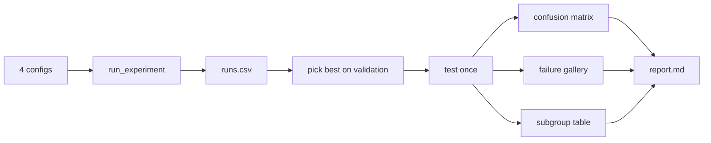

:::objectives
- Write `run_experiment(config)` that seeds, trains, times, and logs every epoch to a shared CSV file.
- Sweep a small grid of settings, plot the logged curves, and choose a winner on validation data.
- Evaluate the winner once on the test set with a confusion matrix and per-class precision and recall.
- Build a failure gallery of the model's most confident mistakes.
- Compare accuracy across a metadata subgroup, with sample sizes and 95% intervals.
:::

The goal is a short, honest report on a digit classifier: what was tried, which run won and why, what it costs to run, and where it fails. Here's the pipeline:



## Step 1: Data with a metadata column

Real datasets come with metadata: which camera, which clinic, which day. The digits don't, so we'll simulate one realistic kind. Suppose most of the forms were scanned on scanner A, but about one in eight went through an older scanner B that blurs and fades the ink. We pass a random 12% of the images through a blur-and-fade function and record which scanner each image came from.

```python run
import csv
import json
import time
import numpy as np
import pandas as pd
import torch
import torch.nn as nn
import torch.nn.functional as F
import matplotlib.pyplot as plt
import torchvision.transforms.v2.functional as TF
from torchvision.transforms import v2
from torch.utils.data import Dataset, DataLoader
from sklearn.datasets import load_digits
from sklearn.model_selection import train_test_split

digits = load_digits()
X = torch.tensor(digits.images, dtype=torch.float32).unsqueeze(1) / 16
y = torch.tensor(digits.target)

gen = torch.Generator().manual_seed(0)
scanner = np.where(torch.rand(len(y), generator=gen).numpy() < 0.12, "B", "A")
is_b = torch.tensor(scanner == "B")
X[is_b] = TF.gaussian_blur(X[is_b], kernel_size=3, sigma=0.8) * 0.6 + 0.2

idx = np.arange(len(y))
train_idx, rest = train_test_split(idx, test_size=0.4, random_state=0, stratify=y)
val_idx, test_idx = train_test_split(rest, test_size=0.5, random_state=0, stratify=y[rest])
for name, part in [("train", train_idx), ("val", val_idx), ("test", test_idx)]:
    print(f"{name:<5} {len(part):>4} images, {np.mean(scanner[part] == 'B'):.0%} from scanner B")
```

```python run alt="Two rows of six digits. The top row, labeled scanner A, shows crisp dark strokes on a white background. The bottom row, labeled scanner B, shows blurrier, paler strokes on a light gray background." caption="Scanner A (top) and scanner B (bottom)"
fig, axes = plt.subplots(2, 6, figsize=(7, 2.6))
for row, which in enumerate(["A", "B"]):
    picks = np.flatnonzero(scanner == which)[:6]
    for ax, i in zip(axes[row], picks):
        ax.imshow(X[i, 0], cmap="gray_r", vmin=0, vmax=1)
        ax.set_xticks([])
        ax.set_yticks([])
    axes[row, 0].set_ylabel(f"scanner {which}")
plt.tight_layout()
plt.show()
```

The split was stratified by digit, not by scanner, so each split has roughly the same share of scanner B, as you'd expect from a random split.

## Step 2: An experiment runner that logs as it goes

`run_experiment` takes a config dictionary and does everything a reproducible run needs: seed first, build, train, measure validation accuracy and time per epoch, and append one row per epoch to `runs.csv`. The config is saved next to it as JSON with the library versions.

```python run
class Images(Dataset):
    def __init__(self, indices, transform=None):
        self.indices, self.transform = indices, transform
    def __len__(self):
        return len(self.indices)
    def __getitem__(self, i):
        j = self.indices[i]
        return (self.transform(X[j]) if self.transform else X[j]), y[j]

def make_cnn(width):
    return nn.Sequential(
        nn.Conv2d(1, width, 3, padding=1), nn.ReLU(), nn.MaxPool2d(2),
        nn.Conv2d(width, 2 * width, 3, padding=1), nn.ReLU(), nn.MaxPool2d(2),
        nn.Flatten(), nn.Linear(2 * width * 2 * 2, 10),
    )

def accuracy(model, indices):
    model.eval()
    with torch.no_grad():
        return (model(X[indices]).argmax(1) == y[indices]).float().mean().item()

def run_experiment(config, log_path="runs.csv"):
    run_id = "_".join(f"{k}={v}" for k, v in config.items())
    torch.manual_seed(config["seed"])
    model = make_cnn(config["width"])
    augment = v2.RandomAffine(degrees=0, translate=(0.15, 0.15)) if config["augment"] else None
    loader = DataLoader(Images(train_idx, augment), batch_size=64, shuffle=True)
    opt = torch.optim.Adam(model.parameters(), lr=config["lr"])
    with open(log_path, "a", newline="") as f:
        writer = csv.writer(f)
        if f.tell() == 0:
            writer.writerow(["run_id", *config, "epoch", "train_loss", "val_acc", "seconds"])
        for epoch in range(1, config["epochs"] + 1):
            start, total, seen = time.perf_counter(), 0.0, 0
            model.train()
            for xb, yb in loader:
                loss = F.cross_entropy(model(xb), yb)
                opt.zero_grad()
                loss.backward()
                opt.step()
                total += loss.item() * len(yb)
                seen += len(yb)
            writer.writerow([run_id, *config.values(), epoch, round(total / seen, 4),
                             round(accuracy(model, val_idx), 4), round(time.perf_counter() - start, 3)])
    env = {"torch": torch.__version__, "device": "cpu", "train_size": len(train_idx)}
    with open(f"{run_id}.json", "w") as f:
        json.dump({"config": config, "env": env}, f)
    return model
```

Notice `loss.item()` in the running total, not `loss`: the warning from the notes about leaking computation graphs applies to every loop you write.

## Step 3: Sweep four configurations and read the log

Two learning rates, with and without shift augmentation. Every run uses the same seed, so the only differences are the settings.

```python run
models = {}
for lr in [0.001, 0.003]:
    for augment in [False, True]:
        config = {"lr": lr, "augment": augment, "width": 16, "epochs": 12, "seed": 0}
        models[(lr, augment)] = run_experiment(config)

log = pd.read_csv("runs.csv")
summary = (log.groupby("run_id")
              .agg(best_val=("val_acc", "max"), final_val=("val_acc", "last"), total_seconds=("seconds", "sum"))
              .sort_values("final_val", ascending=False))
print(summary.round(3).to_string())
```

The log is plain data, so plotting every run is a few lines of pandas and matplotlib:

```python run alt="Line chart of validation accuracy over 12 epochs for four runs. The two learning rate 0.003 runs finish highest, without augmentation at about 0.97 and with augmentation at about 0.94. The two 0.001 runs finish lower, the augmented one lowest at about 0.89." caption="Validation accuracy for every run in the sweep, read back from runs.csv"
fig, ax = plt.subplots(figsize=(6.5, 3.2))
for run_id, rows in log.groupby("run_id"):
    style = "--" if "augment=True" in run_id else "-"
    ax.plot(rows["epoch"], rows["val_acc"], style, label=run_id.split("_width")[0])
ax.set(xlabel="epoch", ylabel="validation accuracy", ylim=(0.5, 1.0))
ax.legend(fontsize=8, frameon=False)
ax.spines[["top", "right"]].set_visible(False)
plt.tight_layout()
plt.show()
```

The validation set looks like the training data (mostly centered digits), so augmentation for shifts doesn't pay off here; it would if the validation data contained shifted digits. The winner is the run with the best final validation accuracy. We pick it **before** looking at the test set.

```python run
winner_id = summary.index[0]
last_row = log[log["run_id"] == winner_id].iloc[-1]
best_config = {"lr": float(last_row["lr"]), "augment": bool(last_row["augment"])}
best = models[(best_config["lr"], best_config["augment"])]
print("winner:", best_config)
```

## Step 4: Test once, with a confusion matrix

```python run alt="A 10 by 10 confusion matrix for digits 0 to 9. Almost all counts sit on the diagonal, 30 to 37 per digit. The largest off-diagonal cell is 3, true 8 predicted as 1; a few other cells hold 1 or 2 errors." caption="Rows are the true digit, columns the predicted digit; anything off the diagonal is a mistake"
from sklearn.metrics import ConfusionMatrixDisplay, classification_report

best.eval()
with torch.no_grad():
    probs = F.softmax(best(X[test_idx]), dim=1)
pred = probs.argmax(1).numpy()
true = y[test_idx].numpy()
print(f"test accuracy: {np.mean(pred == true):.1%}")

fig, ax = plt.subplots(figsize=(4.6, 4.2))
ConfusionMatrixDisplay.from_predictions(true, pred, ax=ax, colorbar=False, cmap="Blues")
plt.tight_layout()
plt.show()
print(classification_report(true, pred, digits=3))
```

The matrix tells you *which* mistakes happen, which accuracy can't: here the most common one is an 8 read as a 1, and 8 has the lowest recall. In the report, **recall** for a digit is the share of that digit's images the model got right, and **precision** is the share of that digit's predictions that were correct. A digit with low recall is being missed; one with low precision is being guessed when it isn't there.

## Step 5: A gallery of the most confident mistakes

Numbers summarize failures; pictures explain them. Sort the mistakes by how confident the model was, and look at them:

```python run alt="A grid of 12 misclassified test digits, each titled with the true and predicted digit, the model's confidence, and the scanner. Eleven are from scanner A; one faint, blurry scanner B image, a 2 read as a 1, is among them." caption="The test mistakes, most confident first"
wrong = np.flatnonzero(pred != true)
wrong = wrong[np.argsort(-probs.max(1).values.numpy()[wrong])][:12]

fig, axes = plt.subplots(2, 6, figsize=(8, 3.4))
for ax in axes.flat:
    ax.axis("off")
for ax, k in zip(axes.flat, wrong):
    i = test_idx[k]
    ax.imshow(X[i, 0], cmap="gray_r", vmin=0, vmax=1)
    ax.set_title(f"{true[k]}→{pred[k]} ({probs[k].max():.2f})\nscanner {scanner[i]}", fontsize=8)
plt.tight_layout()
plt.show()
print(f"{len(np.flatnonzero(pred != true))} mistakes in {len(true)} test images")
```

Look for patterns a person can name: a particular pair of digits, unusual handwriting, or a recording condition. Here, three of the twelve are 8s read as 1s; at 8×8 pixels, a narrow 8 whose loops fill in looks like one thick stroke. Only one of the twelve came from scanner B, a first hint that any scanner gap is small.

## Step 6: Accuracy by subgroup, with intervals

The gallery suggests a hypothesis; the subgroup table tests it. With small groups, a bare percentage is misleading, so each row gets a **95% Wilson interval**, a standard confidence interval for a proportion that behaves well with small counts:

```python run
def wilson(correct, n, z=1.96):
    p = correct / n
    centre = (p + z * z / (2 * n)) / (1 + z * z / n)
    half = z * np.sqrt(p * (1 - p) / n + z * z / (4 * n * n)) / (1 + z * z / n)
    return centre - half, centre + half

rows = []
for group in ["A", "B"]:
    mask = scanner[test_idx] == group
    n, k = int(mask.sum()), int((pred[mask] == true[mask]).sum())
    low, high = wilson(k, n)
    rows.append({"scanner": group, "n": n, "accuracy": k / n, "95% low": low, "95% high": high})
audit = pd.DataFrame(rows)
print(audit.round(3).to_string(index=False))
```

Scanner B's measured accuracy is lower, but look at the intervals. B's runs from about 81% to 97% and overlaps A's, because it rests on only 50 images. This test set can't tell a real gap from bad luck, and the report should say exactly that: B *may* be worse, and the evidence is thin. The next step is more scanner-B test images; a few hundred would narrow its interval to a few points. Compare Gender Shades, where each subgroup had hundreds of faces and the gaps were many times larger than the noise.

## Step 7: Write the report

The last step turns all of this into a file someone else can read without running anything:

```python run
table = "\n".join(f"| {r.scanner} | {r.n} | {r.accuracy:.1%} | {r._4:.1%} to {r._5:.1%} |" for r in audit.itertuples())
report = f"""# Digit classifier: run report

**Winner:** lr={best_config['lr']}, augment={best_config['augment']}, width=16, 12 epochs, seed 0
**Chosen by:** final validation accuracy across {log['run_id'].nunique()} runs (log: runs.csv)
**Test accuracy:** {np.mean(pred == true):.1%} on {len(true)} images
**Training cost:** {summary.loc[winner_id, 'total_seconds']:.1f} s on CPU, {sum(p.numel() for p in best.parameters()):,} parameters

## By scanner
| scanner | n | accuracy | 95% interval |
| --- | --- | --- | --- |
{table}

## Known limitations
- Scanner B is {np.mean(scanner == 'B'):.0%} of the data. Its measured accuracy is lower, but with {audit.n[1]} test images the interval is too wide to confirm a gap.
- One seed per configuration; differences under about 1 point may be noise.
"""
with open("report.md", "w") as f:
    f.write(report)
print(report)
```

:::video 6CEld3hZgqc
The PyTorch team's short tour of TensorBoard. Watch for `add_scalar` and how TensorBoard draws training and validation curves together: the live-dashboard version of the CSV log you just built.
:::

:::quiz
Q: Why does the code choose the winning configuration before computing any test metric?
- [x] Choosing by test score would make the test number an optimistic, tuned result
  The test set is only an unbiased estimate if nothing was chosen by looking at it.
- [ ] The test set is too small to rank four runs
  It's the same size as validation; the reason is about bias, not size.
- [ ] `pandas` can't read test metrics from the CSV
  The CSV could hold anything; the choice is deliberate.

Q: Scanner B scored 92% with a 95% interval of about 81% to 97%; scanner A scored 96.5% (94% to 98%). What can the report claim?
- [ ] Scanner B is proven to be worse than scanner A
  The intervals overlap, so this test set can't rule out that the gap is luck.
- [x] B's measured accuracy is lower, but with 50 images the evidence is too thin to confirm a gap
  The honest claim names the difference, the sample size, and the uncertainty, and asks for more B data.
- [ ] The two scanners perform the same
  Overlapping intervals don't show equality either; a real gap of several points is still quite possible.

Q: Why does each CSV row repeat the full config instead of just the run id?
- [ ] CSV files require every column to be filled
  Empty cells are allowed; the repetition is a choice.
- [x] So you can filter and group by any setting directly, without parsing ids or joining another file
  `log[log.lr == 0.003]` just works.
- [ ] To make the file larger and easier to find
  Size isn't a goal.
:::

:::takeaways
- One runner function that seeds, trains, times, and logs every epoch makes every run comparable and reproducible.
- Read the log back as data: plot all the curves and summarize every run, then choose the winner on validation.
- A confusion matrix shows which classes get confused; precision and recall per class show missing versus over-guessing.
- A failure gallery turns error counts into patterns you can name.
- Report subgroup accuracy with its sample size and interval; small groups need more data before their numbers mean much.
:::

## Ideas to extend it

- Run each configuration with three seeds and plot the mean with a shaded band for the spread.
- Add a `val_shift_acc` column (validation accuracy on shifted digits) and see whether the augmented runs win when it's part of the selection rule.
- Add scanner-B augmentation (blur plus fade) to training and rerun the audit. Does the gap close, and what happens to scanner A?
- Swap the CSV for TensorBoard in Colab: one `SummaryWriter` per run, with `add_scalar` in place of `writer.writerow`.

## Further reading

- [A Recipe for Training Neural Networks (Karpathy)](https://karpathy.github.io/2019/04/25/recipe/): how an experienced practitioner sets up, logs, and debugs training runs.
- [scikit-learn: Metrics and scoring](https://scikit-learn.org/stable/modules/model_evaluation.html): precision, recall, confusion matrices, and every other classification metric, with definitions.
- [How to use TensorBoard with PyTorch](https://docs.pytorch.org/tutorials/recipes/recipes/tensorboard_with_pytorch.html): the official recipe for logging scalars and opening the dashboard.
