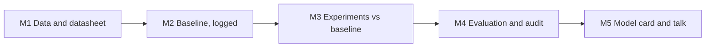

:::objectives
- Explain what the capstone asks for and how each part maps to Modules 2 to 7.
- Choose a project whose data, compute, and risks you can handle in the time you have.
- Document a dataset with the questions a datasheet asks.
- Write a one-page plan with a baseline, a metric chosen in advance, subgroups, and a compute budget.
:::

A model study isn't a leaderboard entry. Anyone can post "94% accuracy." Your study answers the questions a careful reader asks next: 94% on what data, compared with what baseline, at what cost, failing on which images, and safe to use for what? This page is the brief and the planning; the next two lessons cover building and presenting.

## What you'll hand in

1. **A notebook** that trains and evaluates a vision model from start to finish, and reruns from top to bottom without errors.
2. **An experiment log** (`runs.csv` or TensorBoard) with at least three runs, including a simple baseline.
3. **A model card**, one to two pages, describing the model, its data, its results by subgroup, and where it should and shouldn't be used.
4. **A five-minute presentation** of the question, the evidence, and the limits.

Every requirement is something you've already practiced:

| Requirement | Where you learned it |
| --- | --- |
| Datasheet: source, license, size, splits, who and what is represented | This lesson |
| Architecture and why you chose it, with tensor shapes traced | Modules 2 and 5 |
| Training loop with a validation curve, seeded and logged | Modules 4 and 7 |
| Augmentation chosen to keep labels true, and shown on real examples | Module 5 |
| Transfer learning or a justified decision not to use it | Module 6 |
| Metrics: overall, per class, and at least one subgroup or condition with intervals | Module 7 |
| A failure gallery and a written diagnosis of the patterns | Module 7 |
| Resources: training time, hardware, parameters, peak memory | Module 7 |
| Model card with intended use, out-of-scope uses, and limitations | Lessons 2 and 3 of this module |

## Five project ideas

Pick one, or propose your own at the same scale. The level describes the data and compute, not the thinking; every option needs the same careful evaluation.

**1. Scanner robustness for digit reading (starter level; runs on any CPU).** Use `load_digits` and simulate two or three recording conditions (blur, fading, shifts, low resolution). Study which conditions break a CNN, which augmentations fix which failures, and what each fix costs on clean images. The next lesson's starter code is built on this project.

**2. Augmentation study on CIFAR-10 (intermediate; Colab GPU).** 60,000 small color photos in 10 classes. Train a small CNN with no augmentation, then add crops, flips, and color jitter one at a time. Which help, which hurt, and which classes benefit? Cats and dogs are the classic confusion; does augmentation help them, or only the easy classes?

**3. Flowers with ten labels per class (intermediate; Colab GPU).** Oxford Flowers-102 has exactly ten training images per species. Compare training from scratch, a frozen ResNet-18 with a new head, and fine-tuning the last stage, at 2, 5, and 10 images per class. Plot the learning curve for each, and find the species the best model still confuses.

**4. Your own small dataset (advanced; Colab GPU).** Photograph 30 to 50 examples per class of something local: recycling categories, leaf types, lab glassware. Load them with `datasets.ImageFolder` and use transfer learning. The challenge is documentation: record where, when, and how you photographed, then test on images taken in different conditions (a different room, a phone, daylight versus lamp light) to measure what your collection process baked in. Don't photograph people.

**5. Audit a pretrained pedestrian detector (advanced; Colab GPU).** The Penn-Fudan dataset has 170 street images with 345 labeled pedestrians, and it's used in the official torchvision detection tutorial. Run a COCO-pretrained Faster R-CNN on it, match detections to labels at IoU 0.5, and report recall by person size (small, medium, large boxes) and by how occluded each person is. You're evaluating, not training, so the work is in the matching code and the failure gallery.

:::warning
**Some vision tasks are out of scope for this capstone, however interesting they look:** classifying people's gender, race, age, emotion, or identity from their faces, or any model that judges people from photos. Gender Shades showed how these systems fail unequally; building one well needs consent, careful labeling, and an ethics review you can't do in a course project. Project 5 involves people in public street photos, but it measures whether a safety-relevant detector finds everyone; it doesn't label who they are.
:::

## Document the dataset before you train

Researchers call this a **datasheet**, after Gebru and colleagues' paper *Datasheets for Datasets*. For a course project, answer these in a few sentences each:

- **Motivation:** who made this dataset, and for what task?
- **Composition:** how many images, how many per class, what resolution? What's in the images besides the label (backgrounds, people, text)?
- **Collection:** how were images gathered and labeled? Who labeled them, and how do you know the labels are right? Look at 50 random images with their labels and count the mistakes.
- **Coverage:** which conditions, places, or groups are represented, and which are missing? This is where your subgroup slices come from.
- **License and use:** may you use it for this? Cite it the way its authors ask.
- **Splits:** how are train, validation, and test separated? Could near-duplicate images (the same object photographed twice, the same writer, the same video) end up on both sides?

The last question catches the most common hidden flaw in vision projects. If two photos of the same leaf land in train and test, the test score measures memory, not generalization.

## Fill in the plan

Copy this template into the first text cell of your notebook and fill it in **before** writing training code. Writing the metric and the subgroups down first is what keeps you from choosing them after you've seen which ones look good.

```text
PROJECT PLAN
Question:          One sentence. "How much does X change Y for Z?"
Dataset:           Name, source URL, license, size, classes.
Splits:            Train / val / test sizes, how they're separated, duplicate check.
Baseline:          The simplest reasonable model (e.g. small CNN, no augmentation).
Experiments:       2 to 4 changes, each tested against the baseline.
Primary metric:    Chosen now. Accuracy? Macro recall? Recall at IoU 0.5?
Subgroups:         Which slices, why, and how many test images each has.
Compute budget:    Epochs x seconds per epoch x runs, on which hardware.
Risks:             What could go wrong with the data, the model, or its use.
Out of scope:      Uses this model must not be put to.
```

The compute budget deserves real numbers. Time one epoch of your baseline, multiply by epochs and by the number of runs (three seeds each for the runs you'll compare), and add a margin. Colab's free tier can disconnect long sessions, so plan runs of under an hour, save checkpoints and `runs.csv` to Google Drive as you go, and make every cell safe to rerun.

## Five milestones



| Milestone | Done when |
| --- | --- |
| M1 Data | Datasheet answered, splits fixed and saved, 20 random examples plotted with labels, duplicate check run |
| M2 Baseline | Baseline trained with a fixed seed, curves logged, validation score recorded |
| M3 Experiments | Each change run against the baseline with the same seeds, all runs in the log |
| M4 Evaluation | Best run chosen on validation, test evaluated once: per-class table, confusion matrix, subgroup table with intervals, failure gallery |
| M5 Communication | Model card written, tests passing, notebook reruns cleanly, five-minute talk rehearsed |

Give M4 as much time as M2 and M3 together. Training is the part that feels like progress, but the evaluation is where the study earns its conclusions.

:::video UG_X_7g63rY
Joy Buolamwini's TED talk on the "coded gaze." Watch for her point about who is in the training set, and ask the same question in your datasheet's coverage answer.
:::

:::tip
Pick the project you can finish. A small dataset studied carefully, with honest subgroup results and a clear limitations section, is a stronger capstone than a large model with one accuracy number.
:::

## Further reading

- [Datasheets for Datasets (Gebru et al.)](https://arxiv.org/abs/1803.09010): the full list of questions, with worked examples for real datasets.
- [Model Cards for Model Reporting (Mitchell et al.)](https://arxiv.org/abs/1810.03993): the paper that proposed model cards, including two complete example cards.
- [CS231n: Convolutional Neural Networks](https://cs231n.github.io/convolutional-networks/): a refresher on architecture choices while you plan your baseline.
