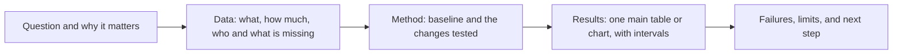

:::objectives
- Write automated tests for shapes, data splits, augmentation, learning, determinism, and evaluation side effects.
- Polish a notebook so it reruns from a fresh runtime and every number in the write-up comes from code.
- Write a model card whose limitations are specific enough to act on.
- Present the study in five minutes and assess it with the rubric.
:::

A study is finished when someone who wasn't there can trust it. That takes three things beyond the results: tests that show the pipeline does what you say it does, a model card that says what the model is for and where it breaks, and a short talk that puts the evidence before the conclusions.

## Six tests every vision project should have

Each test below targets a bug that silently ruins vision projects, the kind that produces a plausible number instead of a crash. They're written against a compact version of the capstone starter; in your project, point them at your own functions.

```python run
import sys
import unittest
import numpy as np
import torch
import torch.nn as nn
import torch.nn.functional as F
from torchvision.transforms import v2
from sklearn.datasets import load_digits
from sklearn.model_selection import train_test_split

digits = load_digits()
X = torch.tensor(digits.images, dtype=torch.float32).unsqueeze(1) / 16
y = torch.tensor(digits.target)
idx = np.arange(len(y))
train_idx, rest = train_test_split(idx, test_size=0.4, random_state=0, stratify=y)
val_idx, test_idx = train_test_split(rest, test_size=0.5, random_state=0, stratify=y[rest])
augment = v2.Compose([v2.RandomAffine(degrees=0, translate=(0.15, 0.15)), v2.ColorJitter(contrast=0.5)])

def make_cnn(width=16):
    return nn.Sequential(
        nn.Conv2d(1, width, 3, padding=1), nn.ReLU(), nn.MaxPool2d(2),
        nn.Conv2d(width, 2 * width, 3, padding=1), nn.ReLU(), nn.MaxPool2d(2),
        nn.Flatten(), nn.Linear(8 * width, 10),
    )

def train_steps(model, images, labels, steps, lr=3e-3):
    opt = torch.optim.Adam(model.parameters(), lr=lr)
    for _ in range(steps):
        loss = F.cross_entropy(model(images), labels)
        opt.zero_grad()
        loss.backward()
        opt.step()
    return loss.item()

def evaluate(model, indices):
    model.eval()
    with torch.no_grad():
        return (model(X[indices]).argmax(1) == y[indices]).float().mean().item()
print("pipeline loaded")
```

```python run
class TestVisionPipeline(unittest.TestCase):
    def test_1_output_shape(self):
        """One row of 10 class scores per image, for any batch size."""
        for n in [1, 7, 64]:
            self.assertEqual(tuple(make_cnn()(X[:n]).shape), (n, 10))

    def test_2_splits_are_disjoint(self):
        """No image index, and no identical image, appears in two splits."""
        self.assertFalse(set(train_idx) & set(val_idx) or set(train_idx) & set(test_idx) or set(val_idx) & set(test_idx))
        train_pixels = {X[i].numpy().tobytes() for i in train_idx}
        self.assertFalse(any(X[i].numpy().tobytes() in train_pixels for i in test_idx))

    def test_3_augmentation_keeps_shape_and_range(self):
        torch.manual_seed(0)
        for i in train_idx[:50]:
            out = augment(X[i])
            self.assertEqual(out.shape, X[i].shape)
            self.assertEqual(out.dtype, torch.float32)
            self.assertTrue(0.0 <= out.min() and out.max() <= 1.0)

    def test_4_can_overfit_one_batch(self):
        """A working loop drives the loss near zero on 32 images."""
        torch.manual_seed(0)
        loss = train_steps(make_cnn(), X[train_idx[:32]], y[train_idx[:32]], steps=150)
        self.assertLess(loss, 0.05)

    def test_5_same_seed_same_weights(self):
        weights = []
        for _ in range(2):
            torch.manual_seed(0)
            model = make_cnn()
            train_steps(model, X[train_idx[:64]], y[train_idx[:64]], steps=5)
            weights.append(model[0].weight.detach().clone())
        self.assertTrue(torch.equal(*weights))

    def test_6_evaluation_changes_nothing(self):
        """Evaluating must not update weights or leave gradients behind."""
        torch.manual_seed(0)
        model = make_cnn()
        before = [p.detach().clone() for p in model.parameters()]
        evaluate(model, test_idx)
        self.assertTrue(all(torch.equal(a, b) for a, b in zip(before, model.parameters())))
        self.assertTrue(all(p.grad is None for p in model.parameters()))

suite = unittest.defaultTestLoader.loadTestsFromTestCase(TestVisionPipeline)
unittest.TextTestRunner(stream=sys.stdout, verbosity=2).run(suite)
```

What each test protects against:

1. **Output shape:** a wrong `Linear` size, or a flatten that merges the batch dimension.
2. **Disjoint splits:** leakage from splitting twice with different seeds, or the same photo saved under two names.
3. **Augmentation range:** a transform that pushes pixel values outside what the model trained on, or silently changes the dtype.
4. **Overfit one batch:** a loop that doesn't learn (optimizer holding the wrong parameters, labels shuffled separately from images, a missing `zero_grad`).
5. **Determinism:** randomness that `torch.manual_seed` doesn't control, which makes every comparison between runs unreliable.
6. **Evaluation side effects:** evaluating in training mode (BatchNorm statistics change, dropout stays on) or accidentally taking an optimizer step.

Run them after every significant change. In your presentation, "all six tests pass" is a sentence that earns trust.

## Polish the notebook

Before you call it done:

- **Restart and run all** (**Runtime › Restart session and run all** in Colab). Fix anything that depended on a cell you deleted or ran out of order.
- **Generate every number.** Tables, the model card, and slide figures come from code, never retyped. If a number appears in your talk, you should be able to point to the cell that made it.
- **Print the environment** at the top: torch and torchvision versions, GPU name, and the date.
- **Label every chart** with a title, axis labels, and units, and say in a sentence what to notice.
- **Delete dead ends** from the notebook, but keep them in the log. A failed run is evidence; a stale cell is a trap.

## Write a model card that's specific

The model card is the part people will read without opening your notebook. Use these sections, which follow Mitchell and colleagues' *Model Cards for Model Reporting*:

```text
# Model card: <name>
Model details      Architecture, parameters, training data size, date, author, version.
Intended use       The task, the users, and the setting. Be narrow.
Out of scope       Uses you know it would fail at or that would be harmful.
Data               Training and evaluation data, with a link to your datasheet.
Metrics            The primary metric chosen in your plan, and why it fits the use.
Results            Overall, per class, and per subgroup or condition, with sample sizes and intervals.
Resources          Training time, hardware, peak memory, inference speed if measured.
Limitations        Specific, testable statements (see below).
Recommendations    What a user must do to use it safely, and what to collect next.
```

Most model cards fail at **limitations**, by being vague. Compare:

| Vague | Specific |
| --- | --- |
| "May not work in all conditions." | "Accuracy on digits shifted one pixel diagonally is 62% (95% interval 57–67%), versus 89% on clean digits." |
| "The dataset may be biased." | "All training photos were taken indoors under ceiling lights; outdoor accuracy was not measured." |
| "Results could vary." | "The augmented and baseline models differ by less than their seed-to-seed spread on mean validation accuracy." |

A specific limitation tells a reader exactly what to test before trusting the model in their setting.

## Present it in five minutes



- **Lead with the question,** not the architecture. "Can a digit reader trained on clean scans handle faded ones?" beats "I used a two-layer CNN."
- **Show examples early.** Six images from your dataset explain it faster than a paragraph.
- **One main result per slide,** with the baseline beside it and the interval visible.
- **Show three failures** from your gallery and say what pattern they share.
- **End with a limitation and a next step,** not with your best number.

Rehearse with a timer. Five minutes is about 650 spoken words.

## The rubric

| Criterion | Points | Strong | Developing |
| --- | --- | --- | --- |
| Question and plan | 10 | One clear question; metric and subgroups fixed before training | Question vague, or metric chosen after results |
| Data and datasheet | 15 | Source, license, splits, coverage gaps, and a duplicate check documented | Dataset named but not described; leakage not checked |
| Experiments | 20 | Logged baseline; one change at a time; at least two seeds for compared runs | Runs not logged, several changes at once, single seed |
| Evaluation | 25 | Test used once; per-class and subgroup results with intervals; failure gallery with a named pattern | Only overall accuracy; test reused for choices |
| Resources and reproducibility | 10 | Time, hardware, parameters, peak memory; tests pass; reruns cleanly | Missing costs; notebook only runs in a certain order |
| Model card | 10 | Intended and out-of-scope uses; specific, measured limitations | Generic limitations, or missing |
| Presentation | 10 | Under five minutes; evidence before claims; failures shown | Over time; claims without the numbers behind them |

A study with modest accuracy and excellent evaluation will score well. A high accuracy number with no baseline, no seeds, and no subgroup results won't.

## Reflect before you move on

Write a short paragraph answering each:

1. Which result surprised you, and what does that say about the assumption you started with?
2. Which subgroup or condition would you most want more test data for, and roughly how many images would make its interval useful?
3. If someone used your model outside its intended use tomorrow, what's the most likely way it would fail, and who would notice?
4. What would you do with ten times the compute? With ten times the labeled data? Which would help more?

## Where to go next

- **Go deeper on the foundations:** Andrej Karpathy's *Neural Networks: Zero to Hero* builds backpropagation and language models from scratch in code.
- **More vision, more practice:** fast.ai's *Practical Deep Learning for Coders* trains strong image models quickly and covers deployment; Stanford's CS231n has the full lecture notes and assignments for convolutional networks.
- **Beyond classification:** the Hugging Face Computer Vision Course covers vision transformers, detection, segmentation, and multimodal models with current libraries.
- **Read a landmark paper:** *Deep Residual Learning for Image Recognition* (He et al., 2015) introduced the ResNet you fine-tuned in Module 6. With what you know now, its figures and tables are readable.

:::video VMj-3S1tku0
Karpathy builds a tiny autograd engine, micrograd, from nothing. It's long; watch the first part, where he computes gradients by hand on a small expression, and compare it with what `loss.backward()` has been doing for you all course.
:::

## Further reading

- [Model Cards for Model Reporting (Mitchell et al.)](https://arxiv.org/abs/1810.03993): the sections above in full, with two complete example cards.
- [Practical Deep Learning for Coders (fast.ai)](https://course.fast.ai/): a free course that picks up where this one ends.
- [Hugging Face Computer Vision Course](https://huggingface.co/learn/computer-vision-course/unit0/welcome/welcome): detection, segmentation, and vision transformers with today's tools.
