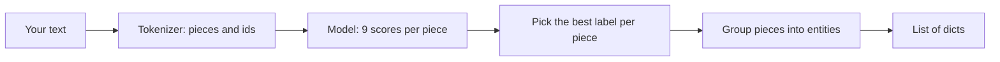

:::objectives
- Run a scikit-learn text cell and read its output.
- Download a tokenizer from the Hugging Face Hub and see how it splits a sentence.
- Run a named-entity pipeline and print its results in a readable form.
- Fix the three errors people meet on a first run: a misspelled model name, a missing key, and a download that can't connect.
- Finish with a check cell that fails loudly if anything is broken.
:::

Your notebook from the last lesson can print version numbers. That proves the libraries exist, not that they work. A setup is only proven when real text goes in and sensible output comes out, so this lesson pushes one sentence through each layer you'll use in the course: scikit-learn first, then a tokenizer, then a full model.

Keep working in the notebook you made in the last lesson, or create a new one called `nlp-m1-first-run.ipynb`.

## Step 1: Count words with scikit-learn

This cell runs entirely on your machine, with no downloads. It turns three short support messages into a table of word counts, which is the oldest trick in NLP and the starting point for Module 2.

```python run title="first_counts.py"
from sklearn.feature_extraction.text import CountVectorizer

messages = [
    "My card was charged twice.",
    "The app crashes when I open my card settings.",
    "Charged twice again? Please refund me.",
]

vectorizer = CountVectorizer()
counts = vectorizer.fit_transform(messages)

print(vectorizer.get_feature_names_out())
print(counts.toarray())
```

The first line of output is the vocabulary: every distinct word, lowercased and sorted. Each row of the table is one message, and each column counts one vocabulary word. Look at the column for `charged`: it's 1 in the first and third rows, because both messages contain it. Notice what's missing, too: the single-letter word `I` and the punctuation. `CountVectorizer` keeps only tokens of two or more letters or digits unless you tell it otherwise. You'll take that rule apart in Module 2.

If your Colab output matches this, scikit-learn works.

## Step 2: Download a tokenizer from the Hub

Run this in Colab. The first time, it downloads a few small files from the Hugging Face Hub:

```python
from transformers import AutoTokenizer

tokenizer = AutoTokenizer.from_pretrained("dslim/distilbert-NER")

sentence = "Tokenization is unbelievably useful."
print(tokenizer.tokenize(sentence))
print(tokenizer(sentence)["input_ids"])
```

```text
['To', '##ken', '##ization', 'is', 'un', '##bel', '##ie', '##va', '##bly', 'useful', '.']
[101, 1706, 6378, 2734, 1110, 8362, 8511, 1663, 2497, 4999, 5616, 119, 102]
```

`"dslim/distilbert-NER"` is a model's address on the Hub: the account `dslim`, then the model name. `AutoTokenizer` reads the model's config, works out which kind of tokenizer it needs, and loads its vocabulary of 28,996 pieces.

The output shows something that surprises most people. The model never sees the word *Tokenization*. It sees three pieces, `To`, `##ken`, and `##ization`, where `##` means "glued to the piece before". The second line is what the model actually receives: one integer per piece, plus `101` and `102` at the ends, which are the special `[CLS]` and `[SEP]` markers for the start and end of the text. Module 2 explains why splitting words this way is a good idea.

## Step 3: Run a named-entity model

Now the full model. This downloads about 260 MB the first time, which takes a few seconds on Colab:

```python
from transformers import pipeline

ner = pipeline(
    "token-classification",
    model="dslim/distilbert-NER",
    aggregation_strategy="first",
)

text = "Maya Patel flew from Toronto to Nairobi to meet engineers at Safaricom."
for entity in ner(text):
    print(f"{entity['entity_group']:5} {entity['score']:.3f}  {entity['word']!r}  {entity['start']}-{entity['end']}")
```

```text
PER   0.999  'Maya Patel'  0-10
LOC   0.998  'Toronto'  21-28
LOC   0.998  'Nairobi'  32-39
ORG   0.998  'Safaricom'  61-70
```

Each line is one entity: its type (person, location, organization, or MISC for everything else), the model's confidence, the text, and the character positions where it starts and ends. Check one: `text[61:70]` is `'Safaricom'`. Those positions matter, because they let you highlight or redact the exact characters in the original text.

Before the results, Colab prints a line like `Device set to use cpu`, or `cuda:0` on a GPU runtime. That's the pipeline telling you where the model is running.



:::try
Run the pipeline on three sentences of your own. Include a name that's also a place, such as "Jordan visited Jordan", and a company that's also a fruit. Write down one result that's wrong. You'll find out why in Module 4.
:::

## Step 4: The errors you'll meet on a first run

**A misspelled model name.** Model ids are case-sensitive, and the error doesn't suggest a fix:

```text
OSError: dslim/distilbert-ner-base is not a local folder and is not a valid model identifier listed on 'https://huggingface.co/models'
```

Copy the id from the model's page on the Hub (there's a copy button next to the name) instead of typing it.

**`KeyError: 'entity_group'`.** If you leave out `aggregation_strategy`, the pipeline returns one dict per *piece* instead of per entity, and those dicts call the label `entity`, with values like `B-PER` and `I-PER`. Code written for grouped output then crashes on the missing key. Either add `aggregation_strategy="first"` or read `entity["entity"]`.

**A download that can't connect.** Errors mentioning `ConnectionError` or `Max retries exceeded` mean the runtime couldn't reach the Hub. Rerun the cell; if it keeps failing, check [status.huggingface.co](https://status.huggingface.co/).

:::note
If you print a whole result with `print(ner(text))`, the scores may appear as `np.float32(0.9990412)`. That's NumPy 2 showing you the number's type. Format it with `:.3f` as above, or convert it with `float()`.
:::

## Step 5: Downloads are cached

Run the pipeline cell a second time. It starts almost instantly, because the files are now stored in a cache on the runtime's disk. This cell lists what's there:

```python
from huggingface_hub import scan_cache_dir

for repo in scan_cache_dir().repos:
    print(repo.repo_id, repo.size_on_disk_str)
```

```text
dslim/distilbert-NER 261.7M
```

The cache lives on the Colab machine, not in your Drive. A new runtime starts with an empty cache, so the first run of each day downloads again. That's normal.

## Step 6: One cell that proves it all works

Add this as the last cell of your setup notebook. It runs a sentence with a known answer and stops with an `AssertionError` if the model gives anything else:

```python
from transformers import pipeline

ner = pipeline("token-classification", model="dslim/distilbert-NER", aggregation_strategy="first")

result = ner("Ada Lovelace was born in London.")
labels = [(entity["entity_group"], entity["word"]) for entity in result]
print(labels)

assert ("PER", "Ada Lovelace") in labels and ("LOC", "London") in labels
print("Model download and inference: OK on", ner.device)
```

```text
[('PER', 'Ada Lovelace'), ('LOC', 'London')]
Model download and inference: OK on cpu
```

On a GPU runtime the last word is `cuda:0`. When you see both lines, your setup is done: scikit-learn, the tokenizer, the model, and the cache all work.

:::video tiZFewofSLM
Hugging Face's own short introduction to `pipeline()`. Watch how one function call covers several tasks (sentiment, generation, entities), and notice that each task picks a default model unless you name one, which is why this course always names its model.
:::

:::quiz
Q: The tokenizer turns "Tokenization is unbelievably useful." into 13 ids, but the sentence has 4 words and a period. Where do the extra ids come from?
- [ ] The tokenizer adds one id per letter
  Then there would be dozens of ids, not 13.
- [x] Long words are split into several pieces, and `[CLS]` and `[SEP]` are added at the ends
  *Tokenization* becomes 3 pieces and *unbelievably* becomes 5, and ids 101 and 102 mark the start and end.
- [ ] Spaces get their own ids
  This tokenizer drops spaces; the `##` prefix is how it records that a piece continues a word.

Q: Your loop prints `entity['entity_group']` and crashes with `KeyError: 'entity_group'`. What's the most likely cause?
- [ ] The model found no entities
  Then the list would be empty and the loop body would never run, so there'd be no error.
- [x] The pipeline was created without `aggregation_strategy`, so each dict has `entity` instead
  Ungrouped output is one dict per piece, with labels like `B-PER` under the key `entity`.
- [ ] The model hasn't finished downloading
  `pipeline()` doesn't return until the download is finished.

Q: You open your notebook the next morning and the pipeline cell spends a while downloading again. Why?
- [ ] Hugging Face deletes downloads after 24 hours
  The Hub doesn't control your disk. The cache is just files.
- [x] You're on a new runtime, and its cache starts empty
  The cache lives on the Colab machine, which is replaced when you reconnect after a break.
:::

:::takeaways
- A setup is proven when real text produces sensible output, not when imports succeed.
- `AutoTokenizer.from_pretrained` and `pipeline(..., model=...)` take a Hub id such as `dslim/distilbert-NER`; copy ids rather than typing them.
- Tokenizers split rare words into pieces and add special tokens, so the model sees integers, not words.
- With `aggregation_strategy`, the NER pipeline returns one dict per entity, with `entity_group`, `score`, `word`, `start`, and `end`.
- Downloads are cached on the runtime's disk and disappear with the runtime.
:::
