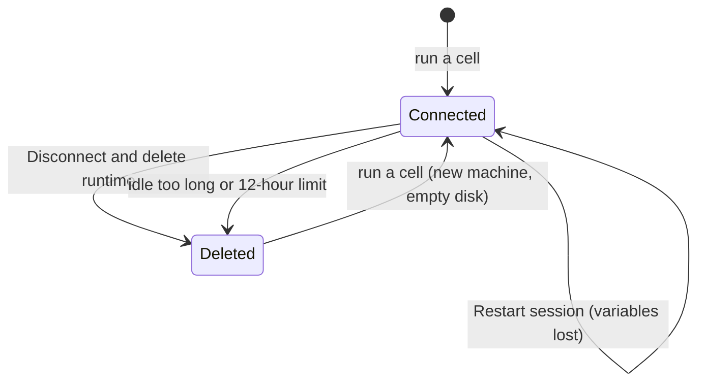
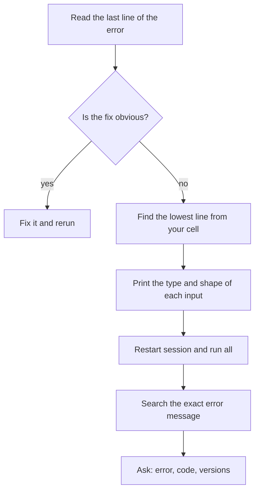

:::objectives
- Predict what survives a session restart, a deleted runtime, and an idle timeout.
- Set up each course notebook with the same first cell, and save files to Drive when they must outlive the runtime.
- Use seeds so a split or a training run gives the same result twice.
- Read a Python traceback from the last line up, and work through a short checklist when you're stuck.
- Choose text that is safe to process and share, and keep tokens and personal data out of notebooks.
:::

A notebook that worked perfectly on Friday fails on Monday at the third cell:

```python run raises
# Cell 3, run first thing on Monday
print(len(vocabulary), "words in the vocabulary")
```

Nothing in cell 3 changed. On Friday, `vocabulary` existed because you'd built it in a cell you later deleted, and the variable stayed in memory until the runtime ended. Monday's fresh runtime has no memory of it. Notebooks let you run cells in any order, which is great for experimenting and terrible for knowing whether your notebook really works. This lesson is about habits that close that gap.

## What each kind of reset keeps

Colab has three ways to lose state, and they don't lose the same things:

| What happens | Variables in memory | Files in `/content`, installs, model cache | The notebook itself |
| --- | --- | --- | --- |
| **Runtime › Restart session** | Lost | Kept | Kept |
| **Runtime › Disconnect and delete runtime** | Lost | Lost | Kept |
| Idle timeout, or the free tier's maximum session length (at most 12 hours) | Lost | Lost | Kept |

The notebook file lives in your Drive, so it always survives. Everything else lives on a temporary virtual machine.



The habit that catches hidden state: before you call a notebook finished, choose **Runtime › Restart session and run all**. If anything depends on a deleted cell or on running cells out of order, it fails now, while you still remember why.

## One notebook per lesson, with the same first cell

Make a Drive folder called `NLP course` and keep one notebook per lesson in it, named so they sort in order: `nlp-m2-l2-tokenizer.ipynb`, `nlp-m3-l2-ticket-triage.ipynb`. Start every notebook with a cell like this:

```python
# Setup: run this first, every time
import random

import numpy as np
from importlib.metadata import version

SEED = 0
random.seed(SEED)
np.random.seed(SEED)

for package in ["transformers", "torch", "scikit-learn"]:
    print(package, version(package))
```

Printing versions at the top costs nothing and explains a lot later. If a classmate gets a different number from the same notebook, the version lines are the first thing to compare. Use **Insert › Text cell** to add headings between steps; a notebook with headings is much easier to come back to.

## Save files that must outlive the runtime

Anything your code writes to `/content` disappears with the runtime. To keep a file, mount your Drive and save it there:

```python
from google.colab import drive

drive.mount("/content/drive")

with open("/content/drive/MyDrive/NLP course/notes.txt", "w") as f:
    f.write("Vocabulary size after cleaning: 412\n")
```

The first time, Colab asks you to allow access to your Drive. After that, `/content/drive/MyDrive` is your Drive, and files saved there stay. The notebook itself saves automatically; **File › Download › Download .ipynb** gives you a copy on your own computer.

## Seeds make results repeatable

Many steps in NLP involve randomness: shuffling data, splitting it into training and test sets, initializing model weights. Without a seed you get different numbers every run, and you can't tell whether a change you made helped or whether the dice just rolled differently.

```python run title="seeds.py"
from sklearn.model_selection import train_test_split

texts = ["refund please", "app crashed", "card charged twice", "login fails",
         "parcel is late", "wrong size delivered", "reset my password", "double charge"]

for attempt in range(3):
    train, test = train_test_split(texts, test_size=2)
    print("no seed:", test)

for attempt in range(3):
    train, test = train_test_split(texts, test_size=2, random_state=0)
    print("seed 0: ", test)
```

The three unseeded splits usually differ from each other; the seeded ones are identical every time, on every computer with the same library versions. In scikit-learn, pass `random_state=` to anything that shuffles. For PyTorch and transformers, `from transformers import set_seed` and `set_seed(0)` seeds Python, NumPy, and PyTorch in one call. Even with seeds, GPU results can differ from CPU results in the last decimal places, so compare to two or three decimals, not ten.

## Read a traceback from the bottom up

Errors from transformers can be forty lines long, most of it inside library code you didn't write. The useful part is almost always at the bottom: the last line names the error type and says what went wrong, and the lowest line that mentions *your* cell tells you where. Here's a classic from Module 3:

```python run raises
from sklearn.feature_extraction.text import TfidfVectorizer

vectorizer = TfidfVectorizer().fit(["my card was charged twice", "the app crashes"])
vectorizer.transform("refund my card")
```

The last line says it plainly: `transform` wanted an iterable of documents and got one string. A string is itself iterable (character by character), which is why scikit-learn checks for this. The fix is `vectorizer.transform(["refund my card"])`, a list holding one document.

When the last line doesn't make the fix obvious, work through this:



When you ask for help (a classmate, the [Hugging Face forums](https://discuss.huggingface.co/), a search engine), include the last line of the error, the smallest piece of code that causes it, and your version cell's output. Most questions answer themselves while you're cutting the code down.

## Privacy: what text belongs in a notebook

Every example in this course is made up: invented support tickets, invented names, sentences written for the lesson. Keep your own experiments the same way.

- **Don't process real people's private text.** Classmates' messages, school records, someone's emails, or anything with phone numbers and addresses stays out, even if a model would handle it well.
- **Remember that outputs travel with the notebook.** If you share a notebook, everyone sees every printed result. **Edit › Clear all outputs** before sharing removes them.
- **Know where text goes.** A model you download with `from_pretrained` runs on your Colab runtime; your sentences aren't sent to Hugging Face. Hosted APIs are different: text you send to them leaves your machine, which matters in later modules.
- **Tokens and keys go in Secrets**, never in cells, as in the setup lesson.

:::warning
Models make confident mistakes. The entity model from the last lesson labels the first "Washington" in "Washington signed the treaty in Washington." as a location, with a score of 0.968. A score is not a guarantee, so never let a model's output decide something about a real person without a human checking it. Module 7 is about measuring exactly this kind of failure.
:::

## Make Colab comfortable to use

- **Zoom** with **Ctrl and +** (**Cmd and +** on a Mac) to enlarge code and output together.
- **Tools › Settings** has a theme choice (light, dark, or adaptive) and editor options such as line numbers.
- **Tools › Command palette** lets you type the name of any menu command instead of finding it with a mouse.
- **Tools › Keyboard shortcuts** lists, and lets you change, every shortcut.

:::quiz
Q: You install a package with `%pip`, download a model, and create a variable `texts`. Then you choose Runtime › Restart session. What's left?
- [ ] Nothing; restarting wipes the machine
  That's Disconnect and delete runtime. A restart only ends the Python process.
- [x] The installed package and the downloaded model, but not `texts`
  Files on disk survive a restart; variables in memory don't.
- [ ] Everything, including `texts`
  A restart starts a fresh Python process, so every variable is gone.

Q: `vectorizer.transform("refund my card")` raises `ValueError: Iterable over raw text documents expected, string object received.` What's the fix?
- [ ] Refit the vectorizer on the new text
  The vectorizer is fine. Refitting would also change its vocabulary.
- [x] Pass a list: `vectorizer.transform(["refund my card"])`
  `transform` expects a collection of documents, even when there's only one.
- [ ] Lowercase the string first
  The text is already lowercase, and case has nothing to do with this error.

Q: Your test accuracy is 0.82 on one run and 0.76 on the next, with no code changes. What should you check first?
- [ ] Whether the GPU is broken
  Hardware faults don't usually show up as a small, plausible change in accuracy.
- [x] Whether the split and the model use a fixed `random_state` or seed
  Without seeds, a different split each run gives different scores.
- [ ] Whether the notebook is saved to Drive
  Where the file is saved doesn't affect the numbers it computes.
:::

:::takeaways
- A session restart loses variables; deleting the runtime (or timing out) also loses files, installs, and the model cache. The notebook in Drive always survives.
- Before calling a notebook finished, choose **Runtime › Restart session and run all**.
- Start every notebook with the same setup cell: imports, a seed, and printed versions.
- Save files you need later to `/content/drive/MyDrive`, not `/content`.
- Read tracebacks from the bottom. Ask for help with the error's last line, a minimal example, and your versions.
- Work with made-up or public text, clear outputs before sharing, and keep tokens in Secrets.
:::
