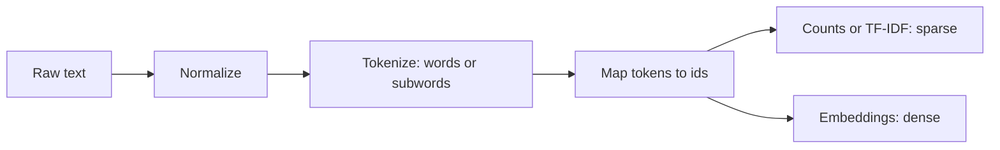

:::objectives
- Use Unicode normalization and case folding to make visually identical strings compare equal, and say what that costs.
- Compare whitespace, regex, and subword tokenization on the same messy sentence.
- Explain how a subword vocabulary can spell words it has never seen.
- Build one-hot, count, and TF-IDF representations with scikit-learn and say what each one can't capture.
- Explain why a word's meaning can come from the words around it, and why one vector per word isn't enough for words like *bank*.
:::

A café's support search has two bugs. Someone searches for `cafe` and gets nothing, because the tickets say "Café", "CAFÉ!", and "café". Someone else searches for `bank` and gets complaints about the riverside terrace mixed in with complaints about bank transfers. The first bug is the computer seeing differences that don't matter. The second is the computer missing a difference that does. Every choice in this lesson moves you between those two failures.

## Normalization decides which strings count as the same

To a computer, text is a sequence of Unicode code points, and the same visible word can be spelled with different code points. The accent in *café* can be one character (é) or two (e followed by a combining accent mark). They look identical and compare unequal.

```python run
import unicodedata

typed = "café"            # é as one character
pasted = "café"     # e, then a combining accent
print(typed == pasted, len(typed), len(pasted))
print(unicodedata.normalize("NFC", typed) == unicodedata.normalize("NFC", pasted))
```

**NFC** normalization rewrites both into the same canonical form, so they compare equal. From there you choose how far to go:

```python run
def strip_accents(text):
    decomposed = unicodedata.normalize("NFKD", text)
    return "".join(ch for ch in decomposed if not unicodedata.combining(ch))

for raw in ["CAFÉ!", "Straße", "ＡＩ file", "naïve résumé"]:
    print(repr(raw), "->", repr(raw.lower()), "->", repr(strip_accents(raw).casefold()))
```

`lower()` handles everyday capitals. `casefold()` goes further and turns German *ß* into *ss*. **NFKD** also folds "compatibility" characters, so full-width letters and the *fi* ligature become plain ASCII, and splits accented letters so `strip_accents` can drop the marks.

Each step merges strings that used to be different, and some of those differences carried meaning. Lowercasing makes "US" and "us" the same token, and "Apple" the company the same as the fruit. The rule this course follows: normalize aggressively for counting and search, but keep the original text for anything where case and accents are evidence, like entity recognition in Module 4.

## Tokenization: deciding where one token ends

Splitting on spaces is the obvious first try, and punctuation stays glued to words:

```python run
import re

text = "Charged twice?! I don't get it. C++ costs $4.50 at U.S. prices."
print(text.split())
print(re.findall(r"\w+|[^\w\s]", text))
```

The whitespace split makes `twice?!` and `it.` into tokens that will never match `twice` or `it`. The regex `\w+|[^\w\s]` means "a run of word characters, or a single character that's neither a word character nor a space". It separates punctuation, and it also breaks `don't` into `don`, `'`, `t`, `C++` into three tokens, and `$4.50` into four. No regex handles every case; you choose rules that suit your text. Code snippets, prices, and emails each need their own.

## Subwords: a fixed vocabulary that can spell anything

Whatever your rules, a word-level vocabulary has a hard problem. New words keep arriving: names, typos, slang, product codes. A word the vocabulary has never seen has to become a single `[UNK]` (unknown) token, and everything about it is lost. Characters fix that (any word can be spelled) but make sequences several times longer, and single letters carry little meaning.

**Subword tokenizers** sit in between. Common words get a single token; rare words are spelled from a few reusable pieces. Two families dominate:

- **Byte-pair encoding (BPE)**, used by GPT models, starts with single characters (or bytes) and repeatedly merges the most frequent adjacent pair into a new token, until the vocabulary reaches its target size. You'll build one in the next lesson.
- **WordPiece**, used by BERT, learns its vocabulary in a similar way. When it tokenizes, it splits each word greedily: take the longest piece from the start of the word that's in the vocabulary, then repeat on what's left. Pieces that continue a word are written with `##`.

Step through WordPiece's greedy loop on a tiny vocabulary:

:::trace Watch WordPiece take the longest piece it knows
```python
vocab = {"un", "happy", "##happ", "##ily", "##ly", "##i"}
word = "unhappily"
pieces = []
start = 0
while start < len(word):
    end = len(word)
    piece = None
    while end > start:
        candidate = word[start:end]
        if start > 0:
            candidate = "##" + candidate
        if candidate in vocab:
            piece = candidate
            break
        end -= 1
    if piece is None:
        pieces = ["[UNK]"]
        break
    pieces.append(piece)
    start = end
print(pieces)
```
:::

The inner loop shrinks `end` until `word[start:end]` is in the vocabulary, so `un` wins only after the seven longer candidates fail. Notice that `happy` is in the vocabulary but never used: in the middle of a word, only `##` pieces are allowed.

Here are two real tokenizers on the same sentence. Run this in Colab:

```python
from transformers import AutoTokenizer

wordpiece = AutoTokenizer.from_pretrained("dslim/distilbert-NER")
bpe = AutoTokenizer.from_pretrained("openai-community/gpt2")

sentence = "Tokenization is unbelievably useful."
print("WordPiece:", wordpiece.tokenize(sentence))
print("BPE:      ", bpe.tokenize(sentence))
print("Vocabulary sizes:", wordpiece.vocab_size, bpe.vocab_size)
```

```text
WordPiece: ['To', '##ken', '##ization', 'is', 'un', '##bel', '##ie', '##va', '##bly', 'useful', '.']
BPE:       ['Token', 'ization', 'Ġis', 'Ġunbelievably', 'Ġuseful', '.']
Vocabulary sizes: 28996 50257
```

GPT-2's BPE marks a leading space with `Ġ` instead of marking continuations with `##`, and its larger vocabulary keeps *unbelievably* whole. Both can encode any string you give them, without an `[UNK]`. Different models split differently, which is why you always use the tokenizer that was trained with the model.

## Four ways to turn tokens into numbers

A model needs numbers. These are the classic choices, from simplest to richest:

1.  **One-hot:** each vocabulary word gets its own position, and a word is a vector of zeros with a single 1 at that position. Every pair of different words is equally different, so *cat* is as far from *kitten* as from *invoice*.
2.  **Counts (bag of words):** add up the one-hot vectors of a document's words. Simple and often surprisingly good, but word order is gone.
3.  **TF-IDF:** counts reweighted so that words appearing in many documents count less.
4.  **Embeddings:** short, dense vectors (hundreds of numbers instead of tens of thousands) learned from data, where words used in similar ways end up close together.

Here's what counts and TF-IDF give for four support messages:

```python run
from sklearn.feature_extraction.text import CountVectorizer, TfidfVectorizer

docs = [
    "the card was charged twice",
    "the app crashed on the card screen",
    "the parcel arrived late",
    "refund the double charge",
]
counts = CountVectorizer().fit(docs)
tfidf = TfidfVectorizer().fit(docs)
words = tfidf.get_feature_names_out()
c = counts.transform(docs[1:2]).toarray()[0]
t = tfidf.transform(docs[1:2]).toarray()[0]

print(f"{'word':8} {'count':>5} {'idf':>5} {'tf-idf':>7}   (second message)")
for i in t.argsort()[::-1]:
    if c[i]:
        print(f"{words[i]:8} {c[i]:5} {tfidf.idf_[i]:5.2f} {t[i]:7.3f}")

a, b = CountVectorizer().fit_transform(["dog bites man", "man bites dog"]).toarray()
print("Same bag of words:", (a == b).all())
```

Read the `idf` column. scikit-learn computes idf as ln((1 + n) / (1 + df)) + 1, where n is the number of documents and df is how many contain the word. *the* is in all four messages, so its idf is the minimum, 1.0. *card* is in two, so 1.51. Words found in only one message get 1.92. Each count is multiplied by its idf and then the whole row is scaled to length 1, which is why the last column is smaller.

Even so, *the* still has the biggest weight here, because it appears twice. IDF reduces common words; it doesn't remove them. Passing `stop_words="english"` or `sublinear_tf=True` (which uses 1 + log(count)) are the usual fixes. The last line shows the limit every bag of words shares: *dog bites man* and *man bites dog* get identical vectors.

## Meaning from the company a word keeps

None of the first three representations knows that *refund* and *money back* mean nearly the same thing. Embeddings get there through an old idea, the *distributional hypothesis*: words that appear in similar contexts have similar meanings. If *latte* and *espresso* both keep showing up next to *ordered*, *cup*, and *hot*, a method that turns each word's neighbours into a vector will put them close together. In the next lesson you'll build exactly that from a co-occurrence table.

That approach gives each word **one** vector, and that's the second bug from the start of the lesson. *bank* gets one vector that's a blend of its river and money senses. Transformers fix this with **contextual embeddings**: the vector for *bank* is computed from the whole sentence, so it comes out different in "the bank of the river" and "the bank approved my loan". Module 4 shows those vectors pulling apart.



:::video wjZofJX0v4M start=12:27
3Blue1Brown's chapter on word embeddings, inside his transformers video. Watch how directions in the embedding space carry meaning (the famous *king − man + woman* example), and how the dot product measures how well two vectors line up. Stop at "Embeddings beyond words" around 18:25.
:::

:::video HEikzVL-lZU
Hugging Face's five-minute walk-through of BPE training on a tiny corpus. Watch the merge counts: each merge picks the most frequent adjacent pair, and that one rule is all the next lesson's tokenizer needs.
:::

## Common mistakes

:::warning
**Fitting a vectorizer on the query.** `fit_transform` learns a new vocabulary from whatever you give it. Call it on a search query and you get a vector in a different space from your documents:

```python run raises
from sklearn.metrics.pairwise import cosine_similarity

vectorizer = TfidfVectorizer()
doc_vectors = vectorizer.fit_transform(docs)
query_vector = vectorizer.fit_transform(["card charged"])
cosine_similarity(query_vector, doc_vectors)
```

The query was given a two-word vocabulary of its own, so its vectors have 2 columns instead of 15. Fit once on the documents, then call `vectorizer.transform([query])`. (Worse, that second `fit_transform` also replaced the vectorizer's vocabulary, so `doc_vectors` no longer matches it either.)
:::

:::warning
**Lowercasing text before a cased model.** The entity model in this course is cased: *Apple* and *apple*, *Jordan* and *jordan* look different to it, and that difference is evidence. Lowercasing for search is fine; lowercasing before running the model throws that evidence away.
:::

:::quiz
Q: Two tickets say "CAFÉ" and "cafe". Which steps make them the same token?
- [ ] `lower()` alone
  That gives "café" and "cafe", which still differ by the accent.
- [x] NFKD normalization, dropping combining marks, then `casefold()`
  NFKD separates the accent from the letter, the filter drops it, and case folding handles the capitals.
- [ ] Splitting on whitespace
  Splitting decides where tokens end; it doesn't change the characters.

Q: In the TF-IDF table, *the* has the lowest idf yet the highest tf-idf in the second message. Why?
- [ ] scikit-learn ranks common words first
  Ranking isn't involved; the weights come from counts and idf.
- [x] It appears twice in that message, and count × idf (2 × 1.0) beats 1 × 1.92 before normalization
  IDF shrinks common words but doesn't cancel a higher count. Stop words or sublinear tf deal with this.
- [ ] The idf formula has a bug for words in every document
  The +1 terms are deliberate, so a word found in every document still gets idf 1, not 0.

Q: A WordPiece vocabulary contains `un`, `##do`, and `##able` but not `undoable`. What does greedy longest-match produce for *undoable*?
- [x] `['un', '##do', '##able']`
  The longest known piece at the start is `un`, then `##do`, then `##able`.
- [ ] `['[UNK]']`
  WordPiece gives up only when some part of the word can't be matched at all.
- [ ] `['undoable']`
  That piece isn't in the vocabulary, so it can't be chosen.

Q: Why does a static word embedding struggle with *bank*?
- [ ] *bank* is too short to embed
  Length doesn't matter; every vocabulary word gets a vector.
- [x] It gets one vector for every use, which blends the river and money meanings
  Static embeddings are a lookup table, so context can't change the vector. Contextual embeddings fix this.
- [ ] TF-IDF gives it a low weight
  TF-IDF and embeddings are separate representations.
:::

:::takeaways
- Normalization (NFC or NFKD, case folding, accent stripping) merges strings that look the same, and every merge can also erase a difference that mattered.
- Tokenization rules are choices. Whitespace keeps punctuation attached; regexes break prices, contractions, and code.
- Subword tokenizers (BPE, WordPiece) keep common words whole and spell rare words from pieces, so they never need `[UNK]` for ordinary text. Always use the tokenizer that came with the model.
- One-hot and counts treat all words as equally different. TF-IDF downweights common words. Embeddings put similar words close together.
- Fit a vectorizer once on your documents, then `transform` new text.
- One vector per word blends a word's meanings; contextual embeddings give one vector per occurrence.
:::

## Further reading

- [scikit-learn: text feature extraction](https://scikit-learn.org/stable/modules/feature_extraction.html#text-feature-extraction): the user guide for `CountVectorizer` and `TfidfVectorizer`, including the exact idf formula and its options.
- [Hugging Face LLM Course, Chapter 6](https://huggingface.co/learn/llm-course/chapter6/1): how BPE, WordPiece, and Unigram tokenizers are trained and used, with code.
- [Speech and Language Processing, Jurafsky and Martin](https://web.stanford.edu/~jurafsky/slp3/): the free textbook draft. Chapter 2, "Words and Tokens", covers normalization and BPE; Chapter 5, "Embeddings", covers TF-IDF and learned word vectors.
