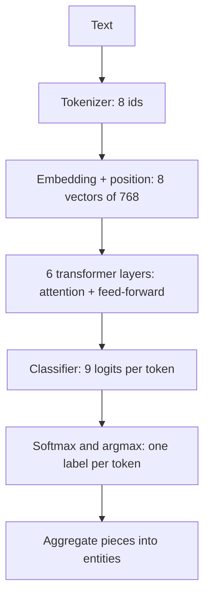

:::objectives
- Describe named-entity recognition as labelling every token, and write BIO tags for a sentence.
- Turn a sequence of BIO tags back into entities, and explain what the B tag is for.
- Extract dates, money, and emails with rules where a pretrained model has no label for them.
- Read the output of a token-classification pipeline, and choose an aggregation strategy that keeps words whole.
- Follow a sentence through a transformer: tokens, ids, contextual vectors, logits, probabilities, labels.
:::

Here's what the entity model from Module 1 does with two sentences:

```text
Jordan Peele grew up far from Jordan.
   PER   0.998  'Jordan Peele'
   LOC   0.999  'Jordan'

Washington signed the treaty in Washington.
   LOC   0.968  'Washington'
   LOC   0.999  'Washington'
```

In the first sentence, the same word gets two different labels, and both are right. The model didn't look *Jordan* up in a list. It read the words around it: *Peele* after it, *from* before it. In the second sentence it gets the first *Washington* wrong (a person signed the treaty), and it's confident about it. This lesson is about both halves of that: how context reaches each word, and how to find out why a model decided what it did.

## Named-entity recognition gives every token a label

**Named-entity recognition (NER)** finds spans of text that name things and says what kind of thing each one is. The model in this course was trained on CoNLL-2003, a collection of news articles labelled with four types: **PER** (people), **ORG** (organizations), **LOC** (locations), and **MISC** (other names, such as events, nationalities, and products).

The trick that makes NER a classification problem is to label every token, not every span. The standard scheme is **BIO**: *B-* marks the first token of an entity, *I-* marks a token inside one, and *O* marks a token outside any entity.

| Token | Maya | Patel | flew | to | New | York | . |
| --- | --- | --- | --- | --- | --- | --- | --- |
| Tag | B-PER | I-PER | O | O | B-LOC | I-LOC | O |

Why not just *PER* and *LOC*? Because two entities of the same type can sit side by side. In "gave Maria Lopez Garcia's notes", B tags are the only way to say whether that's one person or two. The model trained on these tags predicts one of 9 labels for each token: O, plus B- and I- for each of the four types.

Turning tags back into entities is a small state machine. Step through it and watch `current` grow and get flushed:

:::trace Decode BIO tags into entities
```python
tokens = ["Maya", "Patel", "flew", "to", "New", "York", "."]
tags = ["B-PER", "I-PER", "O", "O", "B-LOC", "I-LOC", "O"]
entities = []
current = None
for token, tag in zip(tokens, tags):
    if tag.startswith("B-"):
        if current:
            entities.append(current)
        current = [tag[2:], token]
    elif tag.startswith("I-") and current:
        current[1] = current[1] + " " + token
    else:
        if current:
            entities.append(current)
        current = None
if current:
    entities.append(current)
print(entities)
```
:::

A *B* tag always starts a new entity, even right after another one. An *O* closes whatever was open. The final `if current` after the loop catches an entity that runs to the last token; forgetting it is the classic bug in this code, and it silently drops entities at the end of a sentence.

## Rules still win for some entities

The model knows four labels, so it has nothing to say about dates, prices, or email addresses. Run it on "Contact priya.shah@example.org about the Nov 3 invoice for $1,250 before 15 December 2026." and it returns an empty list. For entities with a regular shape, a few regular expressions do the job reliably:

```python run
import re

text = "Contact priya.shah@example.org about the Nov 3 invoice for $1,250 before 15 December 2026."

MONTH = r"(?:Jan|Feb|Mar|Apr|May|Jun|Jul|Aug|Sep|Oct|Nov|Dec)[a-z]*\.?"
RULES = {
    "EMAIL": r"[\w.+-]+@[\w-]+(?:\.[\w-]+)+",
    "MONEY": r"[$€£]\d+(?:[.,]\d+)*",
    "DATE": rf"\b\d{{1,2}} {MONTH}(?: \d{{4}})?|\b{MONTH} \d{{1,2}}(?:, \d{{4}})?",
}
for label, pattern in RULES.items():
    for match in re.finditer(pattern, text):
        print(f"{label:6} {match.group()!r:28} {match.start()}-{match.end()}")
```

`re.finditer` gives each match's start and end positions, the same character offsets the model reports, so rule and model results can be merged later. Rules are precise and explainable, but brittle: this month pattern also matches the start of *Mayor* or *Marching* when a number follows, and it knows nothing about *next Tuesday*. Real systems combine both, which is the next lesson's build.

## What the pipeline gives back

The pipeline's raw output is one dict per **subword token**, with its BIO label. The `aggregation_strategy` setting decides how those are grouped into entities. Run this in Colab:

```python
from transformers import pipeline

text = "Maya Patel flew from Toronto to Nairobi to meet engineers at Safaricom on 5 March."
for strategy in ["none", "simple", "first"]:
    ner = pipeline("token-classification", model="dslim/distilbert-NER", aggregation_strategy=strategy)
    print(strategy)
    for entity in ner(text):
        label = entity.get("entity_group", entity.get("entity"))
        print(f"   {label:6} {entity['score']:.3f}  {entity['word']!r:12} {entity['start']}-{entity['end']}")
```

```text
none
   B-PER  0.999  'Maya'       0-4
   I-PER  0.999  'Patel'      5-10
   B-LOC  0.998  'Toronto'    21-28
   B-LOC  0.998  'Nairobi'    32-39
   B-ORG  0.984  'Sa'         61-63
   B-ORG  0.975  '##fari'     63-67
   B-ORG  0.986  '##com'      67-70
simple
   PER    0.999  'Maya Patel' 0-10
   LOC    0.998  'Toronto'    21-28
   LOC    0.998  'Nairobi'    32-39
   ORG    0.984  'Sa'         61-63
   ORG    0.975  '##fari'     63-67
   ORG    0.986  '##com'      67-70
first
   PER    0.999  'Maya Patel' 0-10
   LOC    0.998  'Toronto'    21-28
   LOC    0.998  'Nairobi'    32-39
   ORG    0.984  'Safaricom'  61-70
```

*Safaricom* is split into three WordPiece tokens, and the model tagged each piece *B-ORG* instead of *B-ORG, I-ORG, I-ORG*. The `simple` strategy follows the BIO rules literally, so every *B* starts a new entity, and one company becomes three. The `first` strategy works at the word level: it gives the whole word the label of its first piece. That's why this course uses `first` (`max` and `average` are also word-level). *O* tokens are filtered out, and *5 March* is missing because DATE isn't one of the model's labels.

## Inside the pipeline: from tokens to labels

The pipeline is three steps you can run yourself. The tokenizer makes ids, the model turns them into **logits** (one raw score per label per token), and a softmax turns each token's scores into probabilities:

```python
import torch
from transformers import AutoTokenizer, AutoModelForTokenClassification

name = "dslim/distilbert-NER"
tokenizer = AutoTokenizer.from_pretrained(name)
model = AutoModelForTokenClassification.from_pretrained(name)

inputs = tokenizer("Maya Patel flew to Nairobi.", return_tensors="pt")
tokens = tokenizer.convert_ids_to_tokens(inputs["input_ids"][0])
print(inputs["input_ids"])

with torch.no_grad():
    logits = model(**inputs).logits
print(logits.shape)

probs = logits.softmax(dim=-1)[0]
for token, p in zip(tokens, probs):
    best = p.argmax().item()
    print(f"{token:9} {model.config.id2label[best]:6} {p[best]:.3f}")
```

```text
tensor([[  101,  9738, 22545,  4843,  1106, 23248,   119,   102]])
torch.Size([1, 8, 9])
[CLS]     O      0.874
Maya      B-PER  0.999
Patel     I-PER  0.998
flew      O      1.000
to        O      1.000
Nairobi   B-LOC  0.998
.         O      1.000
[SEP]     O      0.963
```

The logits have shape `[1, 8, 9]`: one sentence, 8 tokens, 9 labels. `model.config.id2label` maps each label position to its name. `torch.no_grad()` tells PyTorch not to record the calculation for training, which saves memory when you only want predictions.



## What the transformer layers add: context

The box in the middle of that diagram is where context happens. Each token starts as a vector looked up from a table (plus a vector for its position), so *Washington* starts the same in every sentence. Each of the 6 layers then does two things:

- **Attention.** Every token computes a weight for every token in the sentence, weights that are positive and add up to 1, and takes that weighted average of their vectors. Each layer has 12 *heads* that compute separate sets of weights, so one head can track the previous word while another tracks something else.
- **Feed-forward.** Each token's vector goes through a small neural network on its own.

After 6 rounds, each token's vector depends on the whole sentence. You can measure it. Here's *bank* in three sentences, compared before the first layer and after the last:

```python
def bank_vectors(sentence):
    inputs = tokenizer(sentence, return_tensors="pt")
    tokens = tokenizer.convert_ids_to_tokens(inputs["input_ids"][0])
    with torch.no_grad():
        layers = model(**inputs, output_hidden_states=True).hidden_states
    i = tokens.index("bank")
    return layers[0][0, i], layers[-1][0, i]   # before layer 1, after layer 6

river1 = bank_vectors("She sat on the bank of the river and watched the water.")
money = bank_vectors("He opened a savings account at the bank downtown.")
river2 = bank_vectors("The fishermen pulled their boat onto the muddy bank.")

cos = torch.nn.functional.cosine_similarity
for name, layer in [("input", 0), ("layer 6", 1)]:
    print(f"{name:8} river vs money {cos(river1[layer], money[layer], dim=0):.2f}   river vs river {cos(river1[layer], river2[layer], dim=0):.2f}")
```

```text
input    river vs money 0.97   river vs river 0.97
layer 6  river vs money 0.85   river vs river 0.95
```

Before any layer runs, the three *bank* vectors are nearly identical (they differ only by position). After six layers, the two river banks are still close and the money bank has moved away. That's the fix for the static-embedding problem from Module 2, and it's also how *Jordan* the person and *Jordan* the country end up with different labels. Module 5 looks at attention itself in detail.

:::video wjZofJX0v4M start=3:03
3Blue1Brown's tour of a transformer. From 3:03 to about 6:30 he shows the overall flow: tokens become vectors, attention blocks let vectors pass information to each other, and feed-forward blocks update each one. Keep that picture in mind; it's the same flow inside the NER model, which classifies every token instead of predicting the next one.
:::

:::video 0E7ltQB7fM8
Hugging Face's three-minute look inside the token-classification pipeline: tokenizer, model, logits, softmax, then grouping. It's the code above, narrated, including how the start and end offsets are recovered.
:::

## Common mistakes

:::warning
**Lowercasing before a cased model.** The model reads capital letters as strong evidence. Lowercase the Module 1 sentence and run it again:

```text
maya patel flew from toronto to nairobi to meet engineers at safaricom.
   LOC   0.991  'toronto'
   LOC   0.910  'nairobi'
```

The person and the company vanish. Keep the original text for NER, even if you normalize a copy for search.
:::

:::warning
**Reading the score as a guarantee.** A score of 0.968 for the wrong label on *Washington* shows the score is the model's confidence, not a probability that it's right. Measure accuracy on labelled examples like your real text (the next two lessons do) before trusting any threshold.
:::

:::quiz
Q: What are the correct BIO tags for "Ana met Tom Lee in Rome"?
- [x] B-PER O B-PER I-PER O B-LOC
  *Ana* is a one-token person, *Tom Lee* is a two-token person, and *Rome* is a location.
- [ ] B-PER O B-PER B-PER O B-LOC
  Two B tags in a row would make *Tom* and *Lee* two separate people.
- [ ] PER O PER PER O LOC
  Without B and I, adjacent entities of the same type can't be separated.

Q: The BIO decoder in the trace forgets the final `if current: entities.append(current)`. What breaks?
- [ ] Nothing; the loop already appends every entity
  The loop only appends when the next B or O arrives.
- [x] An entity on the last token of the sentence is lost
  With nothing after it to trigger the append, `current` is never saved.
- [ ] The first entity is lost
  The first entity is appended when the next B or O arrives.

Q: The model tags *Sa*, *##fari*, *##com* as B-ORG, B-ORG, B-ORG. Which aggregation strategy returns one ORG entity, *Safaricom*?
- [ ] `none`
  That returns the three pieces separately, with their BIO tags.
- [ ] `simple`
  It starts a new entity at every B tag, so it returns three.
- [x] `first`
  Word-level strategies label each whole word, here using its first piece's label.

Q: The logits for a sentence have shape `[1, 12, 9]`. What does the 12 count?
- [ ] Words in the sentence
  It counts tokens, which can be more than words because of subword pieces and the special tokens.
- [x] Tokens, including `[CLS]` and `[SEP]`
  One row of 9 label scores per token the model saw.
- [ ] Attention heads
  The heads live inside the layers; the classifier outputs one score per label per token.
:::

:::takeaways
- NER labels every token. BIO tags (B-, I-, O) let you recover spans and keep neighbouring entities apart.
- Decoding BIO is a small state machine; don't forget the entity still open at the end.
- A model only knows its training labels. Rules handle regular shapes like dates, money, and emails, and report the same character offsets.
- Subword tokens can carry inconsistent tags. Word-level aggregation (`first`, `max`, `average`) keeps words whole.
- Inside the pipeline: ids → embeddings → 6 layers of attention and feed-forward → logits of shape tokens × labels → softmax → labels.
- Attention mixes context into every vector, so the same word gets different vectors (and labels) in different sentences.
:::

## Further reading

- [Hugging Face LLM Course: Token classification](https://huggingface.co/learn/llm-course/chapter7/2): fine-tuning a model for NER, including how labels are aligned with subword tokens.
- [Hugging Face docs: Pipelines](https://huggingface.co/docs/transformers/main_classes/pipelines): every option of `TokenClassificationPipeline`, including the aggregation strategies.
- [The Illustrated Transformer, by Jay Alammar](https://jalammar.github.io/illustrated-transformer/): the classic visual walk-through of attention and transformer layers.
