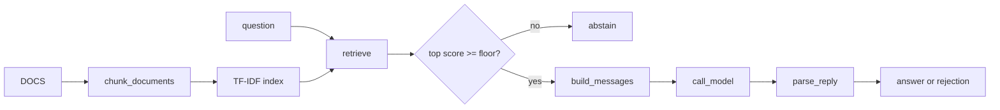

:::objectives
- Chunk documents along their structure, with a one-sentence overlap for long paragraphs.
- Index the chunks with TF-IDF and retrieve the top matches for a question.
- See what a similarity threshold can and can't catch.
- Build a prompt with numbered sources, then validate replies with a strict Pydantic model and a citation check.
:::

Here's the finished pipeline answering a question about a public library's rules. The "model" in this run is a stand-in that copies the source sentence that best matches the question, so everything works on this page with no API key. In Colab you swap in a real model with one argument.

```text
Q: How many hours a week can I book a study room?
   status : ok
   answer : Each card can book two hours per day and six hours per week.
   sources: rooms#0
```

Every answer comes back with the chunk ids it relied on, or with a reason it was rejected. Nothing reaches the user without passing the checks.



## Step 1: The documents

Six help pages for a made-up public library, each a title and some paragraphs. Blank lines separate the paragraphs, and we'll use that structure when we chunk.

```python run
import json
import re

import numpy as np

DOCS = {
    "cards": ("Library cards",
        "Anyone who lives, works, or goes to school in Maple Grove can get a free library card. "
        "Bring a photo ID and proof of address to any desk.\n\n"
        "Cards for children under 13 need a parent or guardian's signature. "
        "A lost card can be replaced at the desk for 2 dollars."),
    "borrowing": ("Borrowing and renewals",
        "You can borrow up to 30 items at a time. Books and audiobooks are loaned for 21 days. "
        "DVDs and video games are loaned for 7 days.\n\n"
        "Items can be renewed up to three times online or by phone, unless another patron has placed a hold. "
        "Laptops and hotspots cannot be renewed."),
    "fees": ("Fines and fees",
        "Maple Grove Library does not charge late fines on books, audiobooks, or DVDs. "
        "You get an email reminder three days before each due date. "
        "Items more than 30 days overdue are billed at their replacement cost. "
        "The bill is removed when the item comes back, even months later.\n\n"
        "Laptops and hotspots are charged 5 dollars per day late. "
        "Damaged items are billed at the repair or replacement cost."),
    "rooms": ("Study rooms",
        "Study rooms seat up to six people and can be booked online up to two weeks ahead. "
        "Each card can book two hours per day and six hours per week.\n\n"
        "Rooms are released if no one checks in within 15 minutes of the start time. "
        "Food is not allowed in study rooms; covered drinks are fine."),
    "printing": ("Printing, copying, and Wi-Fi",
        "Black-and-white printing costs 10 cents per page and color printing costs 50 cents per page. "
        "You can print from library computers or send files from your own device to the print queue.\n\n"
        "Free Wi-Fi is available in all branches without a password. "
        "Sessions on library computers last 90 minutes and can be extended if no one is waiting."),
    "access": ("Accessibility services",
        "Large-print books, audiobooks, and magnifiers are available at every branch. "
        "Patrons who cannot visit can request free home delivery of up to 10 items every three weeks.\n\n"
        "Sign language interpreters for library events can be requested at least five days in advance."),
}
print(len(DOCS), "documents,", sum(len(text.split()) for _, text in DOCS.values()), "words")
```

## Step 2: Chunk along paragraphs, with overlap where needed

Each paragraph becomes a chunk. A paragraph longer than `max_words` is split into runs of whole sentences, and each run after the first starts with the last sentence of the one before, so a fact near a boundary appears whole in at least one chunk. Chunk ids like `fees#1` record where every chunk came from.

```python run
def split_sentences(text):
    return re.split(r"(?<=[.!?])\s+", text.strip())

def chunk_documents(docs, max_words=40, overlap=1):
    chunks = {}
    for doc_id, (title, text) in docs.items():
        n = 0
        for paragraph in text.split("\n\n"):
            sents = split_sentences(paragraph)
            start = 0
            while start < len(sents):
                end, words = start, 0
                while end < len(sents) and (end == start or words + len(sents[end].split()) <= max_words):
                    words += len(sents[end].split())
                    end += 1
                chunks[f"{doc_id}#{n}"] = {"title": title, "text": " ".join(sents[start:end])}
                n += 1
                if end == len(sents):
                    break
                start = max(end - overlap, start + 1)
    return chunks

chunks = chunk_documents(DOCS)
print(len(chunks), "chunks")
for chunk_id in ["fees#0", "fees#1"]:
    print(f"\n{chunk_id}: {chunks[chunk_id]['text']}")
```

Only the first fees paragraph was long enough to split. Look at the two chunks: the sentence about items 30 days overdue ends `fees#0` and starts `fees#1`. Without that overlap, `fees#1` would begin with "The bill is removed...", and a reader (or a model) couldn't tell which bill.

## Step 3: Index with TF-IDF and retrieve

TF-IDF from Module 2 scores words that are frequent in a chunk and rare across chunks. One problem shows up fast: "Can I renew a laptop?" shares no exact words with "Laptops and hotspots cannot be renewed." A small analyzer that drops stop words and trims `-s`, `-ed`, and `-ing` fixes most of that.

```python run
from sklearn.feature_extraction.text import ENGLISH_STOP_WORDS, TfidfVectorizer
from sklearn.metrics.pairwise import cosine_similarity

def analyze(text):
    terms = []
    for word in re.findall(r"[a-z0-9]+", text.lower()):
        if word in ENGLISH_STOP_WORDS:
            continue
        for suffix in ("ing", "ed", "s"):
            if word.endswith(suffix) and len(word) - len(suffix) >= 3:
                word = word[: -len(suffix)]
                break
        terms.append(word)
    return terms

print(analyze("Can I renew my laptop?"), analyze("Laptops and hotspots cannot be renewed."))

chunk_ids = list(chunks)
vectorizer = TfidfVectorizer(analyzer=analyze, sublinear_tf=True)
matrix = vectorizer.fit_transform([f"{c['title']}. {c['text']}" for c in chunks.values()])

def retrieve(question, k=3):
    scores = cosine_similarity(vectorizer.transform([question]), matrix)[0]
    best = np.argsort(scores)[::-1][:k]
    return [(chunk_ids[i], float(scores[i])) for i in best]

for chunk_id, score in retrieve("Can I renew a laptop?"):
    print(f"{score:.2f}  {chunk_id}: {chunks[chunk_id]['text'][:60]}...")
```

Two choices in that cell matter. Each chunk is indexed with its **title** in front, so "fees" questions match fee chunks even when the paragraph doesn't repeat the word. And `retrieve` returns scores along with ids, because the next step needs them.

## Step 4: Decide when retrieval found nothing

If the best chunk barely matches, there's no point asking a model; it can only guess. So set a floor on the top score. Before you look at the chart, predict: will the three questions this library can't answer all score below the five it can?

```python run alt="Horizontal bar chart of the top retrieval score for eight questions. Answerable questions score between 0.33 and 0.83. Of the unanswerable ones, 'Who won the 2010 World Cup?' scores 0, but 'Does the library rent bikes?' scores 0.29 and 'What are the opening hours on Sunday?' scores 0.43, above the 0.15 floor." caption="A score floor catches questions that match nothing, not questions that match the wrong thing"
import matplotlib.pyplot as plt

MIN_SCORE = 0.15
questions = {
    "How many hours a week can I book a study room?": True,
    "Is there a late fine for DVDs?": True,
    "How much is color printing?": True,
    "Can I renew a laptop?": True,
    "Can my grandmother get books delivered to her home?": True,
    "Does the library rent bikes?": False,
    "What are the opening hours on Sunday?": False,
    "Who won the 2010 World Cup?": False,
}
top = {q: retrieve(q, k=1)[0] for q in questions}
for q, (chunk_id, score) in top.items():
    print(f"{score:.2f}  {chunk_id:12s} {q}")

fig, ax = plt.subplots(figsize=(8, 3.6))
names = list(questions)
ax.barh(names, [top[q][1] for q in names],
        color=["#4c72b0" if questions[q] else "#dd8452" for q in names])
ax.axvline(MIN_SCORE, color="black", linestyle="--")
ax.invert_yaxis()
ax.set_xlabel("top TF-IDF score (blue: answerable, orange: not in the documents)")
ax.tick_params(axis="y", labelsize=8)
fig.tight_layout()
```

The World Cup question matches nothing and falls below the floor. But "Does the library rent bikes?" scores 0.29 because it shares *library* with the fees page, and the Sunday-hours question scores 0.43 by matching *hours* in the study-room rules, higher than the real grandmother question. Retrieval measures shared words, not whether a chunk answers the question. The floor stays low, and the prompt lets the model say `answerable: false` for the rest.

## Step 5: Build the grounded prompt

Each retrieved chunk is shown to the model as a numbered source: `S1`, `S2`, `S3`. Short ids are easy for a model to copy exactly, and `id_map` translates them back to real chunk ids afterward.

```python run
SYSTEM = (
    "You answer questions about Maple Grove Library using only the sources provided.\n"
    "Cite the id of each source you used. If the sources do not answer the question, "
    "set answerable to false and citations to [].\n"
    'Reply with JSON only: {"answer": string, "citations": [source ids], "answerable": true or false}'
)

def build_messages(question, hits):
    id_map, blocks = {}, []
    for n, (chunk_id, _score) in enumerate(hits, start=1):
        sid = f"S{n}"
        id_map[sid] = chunk_id
        chunk = chunks[chunk_id]
        blocks.append(f'<source id="{sid}" title="{chunk["title"]}">{chunk["text"]}</source>')
    user = "\n".join(blocks) + f"\n\nQuestion: {question}"
    return [{"role": "system", "content": SYSTEM}, {"role": "user", "content": user}], id_map

question = "How many hours a week can I book a study room?"
messages, id_map = build_messages(question, retrieve(question))
print(messages[1]["content"])
print(id_map)
```

Notice S3, the accessibility chunk. It was retrieved because it shares *book* (from *books*), and it has nothing to do with study rooms. Retrieval always returns k chunks, relevant or not, which is one more reason the rules tell the model to use only what answers the question.

## Step 6: Parse and check every reply

The parser accepts a reply only if it contains a JSON object that passes a **strict** Pydantic model and cites only sources it was shown. Strict matters: by default Pydantic quietly converts the string `"yes"` to `True`, which hides a model that isn't following the format.

These four replies are written to match the shapes you'll meet from real models: clean JSON, JSON in a Markdown fence with a made-up source, plain prose, and the wrong types.

```python run
from pydantic import BaseModel, ConfigDict, ValidationError

class GroundedAnswer(BaseModel):
    model_config = ConfigDict(extra="forbid", strict=True)
    answer: str
    citations: list[str]
    answerable: bool

def parse_reply(raw, shown_ids):
    start, end = raw.find("{"), raw.rfind("}")
    if start == -1 or end < start:
        return None, ["reply contains no JSON object"]
    try:
        result = GroundedAnswer.model_validate_json(raw[start:end + 1])
    except ValidationError as err:
        return None, [f"{'.'.join(map(str, e['loc'])) or 'reply'}: {e['msg']}" for e in err.errors()]
    problems = [f"cites {c}, which was never shown" for c in result.citations if c not in shown_ids]
    if result.answerable and not result.citations:
        problems.append("answers without citing a source")
    if not result.answerable and result.citations:
        problems.append("says it can't answer but cites sources anyway")
    return result, problems

replies = {
    "clean": '{"answer": "Six hours per week, at most two per day.", "citations": ["S1"], "answerable": true}',
    "fenced, invented": '```json\n{"answer": "Six hours a week.", "citations": ["S1", "S4"], "answerable": true}\n```',
    "prose only": "Each card can book up to six hours per week.",
    "wrong types": '{"answer": "Six hours.", "citations": "S1", "answerable": "yes"}',
}
for name, raw in replies.items():
    _, problems = parse_reply(raw, set(id_map))
    print(f"{name:17s} -> {problems or 'ok'}")
```

The fenced reply parses fine, since we cut from the first `{` to the last `}`, but it cites S4, and only S1 to S3 were shown. That's the invented-source failure from the start of this module, caught by one list comprehension.

## The finished pipeline

`answer` ties the steps together. The model call is a parameter, so the same function runs offline with a stand-in and in Colab with a real model.

```python run title="rag_pipeline.py"
def stand_in_model(messages):
    """Offline stand-in for an LLM: replies with the shown sentence that best matches the question."""
    user = messages[-1]["content"]
    asked = vectorizer.transform([user.rsplit("Question:", 1)[1]])
    best_score, best_id, best_sentence = 0.0, None, None
    for sid, text in re.findall(r'<source id="(S\d+)"[^>]*>(.*?)</source>', user, re.S):
        for sentence in split_sentences(text):
            score = cosine_similarity(asked, vectorizer.transform([sentence]))[0, 0]
            if score > best_score:
                best_score, best_id, best_sentence = score, sid, sentence
    if best_id is None:
        return '{"answer": "The sources do not say.", "citations": [], "answerable": false}'
    return json.dumps({"answer": best_sentence, "citations": [best_id], "answerable": True})

def answer(question, call_model, k=3):
    hits = retrieve(question, k)
    if hits[0][1] < MIN_SCORE:
        return {"status": "abstained", "reason": f"best match scored {hits[0][1]:.2f}"}
    messages, id_map = build_messages(question, hits)
    result, problems = parse_reply(call_model(messages), set(id_map))
    if problems:
        return {"status": "rejected", "problems": problems}
    if not result.answerable:
        return {"status": "not in documents", "answer": result.answer}
    return {"status": "ok", "answer": result.answer,
            "sources": [id_map[c] for c in result.citations]}

for q in ["How many hours a week can I book a study room?",
          "Can I renew a laptop?",
          "Does the library rent bikes?",
          "Who won the 2010 World Cup?"]:
    print("Q:", q)
    for key, value in answer(q, stand_in_model).items():
        print(f"   {key:7s}: {', '.join(value) if isinstance(value, list) else value}")
```

The first two answers are right, and the World Cup question never reaches the model. Now look at the bikes question. The stand-in returns a sentence about late fines, cites a source it was really shown, and passes every check in `parse_reply`. A well-formed answer with a real citation can still have nothing to do with the question; checking that the cited source *supports* the answer is the job of Module 7. A real model would most likely say `answerable: false` here, which is one reason to plug one in. To use Gemini or Ollama in Colab, define `call_model` with the client from the last lesson:

```python
from google.colab import userdata
from openai import OpenAI

client = OpenAI(api_key=userdata.get("GEMINI_API_KEY"),
                base_url="https://generativelanguage.googleapis.com/v1beta/openai/")

def gemini_model(messages):
    response = client.chat.completions.create(
        model="gemini-3.5-flash-lite", messages=messages, temperature=0)
    return response.choices[0].message.content

print(answer("Can I renew a laptop?", gemini_model))
```

`temperature=0` makes replies as repeatable as the provider allows, which you'll want when you start measuring them in Module 7.

:::video qppV3n3YlF8
What to watch for: how the retrieval side (your documents, embeddings, a vector database) feeds the model, the same split as `retrieve` and `call_model` here. The video uses embeddings and a vector database where this lesson uses TF-IDF.
:::

:::quiz
Q: Why does each chunk get indexed as `title + ". " + text` instead of just the text?
- [ ] Titles make chunks long enough for TF-IDF to work
  TF-IDF works on short text; length isn't the reason.
- [x] The title adds the page's topic words, so a chunk can match even when its paragraph doesn't repeat them
  "Rooms are released if no one checks in..." never says "study", but its title does.
- [ ] The model needs the title to cite the source
  Citations use the S ids; the title helps retrieval, not citation.

Q: "What are the opening hours on Sunday?" retrieves a study-room chunk with a score of 0.43. Which part of the pipeline should handle it?
- [ ] Raise `MIN_SCORE` to 0.5
  That would also reject real questions, like the grandmother one at 0.33.
- [x] The model, by setting `answerable` to false because no source states opening hours
  Retrieval can't tell shared words from an answer; the prompt and schema give the model an honest way out.
- [ ] `parse_reply`, which rejects low-quality answers
  The parser checks format and citations, not whether the answer is right.

Q: Why does `GroundedAnswer` use `strict=True`?
- [x] So a reply with `"answerable": "yes"` fails instead of being silently converted to `True`
  Strict mode rejects type coercion, which exposes a model that isn't following the schema.
- [ ] So the model is forced to produce valid JSON
  Pydantic only checks replies after they arrive; it can't control the model.
- [ ] So extra keys are rejected
  That's `extra="forbid"`, a separate setting.
:::

:::takeaways
- Chunk by structure first, split only long paragraphs, and overlap by a sentence so boundary facts survive.
- Index chunks with their titles, and keep chunk ids so every answer can point back to its source.
- A score floor catches questions that match nothing; it can't catch questions that match the wrong words.
- Show sources with short ids, map them back afterward, and reject any reply that cites an id you didn't show.
- Pass the model call in as a function, so the whole pipeline can run and be tested offline.
:::

## Ideas to extend it

-   Swap TF-IDF for sentence embeddings (the `sentence-transformers` library in Colab) and rerun Step 4's chart. Does the Sunday question still score above the grandmother one?
-   On a rejected reply, retry once with the problems appended to the prompt, then give up.
-   Combine scores from TF-IDF and embeddings (hybrid retrieval) and compare the top chunks.

## Further reading

-   [TfidfVectorizer](https://scikit-learn.org/stable/modules/generated/sklearn.feature_extraction.text.TfidfVectorizer.html) in the scikit-learn docs: every option used here, including a custom `analyzer`.
-   [Strict mode](https://pydantic.dev/docs/validation/latest/concepts/strict_mode/) in the Pydantic docs: exactly which conversions lax mode allows and strict mode refuses.
-   [Advanced RAG on Hugging Face documentation](https://huggingface.co/learn/cookbook/advanced_rag) in the Hugging Face cookbook: the same pipeline with embeddings, a vector index, and a reranker.
