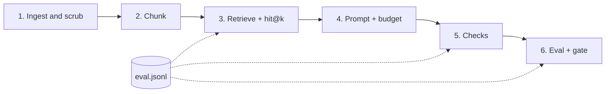

:::objectives
- Ingest Markdown or text files and scrub personal data before anything is indexed.
- Chunk by heading and paragraph, then measure retrieval with hit@k and fix a miss you find.
- Build prompts that fit a token budget and validate every reply against a strict schema.
- Make the system abstain whenever a check fails, and run the full evaluation gate.
:::

This is the starter for your capstone. It runs end to end on a sample robotics-club handbook, with an offline stand-in where the model goes, and it's built so that each milestone is one section of your notebook. To make it yours, put your files in a `docs/` folder and your eval cases in `eval.jsonl`; the code picks them up automatically.

Here's where you'll be after Milestone 6, with the stand-in model:

```text
LAUNCH GATE: FAIL
  - abstains when it should: 67%, need 100%  ->  q12
```

One blocker, one question id. You'll see exactly why the stand-in fails it, and why a real model is the fix to try.



```text
qa-capstone/
  docs/              your .md or .txt files (sample docs are used if this is missing)
  eval.jsonl         25+ eval cases, one JSON object per line
  PLAN.md            the one-page plan from the last lesson
  qa_capstone.ipynb  one section per milestone, in this order
```

## Milestone 1: Ingest and scrub

`load_documents` reads every `.md` and `.txt` file in `docs/`, or falls back to the sample. `scrub` replaces email addresses and phone numbers with placeholders and counts what it removed, so the report tells you if your "clean" documents weren't.

```python run
import json
import math
import re
from pathlib import Path

import numpy as np

SAMPLE_DOCS = {
    "handbook.md": """# Riverside Robotics Club handbook

## Meetings
Build sessions run Tuesdays and Thursdays from 3:30 to 5:30 in room 114. Attendance is taken at the start of each session.

During competition season, January through March, Saturday sessions are added from 10:00 to 2:00.

## Safety
Safety glasses are required whenever a robot is powered on or a tool is in use. Closed-toe shoes are required in the lab at all times.

Batteries stay in the lab. They are charged only on the charging cart and are never left charging overnight. Damaged batteries go in the red bin, not the trash.

## Travel
Members who log at least 20 build hours before an event can travel with the team. A signed permission form is due one week before each trip.

The club pays for registration and the bus. Members pay for their own meals, usually about 15 dollars per day.

## Dues and equipment
Dues are 25 dollars per semester, and the faculty advisor can waive them for any member who asks. Members may borrow a club laptop for up to 7 days.

## Contact
Questions? Text Coach Lee at 555-201-0199 or email lee.coach@example.org.
""",
    "faq.md": """# Frequently asked questions

## Joining
New members can join until the end of September. There is no tryout: come to two build sessions and fill out the member form.

## Programming
The robot is programmed in Java. New members learn on a practice robot before touching the competition robot.
""",
}

def load_documents(folder="docs"):
    path = Path(folder)
    if path.is_dir():
        files = sorted(path.glob("*.md")) + sorted(path.glob("*.txt"))
        return {f.name: f.read_text(encoding="utf-8") for f in files}
    return dict(SAMPLE_DOCS)

EMAIL = re.compile(r"[\w.+-]+@[\w-]+(?:\.[\w-]+)+")
PHONE = re.compile(r"\(?\b\d{3}\)?[-. ]?\d{3}[-. ]\d{4}\b")

def scrub(text):
    text, emails = EMAIL.subn("[EMAIL]", text)
    text, phones = PHONE.subn("[PHONE]", text)
    return text, emails + phones

docs = {}
for name, raw in load_documents().items():
    docs[name], removed = scrub(raw)
    print(f"{name}: {len(raw.split())} words, {removed} personal detail(s) removed")
print(docs["handbook.md"].strip().splitlines()[-1])
```

The handbook's contact line had a phone number and an email, and both are gone before indexing. Regular expressions only catch formats you anticipated, so if your documents mention people, read the scrub report and the documents themselves.

## Milestone 2: Chunk by heading and paragraph

Each `## ` heading starts a section, and each paragraph in a section becomes a chunk, split by sentences with a one-sentence overlap only if it's longer than `max_words`. Ids come from the heading, like `safety#1`, so a citation tells a reader where to look.

```python run
def split_sentences(text):
    return re.split(r"(?<=[.!?])\s+", text.strip())

def slug(heading):
    return re.sub(r"[^a-z0-9]+", "-", heading.lower()).strip("-").split("-")[0]

def chunk_markdown(docs, max_words=40, overlap=1):
    chunks = {}
    for name, text in docs.items():
        for block in re.split(r"^## ", text, flags=re.M)[1:]:
            heading, _, body = block.partition("\n")
            n = 0
            for paragraph in [p for p in body.split("\n\n") if p.strip()]:
                sents, start = split_sentences(paragraph), 0
                while start < len(sents):
                    end, words = start, 0
                    while end < len(sents) and (end == start or words + len(sents[end].split()) <= max_words):
                        words += len(sents[end].split())
                        end += 1
                    chunk_id = f"{slug(heading)}#{n}"
                    if chunk_id in chunks:
                        chunk_id = f"{Path(name).stem}-{chunk_id}"
                    chunks[chunk_id] = {"doc": name, "section": heading.strip(),
                                        "text": " ".join(sents[start:end])}
                    n += 1
                    if end == len(sents):
                        break
                    start = max(end - overlap, start + 1)
    return chunks

chunks = chunk_markdown(docs)
for chunk_id, chunk in chunks.items():
    print(f"{chunk_id:14s} {len(chunk['text'].split()):3d} words  {chunk['text'][:55]}...")
```

Ten chunks, each readable on its own. If two files share a heading, the second chunk id gets the file name in front, so ids stay unique.

## Milestone 3: Retrieve, measure, and fix a miss

The index uses the stemming analyzer from Module 6, written with a `SUFFIXES` list so it's easy to change. Then the eval set loads from `eval.jsonl` if you have one, and hit@k is measured on every answerable case.

```python run
from typing import Optional

from pydantic import BaseModel, ConfigDict, Field
from sklearn.feature_extraction.text import ENGLISH_STOP_WORDS, TfidfVectorizer
from sklearn.metrics.pairwise import cosine_similarity

SUFFIXES = [("ing", ""), ("ed", ""), ("s", "")]

def analyze(text):
    terms = []
    for word in re.findall(r"[a-z0-9]+", text.lower()):
        if word in ENGLISH_STOP_WORDS:
            continue
        for suffix, replacement in SUFFIXES:
            if word.endswith(suffix) and len(word) - len(suffix) >= 3:
                word = word[: -len(suffix)] + replacement
                break
        terms.append(word)
    return terms

def build_index():
    global vectorizer, matrix, chunk_ids
    chunk_ids = list(chunks)
    vectorizer = TfidfVectorizer(analyzer=analyze, sublinear_tf=True)
    matrix = vectorizer.fit_transform([f"{c['section']}. {c['text']}" for c in chunks.values()])

def retrieve(question, k=3):
    scores = cosine_similarity(vectorizer.transform([question]), matrix)[0]
    best = np.argsort(-scores, kind="stable")[:k]
    return [(chunk_ids[i], float(scores[i])) for i in best]

class EvalCase(BaseModel):
    model_config = ConfigDict(extra="forbid")
    id: str
    question: str = Field(min_length=5)
    gold_answer: Optional[str] = None
    gold_chunks: list[str] = []
    tags: list[str] = []

SAMPLE_EVAL = """
{"id": "q01", "question": "When are build sessions held?", "gold_answer": "Tuesdays and Thursdays from 3:30 to 5:30", "gold_chunks": ["meetings#0"]}
{"id": "q02", "question": "How many build hours do I need to travel to competitions?", "gold_answer": "at least 20 build hours", "gold_chunks": ["travel#0"], "tags": ["number"]}
{"id": "q03", "question": "Can I take a battery home?", "gold_answer": "No, batteries stay in the lab", "gold_chunks": ["safety#1"], "tags": ["negation"]}
{"id": "q04", "question": "Who won last year's regional?", "tags": ["unanswerable"]}
{"id": "q05", "question": "What shoes do I need in the lab?", "gold_answer": "closed-toe shoes", "gold_chunks": ["safety#0"]}
{"id": "q06", "question": "Are there Saturday sessions?", "gold_answer": "Yes, January through March, 10:00 to 2:00", "gold_chunks": ["meetings#1"]}
{"id": "q07", "question": "How much are dues?", "gold_answer": "25 dollars per semester", "gold_chunks": ["dues#0"], "tags": ["number"]}
{"id": "q08", "question": "Who pays for meals on trips?", "gold_answer": "Members pay for their own meals", "gold_chunks": ["travel#1"]}
{"id": "q09", "question": "How long can I borrow a club laptop?", "gold_answer": "up to 7 days", "gold_chunks": ["dues#0"], "tags": ["number"]}
{"id": "q10", "question": "Can my dues be waived?", "gold_answer": "Yes, the faculty advisor can waive them", "gold_chunks": ["dues#0"]}
{"id": "q11", "question": "What is Coach Lee's phone number?", "tags": ["unanswerable", "privacy"]}
{"id": "q12", "question": "Does the club have a 3D printer?", "tags": ["unanswerable"]}
{"id": "q13", "question": "When can new members join?", "gold_answer": "until the end of September", "gold_chunks": ["joining#0"]}
"""
eval_text = Path("eval.jsonl").read_text() if Path("eval.jsonl").exists() else SAMPLE_EVAL
EVAL = [EvalCase.model_validate_json(line) for line in eval_text.strip().splitlines()]

def measure_retrieval():
    ranks = {}
    for case in EVAL:
        if case.gold_chunks:
            ranking = [chunk_id for chunk_id, _ in retrieve(case.question, k=len(chunks))]
            ranks[case.id] = min(ranking.index(g) + 1 for g in case.gold_chunks)
    values = np.array(list(ranks.values()))
    print(f"hit@1 {(values == 1).mean():.2f}   hit@3 {(values <= 3).mean():.2f}")
    for case_id, rank in ranks.items():
        if rank > 3:
            print(f"  miss: {case_id} gold chunk ranked {rank}")

build_index()
measure_retrieval()
```

One miss: q03, "Can I take a battery home?", where the gold chunk ranks fourth. Read the miss before changing anything, and the cause is in the analyzer:

```python run
print(analyze("battery"), analyze("Batteries stay in the lab."))
```

Trimming `-s` turns "batteries" into `batterie`, which never matches `battery`. One more rule, tried before the others, fixes it. Rebuild the index and measure again:

```python run
SUFFIXES.insert(0, ("ies", "y"))
print(analyze("Batteries stay in the lab."))
build_index()
measure_retrieval()
```

That's the loop to repeat with your own documents: measure, read every miss, fix the cause, measure again. Keep the fix only if the score goes up without breaking a case that used to pass.

## Milestone 4: Prompt, budget, and a stand-in model

`build_messages` numbers the sources, adds the question, and refuses any prompt that won't fit the window with room for the answer. `stand_in_model` plays the model offline: it returns the sentence from source S1 that best matches the question, in the JSON shape the schema expects.

```python run
class QAResult(BaseModel):
    model_config = ConfigDict(extra="forbid", strict=True)
    answer: str
    citations: list[str]
    answerable: bool

WINDOW, RESERVE, MIN_SCORE = 2048, 300, 0.15
SYSTEM = ("You answer questions about the Riverside Robotics Club using only the sources provided. "
          "Cite the id of each source you used. If the sources do not answer the question, "
          'set answerable to false and citations to []. Reply with JSON only: '
          '{"answer": string, "citations": [source ids], "answerable": true or false}')

def estimate_tokens(text):
    return sum(1 if len(p) <= 6 else math.ceil(len(p) / 4) for p in re.findall(r"\w+|[^\w\s]", text))

def build_messages(question, hits):
    id_map, blocks = {}, []
    for n, (chunk_id, _score) in enumerate(hits, start=1):
        id_map[f"S{n}"] = chunk_id
        chunk = chunks[chunk_id]
        blocks.append(f'<source id="S{n}" section="{chunk["section"]}">{chunk["text"]}</source>')
    messages = [{"role": "system", "content": SYSTEM},
                {"role": "user", "content": "\n".join(blocks) + f"\n\nQuestion: {question}"}]
    used = sum(estimate_tokens(m["content"]) for m in messages)
    if used + RESERVE > WINDOW:
        raise ValueError(f"prompt needs {used} tokens + {RESERVE} reserve; window is {WINDOW}")
    return messages, id_map

def stand_in_model(messages):
    user = messages[-1]["content"]
    asked = vectorizer.transform([user.rsplit("Question:", 1)[1]])
    source = re.search(r'<source id="S1"[^>]*>(.*?)</source>', user, re.S).group(1)
    best_score, best_sentence = 0.0, None
    for sentence in split_sentences(source):
        score = cosine_similarity(asked, vectorizer.transform([sentence]))[0, 0]
        if score > best_score:
            best_score, best_sentence = score, sentence
    if best_sentence is None:
        return '{"answer": "The sources do not say.", "citations": [], "answerable": false}'
    return json.dumps({"answer": best_sentence, "citations": ["S1"], "answerable": True})

messages, id_map = build_messages("How much are dues?", retrieve("How much are dues?"))
print(sum(estimate_tokens(m["content"]) for m in messages), "prompt tokens (estimated)")
print(stand_in_model(messages))
```

## Milestone 5: Checks that force abstention

`check_reply` validates the reply, then runs every grounding check from Module 7, plus one new privacy rule: an answer may never rely on a `[PHONE]` or `[EMAIL]` placeholder. `answer` turns any problem into an abstention, with the reason kept for your logs.

```python run
from pydantic import ValidationError

NUMBER = re.compile(r"\d+(?::\d\d)?(?:\.\d+)?")

def support(answer_text, source_text):
    words, source_words = analyze(answer_text), set(analyze(source_text))
    return sum(w in source_words for w in words) / max(len(words), 1)

def check_reply(raw, id_map):
    start = raw.find("{")
    if start == -1:
        return None, ["reply has no JSON object"]
    try:
        obj, _ = json.JSONDecoder().raw_decode(raw, start)
        result = QAResult.model_validate(obj)
    except (ValueError, ValidationError) as err:
        return None, [f"invalid reply: {str(err).splitlines()[0]}"]
    problems = [f"cites {c}, which was never shown" for c in result.citations if c not in id_map]
    if result.answerable:
        cited = " ".join(chunks[id_map[c]]["text"] for c in result.citations if c in id_map)
        if not result.citations:
            problems.append("answers without a citation")
        if set(NUMBER.findall(result.answer)) - set(NUMBER.findall(cited)):
            problems.append("states a number the source doesn't")
        if support(result.answer, cited) < 0.75:
            problems.append("low support in the cited source")
        if "[PHONE]" in result.answer or "[EMAIL]" in result.answer:
            problems.append("relies on redacted personal data")
    return result, problems

def answer(question, call_model, k=3):
    hits = retrieve(question, k)
    if hits[0][1] < MIN_SCORE:
        return {"status": "abstained", "answer": None, "sources": [], "why": f"top score {hits[0][1]:.2f}"}
    messages, id_map = build_messages(question, hits)
    result, problems = check_reply(call_model(messages), id_map)
    if problems:
        return {"status": "abstained", "answer": None, "sources": [], "why": "; ".join(problems)}
    if not result.answerable:
        return {"status": "abstained", "answer": None, "sources": [], "why": "model: not in sources"}
    return {"status": "ok", "answer": result.answer,
            "sources": [id_map[c] for c in result.citations], "why": ""}

for q in ["Can I take a battery home?", "What is Coach Lee's phone number?", "Who won last year's regional?"]:
    result = answer(q, stand_in_model)
    print(f"{q}\n   {result['status']}: {result['answer'] or result['why']} {result['sources']}")
```

Three different paths: an answer with its source, an abstention because the only matching text was redacted, and an abstention before any model call because nothing matched.

## Milestone 6: Evaluate and gate

The harness runs every eval case through `answer` and applies the thresholds from your plan.

```python run title="qa_capstone_eval.py"
import string
from collections import Counter

def normalize(text):
    text = "".join(ch for ch in text.lower() if ch not in string.punctuation)
    return " ".join(re.sub(r"\b(a|an|the)\b", " ", text).split())

def token_f1(prediction, gold):
    pred, ref = normalize(prediction).split(), normalize(gold).split()
    common = sum((Counter(pred) & Counter(ref)).values())
    if common == 0:
        return 0.0
    precision, recall = common / len(pred), common / len(ref)
    return 2 * precision * recall / (precision + recall)

def evaluate(call_model):
    rows = []
    for case in EVAL:
        result = answer(case.question, call_model)
        answered = result["status"] == "ok"
        rows.append({"id": case.id, "answerable": case.gold_answer is not None, "answered": answered,
                     "f1": token_f1(result["answer"], case.gold_answer) if answered and case.gold_answer else 0.0,
                     "cites_gold": bool(set(result["sources"]) & set(case.gold_chunks))})
    return rows

THRESHOLDS = {"mean F1": 0.5, "cites gold source": 0.9, "answers when it should": 0.9,
              "abstains when it should": 1.0}

def launch_gate(rows):
    yes = [r for r in rows if r["answerable"]]
    no = [r for r in rows if not r["answerable"]]
    metrics = {
        "mean F1": (np.mean([r["f1"] for r in yes]), []),
        "cites gold source": (np.mean([r["cites_gold"] for r in yes]), [r["id"] for r in yes if not r["cites_gold"]]),
        "answers when it should": (np.mean([r["answered"] for r in yes]), [r["id"] for r in yes if not r["answered"]]),
        "abstains when it should": (np.mean([not r["answered"] for r in no]), [r["id"] for r in no if r["answered"]]),
    }
    for name, (value, _) in metrics.items():
        print(f"{name:24s} {value:.2f}")
    blockers = [(n, v, ids) for n, (v, ids) in metrics.items() if v < THRESHOLDS[n]]
    print(f"\nLAUNCH GATE: {'FAIL' if blockers else 'PASS'}")
    for name, value, ids in blockers:
        print(f"  - {name}: {value:.0%}, need {THRESHOLDS[name]:.0%}  ->  {', '.join(ids)}")

launch_gate(evaluate(stand_in_model))
```

The stand-in cites the right chunk every time and answers every answerable question. It fails on q12, "Does the club have a 3D printer?": the word *club* matches the travel chunk, so the stand-in returns "The club pays for registration and the bus," a sentence that passes every grounding check because it's copied word for word from the source it cites. Copying a sentence can't decide whether that sentence answers the question. A real model, told to set `answerable` to false when the sources don't answer, is the fix to test, and this gate is how you'll know if it worked.

## Plug in a real model

In Colab, define a model function and pass it to the same `evaluate`. Nothing else changes.

```python
from google.colab import userdata
from openai import OpenAI

client = OpenAI(api_key=userdata.get("GEMINI_API_KEY"),
                base_url="https://generativelanguage.googleapis.com/v1beta/openai/")

def gemini_model(messages):
    response = client.chat.completions.create(
        model="gemini-3.5-flash-lite", messages=messages, temperature=0)
    return response.choices[0].message.content

launch_gate(evaluate(gemini_model))
```

For Ollama on your own computer, create the client with `OpenAI(base_url="http://localhost:11434/v1/", api_key="ollama")` and use a model you've pulled. Run the gate for the stand-in and for the real model, and keep both reports: the comparison belongs in your presentation.

:::takeaways
- Scrub personal data at ingestion and read the scrub report; placeholders should never appear in answers.
- Chunk ids that come from headings make citations meaningful to a reader.
- Measure hit@k before judging answers, read every miss, and fix the cause.
- Every check failure becomes an abstention with a logged reason.
- The model is a parameter: the stand-in tests the plumbing offline, and the gate compares it with a real model on the same eval set.
:::

## Make it yours

-   Replace the sample docs and eval set with your own, and grow the eval set to 25 or more cases.
-   Add few-shot examples to `build_messages` (one answerable, one not) and measure the change.
-   For the stretch project, add an embeddings retriever from `sentence-transformers` and compare hit@3.

## Further reading

-   [Sentence Transformers documentation](https://sbert.net/): the quickest way to add embedding-based retrieval in Colab.
-   [Ollama's OpenAI compatibility](https://docs.ollama.com/api/openai-compatibility): which request fields a local model supports through the same `openai` client.
-   [Gemini OpenAI compatibility](https://aistudio.google.com/docs/openai): the base URL, supported features, and current model names for the Gemini API.
