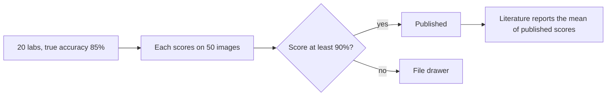

:::objectives
- Rewrite vague research ideas into questions with all five parts and a threshold.
- Classify research goals as prediction or explanation.
- Expose an accuracy claim that's no better than the base rate.
- Compare results from test sets of different sizes with confidence intervals.
- Turn reported means into an effect size and a sentence fit for a report.
- Write precise searches for Google Scholar, PubMed, and arXiv.
:::

## Warm-up

Run this cell; you'll use `missing_parts` in Exercise 1. Then, without running anything, say which parts this question is missing: *"Does our CNN classify bird calls better?"*

```python run title="checker.py"
import numpy as np
import pandas as pd
from scipy import stats
from statsmodels.stats.proportion import proportion_confint

REQUIRED = ["population", "inputs", "comparison", "outcome", "test_set", "threshold"]

def missing_parts(plan):
    return [part for part in REQUIRED if not str(plan.get(part, "")).strip()]

print(missing_parts({"inputs": "audio clips", "outcome": "accuracy"}))
```

(It has the inputs, sort of. "Better" than what, for which birds and recordings, on which test set, and by how much are all missing.)

### Exercise 1: Make three questions testable

Rewrite each idea as a plan dictionary with all six keys filled, so `missing_parts` returns an empty list.

1. "Can ML find exoplanets in telescope data?"
2. "Does machine learning predict air quality?"
3. "Can AI help diagnose skin cancer?"

:::hint
For the comparison, ask what a scientist in that field uses today: a standard pipeline, a simple physical model, or a specialist's judgment. For the test set, name what must be *new* to the model: new stars, new cities, new clinics.
:::

:::solution
One good answer for the first idea; the other two follow the same pattern.

```python run
exoplanets = {
    "population": "Kepler light curves of stars with confirmed planets or confirmed non-detections",
    "inputs": "Phase-folded light curves from the standard Kepler pipeline",
    "comparison": "The pipeline's existing threshold test for transit signals",
    "outcome": "Recall of confirmed planets at a fixed 1% false-positive rate",
    "test_set": "Stars from sky regions excluded from training",
    "threshold": "Recall at least 10 points above the threshold test, CI excluding it",
}
print(missing_parts(exoplanets))
```

Air quality: "For PM2.5 monitors in three cities, does a gradient-boosted model predict next-day PM2.5 with lower mean absolute error than persistence (tomorrow equals today), on a later year than training?" Skin cancer: "For dermoscopic images from clinics not used in training, does the model's sensitivity for melanoma at 80% specificity exceed that of general practitioners in a reader study?" Each has a population, inputs, a comparison someone actually uses, a metric, a test set that is genuinely new, and a bar to clear.
:::

### Exercise 2: Prediction or explanation?

Label each goal P (prediction) or E (explanation), and name one variable that could confound the E goals.

1. Flag which incoming patients are likely to need intensive care in the next 48 hours.
2. Find out whether a new tutoring program raises exam scores.
3. Forecast tomorrow's river level from upstream gauges.
4. Decide whether planting cover crops increases soil carbon.
5. Sort galaxy images into spiral and elliptical.

:::hint
Ask whether the goal involves *changing* something (a program, a farming practice) and wanting to know the consequence. If it does, it's explanation, and a model with high accuracy doesn't settle it.
:::

:::solution
1 P, 2 E, 3 P, 4 E, 5 P. For goal 2, motivation is a confounder: motivated students are more likely to join the program and to score well anyway. For goal 4, farm management style is one: farmers who plant cover crops often also reduce tillage, which affects soil carbon too. Both are reasons to randomize, or at least measure and adjust for those variables.
:::

### Exercise 3: The 97% that isn't

A paper reports that its model detects a rare heart rhythm in ECGs with 97% accuracy, tested on 1,000 recordings. Its supplementary table gives the confusion matrix: 12 true positives, 18 false negatives, 12 false positives, 958 true negatives. Compute the accuracy, the prevalence, the majority-class accuracy, sensitivity (recall for the rare rhythm), and balanced accuracy.

```text
accuracy           0.970
prevalence         0.030
majority-class     0.970
sensitivity        0.400
balanced accuracy  0.694
```

:::hint
Balanced accuracy is the average of sensitivity and specificity, where specificity is TN / (TN + FP). It scores 0.5 for any model that always predicts one class.
:::

:::solution
```python run
tp, fn, fp, tn = 12, 18, 12, 958
total = tp + fn + fp + tn
prevalence = (tp + fn) / total
sensitivity = tp / (tp + fn)
specificity = tn / (tn + fp)
for name, value in [("accuracy", (tp + tn) / total), ("prevalence", prevalence),
                    ("majority-class", max(prevalence, 1 - prevalence)),
                    ("sensitivity", sensitivity),
                    ("balanced accuracy", (sensitivity + specificity) / 2)]:
    print(f"{name:<19}{value:.3f}")
```

The model ties a program that always says "normal", and it misses 60% of the rhythms it exists to find. The honest headline is "detects 40% of cases at a 1.2% false-alarm rate," and the paper should have reported sensitivity and specificity, not accuracy.
:::

### Exercise 4: Is the smaller study really better?

Paper P reports 88% accuracy on 60 images. Paper Q reports 85% on 2,000. Compute both Wilson intervals and decide whether P beats Q. Then find the smallest test set for which an 88% accuracy would have an interval no wider than ±2 points.

```text
P: 0.880  (0.778 to 0.942)
Q: 0.850  (0.834 to 0.865)
...
```

:::hint
For the second part, loop `n` upward from 100 in steps of 10, compute the interval for `round(0.88 * n)` correct, and stop when `(high - low) / 2` is at most 0.02.
:::

:::solution
```python run
for name, acc, n in [("P", 0.88, 60), ("Q", 0.85, 2000)]:
    low, high = proportion_confint(round(acc * n), n, method="wilson")
    print(f"{name}: {acc:.3f}  ({low:.3f} to {high:.3f})")

n = 100
while True:
    low, high = proportion_confint(round(0.88 * n), n, method="wilson")
    if (high - low) / 2 <= 0.02:
        break
    n += 10
print(f"test set needed for +/-2 points at 88%: about {n} images")
```

P's interval contains all of Q's, so the data can't say P is better. To report 88% to within ±2 points, P would have needed roughly 1,000 test images, about 17 times what it used. Seen that way, a 60-image test set supports "somewhere between the high 70s and low 90s" and nothing finer.
:::

### Exercise 5: Report an effect, not just a p-value

An education study reports final exam scores of 78.4 (SD 10.2, n = 150) for students who used an AI tutor and 76.9 (SD 10.8, n = 150) for those who didn't, and calls the tutor "effective". Compute Cohen's d, the Welch t-test p-value, and a 95% confidence interval for the difference in means. Then write one sentence a careful reviewer would accept.

:::hint
The standard error of the difference is `sqrt(sd1**2/n1 + sd2**2/n2)`. For a 95% interval with a sample this large, multiplying by 1.97 (the t critical value for about 300 degrees of freedom) is accurate enough, or use `stats.t.ppf(0.975, df)`.
:::

:::solution
```python run
m1, s1, n1, m2, s2, n2 = 78.4, 10.2, 150, 76.9, 10.8, 150
pooled = np.sqrt(((n1 - 1) * s1**2 + (n2 - 1) * s2**2) / (n1 + n2 - 2))
d = (m1 - m2) / pooled
t, p = stats.ttest_ind_from_stats(m1, s1, n1, m2, s2, n2, equal_var=False)
se = np.sqrt(s1**2 / n1 + s2**2 / n2)
diff = m1 - m2
print(f"d = {d:.2f}, p = {p:.2f}, difference = {diff:.1f} points "
      f"(95% CI {diff - 1.97 * se:.1f} to {diff + 1.97 * se:.1f})")
```

A sentence a reviewer would accept: "Students using the tutor scored 1.5 points higher on average (95% CI −0.9 to 3.9; d = 0.14), a small difference consistent with no effect." It's also not randomized as described, so even a clear difference wouldn't show the tutor caused it.
:::

### Exercise 6: Search like you mean it

You want papers on using machine learning with infrared spectroscopy to identify microplastics in water samples. Write one query each for Google Scholar, PubMed, and arXiv, and describe the next step once you've found one strong paper.

:::hint
Scholar uses quotes for exact phrases. PubMed needs uppercase `AND`/`OR` and accepts field tags like `[tiab]`. arXiv is sparse for this topic, so keep that query short.
:::

:::solution
```text
Google Scholar:  "microplastic" "machine learning" (FTIR OR "infrared spectroscopy") identification
PubMed:          microplastic*[tiab] AND (machine learning[tiab] OR deep learning[tiab]) AND (FTIR[tiab] OR infrared[tiab])
arXiv:           microplastics spectroscopy classification
```

Then snowball: read the strong paper's references for the older work it builds on, and open its **Cited by** list on Google Scholar for newer work, including any papers that failed to replicate it. Two rounds usually find the core of a niche.
:::

:::video ubNGX0VUeBo
Cardiff University Library's short guide to searching Google Scholar. What to watch for: their five tips for getting more precise results, and which of them you could fold into your Exercise 6 query.
:::

### Challenge: How lucky can a small test set be?

A model's true accuracy on new images is 85%. Each of 20 labs tests a copy of it on its own 50-image test set, and only labs scoring at least 90% bother to publish. Compute the probability that one lab scores 90% or more, check it with a simulation of 10,000 labs, and estimate what the published literature would report as the "typical" accuracy.



:::hint
`stats.binom.sf(44, 50, 0.85)` is the probability of 45 or more correct out of 50. For the simulation, draw `rng.binomial(50, 0.85, size=10_000) / 50`, keep the scores of at least 0.9, and average them.
:::

:::solution
```python run
p_lucky = stats.binom.sf(44, 50, 0.85)
rng = np.random.default_rng(0)
scores = rng.binomial(50, 0.85, size=10_000) / 50
published = scores[scores >= 0.90]
print(f"P(score >= 90%) exact: {p_lucky:.3f}, simulated: {np.mean(scores >= 0.90):.3f}")
print(f"expected publishing labs out of 20: {20 * p_lucky:.1f}")
print(f"mean published accuracy: {published.mean():.3f} (true accuracy 0.850)")
```

About one lab in five gets lucky, so a field of 20 labs produces four or five papers, every one reporting 90% or better (about 92% on average) for a model that's really at 85%. Nobody cheated. Small test sets plus selective publication are enough to inflate a literature, which is why you check test-set sizes, look for replications, and treat the most impressive number in a field with the most suspicion.
:::
